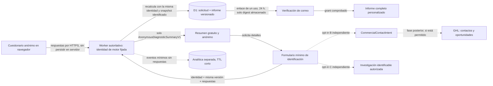

# Arquitectura de Vecidya

## Auditoría UI/UX local y demo sintético (VISUAL-QA-20261025)

Los scripts `tests/e2e/visual-qa-*` crean un Worker local con `.wrangler/visual-qa-demo` como almacenamiento persistente para D1 y el bucket R2 simulado de medios. El dataset tiene diez organizaciones sintéticas; los registros de propietario y miembro se crean/invitan por flujos de auth, y la prueba de administración usa una membresía de plataforma local activa, no impersonación. La carga de medios pasa por la API autenticada y el R2 local. Solo una organización tiene snapshot público v4 publicado. Los otros siete medios de galería permanecen en borradores y la lectura pública anónima responde 404 para esos objetos. Las capturas/manifest y el reporte HTML se mantienen en `.playwright-mcp/visual-qa/`, ignorado por Git.

El E2E de MiniWeb ejecuta usuarios/organizaciones de fixture separados y los limpia al concluir (`fixturesCleaned: true`); el demo persistente permanece disponible para revisión local. No se copian credenciales al código o documentación; `demo-access.json` contiene credenciales falsas locales y permanece ignorado. Este harness no usa D1/R2 remotos, datos de negocios reales, proveedores externos ni publication automática de perfiles demo.

## Transparencia pública y consentimiento local de cookies (PR #102)

`CookieConsent` se monta en el footer del `PublicLayout` y de la MiniWeb pública, pero no en la vista previa autenticada. Usa `cookie-preferences.ts` como contrato v2 en `localStorage`, con tres categorías: necesaria=true (funciones de sesión y seguridad), analítica opcional y marketing opcional. La ausencia, corrupción, versión antigua, fecha futura o indisponibilidad del almacenamiento **no habilita** categorías opcionales. La elección puede ajustarse y se comunica entre pestañas mediante el evento `storage` y dentro de la misma pestaña mediante un evento personalizado.

**Frontera de seguridad:** el panel no carga etiquetas de marketing ni cambia las cookies de autenticación. El contrato `canUseOptionalCookies(category, storage)` debe consultarse por cualquier integración optativa antes de cargar sus recursos; una revocación requiere detener envíos futuros y aplicar la limpieza que corresponda. Este checkpoint no certifica un inventario global de tecnologías de seguimiento.

Las rutas `/cookies` y `/informacion-legal` exponen el estado de información disponible sin atribuir una razón social, identificación fiscal o sede no verificada. `robots.txt` mantiene excluidas las rutas de autenticación y `sitemap.xml` incluye ambas rutas públicas, con resultado estático degradado y TTL abreviado si falla el acceso a D1. Publicar textos legales definitivos está sujeto a confirmación del titular y revisión de requisitos locales; no se sustituyen acuerdos comerciales específicos.


## MiniWeb — experiencia guiada y frontera editorial (UX-MINIWEB-20261024)

La MiniWeb pública `/vecindario/:slug` presenta cabecera y pie del negocio mediante `MiniWebSiteHeader`/`MiniWebSiteFooter` y utiliza `MiniWebRenderer` con la lista de módulos verdaderamente renderizables; no reutiliza cabecera de marketing general. La vista previa privada utiliza ese mismo marco, pero sustituye los enlaces accionables por rótulos, y solo entonces acepta URLs de medios autenticados. `resolveBusinessLogoUrl` limita protocolos y rutas de imagen aceptadas.

En `/app/miniweb`, una configuración de cinco pasos organiza el borrador versionado sin duplicar los datos maestros de `/app/business-profile`. Las secciones derivan su estado de `hasMiniWebModuleContent`; formularios plegables mantienen el estado hasta guardar; `useBlocker` advierte sobre cambios al navegar y el cambio de organización queda suspendido mientras hay edición no guardada. La vista pública se actualiza solo mediante publicación explícita del snapshot.

APP-MINI-02F conserva un único contrato de medios por organización: `gallery` (imagen o vídeo), `cover`, `logo` e `icon` (solo imagen), más `BusinessOffering.imageAssetId` para productos y servicios. La API valida el archivo, su firma, permiso, pertenencia y revisión; el snapshot de publicación v4 hace visibles únicamente sus medios/referencias. Migración `0028`. Artículos, equipo, certificaciones, testimonios, temas personalizados y tipografías editables siguen fuera de alcance, sin anticipar persistencia.


## DIAG-MOTOR-04 — calibración QA-03B de cuatro rangos (2026-10-24; rama sin publicar)

La calibración `diag-v3-candidate-calibration-v4` está adoptada por el recorrido QA-03B `/diagnostico` y el replay autoritativo del Worker. Conserva puntuaciones dimensionales, pesos, confianza y puerta de representatividad (al menos tres dimensiones puntuadas y 60% de cobertura aplicable); presenta cuatro rangos enteros inclusivos: 0–25, 26–50, 51–75 y 76–100. El índice insuficiente sigue siendo `null`. El resumen anónimo v2 mantiene su allowlist de 12 claves y expone la etiqueta general existente con el rango; el informe identificado pasa a v1.2 y sigue aceptando 1.0/1.1. La identidad del motor, sesión y replay usan pipeline v5, sesión schema/key 8 y replay v6. La selección de rangos es determinista, no validación empírica. La matriz sintética conserva 60 rutas; sus objetivos añadidos son supuestos, no hechos puntuables. El Worker público de producción aún no sirve este cambio; ver `ENVIRONMENTS.md`.

## DIAG-VISUAL-ASSETS-01 — proyección gráfica QA-03B (2026-10-24; local)

El flujo activo `/diagnostico` usa `CandidateDiagnosticFlow` y el replay QA-03B server-side. El resumen público acepta el contrato anterior sólo en el runtime legacy V3 independiente; QA-03B ahora serializa `anonymous-diagnostic-summary-v2`. Su `dimensions` contiene ocho entradas en orden canónico, con exactamente `label`, `score` (`number | null`), `statusLabel`, `preliminary` e `illustration`. El validador rechaza claves adicionales, orden/conteo incorrecto, valores fuera de rango e ilustraciones que no estén en `DIMENSION_ILLUSTRATION_BY_KEY`.

`buildAnonymousDiagnosticSummaryV2` copia los valores de `CandidateResultPresentationV3.dimensions`; el informe se construye desde el mismo replay, sin recálculo en JSX. `DiagnosticAreaOverview` presenta la puntuación como texto y una barra decorativa; `null` se muestra como «Sin lectura», sin barra con valor cero. Los ocho WebP existentes se reutilizan como decoración (`alt=""`), con `loading="lazy"` y `decoding="async"`. No se envían respuestas, evidencia, IDs de dimensión ni el informe dentro del resumen anónimo. El informe usa una composición compartida para pantalla e impresión: muestra hallazgo y acción primaria por separado, elimina el plan duplicado, no repite la acción principal en las recomendaciones posteriores ni la nota de cobertura, y omite del PDF las claves internas (la metodología e informe siguen identificados en portada; la identidad técnica permanece en el view model). Este cambio no modifica la identidad del motor, el scoring, la cobertura, la confianza, prioridades o recomendaciones; tampoco añade tablas ni migraciones. PR #62 abierto sobre `main`; no publicado.

La composición visual conserva orden general→áreas, muestra dos columnas de tarjetas en pantallas amplias y se apila en móvil. Las barras respetan `prefers-reduced-motion`; impresión del informe se valida mediante el PDF local de dos páginas A4, sin claves internas ni repeticiones de la acción/cobertura. Keyboard/screen reader, contraste y zoom 200 % requieren aceptación manual independiente. Ver `STATUS.md`/`TESTING.md` para la evidencia vigente; las secciones `DIAG-V3-FUNNEL-01B` siguientes son registros históricos de su corte, no el contrato actual de QA-03B.

## APP-MINI-02B — ofertas del negocio y preguntas frecuentes (2026-10-23; implementación local)

Las ofertas de un negocio se modelan separadas del catálogo de servicios de Vecidya: `business_offering` guarda servicios o productos escritos por la organización, y `business_faq` guarda sus preguntas/respuestas. Ambas tablas filtran por organización, se guardan junto con la configuración MiniWeb mediante una sola revisión CAS y no crean pedidos, pagos, reservas ni CRM.

El snapshot público pasa a versión 2 e incluye perfil, horarios, configuración, ofertas y FAQ. Snapshots v1 se leen con ofertas/FAQ vacías y módulos nuevos desactivados; no se toma contenido de borrador para completar una publicación histórica. La UI permite editar y previsualizar antes de guardar/publicar; el renderer anónimo solo recibe el snapshot publicado y muestra elementos activos de módulos habilitados. `services`, `products` y `faq` están disponibles en `vecidya-default`. Implementación local sin certificación funcional aún; ver `STATUS.md`, `DATABASE.md` y `TESTING.md`.

## APP-MINI-02F — medios de marca e imágenes de contenido (2026-10-24; checkpoint local)

La biblioteca tenant-scoped de medios admite propósitos distintos: `logo` identifica la marca, `icon` es el símbolo compacto, `cover` es la imagen principal y `gallery` reúne fotos complementarias. Logo e icono son recursos diferentes; ambos son imágenes y se cargan por la misma API privada, con CAS, allowlist y límite existentes. Cada oferta de servicio/producto puede referenciar una imagen activa de la misma organización; el servidor rechaza IDs que no pertenezcan a sus medios de imagen activos. Retirar un asset limpia las referencias del draft del editor, mientras que una publicación previa conserva sus referencias hasta volver a publicar.

El snapshot v4 añade IDs allowlisted de logo/icono y los vínculos de imágenes de oferta, preservando lectura de snapshots v1–v3 sin extraer valores del draft. `0028` agrega `image_asset_id` a `business_offering`. La ruta pública entrega un objeto solo si el ID figura en medios publicados o en una oferta activa del snapshot vigente; assets nuevos y referencias de draft siguen privados hasta publicar el conjunto completo. El editor previsualiza los medios en draft y ofrece selección explícita de imagen por oferta. Esto no hace disponible R2 en entornos remotos ni reemplaza la URL legacy del logo hasta una publicación con logo de asset.

## UX-COHERENCE-03 — sistema de experiencia de las tres superficies (2026-10-19; pendiente de QA)

Una identidad compartida no implica unificar permisos ni intención de usuario. **Web** descubre y orienta; **Mi Vecidya** trabaja en la organización activa; **Administración interna** consulta/gestiona operaciones de plataforma como actor `platform_admin`. Las guías editoriales de `JourneyGuide` no ejecutan acciones ni reescriben estados de dominio; los links solo navegan a rutas ya existentes y protegidas. Las clases `experience-*` utilizan tokens `app.css`, tipografía Arial y símbolo oficial `publicAssets.brand.symbol3d`; mantienen titulares, contrastes, ayudas y orden de lectura. Variantes `public`/`client`/`admin` comparten estilo, pero el contexto visual y el copy respetan sus audiencias.

`ProgressMeter` solo se usa para completitud con base calculada por `getBusinessProfileCompletion` y `role=progressbar`. `MetricCard` toma números del loader del ámbito correspondiente. `ComparisonBars` representa magnitudes de origen real con escala relativa al mayor valor visible (`relativeBarWidth`), **no** conversiones de cohortes ni fracción de usuarios; números explícitos junto a barras decorativas para no depender del color. En el panel de diagnóstico se conservan las series originales, los filtros temporales y la tabla de eventos; solo cambia presentación y estado cero. Valores no finitos/negativos nunca producen barras inválidas; esto no modifica la fuente.

No se crean endpoints, migraciones, consultas entre tenants, scores nuevos, métricas ficticias, enlaces GHL ni nuevas capacidades internas. El gate de publicación sigue independiente de Git/PR. Validación Worker/teclado/móvil y revisión visual siguen abiertas.


## EMAIL-TRANSACTIONAL-UX-02 — diseño de envío (2026-10-19, pendiente de validación)

Las plantillas transaccionales de Vecidya se centralizan en `server/email/templates.server.ts` (HTML de tablas con estilos inline + `text/plain`). Usan el logo real `https://vecidya.com/brand/vecidya-icon-3d.png` y colores de `app.css`; no usan imágenes de terceros, tracking, JavaScript ni fuentes web. `sendResetPassword`/verificación de Better Auth reutilizan la plantilla y un `onPasswordReset` publica un aviso de seguridad solo después del cambio real; si falla ese aviso no se revierte ni falsea el cambio.

Better Auth 1.7.5 puede absorber errores del callback de invitación. Para las dos rutas propias protegidas, `createAuth(..., { invitationDeliveryManagedByRoute: true })` evita enviar desde el callback; cada ruta crea la invitación y llama explícitamente al adaptador Gmail una vez, sin dobles copias. El resultado diferencia aceptación del proveedor de envío simulado y fallo no confirmado: Gmail API send no acredita entrega al inbox. Si falla después de crear, la invitación permanece pendiente y el usuario recibe un aviso honesto; no hay reintento automático ni outbox persistente, por riesgo de duplicación. El plugin conserva su envío predeterminado en otros contextos. Requiere E2E real antes del cierre del riesgo.

El Diagnóstico mantiene exclusivamente `diagnostic-dev-inbox.server.ts` para verificación y `access_recovery`, y únicamente `import.meta.env.DEV` habilita ese transporte; las nuevas plantillas no autorizan envío real, acceso al informe ni activación del embudo. Contratos Vecidya↔GHL, datos, derechos y privacidad no se modifican.


## APP-CLIENTE-00-PUBLISH-001-R1 — consistencia del borrador y snapshot legacy (2026-10-23)

El draft profile, hours y MiniWeb se leen bajo una revisión compartida: el loader lee la revisión antes y después del conjunto de consultas, reintenta tres veces si cambió y responde `409` si no puede fijar una lectura estable. Las escrituras conservan el compare-and-set de revisión y token en un batch D1; una respuesta antigua nunca recibe la revisión nueva para habilitar que sobrescriba el cambio concurrente.

Una fila `business_profile_publication` por sí sola no es evidencia de contenido público válido. La inicialización legacy copia el contenido publicado solo cuando no hay snapshot y la fila vacía sigue en revisión inicial, mediante actualización condicional. Toda fila existente sin snapshot válido falla cerrada en perfil, directorio y sitemap. Si la organización todavía no tiene fila, el perfil legacy sigue visible hasta que cualquier mutación materialice su snapshot antes de cambiar datos. Sin cambio de schema ni nueva migración; `0022`/`0023` permanecen intactas.

## APP-CLIENTE-00-PUBLISH-001-R2 — formularios obsoletos e indicador de publicación (2026-10-23)

Los formularios de perfil y horarios mantienen en estado local la revisión que se mostró junto con sus valores iniciales. La revalidación del loader no puede asociar a esos valores una revisión posterior. Un `409` bloquea perfil y horarios hasta recargar explícitamente; un guardado exitoso avanza la revisión al valor devuelto por su propia mutación. Esto mantiene alineados valores y CAS incluso si otro editor ya guardó.

La administración interna y el editor MiniWeb determinan si la publicación está al día comparando el snapshot allowlisted completo (perfil/contacto, horarios y configuración), dentro de la lectura cercada. Snapshot ausente o inválido se trata como pendiente; sin perfil, la acción interna de publicar queda deshabilitada. No cambia el formato del snapshot ni requiere migraciones.

## PLATFORM-ADMIN-GLOBAL — contrato aprobado e implementación local (2026-10-22)

**Estado actualizado al 2026-10-23:** el PR #39 se integró en `origin/main` por `475880bdbdc20922c92177478efaef793168ee15`. La certificación local y el gate de correo real están en `STATUS.md`/`TESTING.md`; el correo real sigue diferido al release y no se declara verificado. El usuario aprobó la invitación propia descrita aquí. La UI interna permite alta de organización, reenvío/revocación de invitación, suspensión/reactivación de organizaciones con ciclo vigente, cambios de rol `admin|member`, edición JSON de configuración MiniWeb y publicación explícita, además de capacitación. Staff conserva lectura. `closed`, transferencia/eliminación de owner y cambio de roles owner siguen deshabilitados.

**Onboarding propio aprobado:** Better Auth `createInvitation` exige membership del actor, así que el platform admin no se hace pasar por owner. `platform_owner_invitation` guarda digest SHA-256 de un token aleatorio, correo normalizado, expiración de siete días, estado y un identificador de consumo. La aceptación usa D1 `batch` con sentencias condicionales para consumir una sola vez, insertar la membership owner, activar el ciclo y auditar; exige sesión, correo idéntico y verificado. El token no se registra. El correo pasa por el adaptador transaccional actual y el panel distingue proveedor aceptado, simulación y envío no confirmado. La ruta de alta prepara token e invitación en la misma URL protegida; no crea contraseña para el destinatario.

### Actor, frontera de autoridad y auditoría

La identidad es la cuenta autenticada existente (`user`) junto a su fila única `platform_member` con `role=platform_admin` y `status=active`; `staff` activo dispone solo de lectura en la lista y detalle de organizaciones. El login, la sesión personal y el correo verificado pertenecen a esa cuenta. No se crean contraseñas para terceros, membresías ficticias, cambio de `activeOrganizationId` ni impersonación. `platform_admin` no se incorpora a `member.role`; las APIs cliente conservan `requireOrganizationPermission` y exigen membresía real y permiso de negocio en cada petición.

Las operaciones transversales se ejecutan en rutas administrativas propias. Cada mutación exige sesión, plataforma activa, target organization explícito y auditoría en el mismo batch lógico cuando cambia datos. `staff` no obtiene rutas mutativas. Nunca se llama a una API cliente con identidad del actor para obtener acceso de negocio. Las APIs cliente conservan sus guards tenant-scoped; sesión, membresía y permiso siguen requeridos.

`platform_audit_log` ya registra actor user, acción, tipo/ID de entidad, organización, valores anterior/nuevo, metadata e instante; debe reutilizarse y extenderse solo si el contrato no cabe allí. Para una entidad global sin organización afectada (p. ej. lectura de catálogo o fallo de prealta) la acción no se ejecutará si no puede registrar auditoría conforme al diseño elegido; decidir antes cómo representar `organization_id` nullable o cómo auditar esos casos. Cada intento sensible guarda actor real, org afectada, acción allowlisted, resultado (`success|denied|failed`), instante y motivo/correlation ID no sensible. No guardar token, contraseña, credenciales, respuestas de formación innecesarias ni PII libre en metadata. Auditoría es append-only desde la UI, legible solo por plataforma autorizada, con política de retención aún por decidir; fallo al registrar auditoría debe abortar la mutación atómica.

### Organización pendiente, propietario e invitación

Estados implementados en schema: `pending_owner`, `owner_invited`, `active` y `suspended`. La expiración se detecta al aceptar; reenvío rota el token y extiende siete días; revocación retorna a `pending_owner`. Aceptación válida activa con owner; suspensión y reactivación solo operan con owner ya aceptado. `closed` no existe. Organizaciones previas sin fila lifecycle se muestran como `legacy` y no admiten estas mutaciones desde la UI.

La administración crea una organización `pending_owner` sin insertar una fila en `member` y sin asignar al actor como owner. Se validan slug global disponible, nombre y datos mínimos; se conserva el email normalizado del propietario previsto y el ID real solo cuando la identidad ya existe y está verificada. Una organización pendiente solo aparece en `/app/internal`; no se muestra en `/app`, selección de organización, directorio, sitemap, rutas públicas ni acceso a recursos tenant. Restricciones de slug y estados se comprueban dentro de la transacción para prevenir colisiones/carreras. No se crea licencia, servicio, perfil publicado ni contenido público por defecto.

Una invitación usa un secreto aleatorio de alta entropía y una sola finalidad/organización/rol. Guardar únicamente digest del token; enviar el token una vez por canal de correo aprobado. La pantalla permite registro o login con cuenta personal y exige verificación del correo. Antes de aceptar se comprueba constant-time/seguro el digest, expiración, estado pendiente, org y estado del ciclo, igualdad con el email de la invitación y verificación de esa cuenta. Identidad discordante no puede cambiar destinatario ni transferir invitación; respuesta no debe filtrar existencia de emails/organizaciones. El consumo, creación de la membresía `owner`, marcado aceptado, activación y audit deben ser atómicos en una sola operación lógica; la recuperación idempotente solo aplica ante un fallo técnico confirmado y no puede producir estado parcialmente activo. Si no puede lograrse con las APIs transaccionales de Better Auth, detenerse y presentar alternativa para aprobación. Expirar, revocar y reenviar invalidan todos los tokens anteriores; reuso devuelve estado terminal sin segunda membresía. Rate-limit por invitación/cuenta/IP según política aprobada, sin persistir IP por defecto.

El proyecto fija Better Auth `1.7.5`; el código local confirma la tabla `invitation`, `requireEmailVerificationOnInvitation: true`, el handler existente de aceptación y la allowlist HTTP restringida del plugin. La documentación oficial de APIs consultada describe `auth.api.createInvitation` y `auth.api.acceptInvitation`: la creación requiere membresía/permiso del actor, por lo que el platform admin sin membership no puede reutilizarla directamente sin suplantar; la aceptación valida invitación pendiente y email, y ofrece protección contra doble aceptación dentro de Better Auth. No se verificó el código interno empacado de `1.7.5` ni que esa atomicidad se pueda ampliar a `platform_organization_lifecycle` y `platform_audit_log`; la tabla integrada tampoco incluye por sí sola nuestro digest/token lifecycle. La API documentada `createOrganization(userId)` asigna owner a ese usuario; `addMember` no forma parte del contrato de APIs server-side consultado. Por tanto, NO se especifica `auth.api.addMember` ni se afirma atomicidad end-to-end. Antes de implementar hay que verificar hooks/garantías contra el paquete instalado y diseñar cómo agrupar ciclo, membership y audit sin acceso privilegiado artificial. La aceptación atómica end-to-end es requisito; si Better Auth no la admite, detenerse para proponer y aprobar un diseño alternativo con prueba de carrera y recuperación.

### Usuarios, roles y permisos de negocio

Las cuentas personales siguen siendo globales (`user`); `member` es vínculo por organización y `platform_member` es autoridad independiente. Owner/admin solo gestionan personas dentro de su organización mediante permisos vigentes; member no gestiona equipo. La invitación nueva nunca crea una contraseña para el destinatario. El email equivocado, no verificado, invitación expirada/revocada/aceptada y conflicto de owner se resuelven con estados seguros, sin enumeración ni elevación.

| Actor | Organización | Invitaciones | Equipo | Capacitación | Auditoría | MiniWeb |
| --- | --- | --- | --- | --- | --- | --- |
| `platform_admin` activo | `R/W` lifecycle vía control plane, target obligatorio; activación solo al satisfacer condiciones; `A` gobierno de perfil según operación autorizada | `R/W` crear/revocar/reenviar para target, actor auditado; nunca aceptar por destinatario | `R/W` target; roles cerrados; no transferir owner implícitamente | `R/W` asignar general/individual, leer agregado; corregir progreso ajeno solo con motivo + auditoría | `R` según política; `W` solo eventos del sistema/transacción | `R/W`; `P` solo con acción explícita y auditada; nunca automático |
| `owner` | `R` propia; no alta/cierre global ni suspensión de plataforma | `R/W` gestionar invitaciones de su org; no aceptar por otra identidad | `R/W` equipo según `member:*`; transferencia owner separada | `R/W` asignación de su org y agregado; no corregir progreso ajeno salvo política aprobada | Sin acceso a auditoría de plataforma | `R/W`; `P` según `business-profile:publish` |
| `admin` | `R` propia; sin ciclo global | `R/W` dentro del permiso `member:invite` | `R/W` solo operaciones permitidas por `member:*`; no transferir owner | `R/W` asignaciones de org si se aprueba el permiso; agregado | Sin acceso a auditoría de plataforma | `R/W/P` únicamente con permisos cliente concedidos |
| `member` | `R` según permiso en org con membership válida; sin gestión global | `R` invitación propia compatible; no administrar las del equipo | `R` lo permitido; sin mutaciones de equipo | `R/W` sus asignaciones/progreso propios; no escribir progreso ajeno | Sin acceso | `R` privado/draft permitido; no publicar |
| Usuario autenticado sin membership | Sin `R/W` tenant ni acceso por ID/activeOrganizationId | Solo su flujo de invitación; `A` aceptación propia tras login + email verificado coincidente | Sin acceso | Sin acceso hasta obtener membership/assignment | Sin acceso | Solo páginas públicas realmente publicadas/no suspendidas; sin preview ni escritura |
| Visitante anónimo | Sin acceso privado ni lifecycle | Landing mínima del token; sin aceptar ni enumerar; requiere cuenta | Sin acceso | Sin acceso | Sin acceso | `R` contenido publicado/no suspendido únicamente; sin preview/escritura/publicación |

Leyenda: `R` lectura, `W` escritura/gestión, `A` aprobación administrativa (solo moderación/verificación si se autoriza; aceptar invitación propia no es aprobación de plataforma), `P` publicación pública. La aprobación humana de esta especificación no es permiso runtime. La activación de organización se deriva de condiciones verificables, no de una aprobación ficticia ni de que el creador sea admin. Toda operación queda sujeta a acción explícita y scope indicado; autenticación sola nunca la habilita.

### Capacitación con contenido de Aprende

Vecidya controla asignaciones y seguimiento, no el contenido editorial. El catálogo se obtiene del contenido existente en `app/content/learn.ts` (`LearnArticle`/slug; incluir solo contenido publicable vigente) y enlaza a la URL pública `/aprende/:slug`. No copiar títulos/cuerpos ni crear editor, CMS o autoría paralela. La curación debe tolerar contenido retirado: la asignación histórica se conserva y se etiqueta `unavailable`, no se reasigna silenciosamente a otro artículo.

Contrato aprobado e implementado parcialmente: asignación a organización completa; progreso (`not_started|in_progress|completed`) declarado por el propio miembro; corrección solo por `platform_admin`, con motivo, actor, historial y auditoría. El API del cliente deriva al usuario de la membership y no acepta `userId` del cuerpo. La vista interna muestra las personas que ya declararon progreso; no infiere visitas ni duración. La asignación individual y las correcciones owner/admin no están habilitadas.

### Navegación prevista, sin registrar rutas

`/app/internal/organizations/:organizationId/training` implementa asignación y corrección, con `requirePlatformAdmin` y permiso de acción en cada loader/action. `/app/training` muestra asignaciones de la organización activa y permite auto-reporte; `GET/POST /api/organizations/:organizationId/training` requiere `organization:read` y solo lee/escribe progreso del usuario autenticado. Las rutas de ciclo de vida, invitaciones, gestión de equipo y edición MiniWeb siguen pendientes. Cada loader/action vuelve a exigir actor/permiso; ocultar controles no es autorización.

### Endpoints implementados y pendientes

Implementados: `GET/POST /api/platform/organizations/:organizationId/training` para lectura/asignación/corrección por `platform_admin`; `GET/POST /api/organizations/:organizationId/training` para auto-reporte por membership. Las rutas consultan target explícito. El resto de endpoints abajo son diseño pendiente.

| Método y ruta propuesta | Operación / permiso de plataforma | Garantías y auditoría |
| --- | --- | --- |
| `GET /api/internal/summary` | `platform.dashboard.read` | Conteos agregados; no PII innecesaria; auditar acceso según política aprobada |
| `GET /api/internal/organizations` / `GET /api/internal/organizations/:id` | `platform.organization.read` | Paginación; target explícito; sin filtrado por activeOrganizationId |
| `POST /api/internal/organizations` | `platform.organization.create` | Idempotency key, slug único, estado pending, sin member/license/profile público; audit transaccional |
| `PATCH /api/internal/organizations/:id/status` | `platform.organization.suspend|reactivate|close` | Transiciones cerradas, motivo, revisión optimista; cierre no disponible hasta aprobación |
| `POST /api/internal/organizations/:id/owner-invitations` | `platform.invitation.create` | Receptor exacto/rol owner, token digest, TTL, rate limit, envío desacoplado y estado recuperable |
| `GET /api/internal/invitations`; `POST /api/internal/invitations/:id/revoke|resend` | `platform.invitation.read|revoke|resend` | Reenvío invalida token previo; no exponer secreto; auditar intentos sensibles |
| `POST /api/organization-invitations/:token/accept` | invitado autenticado; email verificado coincidente (no permiso de plataforma) | One-time, atómico, no aceptar por URL GET; activa solo al garantizar owner/member + auditoría |
| `GET /api/internal/organizations/:id/members`; `PATCH/DELETE /api/internal/organizations/:id/members/:memberId` | acciones `platform.team.read|role.update|remove` | Cada memberId pertenece al target; roles cerrados; no dejar org sin owner |
| `GET /api/internal/training/catalog`; `GET/PUT/DELETE /api/internal/organizations/:id/training-assignments` | `platform.training.catalog.read|assignment.manage` | Slugs allowlisted del catálogo actual; asignación idempotente; tenant del destinatario validado |
| `GET/PUT /api/organizations/:id/training/me` | membership real; `training.read:self` / `training.progress:update:self` | Solo assignments visibles al miembro; progreso propio; no aceptar userId del cliente |
| `PATCH /api/internal/organizations/:id/training-progress/:memberId` | `platform.training.progress.correct` | Motivo requerido, target membership, historial y audit atómicos |
| `GET /api/internal/audit?organizationId=...` | `platform.audit.read` | Paginación/orden estable, filtros tenant-scoped, no PII sensible |
| `GET/PATCH /api/internal/organizations/:id/profile|miniweb`; `POST .../publish` | read/write/publish separados por acción | Reutilizar servicios de dominio y validadores; guard interno propio, target ownership, version check; no llamar APIs cliente mediante suplantación |

Todos los writes validan esquema estricto, estado esperado/revisión (optimistic concurrency), target y actor de nuevo en server. Respuestas idempotentes para operaciones repetibles; conflictos concurrentes dan 409 y no sobrescriben silenciosamente. Si un proveedor de correo falla, la organización/invitación queda en estado recuperable claramente indicado; no se comunica “enviada” hasta confirmación observable. Una tarea de correo no confirma aceptación.

### Persistencia candidata y aislamiento

Reutilizar sin duplicar: `user`, `session`, `platform_member`, `organization`, `member`, `invitation` de Better Auth; `platform_audit_log`; perfil/gobernanza, `miniweb_site`/`miniweb_module`, catálogo de Aprende en código; servicios/licencias existentes. La implementación agrega tres entidades persistentes:

**Implementación real en 2026-10-22:** solo las tres tablas de capacitación existen (`organization_training_assignment`, `organization_training_progress`, `organization_training_progress_history`); las definiciones lifecycle e invitación de abajo siguen siendo candidatas. La asignación implementada es por organización completa y slug, sin `scope`/miembro individual ni `revision`.

1. `platform_organization_lifecycle`: `organization_id` PK/FK, estado cerrado, `intended_owner_email_normalized`, `owner_user_id` nullable FK, `revision`, timestamps y actor creador/actualizador; índice estado/fecha. Una fila por organización administrada en este flujo. No guardar atributos editables de organización duplicados.
2. `organization_training_assignment`: id, `organization_id`, `content_slug`, `scope` (`all_members|member`), `member_user_id` nullable, estado (`active|withdrawn`), actor, timestamps/revision; FK compuesta o validación transaccional que garantice que el destinatario pertenece al mismo tenant; único idempotente por organización, slug, scope y miembro; índice `(organization_id,status)` y `(member_user_id,status)`.

3. `organization_training_progress`: `(assignment_id,member_user_id)` único, estado (`not_started|in_progress|completed`), actor y `updated_at`/`revision`; la pertenencia miembro↔organización se valida en la misma transacción. Se persiste solo el último estado; auditoría existente registra transiciones y correcciones motivadas, sujeto a decidir si cambios propios requieren historial separado.

Los tokens de invitación de owner se proponen como extensión acotada de la tabla `invitation` existente con `token_hash`, `accepted_at`, `revoked_at`, `accepted_by_user_id` y clave idempotente/estado terminal; antes de decidir columnas hay que confirmar que no se puede cumplir con el contrato integrado de Better Auth. No se duplica una tabla de invitaciones. Restricciones: estados validados en código y, si compatible con el patrón de schema del proyecto, CHECK; unicidad idempotente y digest de token único. Las escrituras que cruzan organización, miembro, asignación, invitación y audit deben correr en una transacción D1; jamás confiar en `activeOrganizationId` sin membership. La garantía “un owner activo por org” necesita restricción concurrente validada (índice parcial si disponible o CAS transaccional), no solo chequeo previo.

### Riesgos y decisiones de cierre previas a implementación

| Riesgo | Control contractual / decisión pendiente |
| --- | --- |
| Escalada de privilegios | Sesión + `platform_member` activo + acción allowlisted + target + pertenencia; definir si todos los platform_admin comparten todos los permisos o se necesitan capacidades diferenciadas |
| Acceso entre tenants | Consultas siempre filtradas por target y FK/revisión de membership; IDs ajenos responden igual que inexistentes |
| Token reutilizado/interceptado | Digest único, alta entropía, TTL, revocación/reenvío invalida previo, destinatario verificado, aceptación POST atómica; decidir TTL y política de correo |
| Activar sin owner / owner duplicado | Estado pending hasta membership owner verificada; unicidad por organización y transferencia gobernada; decidir política de co-owners y owner saliente |
| Acción sin audit | Mutación + audit commit/rollback conjunto, conservar actor real/result; resolver organización nula en eventos pre-organización y retención |
| Manipular progreso ajeno | UI cliente solo self; roles gestores no cambian progreso sin corrección motivada y audit; optimistic revision y log mínimo |
| Estado user/member/org inconsistente | Actualizar invitación, member, lifecycle, sesión activa y audit como una unidad recuperable; prevenir activar si identidad/verification no coincide |
| Concurrencia | CAS por estado/revision, unicidades DB, transacción; 409 ante conflicto, pruebas de doble aceptación/reenvío/cambio owner |
| Fallo parcial de correo/Better Auth | No afirmar envío ni aceptación; outbox/estado de entrega pendiente y reconciliación idempotente a diseñar; no compromiso entre sistema externo y D1 |
| Fallo de audit o transacción | Abort total; reparación solo vía reintento idempotente o acción compensatoria auditada |
| Capacitación contenido retirado | Slug histórico queda como unavailable; no reemplazo de contenido ni autoría duplicada |
| Publicación accidental | Separar write/publish; solo acción explícita, consentimiento operativo y guards estado publicado/suspendido existentes |

La asignación usa slug editorial existente; las correcciones internas requieren motivo y quedan en historial/auditoría. `closed`, transferencia/eliminación de owner y auditoría de lecturas no se implementan. La certificación de correo real es un gate separado de release. APP-CLIENTE-00-PUBLISH-001 establece la frontera común de publicación antes de APP-MINI-02B.


## APP-MINI-00 — contrato de aplicación cliente y minisitio (2026-10-12)

**Estado: contrato documental reconciliado; sin cambios funcionales.** La
autoridad comercial es `docs/business/VECIDYA_PRODUCT_CATALOG.md`: Cuadra
(USD 39/mes; puesta en marcha USD 0) es independiente y no incluye CRM/GHL.
Barrio (USD 59/mes) inicia CRM y capacidades comerciales GHL; Ciudad (USD
89/mes) amplía Barrio para operación multiproceso. OPS-001 queda subordinado a
esta frontera y no autoriza una subcuenta GHL para Cuadra.

### System of record

| Dominio | Autoridad | Frontera |
| --- | --- | --- |
| Cuenta, sesión, organización, membresías, roles y permisos | Vecidya | No duplicar en GHL |
| Licencia, derechos, relación contractual/soporte y servicios contratados a Vecidya | Vecidya | No inferir derechos solo desde configuración |
| Perfil, minisitio, servicios públicos del negocio, directorio, SEO y publicación | Vecidya | Una entidad y URL canónica `/vecindario/:slug`; no crear otro editor equivalente en GHL |
| Contactos, oportunidades, conversaciones, pipelines, calendarios CRM, formularios comerciales y automatizaciones | GHL desde Barrio | No construir ni persistir un CRM espejo en Vecidya |

En Cuadra, teléfono, correo, WhatsApp, redes, web o ubicación pueden ser CTA
externos directos; por sí mismos no almacenan leads ni crean operación CRM.
Social Planner como producto, booking CRM, workflows, seguimiento automatizado
y formularios comerciales no forman parte de Cuadra. Para Barrio/Ciudad, «Abrir
CRM» solo se mostrará cuando exista una conexión/URL confirmada; no se simula
SSO.

### Estado observado y contrato de minisitio

APP-MINI-01 confirmó identidad/sesión, organizaciones y miembros, `/app`,
`/app/business-profile`, perfil público `/vecindario/:slug`, horarios,
cobertura, canales y publicación/gobernanza. APP-MINI-02A añadió configuración
modular versionada y compositor compatible; aún no entrega ofertas públicas,
FAQ, galería/portada ni las cuatro plantillas finales. `organization_service`
es el catálogo/asignación de servicios Vecidya al cliente, nunca la oferta que
vende ese negocio.

El contrato objetivo reutiliza la URL/perfil existente como una sola página
responsive modular: hero; presentación; ofertas del negocio; galería; horarios
y cobertura; contacto/redes; FAQ; identidad Vecidya. Cada bloque opcional se
oculta sin contenido real. No es un constructor libre: sin HTML/JS arbitrario,
dominios personalizados, múltiples páginas, ecommerce o formularios CRM en
Cuadra. Lectura pública solo de perfiles publicados y no suspendidos, con datos
allowlisted; preview de borrador bajo sesión/permisos. Escritura y publicación
requieren el contexto de organización activa revalidado y los permisos existentes
`business-profile:update` / `business-profile:publish` (owner/admin); member es
lectura. Mantener slug estable y gobernanza vigente; una licencia no anula una
suspensión ni despublica retroactivamente perfiles publicados.

### Secuencia y estado de checkpoints

APP-MINI-00 reconcilió el contrato comercial/documental. APP-MINI-01 quedó
implementado y validado localmente tras autorización explícita: dashboard con
estado real, editor por secciones, preview privada inline y perfil público base
con CTA directas seguras. No necesitó una ruta, esquema o migración nueva; el
registro de rutas, permisos, slug canónico, SEO y publicación se preservaron.
El cierre técnico local quedó confirmado el 2026-10-15: E2E de experiencia,
ciclo de slug y licencias; typecheck/build/diff-check; página pública HTTP 200
con runtime activo y seis capturas responsive renovadas en
`.playwright-mcp/app-mini-01-{dashboard,editor,public}-{desktop,mobile}.png`.
No está desplegada.

### APP-MINI-02A — núcleo modular (2026-10-15)

**Implementado y probado localmente; no desplegado.** `app/features/miniweb/registry.ts`
declara contratos versionados para las familias `services`, `catalog`,
`gastronomy` y `professional`, y para los trece tipos previstos. Solo
`vecidya-default` y `hero`, `about`, `contact`, `hours`, `location` tienen
availability `available`; la UI no ofrece servicios, galería, productos,
artículos, FAQ, equipo, certificaciones ni testimonios como funciones falsas.
No se persiste JSX/HTML/CSS/JavaScript ni medios.

`miniweb_site` es único por organización y conserva plantilla/layout draft junto
con `published_configuration_json`; `miniweb_module` conserva exclusivamente
filas draft (estado, orden, variante y settings nulos/no admitidos en 02A). No
hay migración masiva ni se crea fila al leer: se crea al guardar o publicar
configuración. La lectura de un perfil legacy sin fila resuelve la configuración
virtual compatible, derivada de `business_profile` y `business_hours`, con orden
determinista. Para un perfil ya publicado, el primer guardado inicializa el
snapshot público desde ese default, por lo que editar el draft no cambia el
sitio visible. Publicar es una operación separada y explícita.

El compositor público conserva `/vecindario/:slug`, usa un DTO allowlisted y
solo transmite datos de módulos activos; omite módulos sin contenido útil y
mantiene los guards de publicado/no suspendido, slug y canonical/SEO. Los
renderers no copian datos de `business_profile`, `business_hours` ni
`business_profile_governance`. El módulo `location` usa contexto existente;
`organization_service` sigue reservado a servicios Vecidya contratados.
El snapshot estructural inválido falla cerrado a `hero`; en el snapshot
completo de publicación el parser inválido oculta el perfil público. Solo la
ausencia explícita de un snapshot completo conserva la lectura virtual legacy.
Categoría, oferta comercial (`business_offering`, requerida para 02B) y servicio
Vecidya son conceptos distintos. Para 02E se deben poder proyectar categoría,
especialidades/tags, ubicación/área/modalidad, ofertas públicas y módulos
activos, sin implementar aún el buscador.

`/app/miniweb` es una base separada del formulario de información: template
actual, secciones disponibles, activación/orden, preview privada del draft y
publicación de configuración. Las escrituras revalidan sesión, organización
activa, membership, permiso y tenant; registry valida template, módulo,
disponibilidad, orden, variante y settings. Owner/admin escriben/publican según
permisos actuales; member solo lee. No se introduce CRM, editor libre, HTML/CSS
del cliente ni dependencia de GHL.

La migración `0017_miniweb-core.sql` contiene las dos tablas. El ledger local
también tiene `0016` de otro checkpoint en espera; 0017 se validó ejecutando su
SQL en D1 local para E2E, sin ejecutar la cadena compartida ni tocar D1 remota.
Las tablas temporales se retiraron tras las pruebas; el ledger local aún reporta
0016/0017 pendientes, por lo que `migrations apply` debe reconciliar la cadena
antes de otro uso de D1 local.

**APP-CLIENTE-00-PUBLISH-001 (2026-10-23):** `business_profile_publication`
mantiene revisión del borrador, versión pública, slug publicado, versión del
schema y un snapshot JSON allowlisted con perfil, horarios y configuración
MiniWeb. `/vecindario/:slug`, listados y filtros leen esa misma versión; los
cambios de perfil, horarios y composición quedan como borrador hasta publicar.
La publicación valida licencia y campos requeridos, incrementa versión/revisión
y actualiza estado público y auditoría en un batch D1 atómico. Un CAS por
revisión y token aleatorio de escritura hace que los guardados concurrentes
queden ligados al cambio que ganó, incluidos los inserts/borrados asociados.
El editor MiniWeb, el formulario de perfil y sus API usan revisión esperada y
responden conflicto `409` si el borrador cambió.

Los perfiles legacy se materializan al guardar o publicar, sin backfill masivo;
la lectura pública con snapshot ausente conserva su ruta legacy y un snapshot
presente inválido falla cerrado. Las operaciones tenant conservan sesión,
membership, permiso y organización explícita; publicación interna conserva su
auditoría. E2E local cubre draft frente a publicación, perfil/horarios juntos,
revisión obsoleta, aislamiento, licencia y snapshot corrupto. Este contrato
cubre el contenido actual de perfil/horarios/MiniWeb; las ofertas y FAQ de 02B
deberán incorporarse explícitamente al mismo mecanismo si se publican allí.

APP-MINI-03 debe exponer estados/derechos reales sin pagos automáticos.
GHL-BARRIO-01 es independiente y no empieza sin cuenta, permisos/scopes reales
y autorización. El copy de `/licencias` aclara que Cuadra no incluye seguimiento
ni automatizaciones CRM.

## VECIDYA-LEGACY-00 — inventario y consolidación (2026-10-12)

### Reconciliación de runtime (2026-10-23)

ACT-04 está integrado en `main`; `/diagnostico` sirve QA-03B con replay de Worker. Contrato vigente: bank `reviewed-evidence-v7`, answer schema `qbv2-answers-v5`, session schema/key 6, replay `qa03b-worker-replay-v4`. El endpoint anónimo conserva la proyección/entrada V3 para rollback y `diagnostico-informe.tsx` sigue sin registrarse. Este inventario es histórico (baseline `50026d0`) y debe revalidarse antes de una retirada; ya no describe dos motores públicos ni un cutover pendiente.

**Conservar durante el release y la ventana de rollback:** claves/sesiones V3 históricas, adaptador V3 del endpoint, pruebas de rollback, módulos base compartidos por QA-03B, source de informe aún protegido por tests y migraciones. Después del deploy y cierre explícito de rollback, abrir un checkpoint de limpieza: re-scan de imports, rutas, bundle, Worker manifest, scripts y tests; borrar solo candidatos sin consumidores. Las rutas `__dev` siguen dev-only y no equivalen al runtime público.

**Resultado: `LEGACY_INVENTORY_READY`; auditoría, no limpieza.** Baseline real `50026d00c59269554500a4f2552fe7385e35ec7f` (`50026d0`, `main` = `origin/main`). El árbol local también tenía cambios y archivos nuevos sin commit; se preservan y no forman parte del inventario. Sin cambios funcionales, D1, migraciones, configuración o secretos; QA-03B, RESULT-UX-02 y FUNNEL-01B no se reabren. ACT-04 no se ejecuta.

### Grafo observado

```mermaid
flowchart TD
  HOME[Home / buildDiagnosticPath] --> ROUTE[/diagnostico/]
  ROUTE --> UI[AnonymousDiagnosticFlow]
  UI --> SESSION[qbv2-session / storage schema-key 2]
  UI --> API[POST /api/diagnostic/anonymous-summary]
  API --> REPLAY[QUESTION_BANK_V2 + planner + qbv2-session]
  REPLAY --> DTO[AnonymousDiagnosticSummaryV1]
  METH[/diagnostico/metodologia] --> MDATA[qbv2-methodology]
  DEV[Previews V3, ACT y QA-03B] --> BASE[Diagnostic result adapters]
  BASE --> REPORT[DiagnosticReport / report-model]
  ACT[/__dev/diagnostico/candidate*] --> ACTPIPE[qbv2-candidate-* raíz]
  QA[/__dev/diagnostico/qa03b*] --> QAPIPE[qa03b bank + candidate pipeline]
  ACTPIPE --> REPORT
  QAPIPE --> REPORT
  REPORT --> MDATA
  OLD[diagnostico-informe.tsx, sin route()] -. assertion de no exposición .-> TEST[diagnostic-report + readiness tests]
  HIST[schema/queries + migraciones 0011-0013] -. sin imports desde app localizados .-> LOCAL[D1 local]
```

El punto de entrada público V3 es `/diagnostico` → `AnonymousDiagnosticFlow`; su resumen se replaya en Worker por `/api/diagnostic/anonymous-summary` usando `QUESTION_BANK_V2` (85), `qbv2-planner.ts` y `qbv2-session.ts`, con DTO allowlisted. QA-03B no es ese runtime: su entrypoint interno es `qa03b/qbv2-candidate-pipeline.ts`, con planner, scoring, consumidores, banco y sesión propios en `qa03b/**`, y dependencias compartidas explícitas en evidencia/contexto, scoring core, narrativa, recomendaciones, metodología y reporte. La calibración sigue viniendo de `qbv2-candidate-calibration.ts`; las rutas QA son dev-only.

DIAG-CLOSE-01 fija QA-03B (`diag-v3-candidate-operation-history-v1`, banco `reviewed-evidence-v4`, respuestas `qbv2-answers-v3`, sesión schema/key 3) como identidad destino del futuro cutover. La candidata ACT raíz es anterior y distinta: conserva banco `reviewed-evidence-v3`, respuestas `qbv2-answers-v2`, planner candidate v2 y sesión schema/key 2; su identidad no puede mezclarse con QA-03B. Esta decisión de destino no cambia `/diagnostico`, las keys públicas ni autoriza ACT-04; el V3 público y ambos candidatos permanecen intactos.

DIAG-CLOSE-02 certifica en local preguntas/contexto, scoring determinista, reportes, persistencia/reanudación y concurrencia QA-03B; sin embargo, su `CandidateDiagnosticFlow` ejecuta `completeCandidateSessionV3` en el cliente. `api-diagnostic-anonymous-summary.ts` sigue recalculando V3 en Worker y devuelve su identidad pública. El reporte QA local se reconstruye desde el resultado QA versionado, pero no comparte un resultado server-authoritative con ese resumen público. Para el futuro ACT-04 se necesita un replay QA server-only que valide identidad y schema, proyecte el resumen anónimo allowlisted y entregue el mismo resultado versionado al adaptador de informe; activar los tres destinos públicos juntos y probar rollback es un gate, no cambio de DIAG-CLOSE-02.

DIAG-CLOSE-03 implementa ese replay en `qa03b/worker-replay.server.ts`: un transcript opcional de respuestas/ediciones en sesión schema/key 3 permite comprobar el orden y replanteamiento reales antes de ejecutar el pipeline QA una sola vez por solicitud. Las sesiones históricas 3 sin transcript se aceptan solo si la secuencia final puede reconstruirse; no se reinterpretan sesiones V3/ACT. En `__dev/diagnostico/qa03b`, una acción limitada por tamaño/tasa devuelve solo la proyección anónima; `/api/diagnostic/report-requests` admite QA **solo en DEV**, vuelve a validar/reproducir y exige el mismo resumen antes de guardar el informe detallado en el snapshot identificado existente. El loader actual valida identidad versionada y exige grant/cookie de correo verificado. No hay datos de respuesta anónima en D1 y el bundle de producción debe excluir módulos candidate-only. No se cambian rutas públicas ni el generador PDF.

#### Identidad y consolidación sin degradar evidencia

- `public-diagnostic-engine-identity.ts` fija la identidad persistida `diag-v3-public` y declara `questionBank: "QUESTION_BANK_V2"`. No se debe confundir con el loader experimental `getQuestionBank(2)` de `qbv2-engine.ts`, cuyo `CURRENT_QUESTION_BANK_VERSION` sigue en 1 y que no es el camino público.
- `qa03b/contract.ts` es la autoridad única candidate-only para IDs de banco, respuesta, contexto, aplicabilidad, scoring, planner, pipeline y sesión; el pipeline y la sesión consumen esos valores en vez de repetir literales. Los IDs/versiones de calibración, observabilidad y comercial siguen definidos por sus módulos propietarios y forman la identidad compuesta estricta del resultado.
- `qa03b/bank.ts` deriva su banco de `REVIEWED_EVIDENCE_CANDIDATE_QUESTIONS_V3` en `qbv2-reviewed-evidence.ts`; quitar esa fuente rompería el candidato aunque un nombre `qbv2-*` sugiera antigüedad.
- La consolidación se hace por consumidor e identidad: inventariar imports/rutas/pruebas y versiones persistidas, comparar IDs/versiones/opciones/aplicabilidad/resultados con casos canónicos y decidir una migración versionada antes de cambiar contratos. Tras DIAG-CLOSE-02, la obligación pendiente es que el resumen anónimo y el informe identificado reciban un mismo resultado QA replayado en Worker; los dos flujos locales actuales no prueban aún esa integración.
- Mantener sesiones, informes y puntuaciones históricas; retirar solo módulos/exportaciones que no tengan consumidores demostrables después del cutover autorizado. No inferir obsolescencia por prefijo, no sobrescribir una implementación vigente con una candidata ni cambiar puntuaciones silenciosamente.

### Inventario y clasificación

| Ruta / grupo versionado | Clase | Imports, rutas y pruebas | Riesgo o justificación |
| --- | --- | --- | --- |
| `app/routes/diagnostic.tsx`, `app/components/diagnostic-flow/anonymous-*`, `app/features/diagnostic/anonymous-summary*`, `app/routes/api-diagnostic-anonymous-summary.ts`, registro de `/diagnostico` y `/api/diagnostic/anonymous-summary` | `KEEP` | Ruta pública → sesión V3 schema/key 2 → replay efímero Worker. `anonymous-summary.test.ts`, `diagnostic-report.test.ts`, `diagnostic-v3-funnel-01b-check.mjs` | FUNNEL-01B depende del motor activo; local, no publicado. |
| Runtime V3 `app/features/diagnostic/qbv2-{bank,planner,session,engine,rules,copy,evidence-v3,contextual-scoring,applicability,reviewed-*,lote-*,narrative,overall,recommendations,solutions,offerings,methodology}.ts` y `app/components/diagnostic-flow/{diagnostic-flow,question-step,flow-screens,flow-copy}.tsx` | `KEEP` | Público, previews y suites legacy/session/outcome/characterization | Consumido por FUNNEL y compartido por candidatos; no quitar por prefijo `qbv2`. |
| `app/features/diagnostic/qa03b/**` (21 archivos), `app/components/diagnostic-flow/qa03b-*`, `app/routes/dev-diagnostic-qa03b*.tsx`, `qa03b-funnel.css` | `KEEP` como motor destino pendiente de cutover | Rutas dev-only; suites `qa03b-*`, E2E QA03B/candidate y reportes | Identidad destino elegida en DIAG-CLOSE-01; sigue inactiva. No retirar contrato candidato certificado. |
| 11 módulos `app/features/diagnostic/qbv2-candidate-{calibration,commercial,interpretation,narrative,overall,pipeline,planner,recommendations,scoring,session,solutions}.ts`; `candidate-*` UI y rutas `dev-diagnostic-candidate*` | `KEEP` durante compatibilidad; `REMOVE_AFTER_CUTOVER` sujeto a cero consumidores | Manifiesto `CANDIDATE_ACTIVATION_MANIFEST_V3`; pruebas ACT-01–03 y R3–R8 | ACT raíz conserva su identidad histórica para comparación/rollback; sus dependencias base son compartidas. No borrar antes del cutover y del barrido de consumidores. |
| `app/components/diagnostic-result/**`, `diagnostic-methodology/**`, `diagnostic-report/**`, `candidate-presentation.ts`, `qa03b-presentation.ts` | `KEEP` durante transición; luego `REMOVE_AFTER_CUTOVER` por adaptador | Preview pública/dev, ACT, QA-03B y `report-model` compartido | El informe legacy y el modelo candidate coexisten; no retirar el renderer compartido junto a una sola ruta. |
| `app/routes/diagnostico-informe.tsx` | `KEEP` como barrera en este corte; luego `REMOVE_AFTER_CUTOVER` | La ruta no está registrada, pero `diagnostic-report.test.ts` y `qbv2-candidate-readiness.test.ts` leen su source | Hay consumidores de test. Sustituir primero por aserción de ruta/bundle; mantener 404 anónimo. |
| `app/routes/dev-diagnostic-v3.tsx`, `dev-diagnostic-result.tsx`, `dev-diagnostic-methodology.tsx`, `dev-diagnostic-report.tsx` | `ARCHIVE` / `REMOVE_AFTER_CUTOVER` | `routes.ts` dev-only; E2E/golden/reportes | Harness histórico útil para comparación y rollback. |
| Base no candidate de `app/features/diagnostic/`: `answers.ts`, `catalog.ts`, `commercial-*`, `context-resolver.ts`, `contracts*.ts`, `deep-link.ts`, `evidence.ts`, `facts.ts`, `flow.ts`, `mappings.ts`, `profiles.ts`, `questions.ts`, `recommendations.ts`, `result.ts`, `routing.ts`, `scoring.ts`, `signals.ts`, `taxonomy.ts`, `types.ts` | `REMOVE_AFTER_CUTOVER` para lógica QBV1; `KEEP` para puentes aún importados | `public-v2.tsx` aún usa `buildDiagnosticPath`/`ProfileId`; barrel y suites legacy consumen contratos | Retirar en grupos definidos por imports; preservar pruebas de caracterización y navegación. |
| `accessible-pdf-{export,renderer}.client.ts`, `pdfkit.d.ts`, `patches/pdfkit@0.20.2.patch`, deps `pdfkit`/`@fontsource/arimo` | `REMOVE_AFTER_CUTOVER` / `INVESTIGATE` | Import dinámico desde reportes candidate; pruebas ACT-03.4B | Gate PDF/B pendiente; generador pausado por decisión del usuario. No retirar ni instalar ahora. |
| Bloque de CSS QBV1 `.diagnostic-page`, `.diagnostic-hero`, `.diagnostic-result-*`, `.diagnostic-recover*`, `.diagnostic-save-for-later*` en `app/app.css` | `REMOVE_NOW_SAFE` candidato (solo selectores de ese bloque) | `git grep` HEAD no encontró consumidores externos; el runtime actual usa `df-*`/`dr-*` | No tocar en LEGACY-00. Mantener `.home-diagnostic-*`, `.df-*`, `.dr-*`, `.rp-*` y CSS QA. |
| `public/assets/catalog/diagnostic/*.png`, manifiesto `app/assets/public-assets.ts`, assets `public/assets/selected/**/diagnostic*` | `KEEP` los selected; `INVESTIGATE` PNG catálogo | `status-assets.ts`, `qbv2-overall.ts`, `public-assets.test.ts`, `qbv2-outcome.test.ts` | Hay referencias/test al catálogo; no borrar assets originales ni entradas del manifiesto por nombre. |
| `db/schema/diagnostic.ts`, `db/queries/diagnostic-*.server.ts`, `server/diagnostic/**`, APIs antiguas sin ruta | `REMOVE_AFTER_CUTOVER` / `INVESTIGATE` | No se localizaron imports de queries/server desde `app/`; `routes.ts` no registra esas APIs | D1 local todavía contiene las tablas; confirmar scripts/tests/worker config y disposición de datos. |
| Migraciones y snapshots `0011`–`0013`, `db/migrations/meta/_journal.json` | `ARCHIVE` | Drizzle journal; DB local 0013 / remoto 0010 según docs | Inmutables; no borrar migraciones aplicadas. Eliminar tablas requiere migración compensatoria aprobada. |
| `tests/unit/diagnostic/**` (135 archivos, incluidos helpers/fixtures), 16 E2E `*diagnostic*` | `KEEP` / `ARCHIVE` por suite | Motor, caracterización, session, QA, ACT, privacy, reporte y funnel | No retirar tests de compatibilidad/isolation/404; equivalencia ejecutable primero. |
| `artifacts/diagnostic-v3-calibration/**`, `vecidya-platform/artifacts/diagnostic-v3-question-review/**`, evidencia en documentos canónicos | `ARCHIVE` | Casos de calibración/revisión y cierres | Mantener evidencia histórica en su dueño; no crear otro documento de fase. |
| `app/routes.ts`, `wrangler.jsonc`, `worker-configuration.d.ts`, `vite.config.ts`, `react-router.config.ts`, `drizzle.config.ts` | `KEEP` | Registro de rutas, runtime/build, tipos generados y schema Drizzle | No se localizaron bindings legacy diagnósticos vigentes en configuración del baseline; revalidar antes de quitar cualquier entry. |
| `package.json`, `pnpm-lock.yaml`, `patches/pdfkit@0.20.2.patch`, `app/features/diagnostic/pdfkit.d.ts` | `KEEP` hoy; `REMOVE_AFTER_CUTOVER` sólo deps PDF sin consumidores restantes | `pdfkit` y `@fontsource/arimo` son referenciados por exportador candidate-only | Cambiar lockfile sólo junto a retirada autorizada del exportador; primero resolver Gate B/decisión PDF. |
| `docs/ARCHITECTURE.md`, `STRUCTURE.md`, `DATABASE.md`, `TESTING.md`, `STATUS.md`, `ROADMAP.md`, `PROJECT_STATE.md`, `CHANGELOG.md` y demás docs canónicos | `KEEP` / evidencia `ARCHIVE` | Son dueños de estado, arquitectura, modelo, pruebas y decisiones | No eliminar historia ni exceder el límite de documentos canónicos. |

Los grupos anteriores cubren las 116 fuentes de `app/features/diagnostic` del HEAD: 30 base no-QBV2, 65 `qbv2-*` raíz y 21 `qa03b/**`. El inventario de rutas diagnósticas contiene 15 fuentes en `app/routes`; el registro efectivo incluye runtime público, API de FUNNEL-01B, metodología, rutas dev conditional y el source del informe sin route. El resto de cualquier grupo no suficientemente demostrado queda `INVESTIGATE`, nunca huérfano por presunción.

### Estimación de retirada potencial

Conteos y bytes fuente medidos con `git ls-tree -r -l 50026d0` (bytes de blobs, no tamaño bundle): la superficie completa `app/features/diagnostic` son 116 archivos/1.359.978 bytes. Los 11 módulos `qbv2-candidate-*` raíz son aproximadamente 110.865 bytes; los 14 `qbv2-candidate-*` bajo QA-03B son 165.956 bytes; todo `app/features/diagnostic/qa03b/**` son 21 archivos/203.991 bytes. Los 25 archivos candidatos por prefijo suman 276.821 bytes brutos, sin incluir UI/rutas/pruebas/config.

Potencial condicional por decisión de identidad: si se conserva ACT raíz, la rama QA-03B (21 archivos/203.991 bytes) sería el grupo candidato a retirar tras ACT-04; si se conserva QA-03B, los 11 módulos candidate raíz (110.865 bytes) más su UI/rutas propias serían candidatos. No sumar ambas ramas como ahorro: se selecciona una y ambas comparten runtime base, reporte, metodología y pruebas de compatibilidad. El máximo observable de duplicación por prefijo (276.821 bytes) no es el ahorro neto ni autoriza borrado. `pdfkit` y `@fontsource/arimo` (2 dependencias directas) + patch/declaración sólo podrían retirarse si ningún flujo PDF queda; cinco tablas de D1 legacy son locales y no se computan como código retirado. No se atribuye una cifra al CSS no referenciado sin aislar/recontar exactamente el bloque. El candidato probado `REMOVE_NOW_SAFE` se limita a selectores CSS y no se ejecuta en esta auditoría.

### Arquitectura objetivo y orden futuro

Un runtime público QA-03B y una identidad de resultado versionada ya están integrados, con adaptador V3 de rollback temporal. El gate siguiente es preflight remoto autenticado y, mediante autorizaciones separadas, deploy seguido de HTTP anónimo fechado. No migrar ni reinterpretar claves/sesiones históricas. La retirada legacy requiere ventana de rollback cerrada y un nuevo barrido ejecutable de consumidores; no se autoriza por este inventario.

1. QA-03B es la identidad destino elegida; autorizar explícitamente el checkpoint ACT-04/cutover por separado.
2. Implementar replay server-authoritative QA-03B y probar resultado único summary/report. La revisión PDF `PDF_OWNER_REVIEW` es manual/no bloqueante; no se requiere PAC/Acrobat/NVDA ni se declara conformidad PDF/UA.
3. Definir/adaptar contrato único de motor, resultado, metodología e informe; key nueva, sin migrar sesiones históricas.
4. Ejecutar cutover atómico sólo bajo ACT-04 autorizado; conservar rutas antiguas necesarias para rollback.
5. Validar Worker local, bundle, rutas, storage, E2E y suites de caracterización.
6. Retirar en lotes `REMOVE_AFTER_CUTOVER`; limpiar schema local sólo tras decisión de datos y migración compensatoria. Migraciones históricas no se reescriben.
7. Retirar dependencias, CSS/assets sólo tras cero refs comprobadas en imports/build/tests.

Pre/post gates, rollback y razones completas se amplían en [TESTING.md](TESTING.md#vecidya-legacy-00--inventario-y-gates-de-compatibilidad). Rollback: regresar adaptadores/rutas a la base inmediatamente anterior al cutover autorizado; mantener todas las keys y filas, no reinterpretar resultados entre identities, no usar `git revert` destructivo sobre datos y no desplegar sin autorización.

## DIAG-V3-FUNNEL-01C.1 — endurecimiento local del ciclo de vida (2026-10-12)

El replace de challenge es un batch con precondición de solicitud pendiente/no expirada repetida en el `UPDATE` y el `INSERT ... SELECT`; la carrera con verificación no puede dejar un challenge pendiente en una solicitud ya verificada. La lectura del informe exige grant/request/snapshot vigentes y relacionados y compara versiones, metodología e identidad motor, además del SHA-256 del JSON almacenado; corrupción o discrepancia devuelve 404. La verificación consume el challenge y emite el grant en batch; el E2E Worker probó simultaneidad y observó exactamente una respuesta exitosa y una concesión.

`purgeExpiredIdentifiedReports` se invoca desde Cron diario y una ruta loopback/dev. Cada tabla limita su sweep a 100; hijos de solicitudes vencidas se retiran en batches transaccionales antes de borrar el padre, evitando una cascada sin límite. Repetición y fallos son recuperables porque el batch revierte íntegro y la siguiente ejecución retoma candidatos pendientes. Los logs solo contienen conteos por tabla. La invocación destructiva exige los switches `DIAGNOSTIC_IDENTIFIED_REPORT_PURGE_ENABLED=true` y `DIAGNOSTIC_IDENTIFIED_REPORT_PURGE_APPROVED=true`; ambos siguen `false` en production/staging y staging no declara Cron. Consentimientos de solicitudes vigentes se preservan, aunque se venza el grant; las finalidades/política de retención siguen sin aprobación.

El helper dev de fixture opera solo sobre la dirección sintética fija del E2E, con operaciones enumeradas y sin consulta SQL arbitraria. El helper y la ruta manual de purga desaparecen del route config de producción (`NODE_ENV=production`); no son controles utilizables como API de producto. En `DIAG-V3-FUNNEL-01C.2`, un reloj inyectado y D1 temporal verificaron antes/exacto/después para request, challenge, grant y snapshot; `now >= expires_at` falla cerrado. El E2E local comprueba un solo challenge pendiente tras dos reenvíos, verify/re-send concurrente, dos pestañas verificando, revocación/lectura, DELETE/lectura, GET/prefetch sin consumo y cleanup solo por UUIDs sintéticos. Un POST de verificación confirmado por el Worker pero con respuesta descartada deja un grant y no una cookie; repetir el token devuelve 404 y no crea otro grant. La recuperación de ese caso no existe aún; el reenvío actual rechaza la solicitud verificada. Propuesta de recuperación por nuevo challenge one-time enviado al email existente queda pendiente de aprobación, no implementada. Estado `IDENTIFICATION_HARDENING_PARTIAL`: pruebas externas de scanner, política/revocación operativa de B/C y aprobación de plazos siguen pendientes. 24 h/30 d no son política; la nueva tarea programada sigue cerrada hasta aprobación. Sin schema nuevo, proveedor, GHL ni reinterpretación histórica.

`DIAG-V3-FUNNEL-01C.3` habilita solo en local/dev la recuperación de una solicitud `verified` con snapshot vigente. El challenge declara su propósito, el POST desde la pantalla y el token son necesarios, y un batch revoca grants anteriores y crea uno; la consulta pública del informe sigue exigiendo cookie/grant vigente ligado al mismo request. Reemitir no altera el snapshot, cálculo, motor, banco ni finalidad. El contrato no se habilita en producción: proveedor, retention policy, B/C y aceptación legal siguen pendientes. En el build de producción no se registra el grupo de rutas dev de identificación.

## DIAG-V3-FUNNEL-01C — solicitud identificada local (2026-10-12; contrato base)

**Contrato local, no preparado para publicación.** El navegador conserva la sesión V3 y envía sus respuestas solo después de una intención explícita de solicitar el informe. El Worker exige identidad exacta (`engine`, banco, versiones de rutas/scoring/result/schema/metodología/informe), reejecuta la ruta adaptativa actual, construye el informe detallado y guarda snapshot versionado en D1. Respuestas no se persisten. Huella de idempotencia ligada al contenido validado evita devolver la solicitud anterior si una misma clave se reusa con datos cambiados.

Finalidad A (preparar y dar acceso al informe) tiene su aviso/checkbox; finalidades comerciales B e investigación C usan registros/tablas y versiones independientes, apagadas por defecto. La identidad se verifica por enlace con token aleatorio en fragmento, digest en D1, confirmación solo por POST y un canje transaccional; un cookie HttpOnly/SameSite Strict da acceso a un snapshot hasta su expiración. El ID de solicitud por sí solo no autoriza leer ni eliminar. Origen, cuerpo incremental acotado, rate limits, límite de cinco intentos, expiración, no-store y borrado cascade protegen el flujo. El reenvío reemplaza challenges pendientes.

Las rutas de formulario backend, verify, informe, buzón y mantenimiento/fixture son dev-only y el handler de correo local falla fuera de `import.meta.env.DEV`; no existe envío Gmail ni producción de campaña. Las retenciones de 30 días/24 horas son parámetros locales provisionales. Antes de cualquier activación faltan texto/base legal, retención aprobada, tratamiento/derechos (incluido retiro de B/C), proveedor y seguridad operacional de correo. No hay CRM/GHL ni analytics. El generador PDF no se modifica; el informe usa solo el componente de pantalla existente y no añade descarga.

Sesiones previas sin `engineIdentity` no se reinterpretan ni son elegibles para report request; iniciar una sesión actual es requisito. Sin remote D1, correo real, deploy, commit o push. `GATE_B_PARTIAL`, QA-03B y ACT-04 quedan intactos.

## DIAG-V3-FUNNEL-01B — resumen anónimo real (2026-10-12, local)

FUNNEL-01B conecta el cuestionario público existente con una proyección anónima calculada en Worker. Mientras ACT-04 no está autorizado, la entrada y el cálculo usan el motor público V3 vigente (`createSessionV3`/`submitAnswerV3`/`completeSessionV3`); QA-03B candidate-only sigue fuera de rutas públicas y del bundle. La adaptación pendiente de cutover no se simula ni se importa.

`POST /api/diagnostic/anonymous-summary` acepta solo `{ answers: [{ questionId, value }] }`. Exige `Origin` same-origin, `application/json`, cuerpo de hasta 32 KiB, claves cerradas, como máximo `ROUTE_HARD_CAP` respuestas únicas y replay en el orden/ruta que el planner V3 acepta; no confía en un resultado, score o `sessionId` enviados por cliente. Ejecuta la finalización del pipeline activo en memoria y devuelve únicamente `AnonymousDiagnosticSummaryV1` (`version: 1`, score nullable, estado/confianza, lectura breve, un foco y primera acción) con `Cache-Control: no-store`. El endpoint no importa D1/KV ni registra payloads. Fallos mantienen respuestas no-store.

En cliente, `/diagnostico` usa `AnonymousDiagnosticFlow`, conserva el cuestionario en la key preexistente `vecidya.diagnostic.v3.session.2` y separa su UI de `DiagnosticResult`/`DiagnosticReport`. Solo la proyección V1 exitosa se copia bajo una key local `anonymous-summary.1` específica de la sesión; al recargar se reutiliza sin recalcular. Una sesión ya completada sin esa marca anterior se conserva en el store y solicita empezar un diagnóstico nuevo en vez de reinterpretar sus respuestas bajo el nuevo flujo. La descarga permanece deshabilitada; el CTA de informe completo solo informa que la identificación futura aún no existe.

El registro de rutas local ya no contiene `/diagnostico/informe`; el componente y el generador PDF quedan intactos en fuente/dev. No se cambia metodología, esquema/migración, D1, scoring, identidad, captación, email, analítica o GHL. Tampoco se ejecutó deploy: esta retirada local no demuestra que la ruta histórica haya dejado de responder en producción. `GATE_B_PARTIAL` se mantiene; no se inicia ACT-04.

## DIAG-V3-FUNNEL-01A — diseño de resumen anónimo e informe identificado (2026-10-11)

**Recomendación: F3 híbrida; `FUNNEL_DESIGN_READY`.** Este corte añade contratos puros y un prototipo local en `/__dev/diagnostico/qa03b/embudo`; no cambia rutas públicas, runtime Worker, D1, exportación PDF, correo ni integración GHL. El diagnóstico público actual sigue siendo cliente-only y guarda respuestas en el navegador durante 14 días. La candidata QA-03B conserva `CONTRACT_CERTIFIED` local y sigue inactiva.

### Recorrido y límite de acceso



El navegador recibe un DTO de resumen allowlistado; no recibe las ocho dimensiones, evidencias completas, plan, todas las recomendaciones ni resultado comercial. El Worker debe ejecutar el motor candidate-only con `diagnosticIdentity` explícita, comprobar la versión del banco/respuestas y descartar las respuestas de la solicitud anónima después de responder. Cuando la persona pide el informe, la solicitud identificada se calcula otra vez con la misma identidad y ese resultado exacto se guarda como snapshot. Así el score no se modifica al identificarse ni se confía en un resultado enviado por el cliente.

| Alternativa | Acceso real al contenido completo | Ventajas | Límite |
| --- | --- | --- | --- |
| F1 — ocultar partes de la UI | Ninguno si el resultado completo está en el bundle/memoria del navegador | Menor trabajo y compatibilidad con la pantalla actual | Editorial; no protege datos ni módulos descargados |
| F2 — controlar el informe desde el backend | El Worker entrega detalles después de validar la solicitud | Frontera técnica clara y poca ambigüedad sobre quién autoriza | Puede duplicar el cálculo anónimo o forzar identificación antes de ver una lectura |
| **F3 — híbrida (recomendada)** | Solo el resumen sale del cálculo anónimo; detalles se calculan/entregan en Worker tras autorización | Mantiene valor anónimo, permite privacidad por defecto y protege el informe completo | Exige separar el runtime candidate-only, fijar identidad/versiones y probar paridad semántica |

La recomendación F3 sigue describiendo el objetivo de identificación y entrega de informe de FUNNEL-01C y posteriores. FUNNEL-01B usa por autorización el motor V3 público actual para el cálculo del resumen; no activa ni sirve la candidata. El prototipo de 01A en la ruta local candidate-only sigue siendo solo diseño y no constituye una barrera de acceso.

### Contratos de pantalla y documentos

El flujo contempla `DIAGNOSTIC_IN_PROGRESS`, `DIAGNOSTIC_COMPLETED`, `ANONYMOUS_SUMMARY`, `DETAILS_REQUESTED`, `IDENTIFICATION_REQUIRED`, `IDENTIFICATION_SUBMITTING`, `IDENTIFICATION_VERIFICATION_PENDING`, `DETAILED_REPORT_AVAILABLE`, `PERSONALIZED_REPORT_READY` y `ERROR_RECOVERABLE`. El prototipo recorre solo resumen, solicitud de detalle, identificación y error recuperable; no muestra éxito ni reportes no autorizados.

`AnonymousDiagnosticSummaryV1` consume `buildCandidateResultPresentationV3` sin recalcular: estado general, score nullable, confianza, cobertura contextual, una interpretación ejecutiva, primera prioridad respaldada, primera recomendación existente, límites y versiones. No presenta porcentaje si es `null`; omite dimensiones, inventario de evidencias, plan exhaustivo, otras recomendaciones y bloque comercial. Si el motor no produjo prioridad/recomendación, el campo queda `null`. La decisión de selección es determinista.

`AnonymousSummaryReportV1` es un contrato de documento aparte y nunca contiene datos identificativos ni acceso al informe completo. Su descarga está deshabilitada en el prototipo. `PersonalizedDetailedReportV1` referencia el informe candidato versionado, personalización y la misma identidad de resultado. La personalización cambia título/contexto del documento, nunca respuestas, puntuación, interpretación, prioridades ni reglas comerciales. No se modificó ni se probó un nuevo renderizador PDF; la implementación PDF permanece pausada.

### Identificación, finalidad y verificación

El formulario propone nombre del negocio/proyecto opcional, nombre responsable y correo requeridos, teléfono opcional, sin cuenta, contraseña ni dirección. A — preparar, entregar y recuperar el informe pedido — se explica como finalidad necesaria de esa solicitud; no se presenta como permiso publicitario. B — contacto comercial — y C — estudio/validación con eventual reutilización identificable — son preferencias distintas, opcionales y desmarcadas inicialmente. La versión final necesita aviso de privacidad, base legal, retenciones y mecanismo para corregir/retirar preferencias aprobados antes de almacenar o contactar; FUNNEL-01A no determina ni declara cumplimiento legal.

Se recomienda **verificar correo antes de conceder el acceso al reporte**, mediante token aleatorio de alta entropía, single-use, TTL propuesto de 24 h; persistir solo su digest, limitar emisión/reenvío/consumo y no escribir el secreto en logs. Tras verificar, una cookie de sesión segura puede recuperar el reporte durante su retención propuesta. Esto demuestra acceso al buzón y reduce solicitudes falsas o divulgación a direcciones mal escritas, aunque añade un paso y puede verse afectado por escáneres automáticos de enlaces. Acceso inmediato reduce fricción, pero ofrece el informe a cualquiera que haya escrito ese correo y dificulta recuperación segura. No se envía ningún correo en esta fase.

`ReportPersonalization` es una capa de presentación voluntaria; `IdentifiedDiagnosticRequest` registra la petición; `DiagnosticReportAccess` autoriza la lectura; `CommercialContactIntent` registra solo la preferencia B; `DiagnosticAnalyticsEvent` queda en silo separado. Ninguno forma parte del scoring. La persona que solicita no es por ello contacto comercial, oportunidad, cliente de pago ni organización tenant.

### Persistencia futura, límites y privacidad

La experiencia pública que está activa hoy conserva sus respuestas en `localStorage` durante 14 días, sin cuenta ni recuperación entre dispositivos. El F3 propuesto procesa en Worker sin persistir respuestas anónimas ni resultado completo anónimo. Solo al pedir el informe identificado se propone guardar datos mínimos de solicitud y un snapshot del informe resultante/versionado; no almacenar respuestas originales salvo que una necesidad aprobada obligue a ello. El modelo D1 candidato se detalla en `DATABASE.md` y **no está implementado**.

No usar IP, user-agent, fingerprinting, campos ocultos ni valores de respuesta para reconstruir identidad comercial. Limitar cuerpos, validar versión/formato en Worker, aplicar rate limit de borde y clave idempotente por solicitud, proteger el consumo del token, responder 404/403 sin enumerar IDs, evitar PII/answers en logs y auditar accesos administrativos. Acceso administrativo al diagnóstico identificado deberá requerir autorización explícita, usuario/rol, recurso y propósito; los reportes personales no son recursos de organización por defecto. Un ID de sesión seudónimo se trata como dato personal mientras permita enlace o singularización.

Los plazos de diseño son **propuestas para decisión**, no política vigente: snapshot y datos identificativos por 30 días desde la emisión, grant por 24 h, eventos pseudónimos crudos por hasta 30 días y luego solo agregados no identificables; preferencias comerciales se retienen mientras estén vigentes o hasta retirada, sujeto a la política que apruebe el responsable. Solicitar borrado elimina petición, snapshot, grant e intención relacionada; logs técnicos no deben conservar su contenido. Antes de implementar se requiere confirmar base legal y plazos con revisión legal/privacidad y especificar exportación/borrado verificables.

### FUNNEL-01D.1 — analítica agregada local

`DIAG-V3-08` y su tabla `diagnostic_event` quedan como artefactos históricos: su flujo por pregunta/sesión y sus métricas no se reutilizan en este checkpoint. El nuevo contrato `funnel-analytics-contract.ts`, versión `1`, solo permite seis eventos y agrega en D1 por día UTC, `diag-v3-public-v1`, versión de contrato y tipo. No hay filas de eventos crudos, identificadores de visitante ni FK hacia solicitudes personales.

| Evento | Unidad y confirmación |
| --- | --- |
| `diagnostic_started` | Una activación del botón de inicio en navegador; estimado, no personas únicas. |
| `diagnostic_completed` | Una reproducción del resumen que finaliza correctamente en Worker; confirmado por el servidor. Reintentos que recalculan cuentan otra vez. |
| `detailed_report_cta_clicked` | Una activación del CTA desde el resumen; estimado, no solicitud ni visitante único. |
| `identified_request_created` | Solicitud nueva y bundle request/snapshot/challenge confirmados en el mismo batch D1 que el incremento. Reintentos idempotentes no cuentan. |
| `email_verified` | Primera transición `verification` + grant en el mismo batch D1 que el incremento. Recovery, reenvío y replay no cuentan. |
| `detailed_report_first_opened` | Primer load autorizado tras validar integridad del informe; el marcador está en la solicitud y el contador se actualiza en el mismo batch. Recovery/revisitas no cuentan. |

El payload de navegador acepta exclusivamente uno de los dos eventos estimados y no acepta fecha, versión ni otros campos. El Worker fija día/versión, valida origen y host loopback, aplica límite de frecuencia y solo registra en desarrollo. Los demás eventos se derivan de operaciones confirmadas del Worker. Los incrementos usan `UPSERT event_count = event_count + 1`; no hay contador por visitante.

`identified_request_created` y `email_verified` actualizan dominio + agregado en el mismo batch transaccional. Si ese batch falla, se reintenta solo la operación de dominio para no bloquear solicitud/verificación; el evento puede quedar subcontado. `detailed_report_first_opened` marca `identified_diagnostic_request.first_report_opened_at` y suma en un batch; ante fallo del agregado intenta persistir solo el marcador y deja el informe autorizado disponible, con posible subconteo. `diagnostic_completed` y la telemetría de navegador también son best-effort. Por tanto, todas las filas presentes representan transiciones/eventos confirmados, pero una caída de D1 puede omitirlas; no se promete exactitud frente a ese fallo.

El esquema `diagnostic_funnel_aggregate` contiene solo `event_day`, `diagnostic_version`, `contract_version`, `event_type` y `event_count`, con clave compuesta y restricciones cerradas; no contiene email, nombre, teléfono, respuestas, scores, dimensiones, request/session/grant ID, IP, user-agent ni fingerprint. `first_report_opened_at` es una marca operacional ligada a la solicitud, no a la tabla analítica; `0019` migra el marcador anterior desde grants y retira esa columna por grant. La lectura dev-only devuelve fecha, versión, tipo y cantidad; omite celdas con menos de cinco eventos. No hay dashboard; la ruta solo se añade a RouteConfig cuando `NODE_ENV=development` (build-isolation pendiente de validación).

Las fechas diarias agregan eventos del mismo día y versión, no describen cohortes enlazadas. Inicios y CTA son estimaciones manipulables/repetibles; los demás son eventos confirmados, no personas. Dividir contadores del mismo período no es una tasa exacta ni prueba causal/comercial. B continúa separado: no es conversión ni autorización para enlazar el agregado.

**Retención propuesta, no aprobada:** conservar agregados locales hasta 30 días y después eliminarlos mediante purga local explícita; no hay scheduler ni plazo legal/operativo aprobado. La lectura omite celdas menores de cinco para reducir singularización. No habilitar analítica pública persistente antes de revisión/aprobación de privacidad; la prueba local no concede esa aprobación.

### GHL

GHL continúa siendo sistema de registro futuro para contactos, conversaciones y oportunidades; `integration_connection` actual no implementa esta integración. Solo un consentimiento B vigente permitiría producir un evento de handoff a la integración de una fase autorizada. El destinatario puede deduplicarse en GHL como contacto con procedencia y fecha de permiso, sin copiar pipelines/historial a D1 ni crear oportunidad automáticamente. Opt-in C no equivale a B. Sin opt-in B, no se inicia seguimiento comercial. No se ha enviado dato a GHL.

GHL continúa siendo sistema de registro futuro para contactos, conversaciones y oportunidades; `integration_connection` actual no implementa esta integración. Solo un consentimiento B vigente permitiría producir un evento de handoff a la integración de una fase autorizada. El destinatario puede deduplicarse en GHL como contacto con procedencia y fecha de permiso, sin copiar pipelines/historial a D1 ni crear oportunidad automáticamente. Opt-in C no equivale a B. Sin opt-in B, no se inicia seguimiento comercial. No se ha enviado dato a GHL.

La compatibilidad con QA-03B se conserva mediante su `diagnosticIdentity` completa y las versiones de metodología/reporte. No se leen ni se reescriben sesiones históricas; una sesión editada tras completar invalida su resultado derivado y exige recálculo antes de emitir reporte. En una versión posterior, errores de registro, expiración, doble envío, concurrencia entre pestañas, acceso cruzado, recuperación, borrado y paridad de score son gates de backend; el prototipo local no los simula como aprobados.

### Eventos y GHL

La taxonomía declarada de 11 eventos y las métricas se especifican aquí y en `TESTING.md`; FUNNEL-01A no crea emisor, binding, tabla, beacon ni dashboard. Si se usa `funnelRunId` para deduplicar y unir pasos, ese identificador es **seudónimo, no anónimo**: TTL corto, sin vínculo a petición/email/informe, sin IP/UA ni valores reales de respuestas, y sin uso antes de determinar base legal/consentimiento. En ausencia de tal base, usar contadores agregados no enlazables. Conversión mide comportamiento del producto, nunca validez científica de las puntuaciones.

| Evento | Objetivo y mínimo | Identificable | Condición y retención propuesta | Riesgo y agregado |
| --- | --- | --- | --- | --- |
| `diagnostic_started` | Inicio + versión; run ID efímero solo si se autoriza deduplicación | No directo; run ID seudónimo | Definir base; evento crudo ≤30 días | Secuencia de actividad; luego conteo por versión |
| `question_answered` | `question_id` y clase `answered/unknown/not_applicable`; nunca valor | Sin dato directo; patrón de preguntas es seudónimo | Definir base; ≤30 días | Patrón puede revelar contexto; agrega por pregunta/clase con celdas pequeñas suprimidas |
| `diagnostic_completed` | Versión y cantidad de respuestas; no score ni respuesta | Seudónimo solo con run ID | Definir base; ≤30 días | Métrica de finalización; conteo por versión |
| `summary_viewed` | Tipo de estado (`with_score/insufficient`) y versión, sin porcentaje exacto | Seudónimo solo con run ID | Definir base; ≤30 días | No inferir calidad/negocio; agrega conteo de resúmenes |
| `summary_download_requested` | Versión de documento y resultado técnico de generación | Seudónimo; no contenido/documento | Definir base; ≤30 días | Descarga puede revelar interés; agrega éxito/error sin archivos |
| `detailed_report_requested` | Evento de intención, sin email ni contenido diagnóstico | El vínculo a run ID es seudónimo | Propósito de servicio y base revisados; ≤30 días | Intención no equivale a lead; agrega solicitudes |
| `identification_submitted` | Resultado del intento (`valid/invalid`), sin campos | Identificable si se enlaza con request ID; evitarlo en analítica | Contador agregado; el request operativo queda en su dominio y plazo aprobado | No correlacionar identidad con historial anónimo |
| `report_access_granted` | Conteo de grants consumidos, sin token/request ID en analítica | Identificable si incluye grant/request ID | Registro de seguridad mínimo según plazo aprobado; TTL operacional | Reintentos y enlaces expuestos; conteo separado |
| `detailed_report_viewed` | Conteo de primera vista/revisita; sin reporte ni identidad | Identificable si queda por request; preferir agregado | Base/retención por confirmar antes de medir por persona | Acceso no es conversión comercial; conteo por cohorte |
| `personalized_report_downloaded` | Versión, resultado de descarga y formato | Identificable si queda vinculado al solicitante | Operación del documento según solicitud; métricas agregadas | Documento revela situación; jamás adjuntarlo al evento |
| `commercial_contact_requested` | Preferencia B, texto/versión del aviso, instante y fuente | **Sí, explícitamente** en `CommercialContactIntent` | Solo al marcar B; corregir/retirar, retener mientras autorización/política lo permita | Separar de analítica y excluir a quien no autorizó |

Los plazos son máximos propuestos para eventos sin identidad directa; la retención y base legal no quedan aprobadas por esta tabla. El registro necesario de A y las autorizaciones B/C se conservan con el expediente mínimo correspondiente, nunca copiando email, teléfono o texto de respuestas al stream de analítica.

GHL continúa siendo sistema de registro futuro para contactos, conversaciones y oportunidades; `integration_connection` actual no implementa esta integración. Solo un consentimiento B vigente permitiría producir un evento de handoff a la integración de una fase autorizada. El destinatario puede deduplicarse en GHL como contacto con procedencia y fecha de permiso, sin copiar pipelines/historial a D1 ni crear oportunidad automáticamente. Opt-in C no equivale a B. Sin opt-in B, no se inicia seguimiento comercial. No se ha enviado dato a GHL.

La compatibilidad con QA-03B se conserva mediante su `diagnosticIdentity` completa y las versiones de metodología/reporte. No se leen ni se reescriben sesiones históricas; una sesión editada tras completar invalida su resultado derivado y exige recálculo antes de emitir reporte. En una versión posterior, errores de registro, expiración, doble envío, concurrencia entre pestañas, acceso cruzado, recuperación, borrado y paridad de score son gates de backend; el prototipo local no los simula como aprobados.


## DIAG-V3-QA-03B — contrato candidato certificado (2026-10-11)

### Sucesor candidate-only propuesto en DIAG-QA-03B-ENGINE-REFINEMENT-02 (2026-10-23)

En la rama local `feat/diagnostic-qa03b-engine-02`, el banco QA-03B suma una fuente directa para `measurement_optimization`: auto-reporte de cómo se anotan y revisan resultados en actividad operativa reciente. La falta de actividad suficiente y la incertidumbre se mapean a no aplicable/incertidumbre, nunca a una nota débil. El score sigue siendo auto-reportado; no verifica analítica, tracking, volumen real ni causalidad. Banco v8/answer schema v6/session 7/replay v5/metodología 3.1 invalidan la lectura de identidad antigua sin migrar sesiones. Las salidas de prioridad/acción requieren evidencia directa puntuada. Estas identidades están solo en la rama candidata; `main` y el runtime desplegado permanecen v7/v5/session 6/replay v4 hasta revisión, merge autorizado, deploy autorizado y HTTP anónima fechada.

**`CONTRACT_CERTIFIED` en entorno local; `GATE_B_PARTIAL` se conserva y la candidata sigue inactiva en producción.** QA-03A/QA-03A.1 y el ajuste aprobado `D2_ELIGIBILITY_APPROVED` están incorporados en una ruta aislada de desarrollo. No cambian rutas públicas, historial de sesiones, migraciones, versión publicada, R3/R8, O4/O6 ni el generador PDF. La identidad nueva usa banco `reviewed-evidence-v4`, respuestas `qbv2-answers-v3`, contexto/pipeline `diag-v3-candidate-operation-history-v1`, R4 `r4-applicability-operation-history-v1` y sesión schema/key 3. La sesión nueva no lee, migra ni elimina valores schema 2.

### Elegibilidad D2 y separación de roles

D2 requiere ambas condiciones en orden: primero comprador directo confirmado (`b2c`, `b2b` o `mixed`); después, evidencia contextual aprobada de posible diferencia comprador/destinatario (relación directa B2B/mixed, organización nonprofit explícita o sector salud/educación). Nonprofit o sector por sí solos no habilitan D2. `no_direct_purchase` y `unknown` omiten D2; `unknown` permanece sin resolver y no obtiene comprador por defecto. Donaciones, subvenciones y financiación institucional permanecen en el contexto de financiación y nunca prueban compra directa ni relación B2B. La salida conserva por separado destinatario, comprador y financiador.

### Cambios aislados y límites de evidencia

El banco versionado conserva 21 definiciones migradas con equivalencia y 17 pendientes sin reinterpretación, y agrega dos preguntas de contexto candidate-only para estado operativo y relación comprador/destinatario. Estado actual e historial de clientes son hechos distintos. R4 distingue operación presente de actividad pausada/histórica por dimensión; confianza y medición no reciben score sin evidencia directa R3, ni se fabrican clientes o conversiones para justificar puntuación. El planner omite preguntas inelegibles y mantiene unknown/N/A sin puntuar. Resultado, metodología e informe se sirven únicamente por `/__dev/diagnostico/qa03b*` durante desarrollo. El informe reutiliza el exportador existente sin modificar su generador.

Certificación local: contrato, D2, seis perfiles de elegibilidad, condiciones contextuales positivas/negativas, financiación independiente, 61 fragmentos conceptuales preservados y 16 recorridos sintéticos completos; sesión aislada/reanudación/concurrencia; typecheck/build, aislamiento de bundle y E2E local documentados en `TESTING.md`. Los cortes previos de QA-03B que indicaban aprobación pendiente se conservan como historia en CHANGELOG, no como estado vigente.

## DIAG-V3-QA-03A — propuesta semántica del cuestionario (2026-10-10)

**Estado: `DESIGN_PARTIAL`; propuesta no implementada.** El baseline `1a0b2948d88d3014046c1b16e8187cc031c24cfa` permanece vigente. QA-03A analiza exclusivamente `REVIEWED_CANDIDATE_QUESTIONS_V2`; no registra ni activa ese banco. R3–R8, O4/O6, runtime legacy, rutas públicas, sesión legacy, PDF y reglas comerciales no se modifican.

### A — tipo de actividad y estado operativo

**Recomendación conceptual: A2**, conservar cuatro categorías de actividad y preguntar el estado operativo por separado. A1 (retocar solo el copy actual) cuesta menos y puede representar los ocho perfiles habituales combinando `q2_entity` con `q2_has_customers`, pero no representa fielmente una operación que ya comenzó y aún no tiene clientes; además el texto actual de `business`/`project` induce etapa. No se debe tratar el registro legal como prueba de operación ni el ingreso puntual como conversión automática de proyecto a empresa.

Copy propuesto para revisión, todavía no contrato:

- **`q2_entity` — «¿Qué tipo de actividad quieres evaluar?»** Pista: «Elige la forma de la actividad, aunque esté preparándose o ya opere. Un proyecto puede generar ingresos. Esta respuesta no indica si ya tienes clientes ni si la actividad está registrada legalmente.»
- `individual`: «Trabajo por cuenta propia, como profesional o persona independiente, incluso con un nombre comercial.»
- `business`: «Un negocio o empresa con actividad comercial.»
- `organization`: «Una organización o iniciativa comunitaria sin fines de lucro.»
- `project`: «Un proyecto personal o colectivo que todavía no tiene forma de negocio u organización.»
- **Nueva `q2_activity_stage` — «¿La actividad ya está en marcha o todavía la estás preparando?»** `preparing`: «Todavía la estoy diseñando, preparando o validando; aún no presto el servicio, atiendo ni vendo.» `operating`: «Ya empecé a prestar, vender, atender o recibir participación o apoyo, aunque todavía no tenga clientes habituales.» `unknown`: «Todavía no lo tengo claro.»
- Mantener `q2_has_customers` como hecho independiente: «¿Ya hay personas que compran, usan o apoyan lo que ofreces?» `yes`: «Sí, ya hay actividad real.» `no`: «No, todavía no hay personas que lo compren, usen o apoyen.» La respuesta `no` no vuelve a significar automáticamente “preparación”.

Los cuatro valores actuales (`individual`, `business`, `organization`, `project`) podrían conservar sus cadenas, pero su semántica cambiaría y exige versionar pregunta, banco y resultado. `q2_other_staff` debe seguir representando personal adicional, no decidir si una empresa existe; hoy `resolveEntityType` cambia `individual` a `business` cuando detecta otra persona remunerada, por lo que QA-03B debe separar esa inferencia de la declaración del tipo. No se pregunta por registro legal: ningún consumidor de diagnóstico justifica inferirlo o añadir una pregunta jurídica.

**Incompatibilidad pendiente que impide cerrar el diseño A.** `resolveDiagnosticContext` deriva actualmente `activity` directamente de `hasRealCustomers` (sí→`active`, no→`prelaunch`). `resolveGrowthStage` además convierte explícitamente `hasRealCustomers=false` en `idea`. `growthStage` participa en aplicabilidad R4, prioridad, cálculo del índice (marca prelaunch), mínimo de ruta del planner y hechos narrativos. Por tanto, introducir “operando sin clientes” obliga a decidir si esa respuesta cambia solo `activity`, o también la interpretación de `GrowthStage` y sus consumidores. Hacerlo cambiaría rutas/resultados en el candidato y no puede declararse equivalente sin pruebas. QA-03A no modifica esos contratos: se requiere autorización explícita de la política de transición antes de implementar A2; si la instrucción de conservar resultados se interpreta como cero cambios para ese perfil, A2 no puede satisfacerla con el resolver actual.

### B — lugar, prestación, agenda y compra

**Recomendación: B2**, representar ejes independientes dentro de una selección múltiple sin forzar cada modo a ser un arquetipo. La fuente actual convierte todos los `deliveryModes` a arquetipos y declara `hybrid` al detectar más de un componente; mapear una prestación remota a `ecommerce`, `professional` o un segundo arquetipo por conveniencia falsearía la clasificación. La propuesta añade `remote_service` como hecho de prestación y no como arquetipo autónomo. El consumidor de `resolveOperationalArchetype` debe basarse en los componentes que sí identifican el tipo de operación; combinar atención presencial y remota del mismo servicio no crea `hybrid` por sí sola. Tienda física + checkout en línea sí puede seguir siendo retail/ecommerce híbrido.

Copy propuesto para un único multiselect, sujeto a validación:

- Pregunta: «¿De qué formas prestas el servicio o vendes lo que ofreces?» Pista: «Elige todas las formas habituales. La cita, el lugar de atención y la compra por internet describen cosas distintas.»
- `physical_location`: «Atiendes en un local, oficina o instalación propia.»
- `appointments`: «Atiendes con citas o sesiones reservadas.»
- `travels`: «Te desplazas al domicilio o lugar del cliente.»
- **`remote_service` (nuevo):** «Prestas el servicio a distancia, por videollamada, teléfono, internet o mensajes.»
- `retail`: «Vendes productos en una tienda física.»
- `onsite`: «Las personas consumen o usan lo que ofreces en tu establecimiento, como en un restaurante, café u hospedaje.»
- `online_checkout`: «Las personas pueden elegir y pagar una compra directamente por internet.»
- `other`: «Otra forma que no aparece arriba.» No exclusiva; puede acompañar una forma conocida.
- `unsure`: «Todavía no lo tengo claro.» Exclusiva y neutral.

La representación de señal separa `serviceSetting` (establecimiento, visita, remoto), `appointmentMode` (con cita) y `purchaseChannel` (tienda/checkout); conserva `onsite` como uso/consumo en instalaciones cuando aplique. Se mantiene un solo control UI. B1 (añadir remoto como `deliveryMode` con tratamiento contextual) es menos invasiva, pero deja que el resolver convierta combinaciones de canales de prestación en `hybrid`. B3 (copy/exclusividad solamente) no permite describir servicio remoto. B2 cambia IDs/producciones y elegibilidad de módulos; requiere analizar `physical_location`, `appointments`, `travels`, `retail`, `onsite` y `online_checkout` con peluquería, clínica, consultor, psicólogo, restaurante, pedidos online, tienda híbrida, mantenimiento, agencia remota y SaaS. No se simula resultado futuro.

### C — alcance desconocido

Copy propuesto: pregunta actual y sus variantes se conservan (incluida la intención futura de prelaunch); añadir `unknown` con etiqueta **«Todavía no lo tengo claro.»** Significado canónico: no existe información suficiente sobre el alcance real o previsto. No significa `local`, `mixed`, no tener clientes ni debilidad comercial. La opción produce una disposición `customerReachUnknown=true`, no una señal `customerReach` con valor geográfico. El resolver expone `customerReach` como `unresolved / declared_unknown`; no inventa valor. En prelaunch se refiere al alcance deseado aún no definido; en actividad existente, al alcance observado aún no conocido. No cambia la semántica de `mixed` ni las cinco respuestas geográficas.

`customerReach` es campo de contexto requerido por el planner, no evidencia de score. Aun así, el planner y sus consumidores deben probar que una respuesta desconocida ya contestada no repite la pregunta ni bloquea la ruta (`budget_blocked`). Se incrementa versión de pregunta/banco; no cambia una respuesta geográfica válida previa.

### D — comprador directo, beneficiario y financiador

**Recomendación: D2**, una pregunta principal sobre quien compra/contrata directamente y una aclaración breve cuando el comprador organizacional puede ser distinto de quien usa el servicio. No se divide en cuatro preguntas ni se infiere un comprador a partir del sector o de la entidad.

- **`q2_customer_buyer` — «¿Quién compra o contrata directamente lo que ofreces?»** Pista: «Piensa en quien decide la compra o firma el contrato, no necesariamente en quien usa el servicio.»
- `b2c`: «Personas individuales que compran o contratan directamente.»
- `b2b`: «Empresas, organizaciones o instituciones que compran o contratan directamente.»
- `mixed`: «Personas y organizaciones compran o contratan directamente de forma habitual.»
- `no_direct_purchase` (nuevo): «No hay una compra directa; la actividad se sostiene con donaciones, subvenciones o aportes.»
- `unknown` (nuevo): «Todavía no lo tengo claro.»
- **Aclaración condicional** cuando comprador y usuario pueden diferir (comprador `b2b`/`mixed`, organización sin fines de lucro, o servicio de salud/educación): «¿Quien compra o contrata es también quien recibe el servicio o producto?» `same_party`: «Sí, quien compra también lo recibe o utiliza.» `third_party`: «No, lo compra o contrata para otras personas.» `unknown`: «Todavía no lo tengo claro.» La rama debe justificarse por contexto declarado y probarse para no aumentar el cuestionario en los casos sencillos.

Solo `b2b`/`mixed` con compra o contrato directo resuelven el contexto de comprador B2B. `no_direct_purchase` deja comprador no aplicable, y `unknown` deja el campo explícitamente desconocido; ninguno produce `customerBuyer=b2b`. Una subvención o donación institucional no activa por sí sola `q2_b2b_pipeline`, un diagnóstico de venta, ni oferta/licencia. Un contrato institucional directo para pacientes/empleados sí puede ser B2B porque existe un comprador/contrato real. La aclaración registra si el destinatario es distinto, sin añadir su clasificación como nueva señal comercial. El origen del financiamiento no se pregunta aparte si `q2_monetization=mission` ya describe el mecanismo y no hay consumidor que necesite conocer la identidad del financiador.

Actualmente `futureB2BApplicability` habilita seguimiento por `customerBuyer=b2b|mixed` **o** arquetipo B2B. QA-03B debe exigir evidencia de comprador/contrato directo como condición y verificar que una señal/arquetipo indirecto no reactive seguimiento tras `no_direct_purchase`. Esa modificación de routing es material y debe quedar en pruebas de compatibilidad; QA-03A no toca rutas ni reglas comerciales.

### Compatibilidad propuesta y pruebas para QA-03B

- Nuevas identidades candidate-only (p. ej. banco `reviewed-evidence-v4`, respuesta `qbv2-answers-v3` y una nueva identidad de resultado). Versionar `q2_entity`, `q2_delivery`, `q2_customer_reach` y `q2_customer_buyer`; asignar identidad/versiones propias a las dos aclaraciones/nuevas preguntas. Nunca reusar la identidad de resultado actual para un contrato distinto.
- Sesión candidate-only nueva schema/key 3. Leer schema 2 solo mediante una migración explícita con comprobación de identidad. Reconfirmar `q2_entity` y todas las respuestas antiguas de `q2_customer_buyer`, porque el usuario pudo responder por etapa o destinatario, no por entidad compradora. Reconfirmar `q2_delivery=other`; migrar modos restantes solo tras probar equivalencia exacta uno a uno. Conservar alcance conocido y `q2_has_customers` sin cambiar su hecho; conservar otras respuestas solo si sus valores y elegibilidad siguen idénticos. Recalcular cola y retirar respuestas que pierdan elegibilidad.
- Nunca convertir automáticamente `project→business`, `other→remote`, `b2c/b2b` antiguo a comprador directo, o financiador a cliente. Si no puede probarse una equivalencia, volver a preguntar o reiniciar de forma explicada. No presentar un resultado completado bajo identidad anterior como resultado de la nueva. La migración debe escribir y validar la nueva sesión antes de retirar la copia vieja; una pestaña abierta con identity/revision antiguos debe quedar en conflicto y requerir recarga. La sesión legacy no se consulta, migra ni borra.
- Certificación requerida: suites del banco/copy, QA-01/02, nueva matriz por escenarios, prueba de neutralidad unknown, R5 rutas y budget, invariantes R3/R4 y R6, diferencias downstream R7/R8, firma de salida, comercial B2B, migración/reanudación/edición/cross-tab schema 2→3, aislamiento de identidad, candidata-only bundle y regresión de rutas públicas. No declarar equivalencia numérica hasta comparar resultados reales después de implementar.
- Validación de comprensión humana: protocolo ciego y breve con profesionales, proyecto prelaunch, empresa constituida sin operaciones, empresa operativa sin clientes, consulta remota e híbrida, restaurante/tienda, nonprofit con donante institucional, clínica con pagador distinto, B2B y alcance desconocido. Registrar paráfrasis, primera respuesta, opción ausente, duda/cambio tras releer y si la persona tuvo que escoger algo falso. Estado en este corte: `HUMAN_VALIDATION_NOT_RUN`.

**Conclusión técnica QA-03A (corte original 2026-10-10):** B2, C y D quedaron especificadas para aprobación; A2 quedó bloqueada por la interacción entre operación, clientes reales, `GrowthStage`, R4 e índice/planner. QA-03A.1 resuelve esa decisión de política como `POLICY_READY_FOR_APPROVAL`; no modifica los contratos congelados ni autoriza QA-03B.

## DIAG-V3-QA-03A.1 — política de operación sin clientes (2026-10-11)

**Resultado: `POLICY_READY_FOR_APPROVAL`; propuesta documental candidate-only, no implementada; `HUMAN_VALIDATION_NOT_RUN`.** La entidad legal/comercial, el estado operativo actual y la experiencia histórica con personas reales son hechos distintos. Tener registro, web, herramientas o anuncios no prueba que se haya empezado a operar. No tener clientes tampoco prueba que la actividad siga en preparación.

### Política y copy propuestos

Mantener `q2_entity` como tipo de actividad, independiente de etapa o registro. Versionar `q2_has_customers` para que describa experiencia histórica y no se use como proxy de operación actual:

- **`q2_has_customers` — «¿Tu actividad ya ha tenido clientes, compradores, usuarios o beneficiarios reales?»** `yes`: «Sí, ya hubo personas reales que compraron, contrataron, usaron o recibieron lo que ofrezco.» `no`: «No, todavía no ha habido personas reales en esas situaciones.»
- **Nueva `q2_operational_status` — «¿Cuál describe mejor el estado actual de tu actividad?»** Preguntar únicamente cuando el estado de hoy no esté demostrado por otra respuesta explícita o evidencia directa. `preparing`: «Todavía no está disponible; la estoy preparando o validando.» `operating`: «Ya está disponible para atender personas, prestar servicios, vender productos u ofrecer actividades a participantes.» `paused`: «Está temporalmente en pausa.» `unknown`: «No lo tengo claro todavía.»

La pregunta de estado no se activa solo por `q2_has_customers=no`: tampoco un `yes` histórico prueba que hoy siga abierta, como muestra un negocio pausado. Si `q2_has_customers` es `yes` y el estado actual no está corroborado, se puede preguntar el estado. `unknown` permanece como desconocido. La disponibilidad de un checkout prueba que se puede comprar en línea, no que ya haya habido una compra. La evidencia directa conserva precedencia y puede evitar una pregunta redundante.

| Hecho observado | Estado operativo propuesto | Experiencia real | Tipo de entidad |
| --- | --- | --- | --- |
| Preparando y aún no disponible | `preparing` | `hasEverHadRealPeople=false` si se confirmó | Independiente |
| Disponible, sin experiencia real previa | `operating` | `hasEverHadRealPeople=false` | Independiente |
| Disponible y con experiencia real | `operating` | `hasEverHadRealPeople=true` | Independiente |
| Temporalmente en pausa | `paused` | `true` o `false`, según respuesta | Independiente |
| Estado actual no determinado | `unknown` | Mantener lo que sí se conozca, sin inferir estado | Independiente |

No presentar la combinación `operating + sin experiencia` como nivel de madurez. El nuevo estado describe disponibilidad operativa; no afirma ventas, conversión, calidad, recurrencia ni éxito.

### Alternativas de arquitectura

| Alternativa | Precisión | Preguntas y rutas | Compatibilidad/coste | Decisión |
| --- | --- | --- | --- | --- |
| **P1 — conservar** `hasRealCustomers=false → prelaunch/idea` | Baja: vuelve a confundir no haber atendido a nadie con no operar. | No añade preguntas ni cambia salidas, pero conserva la clasificación incorrecta y puede excluir R4. | Menor coste inmediato; semántica y resultados engañosos persisten. | Rechazada como política futura; se conserva solo como baseline histórico hasta migrar/versionar. |
| **P2 — separar estado operativo y experiencia real** | Alta: representa preparación, actividad disponible, pausa, desconocido e historial de atención por separado. | Una pregunta condicional; nuevas señales pueden cambiar elegibilidad, rutas, cobertura y qué evidencia se recopila. | Mayor coste de nueva identidad y migración controlada; permite transicionar sin reinterpretar sesiones viejas. | **Recomendada**, junto con el estado desconocido de P3 como salida válida. |
| **P3 — estado siempre indeterminado sin prueba de actividad** | Conservadora, pero pierde precisión incluso cuando la persona confirma que ofrece el servicio. | Puede añadir aclaraciones posteriores o dejar R4 sin contexto. | Menor riesgo de falsa actividad; mayor riesgo de omitir diagnóstico útil y aumentar abandono. | No se usa como política principal; `unknown` de P2 cubre la incertidumbre genuina. |

### GrowthStage y consumidores

| Situación propuesta | `GrowthStage` propuesto | Evidencia/regla |
| --- | --- | --- |
| `preparing` confirmado | `idea` | Solo preparación real; no se deduce de la respuesta histórica de clientes. |
| `operating`, sin clientes reales históricos | `unresolved(insufficient_evidence, [starting, operating])` | No asignar `starting` solo por abrir o estar disponible. La señal no prueba que sean las primeras operaciones ni que los procesos sean inmaduros. |
| `operating`, con experiencia real | Mantener criterio vigente: `starting` únicamente con experiencia real y operación no regular/repetible; con operación regular, usar las señales existentes de demanda, capacidad y expansión | La experiencia real histórica sola no determina una etapa ni la actividad actual. |
| `paused` o `unknown` | No inferir etapa; conservar unresolved hasta una política R4/etapa versionada | La etapa de crecimiento no es una medida de estado abierto/cerrado. |

El contrato actual solo permite `activity=prelaunch|active` y el resolver deriva `activity` de clientes; no representa pausa. En la futura versión candidata, `operationalStatus` debe ser independiente; `activity` no se reinterpretará silenciosamente. `hasEverHadRealPeople=true` conserva el dato histórico, pero solo `operationalStatus=operating` acredita disponibilidad actual. Con `paused`, no activar seguimiento, demanda, ventas o recurrencia actuales por el historial; mantenerlo para preguntas que midan explícitamente experiencia pasada. Para el índice, solo `preparing` debe activar el tratamiento prelaunch; `operating` no puede marcarse prelaunch por falta de clientes. Una pausa solo podrá producir índice si la política R4 versionada aporta dimensiones aplicables y evidencia suficiente. `GrowthStage=idea` también controla hoy el mínimo del módulo startup para entidades project: QA-03B debe cambiar esa condición a evidencia de preparación real, sin retirar esa cobertura a proyectos activos por tener `idea` inferida. Se fija para el diseño candidato el significado operativo vigente de `starting`: experiencia real y operación aún no regular/repetible. La taxonomía actual admite además “primeras operaciones”; QA-03B debe alinear la taxonomía candidate-only con el criterio del resolver, sin tocar runtime congelado. Ningún estado asigna `starting` por el solo hecho de no tener clientes o haber abierto.

### R4 — propuesta por dimensión

Esta matriz orienta una futura versión candidate-only. No cambia las reglas R4 actuales ni el scoring. Evidencia observada válida conserva precedencia para establecer aplicabilidad; un vacío de datos no es una puntuación cero.

| Dimensión | Antes de abrir | Abierto sin experiencia real | ¿Requiere interacción real? / evidencia directa | N/A frente a contexto insuficiente |
| --- | --- | --- | --- | --- |
| **Digital Foundation** | Se puede revisar dominio, canal y contacto previstos si la actividad está definida. | Aplicable: disponibilidad del sitio/contacto, funcionamiento técnico, seguridad y acceso. | No requiere clientes. Evidencia: URL, flujo de contacto/compra probado, disponibilidad y permisos. | N/A solo si todavía no existe actividad/canal que evaluar; `insufficient_context` si ni actividad ni canal pueden establecerse. |
| **Discovery** | Aplicable cuando ya se conoce a quién se desea llegar y existe una vía prevista. | Aplicable: visibilidad, indexación, ficha/localización y canales de descubrimiento pueden evaluarse sin ventas. | No requiere una venta. Evidencia: página/ficha publicada, búsquedas/canales y alcance declarado; impresiones requieren medición real. | N/A si el modelo no busca alcance/demanda digital; insuficiente si audiencia, modelo y actividad no se conocen. |
| **Clarity & Positioning** | Aplicable a una actividad definida en preparación. | Aplicable aunque aún no haya compradores. | No requiere interacción. Evidencia: oferta, público previsto, propuesta y mensajes publicados. | N/A rara; insuficiente si aún no se puede describir qué se ofrece. |
| **Conversion & Access** | Se evalúa preparación del siguiente paso que el modelo necesita (contactar, reservar, donar o comprar). | Aplicable cuando la oferta está disponible o hay una acción accesible. | No requiere conversión concluida. Evidencia: enlace, formulario, reserva o checkout comprobable. | N/A si el modelo realmente carece de acción digital pertinente; insuficiente si no se sabe qué acción ofrece. Checkout no prueba pedidos. |
| **Trust & Reputation** | Puede revisar identidad, transparencia, credenciales y políticas; no exigir reseñas. | Aplicable por señales de confianza que sí existan, incluso sin historial de atención. | Testimonios/reseñas sí requieren personas reales; identidad, contacto, privacidad, licencias o políticas no. | N/A para el subindicador reputacional sin experiencia previa; no usar ausencia de reseñas como deficiencia. Insuficiente si no se conocen señales ni evidencia directa para el área. |
| **Relationship & Recurrence** | Retención/recompra es N/A antes de servir a alguien; no imputar fallo. | La recurrencia es N/A si nunca se atendió a nadie. Herramientas de respuesta/follow-up solo se evalúan si hay una interacción real observada o una capacidad explícita que puede probarse. | Retención y repetición exigen historial; canal/proceso puede comprobarse con evidencia operativa directa. | N/A para recurrencia aún imposible; insuficiente si el estado del contacto o la evidencia de interacción no está claro. Un negocio pausado puede tener historial, que no debe borrarse. |
| **Digital Readiness** | Aplicable: capacidad, claridad de roles y disposición pueden revisarse antes de abrir. | Aplicable sin clientes. | No requiere interacción con clientes. Evidencia: canales/herramientas/roles/proceso declarados o inspeccionables. | N/A rara; insuficiente si no se conoce siquiera la capacidad o forma de trabajo. |
| **Measurement & Optimization** | Métricas de resultado sin operación son N/A; instrumentación y objetivos pueden revisarse si hay una prueba segura. | Puede comprobarse configuración de eventos, fuentes y objetivos; sin tráfico/ventas, resultados no tienen muestra. | Métricas de desempeño sí requieren actividad/muestra; configuración no requiere clientes. | N/A para resultados sin denominador/volumen; no convertir cero actividad en mala calidad. Insuficiente si se desconoce si hay instrumentación o datos. |

La futura matriz debe permitir `applicable` a nivel de capacidad evaluable sin convertir subindicadores imposibles (reseñas, repetición, conversión, volumen) en evidencia negativa. Si el esquema R4 no puede expresar esa diferencia sin alterar puntuación/cobertura, QA-03B debe primero proponer una identidad de aplicabilidad nueva; no ajustar R3–R8, O4/O6 ni reglas comerciales dentro de ese trabajo sin autorización separada.

### R4 durante una pausa temporal

Una experiencia histórica no acredita que la actividad siga abierta ni que hoy haya consultas, demanda o seguimiento. En `paused`, aplicar R4 únicamente a capacidades/evidencias observables y mantener separado lo histórico de lo actual:

| Dimensión | Tratamiento candidato mientras está pausada |
| --- | --- |
| Digital Foundation | Evaluar activos que aún existen y se pueden inspeccionar (sitio, dominio, formulario, seguridad). No inferir disponibilidad actual si no se puede comprobar. |
| Discovery | Revisar canales/listados que siguen publicados. No deducir alcance, impresiones o demanda actuales de actividad pasada. |
| Clarity & Positioning | Evaluar el mensaje/oferta que todavía pueda observarse; si la actividad/oferta no se puede establecer, dejar contexto insuficiente. |
| Conversion & Access | Probar acceso actual solo si la oferta está abierta. Si está suspendida, la conversión actual no aplica; no llamar fallo a una acción deshabilitada deliberadamente. |
| Trust & Reputation | Conservar evidencia directa existente, incluidos testimonios verificables, sin presentarla como operación actual ni exigir reseñas nuevas. |
| Relationship & Recurrence | La historia puede justificar preguntas formuladas explícitamente sobre procesos pasados; nunca inferir seguimiento, recurrencia o relación vigente solo por haber tenido clientes. |
| Digital Readiness | Aplicable a capacidades/equipo actualizables aunque la actividad esté pausada; si no hay evidencia, el estado de la capacidad queda sin resolver. |
| Measurement & Optimization | Métricas históricas solo con periodo y fuente explícitos. Sin muestra actual, resultados actuales quedan N/A o sin evidencia, nunca con cero imputado. |

El `unknown` del estado operativo se trata como contexto insuficiente para reglas que requieran disponibilidad presente, salvo que otra evidencia directa resuelva esa capacidad. La regla R4 se decide dimensión por dimensión; `operating` tampoco activa automáticamente las ocho dimensiones.

### Planner, scoring, resultado y compatibilidad

- **Planner:** operación/experiencia son contexto de selección, no respuestas de evidencia. La pregunta de estado aparece cuando el estado de hoy no está demostrado, tanto si el historial es `yes` como `no`; así se identifica `paused + hasEverHadRealPeople=true`. Una respuesta condicional reduce repetición; la ruta seguirá limitada por el hard cap vigente. Probar budget, preguntas de startup y elegibilidad para `preparing`, `operating`, `paused` y `unknown`. En `paused`, no seleccionar seguimiento actual únicamente por la señal histórica de clientes. No asumir que estar abierto activa todas las preguntas especializadas.
- **Scoring y resultado:** las nuevas señales no puntúan por sí mismas. Una ruta distinta puede recoger otras respuestas DIRECT y, por ello, cambiar score, cobertura, confianza, índice, prioridades o narrativa. No se puede afirmar igualdad de resultados por inspección documental; QA-03B debe comparar la salida real y etiquetar cambios explicables. La ausencia de clientes, reseñas o recurrencia no reduce score por sí sola.
- **Comercial/licencias:** estado operativo e historial de clientes no crean necesidad, comprador B2B, solvencia, oferta ni licencia. Mantener las reglas comerciales; verificar no-regresión de clasificación de comprador y de ausencia de oferta sin evidencia.
- **Identidad/migración:** crear nueva versión de pregunta para `q2_has_customers`, pregunta y señal de estado operativo, answer schema, banco, planner/R4/result identity y key/session schema candidate-only. No se puede migrar automáticamente la respuesta antigua `no` a `preparing` ni `operating`, ni `yes` a estado abierto hoy: exigir reconfirmación del dato ambiguo. Revisar sesiones activas y completas, reanudación, pestañas con revision/writer antiguos y reportes generados: resultado viejo conserva identidad antigua y nunca se vuelve a etiquetar. Legacy no se lee ni migra.
- **Decisiones del diseño QA-03A:** A queda resuelta como P2+unknown, pendiente de aprobación humana; B2/C-unknown/D2 permanecen propuestas para aprobar junto con A. No se inicia QA-03B hasta aprobación explícita del paquete y su compatibilidad. Las rutas públicas, motor legacy, PDF y persistencia no se tocan.

### Simulación y validación

El simulador conceptual conserva sus **51 casos** (25 R7-A + 9 QA-02 + 17 fronteras) y añade los diez escenarios `QA031-01`–`QA031-10`: constituida/cerrada; abierta reciente; profesional abierto sin clientes; tienda lista sin pedidos; restaurante cerrado/preparado; restaurante abierto sin ventas; organización activa sin beneficiarios; proyecto con clientes; negocio temporalmente pausado; estado operativo desconocido. Total: **61**. El baseline de los 51 primeros sigue identificado como fixture ejecutado; los diez nuevos son análisis estático/conceptual y el motor propuesto no se ejecutó. Cada registro conserva hechos/respuestas, contexto actual derivado estáticamente y nivel de evidencia, estado propuesto, rutas/preguntas y dimensiones potencialmente afectadas, aplicabilidad/R4 pendiente por ejecución, riesgos y salida futura no determinable. `humanValidation=NOT_RUN` para todos.

Estado de diseño: `POLICY_READY_FOR_APPROVAL`, no política aprobada. La revisión humana y la aprobación del responsable siguen pendientes.

## DIAG-V3-ACT-03.4B.1 — verificación de cierre (2026-10-10)

**Disposición: `GATE_B_PARTIAL`; candidata pública inactiva.** La integración conserva el papel seleccionado durante la generación: bloquea el selector A4/Carta y retira el enlace alternativo mientras el PDF se genera; la operación captura papel y nombre al inicio. El E2E intenta cambiar a Carta mientras C01/A4 espera la fuente, comprueba el bloqueo y descarga el archivo A4 confirmado. PyMuPDF vuelve a comprobar 14/14 PDF en contenido, enlaces, XMP, tags, idioma, fuentes incrustadas y geometría; cero pérdidas semánticas, diferencias inexplicadas o duplicados, con mínimo 8,5 pt. CIDSet 4/4 y las regresiones locales del exportador pasan.

La instalación aislada con Node `v24.21.0` y pnpm `11.21.0` no concluyó: `pnpm install --frozen-lockfile` resolvió el lockfile, pero el registry oficial no permitió descargar paquetes, incluido Arimo 5.3.0. Estado `INSTALL_REPRO_BLOCKED`; no se pudo comprobar aplicación del patch ni generar PDF desde una instalación limpia. **La validación local de veraPDF sí se completó después:** Greenfield 1.30.2 con Temurin JRE 21.0.12.1+1 y verificación de la firma oficial; 14/14 PDF/UA-1 conformes, cero checks fallidos y cero errores de parseo/excepciones, con informes locales en `tmp/pdfs/act03-4b-pac-nvda-2026-10-10/verapdf-1.30.2-ua1/`. Esa validación no sustituye la aceptación independiente PAC/Acrobat/NVDA/humana ni certifica por sí sola accesibilidad humana.

La membresía responde cuando el fixture se prepara con el Worker detenido y luego se inicia; la reproducción estándar pierde la primera solicitud a `GET /api/organizations/{id}/members` con `ECONNRESET` cuando inserta D1 con el Worker activo. El Worker permanece vivo, las sondas antes/después devuelven 200 y no hay error de aplicación o SQLite observado. Esa evidencia no basta para asignar una causa TCP/D1 definitiva; no se modificó la lógica de membresías ni se ocultó con reintentos. El runner general actual falla antes, en `business-profile-slug-lifecycle-check.mjs` (401), reproducido también de forma aislada. Los detalles y conteos constan en [TESTING.md](TESTING.md).

El smoke del Worker local compilado confirma 200 para las tres rutas públicas y 404 para la ruta candidate-only; build/client y build/server no contienen PDFKit/fontkit/Arimo/exportador. Gate B permanece parcial por instalación congelada no reproducible y aceptación PAC/Acrobat/NVDA/humana pendiente. La suite general actual falla antes de membresías (slug lifecycle 401) y el reset de membresías no tiene causa raíz demostrada, por lo que no se declara readiness global ni se justifica su separación. ACT-03.5 solo se podrá proponer después de Gate B PASS. ACT-04 no está autorizado.

## DIAG-V3-ACT-03.4B — Integración local de exportación PDF candidata (2026-10-10)

**Disposición: integración implementada; `GATE_B_PARTIAL`; candidata pública inactiva.** El usuario autorizó para este checkpoint la adopción técnica de `pdfkit@0.20.2` y de `patches/pdfkit@0.20.2.patch`. `pnpm-workspace.yaml` y `pnpm-lock.yaml` fijan la misma versión y hash del patch. El patch mínimo modifica solo los tres bundles distribuidos; el harness prueba PDF/UA regular/negrita, PDF/A-1b y PDF ordinario, además de encabezados, listas y enlaces. El rollback es retirar `patchedDependencies`/la identidad de patch en pnpm, reinstalar desde lock revisado y volver a ejecutar CIDSet, las muestras y las regresiones. Mantener el patch hasta que upstream publique una corrección equivalente y pasar el mismo test de matriz antes de retirarlo.

La ruta `dev-diagnostic-candidate-report.tsx` construye el informe desde la sesión local validada y `CandidateDiagnosticReportV1`; dinámicamente importa `accessible-pdf-export.client.ts`, que carga Arimo desde rutas del mismo origen y llama `accessible-pdf-renderer.client.ts`. No usa respuestas crudas ni altera scoring, confianza, prioridades, recomendaciones u ofertas. El renderer conserva la estructura con API pública (`doc.struct`, `.add()`, `doc.addStructure()`); no usa propiedades internas ni reemplaza métodos de PDFKit. Fuente, módulos y PDF no se envían a otro origen; el PDF se entrega como `Blob` con URL temporal que se revoca después de iniciar la descarga. Se conserva imprimir/guardar HTML y la ruta pública no cambia.

Antes de iniciar y justo antes de crear el Blob se compara el texto snapshot exacto y se valida sesión, revisión, writer, fecha, estado completado y TTL de 14 días. Un evento de almacenamiento cross-tab aborta la generación; los cambios o expiración descubiertos al terminar descartan los bytes y muestran recuperación. Esta validación no persiste sesión ni PDF en backend.

PDFKit y Arimo permanecen en `devDependencies` mientras todas las rutas candidatas sigan siendo solo desarrollo. La build de producción no incorpora rutas candidate-only, PDFKit, fontkit, Arimo ni renderer. Cualquier cutover autorizado debe revisar el bundle real primero y clasificar las dependencias dentro del mismo cambio: solo mover PDFKit y las fuentes a runtime dependencies si una ruta de producción autorizada los importa; nunca como parte de este checkpoint. En Vite dev, la carga fría del módulo midió 883 ms (297 ms con módulos ya evaluados), fuentes 22 ms y render 544 ms en C01/A4. PDFKit se sirve como módulo dev codificado de 3.296.560 bytes (no se solicita hasta exportar). El bundle aislado/minificado del renderer pesa 546.326 bytes / 219.747 gzip; Arimo WOFF pesa 14.768/14.916 bytes. La salida generada mide 43–56 KB. No existe chunk productivo candidato que medir porque la ruta permanece excluida del build.

ACT-03.4B generó 14 informes desde la interfaz real: cero pérdida semántica obligatoria, diferencias inexplicadas o duplicados, todas las muestras en 2–3 páginas, mínimo físico 8,5 pt, XMP, identificador PDF/UA, idioma español, fuente embebida y enlaces estructurados. PyMuPDF confirma estos campos; el resultado no sustituye veraPDF ni aceptación PAC/Acrobat/NVDA. En este entorno no hay veraPDF, Java o Docker y la instalación congelada limpia no concluyó por fallos de descarga del registry. Unitarias 1412/1412, ACT-01 8/8, ACT-03 15/15, hardening sesión 8/8, legacy 10/10 y renderer PDF legacy 26/26; el runner local general conserva el bloqueo ECONNRESET descrito en `TESTING.md`. El Worker local compilado sirve las tres rutas públicas (200) y devuelve 404 para el informe candidato; bundle client/server sin dependencia o renderer. Gate B queda parcial. La integración no activa la candidata y no autoriza publicación.

## DIAG-V3-ACT-03.4A — Propuesta de corrección mantenida para CIDSet (2026-10-10)

**Disposición: `ROOT_CAUSE_RESOLVED`; `MAINTAINED_PATCH_PROPOSED`; Gate B `NOT_STARTED`; candidata inactiva.** PDFKit 0.20.2 asigna `subset=1` al inicializar PDF/UA y usa ese mismo valor para decidir la generación de `/CIDSet`; PDF/A-1 usa la misma condición. En la reproducción de Vecidya, veraPDF señala `7.21.4.2-2`: el CIDSet `fffffffc` representa 30 CIDs activos, aunque el subconjunto Arimo contiene 33 glifos. Es un defecto de interacción en la condición de generación del mapa, no un cambio necesario al modelo o al contenido del informe.

El patch local `patches/pdfkit@0.20.2.patch` acota el emisor a `subset===1 && subset_conformance != null`. Así, PDF/UA sigue declarando `pdfuaid:part=1` y omite el CIDSet opcional que resulta incompleto; PDF/A-1 conserva el CIDSet requerido. La matriz local pasa veraPDF para PDF/UA regular/negrita (2/2) y PDF/A-1b (1/1); PDF ordinario conserva texto/fuente embebida sin CIDSet. Los ocho escenarios A4/Carta pasan UA-1 8/8 y son idénticos a ACT-03.3 en texto, enlaces, cajas, pixeles y tamaño. La evidencia completa y regresiones constan en [TESTING.md](TESTING.md).

La dependencia se mantiene en PDFKit 0.20.2; pnpm aplica un patch pequeño a los tres bundles distribuidos (`js/pdfkit.js`, `js/pdfkit.node.mjs`, `js/pdfkit.browser.mjs`), dado que el tarball no publica `lib/font/embedded.js`. El arreglo es reproducible y localizado, pero una adopción implica que Vecidya mantiene esa desviación hasta que upstream la acepte o publique una corrección equivalente. Esta sección documenta una **propuesta**, no una aprobación de adopción. Gate B requiere que se apruebe el patch y que se complete PAC/Acrobat, NVDA y revisión humana; no activa el renderer en el producto. No se publicó issue o PR upstream.

Referencias: [PDFKit 0.20.2](https://github.com/foliojs/pdfkit/releases/tag/v0.20.2), [generación CIDSet en fuente](https://github.com/foliojs/pdfkit/blob/v0.20.2/lib/font/embedded.js), [regla PDF/UA 7.21.4.2](https://github.com/veraPDF/veraPDF-validation-profiles/wiki/7.21-Embedded-fonts).

## DIAG-V3-ACT-03.4 — Gate A bloqueado (2026-10-10)

**Corte histórico sustituido por ACT-03.4A.** La evaluación inicial trató `subset=1` como una única condición sin distinguir PDF/UA de PDF/A-1. Su reproducción, corrección propuesta y estado vigente constan arriba y en [TESTING.md](TESTING.md).

El manifiesto semántico consume el `CandidateDiagnosticReportV1` V1 sin recalcular el diagnóstico. Sus únicos cambios de presentación añaden la fecha de generación del informe, muestran `Lectura preliminar` cuando el modelo lo marca y aclaran O4 en metodología. El renderer, resultados de motor, sesiones y rutas públicas continúan sin integración.

En el corte inicial, el shim parecía necesario porque la API pública de PDFKit no expone un selector independiente para CIDSet. La reproducción posterior aisló el solapamiento `subset=1` y el patch propuesto se describe en ACT-03.4A, arriba. El issue oficial [foliojs/pdfkit#1804](https://github.com/foliojs/pdfkit/issues/1804) trataba el valor documentado, no este defecto de CIDSet. El renderer continúa sin aprobar y no se conecta a la experiencia candidata.

La clasificación exhaustiva y el estado ejecutado de Gate A están en [TESTING.md](TESTING.md). PAC/Acrobat, NVDA y evaluación humana del orden de lectura continúan pendientes; veraPDF no demuestra por sí solo el funcionamiento con lector de pantalla.

## DIAG-V3-ACT-03.3 — Exportación PDF accesible (2026-10-10)

**Disposición: `PARTIALLY_FEASIBLE_WITH_BLOCKERS`.** Un PoC aislado en `tests/e2e/accessible-pdf-renderer.ts` demuestra que PDFKit puede producir desde Edge documentos A4/Carta con XMP, `pdfuaid:part=1`, idioma `es`, árbol etiquetado, estructura de encabezados/listas/enlaces y Arimo incrustada. Consume el `CandidateDiagnosticReportV1` ya construido por el pipeline; no recibe respuestas crudas ni recalcula scores. No hay ruta de producto, backend, petición de red ni sustitución de `window.print()`.

| Alternativa | Capacidad documentada | Verificación de este checkpoint | Decisión |
| --- | --- | --- | --- |
| Chromium `window.print()` | HTML/DOM accesible y generación del navegador; la aplicación no controla el PDF resultante | Las 14 muestras ACT-03.2 tenían tags/idioma, pero no diccionario XMP. | Conservar mientras la candidata siga inactiva; no resuelve metadatos controlables. |
| PDFKit 0.20.2 en navegador | [Documenta marcado y estructura PDF/UA](https://pdfkit.org/docs/accessibility.html) y configuración de idioma/título; la documentación señala que anotaciones no se integran automáticamente al árbol lógico. | En PoC Edge creó XMP, tags, enlaces con relación manual y fuentes. veraPDF UA-1 pasó 8/8 con el renderer de ese corte. | ACT-03.4A aisló y propuso corregir el CIDSet; adopción y auditoría independiente esperan decisión de Gate B. |

El PoC queda en herramientas de desarrollo, con PDFKit 0.20.2 y esbuild 0.28.2 (MIT), y Arimo 5.3.0 (OFL-1.1) como dependencias dev. El bundle medido es 546.620 bytes (219.802 gzip); no se añade su renderer ni sus fuentes al bundle de producción. En este corte inicial, un ajuste envolvía `font.finalize()` privado para resolver un CIDSet incompleto. ACT-03.4A retiró ese shim y propuso un patch localizado a los bundles PDFKit, descrito arriba.

La ejecución local con Edge generó ocho archivos (C01, C14, C16 y C24 en A4/Carta), sin solicitudes de red, con fuentes incrustadas y XMP/estructura presentes. veraPDF 1.30.3 reportó PDF/UA-1 conforme para 8/8. PyMuPDF confirma texto mínimo 8,5 pt, fuentes incrustadas y cero spans fuera de página. El diseño condensado limita cada PDF a tres páginas: C01 y C14 ocupan tres; C16 y C24 A4, dos; C24 Carta, tres. Se agruparon datos repetidos, se acortaron las fuentes a un enlace descriptivo y se resumió la referencia técnica. Es evidencia automática de reglas, no certificación completa: PAC/Acrobat y NVDA no están disponibles y el orden de lectura necesita revisión humana. Los PDF se guardan bajo directorios `tmp/act03-3/`, `tmp/pdfs/act03-3/` y `tmp/pdf-renders/act03-3/`, ignorados por Git; las muestras ACT-03.1/03.2 no se modifican.

El renderer conserva títulos, hechos, puntuaciones, prioridades, recomendaciones, licencia, ofertas y fuentes del modelo V1, y omite metadata interna no destinada al cliente. C16 mantiene ausencia de score y el mensaje de evidencia insuficiente. ACT-03.3 no cambia contenido certificado, sesiones, rutas o activación. El gate PDF y ACT-04 permanecen bloqueados hasta revisión independiente y decisión sobre la dependencia de API privada.

## DIAG-V3 Candidate Activation / Cutover Readiness (2026-10-09) — ACT-03.2 sesión PASS local; gate PDF BLOCKED

La candidata integra `qbv2-candidate-pipeline.ts`, sesión independiente, cuestionario `CandidateDiagnosticFlow`, presentación, metodología 3.0 y `CandidateDiagnosticReportV1`. La interfaz reconstruye el resultado desde respuestas activas, exige `CANDIDATE_RESULT_IDENTITY_V3` y no vuelve a agregar dimensiones ni modifica puntuación/O4/O6. El renderer candidato reutiliza `DiagnosticReport`; el control A4/Carta se conserva dentro del router para no perder estado al cambiar formato.

La ruta pública sigue en `DiagnosticFlow` → sesión schema 2 → `runDiagnosticPipelineV3`. `/diagnostico`, `/diagnostico/metodologia` y `/diagnostico/informe` continúan legacy. El candidato reside en `/__dev/diagnostico/candidate`, `/__dev/diagnostico/candidate/metodologia` y `/__dev/diagnostico/candidate/informe`, registrado solo con `NODE_ENV=development`; loaders dev-only fallan cerrado en production. El build no incluye ruta, key ni identidad candidate.

La sesión usa `vecidya.diagnostic.v3.candidate.session.2` (schema 2), identidad exacta y revisión por pestaña. Persiste `startedAt`, `updatedAt` y `completedAt` por separado; el resultado se reconstruye y no se almacena. `completedAt` nace al finalizar, se mantiene al reanudar/reconstruir/exportar, y se limpia al editar; una nueva finalización registra otra fecha. Las sesiones schema 1 válidas se copian a schema 2 y solo se elimina la key anterior después de verificar la nueva copia. Una sesión schema 1 ya marcada completada pasa a `completing` porque su fecha verdadera no es recuperable; el usuario debe reconstruir/finalizar explícitamente. Nunca se lee, migra o borra la key legacy.

`CandidateSessionStoreV3` serializa read-check-write y reset con Web Locks API cuando está disponible. La revisión y el writer siguen aplicándose; eventos `storage`, incluso borrados, ponen en pausa las pestañas rivales y requieren recarga. Sin Web Locks el camino es optimista, no atómico; las pruebas y la documentación no afirman atomicidad para ese fallback. Un write progresado obsoleto no puede restaurar una key eliminada. El TTL de 14 días es expiración lógica comprobada en una lectura/escritura; la eliminación física ocurre cuando el navegador vuelve a ejecutar ese acceso, no en un temporizador exacto. La key candidate no está activada; la página pública de privacidad no se cambió. Texto para cutover pendiente de aprobación de producto: «tras 14 días sin actividad, la sesión deja de ser válida cuando vuelves a abrir el diagnóstico; la eliminación local ocurre al acceder de nuevo y también puedes reiniciar antes».

ACT-03.2 hace que cada transición espere el resultado `written` antes de presentar el siguiente estado; durante la escritura se muestra guardado pendiente y la recarga recibe un aviso. Lecturas, migraciones, escrituras y reset inaccesibles/cuota llena producen estados recuperables. Un informe abierto conserva el snapshot fuente y oculta impresión cuando otra pestaña cambia o elimina la sesión. La comprobación E2E local cubre escritura demorada e invalidación cruzada; ver `TESTING.md`.

ACT-03: 15/15 recorridos de navegador, 210 transiciones, B4 edit/replan/reload PASS; pruebas legacy 10/10 y PDF 26/26; comparación 117 fixtures, 1056 diferencias explicadas, `UNEXPLAINED=0`. El coste medido del cierre UI candidate isolated/minified es 508.850 bytes (115.968 gzip) con React, React DOM y React Router externos compartidos. La app pública actual mantiene Diagnostic legacy 308.851 bytes (79,34 kB gzip), sin módulos candidate. Vite dev (134 módulos) observó 9,42 MB y no se interpreta como bundle production.

**ACT-03.1/03.2 — PDF (histórico):** siete escenarios candidate se generaron en A4 y Carta (14 PDFs), retenidos localmente bajo `tmp/pdfs/act03-1/` e ignorados por Git. Pasaron verificaciones automáticas del DOM/árbol de accesibilidad de Chromium, secuencia de encabezados, listas, relaciones término/valor, enlaces, alt decorativo, idioma/contenido, estructura marcada, paginación y densidad. La revisión visual descubrió y eliminó contornos magenta de `debug` de la impresión candidate. PAC, Acrobat Accessibility Checker y NVDA no se ejecutaron; por tanto el orden de lectura efectivo y la escucha del PDF no se verificaron independientemente y no se declara PDF/UA. La decisión propietaria del 2026-10-19 supersede esta condición como gate: queda `PDF_OWNER_REVIEW`, manual y no bloqueante; el historial de pruebas no se reescribe ni se repite.

**ACT-04 — implementación local 2026-10-22, rama no publicada.** `/diagnostico` y `/diagnostico/metodologia` usan QA-03B; su replay server-authoritative deriva el resumen allowlisted desde el resultado recalculado en Worker. Se conserva key/schema 3 sin conversión; un sobre QA-03B con identidad V3/ACT falla cerrado. El endpoint mantiene también el contrato exacto anterior `{ answers }`, de modo que el adaptador público V3 puede restaurarse sin cambiar el API ni reinterpretar las keys históricas. El ensayo temporal de rollback sustituyó ambas rutas públicas por sus adaptadores previos y pasó el E2E V3 6/6. Identificación/correo siguen dev-only; `/diagnostico/informe` no se activa. Sin migración ni afirmación PDF/UA. Merge/publicación requieren sus gates; publicar requiere autorización y HTTP anónimo fechado.
## DIAG-V3-R8-O6 — observabilidad del contexto y denominador de cobertura (2026-10-09)

**Decisión: `ADOPT_CONTEXT_OBSERVABLE`; H3 `R5_OPPORTUNITY` operacionaliza H1.** `applicable` conserva el dictamen R4; `observable` requiere fuente DIRECT R3 y una oportunidad útil del plan real R5 en ese contexto (o una fuente DIRECT ya leída); `observed` exige score puntuable y confianza DIRECT positiva. La cobertura candidata divide dimensiones DIRECT observadas entre las R4-aplicables con oportunidad DIRECT útil según `evidenceUsefulQuestionIds` de R5. Identidad separada: `diag-v3-candidate-context-observability-v1`; no se modifica calibration v1/v2.

**Matriz por dimensión.** La matriz ejecutable incluye aplicabilidad, ids de fuentes DIRECT del banco, ids útiles/reachables, ids contestados, lectura observada y razones cerradas: `not_applicable`, `context_unresolved`, `no_direct_source_in_bank`, `no_direct_source_in_context`, `direct_source_reachable`, `observed_direct`, `respondent_unknown`, `respondent_not_applicable`, `respondent_non_scoring_answer`, `budget_blocked`, `hard_cap_blocked`. Una pregunta útil que no cabe por budget/hard cap permanece en denominador; unknown/N/A no puntuable sigue siendo gap si R4 conserva la aplicabilidad. SUPPORTING no crea observación DIRECT. Instrument gaps sin fuente DIRECT útil contextual quedan fuera; Measurement ejemplifica la regla general.

**Hipótesis y evidencia.** H0 conserva el denominador bancario histórico; H1 es semántica contextual; H2 cuenta fuentes de la ruta concreta y puede perder preguntas no seleccionadas; H3 reutiliza oportunidad/skip reasons de R5, sin duplicar gates ni planner. En R7 (61), H0→H1 modifica cobertura en 58 casos, denominador en 61 y confidence/provisional en 1; los demás campos no cambian. En holdout independiente (750), coverage cambia en 550, denominador en 743, confidence/provisional en 60 e índice disponible, bandas y consumidores downstream en cero. H2 difiere de H1 en 90 coberturas y 97 denominadores del holdout; H1 y H3 coinciden.

**Confianza y testigo.** La ruta #24 con semilla `0x8c01` queda 3/7, 0,43, low/provisional bajo H0 y 3/3, 1,00, medium/no provisional bajo H3; raw/display y banda permanecen iguales. El mínimo de tres lecturas impide índices con denominadores 1/2 y evita confianza inflada; tres lecturas limpias sin corroboración siguen como máximo en medium. El umbral 1/3 permanece congelado: con máximo siete dimensiones y mínimo tres, 3/7 > 1/3. No cambian scoring, severidad, supporting, O4 ni salidas comerciales.

## DIAG-V3-R8-O4 — checkpoint de agregación de facetas hermanas (2026-10-09)

**Decisión: `KEEP_CURRENT_MEAN`; O4 cerrada.** Se conserva el promedio aritmético de contribuciones directas disponibles, con pesos iguales y normalización por el número de observaciones directas. No se cambia `qbv2-contextual-scoring.ts`, la calibración v1/v2 ni la ruta compartida con legacy. El tratamiento existente queda explícito: `unknown` y N/A no aportan como cero; si no queda observación puntuable, el score es nulo. La aplicabilidad del área continúa siendo un gate previo. Confidence sigue contando directas, supporting, unknown y contradicción por separado.

**Inventario ejecutable.** El banco contiene 21 preguntas migradas, pero no 21 fuentes directas: hay 19 DIRECT y dos SUPPORTING (`q2_b2b_status_visibility`, `q2_operations_handoffs`). Las 19 directas se distribuyen en Clarity 3, Conversion 2, Foundation 3, Readiness 2, Discovery 1, Relationship 6 y Trust 2: 24 pares hermanos potenciales y 22 ternas potenciales. Las preguntas son observaciones de capacidades distintas dentro de una misma dimensión; la prueba conserva cada `questionId`, versión, módulo y enunciado para evitar tratarlas como la misma faceta.

**Orden de decisión ejecutado.** Primero se preservan contratos e invariantes R3/R4 (capacidad, unknown/N/A neutral, aplicabilidad y routing), luego la autoridad DIRECT frente a SUPPORTING, los gates comerciales y la independencia de legacy; después se comparan robustez y explicabilidad y se elige la fórmula más simple que sobreviva. H1 es mínimo DIRECT, H2 máximo DIRECT y H3 agrega por prioridad/estructura sin alterar procedencia. H3 coincide con H0 porque no hay metadata contractual que marque una faceta como crítica ni una regla de equivalencia/compensación; inventar ponderaciones sería una nueva política sin ancla. Resultado: H0 (media) gana sin modificar el algoritmo.

**Evidencia y límites.** `qbv2-r8o4-sibling-aggregation.test.ts` enumera 1.176 combinaciones de estados en pares y 7.546 en ternas; verifica monotonicidad, unknown/N/A, ausencia de score sin evidencia aplicable, routing y separación de confidence. En el corpus R7 de selección (61 casos), aparecen 9 dimensiones con múltiples directas, en 4 pares y ninguna terna. El holdout separado reúne 300 entradas R8-B, 300 answer bags R8-C y 150 rutas limpias: 11 dimensiones con hermanas directas, en 4 pares distintos y ninguna terna; 2 de esas instancias también reciben refinamiento SUPPORTING, que se conserva separado. Son observaciones de consistencia interna, no etiquetas humanas ni prueba de exactitud empírica.

La matriz downstream reconstruida por las funciones reales muestra para H1 cambios de score, hechos, prioridades/severidad, raw score y recomendaciones en 7/61 casos de selección; en el holdout cambia score/hechos/prioridades/recomendaciones en 6/750, severidad en 2 y ofertas/solución en casos aislados. H2 cambia scores, hechos y prioridades en 7/61, mueve banda y soluciones en los 7, cambia ofertas en 2 y licencia en 3. En el holdout cambia scores/hechos/prioridades/recomendaciones/soluciones/licencia en 6/750, ofertas en 3. Esos cambios se derivan de retirar evidencia discordante del score que consume la cadena; los gates R6 todavía exigen soluciones y base directa, así que el aggregate no crea por sí solo una oferta/licencia. Aun así H2 borra necesidades reflejadas por las facetas débiles y altera elegibilidad comercial downstream, un efecto no respaldado por semántica contractual.

Casos: A14 `digital_foundation` queda 50 con una contribución débil y otra estable (overall raw 70, una prioridad y una contradicción); H1 baja la dimensión a 25/raw 65; H2 la sube a 75/raw 75, elimina la prioridad, cambia de banda y borra los hechos de brecha. N01 y N02 conservan Trust 50/raw 68,75 y sus necesidades/ofertas LATER bajo H0; H2 produce raw 75, elimina prioridad, recomendación y oferta. En A14, cambiar la respuesta débil a unknown o retirarla deja Foundation 75, pero confidence cae a `low` con unknown y queda `medium` si no fue respondida: la estimación usa solo lo conocido y confidence informa cuánto falta. No es evidencia de que unknown sea una mejora de capacidad.

**O6 cerrada después.** La instantánea de O4 se redactó antes del cierre de O6; la disposición vigente es `ADOPT_CONTEXT_OBSERVABLE` según la sección superior. O4 queda cerrada y la candidata sigue inactiva.

## DIAG-V3-R8-FINAL — certificación y freeze de calibración

R8-FINAL cierra la certificación de R8 sin recalibrar ni activar la candidata. La calibración vigente permanece `diag-v3-candidate-calibration-v2` (versión 2); `CANDIDATE_CALIBRATION_BASELINE_V1` y `CANDIDATE_CALIBRATION_R8B_V2` son identidades distintas, inmutables y reproducibles. No se crea una v3 artificial. La versión 1 conserva el baseline histórico y la versión 2 conserva `mediumAt=1` / `highAt=2`; las contribuciones (`strong=1`, `established=0.75`, `partial=0.5`, `weak=0.25`, `dependency=0.25`, `missing=0`), pesos (direct=1, supporting=0.5, cap=0.5), agregación, modelo general, bandas 41/71, confianza general 0.5/0.75/0.5 y severidad 50/75 quedan congelados según sus identidades versionadas. El test certifica los valores exactos y el freeze profundo.

La certificación cruza la cadena R3→R8 sobre 61 casos R7 y verifica score, aplicabilidad, conteos de evidencia, índice general, banda y soluciones concretas; también fija la selección del planner, la matriz de confianza sintética de R8-B y el testigo O6 (3/7, cobertura 0.43, provisional/low). O4 queda cerrada por el checkpoint `KEEP_CURRENT_MEAN`; O3 conserva su peso supporting de 0.5 por falta de ancla nueva. Cualquier cambio futuro a O3 requiere evidencia empírica o externa nueva y una fase explícita. O4 y O6 no bloquean la certificación; solo O6 requiere su checkpoint antes de activar la candidata.

Identidades de entrada preservadas: evidencia revisada + R3 + R4 + planner v2 para R5; sistema comercial de producto + candidato v1 para R6; proceso `q2_process_systemization` para R7. La calibración es solo de pruebas: los módulos `qbv2-candidate-*` no se exportan por el barrel público, el runtime público continúa con 85 preguntas legacy, diagnóstico 2.0, versiones de banco/routing/scoring/result 1 y planner 2, y `SOUND=75` permanece LEGACY_ONLY. No hay cambios funcionales, persistencia, migraciones, activación ni publicación.

## DIAG-V3-R8-C — calibración del índice general, confianza, bandas y severidad

R8-C estudia los únicos parámetros que le pertenecen (suficiencia del índice, bandas públicas, confianza general y severidad de prioridades) con la calibración dimensional de R8-B congelada. **Resultado: se conservan todos los valores; la calibración vigente sigue siendo `diag-v3-candidate-calibration-v2`.** No se crea una v3 sin cambios (§40); `CANDIDATE_CALIBRATION_BASELINE_V1` y `CANDIDATE_CALIBRATION_R8B_V2` siguen inmutables y reproducibles. Producción sin cambios: solo pruebas y documentación.

**Arquitectura numérica real.** Capacidad (`rawScore`: media de pesos iguales de las áreas aplicables con lectura), cobertura (lecturas / áreas aplicables observables; Measurement, sin fuentes DIRECT en el banco, sale del denominador desde R6-B) y confianza general (cobertura + proporción de áreas que alcanzan el nivel) siguen separadas; nada multiplica capacidad por confianza ni rellena con cero. La misma severidad (50/75) gobierna prioridades, lecturas de hechos y prerrequisitos de recomendaciones; las bandas solo leen `rawScore`.

**Método.** 16 hipótesis por familias (`qbv2-r8c-overall-calibration-experiments.ts`): BASELINE_V2; SUFFICIENCY_ONLY (INDEX-H1 cobertura 0,40; H2 0,50; H3 4 lecturas + 0,50); BANDS_ONLY (40/68, 40/65, 45/70 y la contraparte estricta 50/75); OVERALL_CONFIDENCE_ONLY (alta 0,80; media 0,60 + alta 0,80; proporción 0,60; y la dirección opuesta, media 0,40); SEVERITY_ONLY (45/70, 50/70, 50/72); COMBINED_CONSERVATIVE (la variante más suave de cada familia). Cada una declara parámetros, motivación, ancla (o por qué no la tiene) y efecto esperado, y se evalúa por la cadena real (`buildCandidateCommercialBoundaryV3({ answers, calibration })`) sobre el corpus R7 (25 + 36) y sobre dominios sintéticos exhaustivos para las reglas puras (fracciones k/n con n ≤ 7, todas las composiciones de niveles por área, combinaciones de evidencia). Orden de decisión ejecutable: se descarta lo que rompe un invariante, mueve un parámetro de R8-B, rompe un contrato por resultado (índice, denominador, banda, redondeo, provisional, caveats), el redondeo de cobertura o del número visible, el contrato de confianza general, la semántica de bandas, la coherencia de severidad, la seguridad supporting/estructural o una expectativa, y lo que mueve un parámetro sin ancla certificada; entre los supervivientes gana el que mueve menos. **Solo sobrevive BASELINE_V2.** Ninguna alternativa tiene ancla. Además:

- INDEX-H3 deja sin índice rutas limpias completas (A07d, A08, A16, N07, N08: IX3).
- OVERALL-CONF-H2 vuelve provisionales 20 lecturas normales del corpus (18 rutas limpias completas: OC6).
- INDEX-H2, INDEX-H3 y OVERALL-CONF-H4 anulan la cobertura como criterio del nivel medio (§22).
- INDEX-H1, OVERALL-CONF-H1/H3 y SEVERITY-H1/H2/H3 no tienen efecto en el corpus: adoptarlas solo crearía una versión artificial.

El holdout determinista, nunca usado para elegir, son 300 entradas (`0x8c0c`) y 150 rutas interactivas sin "no sé" (`0x8c0d`). **Limitación explícita:** el corpus R7 nace del mismo contrato semántico. R8-C certifica consistencia, monotonía, seguridad estructural, orden relativo, honestidad de cobertura y explicabilidad, pero no la exactitud empírica de los umbrales. La propia metodología pública declara 41/71 como regla interna no validada externamente.

**Suficiencia del índice: 3 lecturas y 1/3 se conservan.** Con a lo sumo 7 áreas observables, 3 lecturas ya cubren 3/7 ≈ 0,43, así que 1/3 (y 0,40) nunca es vinculante: el mínimo efectivo es el antirrepetición de DIAG-V3-10 (una o dos lecturas solo repetirían esas áreas). Corpus R7: 0–2 lecturas nunca producen índice; 3 lecturas 7/7 con índice; 4 lecturas 26/26; 5 o más 23/23. Prelaunch nunca tiene porcentaje, banda ni etiqueta; `sufficient` ⇔ `rawScore !== null`; `rawScore`, `displayScore` y `publicLabel` son nulos a la vez.

**Observabilidad y denominador.** Measurement aplicable (57 casos) nunca se lee ni entra en el denominador; con lecturas, la cobertura candidata siempre supera a la legacy (no se restaura el denominador legacy). Hallazgo: de las 150 áreas observables sin lectura del corpus R7, 138 no tienen ninguna pregunta DIRECT en la ruta de su contexto (límite del instrumento) y solo 12 son respuestas "no sé" o no aplica del encuestado (ver R8-O6).

**Bandas: 41/71 se conservan.** Definición precisa: BIEN = las áreas evaluadas funcionan de forma habitual (`established`, la lectura más alta que el instrumento demuestra) dentro del alcance observable; BIEN ≠ excelencia. Con el techo de 75, BIEN exige todas las áreas `established`, salvo la dilución de una sola área parcial entre siete.

- **Expectativas fijas:** todas `established` → BIEN; todas parciales → REGULAR; todas débiles o ausentes → MAL. Se cumplen con 3–7 áreas bajo todas las hipótesis, así que no discriminan entre ellas.
- **Consistencia por tamaño imposible:** "una parcial" BIEN para todo n exige `solidFrom` ≤ 66,67, y "una débil" REGULAR para todo n exige `solidFrom` > 67,86. Ningún umbral sobre la media cumple ambas; es una propiedad de la media de pesos iguales (§14).
- **Bajar las bandas hacia el techo** (40/68, 40/65, 45/70) solo convierte en BIEN los casos que quedan justo debajo de 71 (C23, N03, N04, N06, A14); con 65, también lecturas con un freno material. Es la reinterpretación de `established` como excelencia que R3/R8-B rechazaron, ahora por la vía de las bandas.
- 41/71 es además el contrato público que publica la metodología.
- Observado: ningún BIEN del corpus lleva un freno material.

**Sensibilidad de bandas (R8-O5).** El análisis aplica 963 mutaciones de una sola respuesta sobre el corpus R7: cada respuesta de capacidad de un área aplicable pasa a cada otro estado R3, incluidos "no sé" y no aplica. Producen 265 cruces de banda en 50 casos (BIEN → REGULAR 143, REGULAR → BIEN 85, REGULAR ↔ MAL 6, índice perdido o ganado 31). Todos se explican:

| Causa del cruce | Cruces |
| --- | --- |
| Cambio de una lectura directa | 174 |
| Faceta hermana retirada por "no sé" o no aplica (el área pierde una fuente y su confianza no sube) | 10 |
| Refinamiento supporting | 5 |
| Cambio de cobertura | 45 |
| Disponibilidad del índice | 31 |
| Sin explicar | 0 |

De ellos, 49 tienen evidencia fina (confianza general `low` antes o después). Los cruces junto al umbral son legítimos: C23 (70,75), N03 y N04 (70,83) y A14 (70) cruzan cuando un área pasa de parcial o débil a habitual. Las bandas alternativas no reducen la sensibilidad: 309, 304 y 313 cruces, y 277 con 50/75.

**Redondeo.** `rawScore` decide la banda y `displayScore` solo la presenta. En una rejilla de 0,01 sobre [0, 100], más ±0,001/0,49/0,5/0,51/1 alrededor de cada límite, el entero visible nunca sale de la banda de `rawScore` (40,5 → 40; 70,5 → 70; 41,49 → 41; 74,99 → 75). La cobertura publicada a dos decimales nunca contradice una decisión tomada sobre la fracción exacta, para ningún k/n con n ≤ 7 bajo los umbrales vigentes. Los helpers públicos de un argumento (`bandFor`, `displayScoreFor`, `resolveGlobalDigitalStatus`) siguen intactos.

**Confianza general: 0,5/0,75/0,5 se conservan.** El contrato se verifica sobre todas las composiciones alcanzables (n ≤ 7 y cualquier mezcla de niveles por área):

- Sin índice → `low`; sin áreas con respaldo → `low`.
- Nunca `high` sin un área corroborada.
- Mejorar un área, o añadir una al nivel superior, nunca baja la confianza.
- La cobertura sigue siendo parte del nivel medio, y `medium` y `high` son alcanzables.

Lectura de los niveles:

- `low`: sin índice, menos de la mitad de las áreas observables leídas o mayoría de lecturas débiles.
- `medium`: la mayoría de las áreas tiene una lectura directa limpia, sobre al menos la mitad de lo observable.
- `high`: al menos tres cuartos leídos y la mitad de las áreas corroborada por dos fuentes directas consistentes.

Corpus R7: `medium` 55, `low` 6 (5 sin índice más A17b) y `high` 0. R5 hace una pregunta directa por área, así que la corroboración es rara, y ningún umbral puede crear la corroboración que la ruta no recoge.

**Provisional y caveats.** Provisional ⇔ hay índice con confianza general `low`. Los caveats solo matizan BIEN y nunca cambian banda, número ni etiqueta: un freno material da BIEN con caveat; la confianza limitada da un BIEN preliminar (A17b: 3/7 áreas, BIEN, `low`, provisional, `limited_confidence`). REGULAR y MAL nunca llevan caveat.

**Severidad: 50/75 se conservan.** Escalera R3 por la cadena real: directa `established` → sin freno; `partial` → moderado; `weak` → material. Prioridades, lecturas de hechos (`weakness`/`partial`/`strength` y su severidad) y prerrequisitos de recomendaciones coinciden en todos los resultados del corpus y del holdout. Las alternativas solo difieren en puntuaciones sintéticas (45–47 y 70–72) que ninguna lectura del corpus alcanza.

**Seguridad supporting (C24 y equivalentes).** C24 conserva Readiness 67 → moderado → `improve`, sin solución ni licencia; N06 igual. La matriz supporting (§15) no selecciona intervención sobre una directa sana, ni con directa desconocida o ausente, bajo v2 y bajo cada hipótesis.

**Metamórficas R8-C.** Resultado: 0 violaciones.

- Una lectura más alta con cobertura fija nunca baja el índice, y una más baja nunca lo sube.
- "No sé" o no aplica nunca rellena con cero ni deja un área sin lectura dentro del índice.
- Perder un área comparable nunca sube la confianza.
- La aclaración comercial (cuatro respuestas) no cambia índice, confianza, prioridades ni hechos.
- El orden de las claves no cambia nada.

**Holdout (calibración seleccionada).** Sobre 300 entradas y 150 rutas limpias hay 0 violaciones estructurales, de contrato del índice o de coherencia de severidad, e IX1–IX3 se cumplen. De esas rutas, 39 tienen índice, y ninguna queda `low` por contexto en esta muestra.

**Instantánea histórica de R8-C (`R8C_OPEN_DECISIONS_V3`, previa al cierre de O6).**

- **R8-O3 (magnitud supporting):** se conserva 0,5 por falta de ancla. Mueve la severidad y, junto a un límite, la banda (C24 73 → 70,75 con supporting débil; N06), pero nunca selecciona intervención. No bloquea R8-FINAL; una magnitud nueva exige evidencia externa.
- **R8-O4 (agregación de facetas hermanas):** `KEEP_CURRENT_MEAN` (checkpoint 2026-10-09; detalle en la sección de O4 al inicio). La media se conserva tras comparar mínimo, máximo y modelo estructurado; O4 queda cerrada y no altera calibración/runtime.
- **R8-O6 (nueva) — observabilidad por contexto en la cobertura:** en esa instantánea se registró `CALIBRATION_MODEL_DECISION_REQUIRED`. El denominador certificado entonces era por banco, así que un área sin pregunta directa alcanzable en un contexto contaba como no leída. Consecuencias de ese corte:
  - Las rutas completas leen entre 0,5 y 0,86 de sus áreas observables.
  - Una ruta limpia 3/7 queda `low` y provisional. Testigo: ruta #24 de la campaña exploratoria `0x8c01`, sin "no sé" ni no aplica y con 4 áreas inalcanzables.
  - Una lectura 5/7 totalmente corroborada queda `medium`.
  - En rutas limpias es raro (2, 1 y 0 de 400 en tres campañas), pero ningún umbral lo corrige: 0,40 anula la cobertura (OVERALL-CONF-H4) y 0,50 o 0,60 empeoran la otra cara (INDEX-H2, OVERALL-CONF-H2).
  - Un denominador por contexto tendría que seguir mostrando los vacíos del propio encuestado. No bloquea R8-FINAL; requiere un checkpoint propio antes de activar.

**Condiciones de entrada a R8-FINAL.**

- Calibración vigente v2, sin v3.
- v1 y v2 reproducibles.
- R8-A, R8-B y R8-C certificadas por sus suites.
- Legacy, runtime y caracterización intactos; candidata inactiva y privada.
- En ese corte O4 estaba resuelta como `KEEP_CURRENT_MEAN`; O6 aún era Open Debt. La disposición vigente de O6 es `ADOPT_CONTEXT_OBSERVABLE` (sección superior); la instantánea no representa Open Debt actual.
- R8-O3 conservada sin ancla.

## DIAG-V3-R8-B — calibración de contribuciones y confianza dimensional

R8-B decide números candidate-only de contribución, agregación y confianza dimensional sin tocar semántica, routing, aplicabilidad ni reglas de intervención o comercialización. Severidad, índice general, bandas públicas y confianza global quedan para R8-C. **Resultado: `diag-v3-candidate-calibration-v2` (versión 2), que solo mueve los umbrales de confianza dimensional (`mediumAt` 1,5 → 1; `highAt` 3 → 2).** `CANDIDATE_CALIBRATION_BASELINE_V1` (`…-v1`) queda como baseline histórico inmutable y reproducible; `CANDIDATE_CALIBRATION_V3` apunta a v2.

**Método.** Once hipótesis interpretables (`qbv2-r8b-calibration-experiments.ts`): BASELINE; CONTRIBUTION_H1/H2/H3 (`established` 0,85/0,90/1,00); CONFIDENCE_H1 (1/2) y H2 (1/2,5); SUPPORTING_H1/H2 (peso y tope 0,35/0,25); y combinaciones (`established` 0,85 o 1,00 con CONFIDENCE_H1, más supporting 0,35). Cada una se evalúa por la cadena candidata real sobre el corpus R7 (25 canónicos + 36 adversariales) y se selecciona con un procedimiento ejecutable (§32): se descarta lo que rompe invariantes, la semántica R3, el contrato de confianza, las expectativas derivadas de contrato o la seguridad estructural, y lo que mueve un parámetro sin ancla certificada (§33); entre los supervivientes gana el que mueve menos parámetros. Solo sobrevive CONFIDENCE_H1. Un holdout determinista (300 entradas, semilla `0x8b0b`, nunca usado para elegir) verifica estructura, neutralidad, procedencia, reglas de confianza y seguridad comercial. **Limitación explícita:** el corpus R7 se construyó desde el mismo contrato semántico; R8-B demuestra consistencia interna, monotonía y proporcionalidad, no exactitud empírica del score, que exige datos o evaluaciones externas.

**R8-O1 — techo de 75: se conserva; no es un artefacto.** R3 certificó el significado de las respuestas superiores del banco candidato: "`established` (capacidad habitual declarada, no excelencia)" y "funcionamiento habitual declarado, no excelencia general demostrada". Subir `established` a 1,0 lo igualaría numéricamente a `strong` (excelencia), es decir, reinterpretaría R3 por la vía numérica (prohibido); 0,85 o 0,90 no tienen ancla, y 0,75 es exactamente el punto medio entre `partial` ("a veces", 0,5) y `strong` (1,0) en la escala equiespaciada certificada. El techo expresa que el instrumento autodeclarado no puede observar excelencia. Su consecuencia —la banda BIEN (≥ 71) se alcanza casi solo con todas las áreas `established`— queda registrada para R8-C.

**R8-O2 — confianza dimensional: umbrales 1/2.** El planner R5 certificado cierra una dimensión en su primera observación directa (`sufficient` ⇔ ninguna dimensión aplicable sin lectura directa), así que con 1,5/3 la lectura que el propio instrumento declara suficiente era siempre `low` (232/240 observaciones) y `high` era inalcanzable. Con 1/2 el nivel cuenta observaciones directas independientes: `low` = sin directa o degradada (respuesta "no sé" o contradicción sobre una sola); `medium` = una observación directa limpia; `high` = dos directas consistentes (corroboración). Supporting sigue valiendo 0,5 acotado al número de directas, así que una directa nunca llega a `high` por supporting, y "1 directa + supporting" (1,5) ya no equivale a "2 directas" (2), cosa que v1 violaba (§31). Contradicción y desconocidos siguen restando un nivel, y una dimensión contradictoria nunca produce un hecho "confirmado". CONFIDENCE_H2 (1/2,5) se descartó: deja `high` inalcanzable en el corpus y vuelve a igualar 1 directa + supporting con 2 directas.

**R8-O3 — arrastre de supporting: se conserva el medio peso certificado.** No hay ancla independiente para 0,35 ni 0,25. Hallazgo documentado: con medio peso, "directa established + supporting weak" (C09, 58) **empata** con "directa partial + supporting established" (C23, 58); supporting puede neutralizar exactamente un escalón directo sin invertirlo, que es el límite de "supporting no supera a la directa". Cualquier peso < 0,5 haría estrictamente dominante el escalón directo, pero elegir el valor es una decisión sin ancla y queda abierta.

**R8-O4 — cancelación entre hermanas: RESUELTA como `KEEP_CURRENT_MEAN` (checkpoint 2026-10-09).** El estado abierto del snapshot R8-C queda como historia del checkpoint que lo resolvió; la prueba ejecutable y la decisión final están en la sección de O4 al inicio. La heterogeneidad sigue visible: hecho `contradiction` (`mixed_signals`), señales positivas y negativas, y confianza separada.

**R8-O5 — sensibilidad de bandas:** sin cambios (41/71); pasa a R8-C.

**Efectos aguas abajo (v1 → v2).** Ningún score cambia (contribuciones y pesos intactos); 728 niveles de confianza dimensional cambian en el corpus R7 más el holdout. Por la regla R6 que levanta un ítem "verificar" para una fricción declarada solo cuando la lectura sana es `low`, en C20, A07, A07c y A07e el ítem `verify` (sin solución) se sustituye por el hecho R6 `contradiction:declared_friction` ("Lo que señalaste como principal freno no se confirma en tus respuestas…"); nunca se convierte en `improve`. En el holdout una entrada reordena dos prioridades existentes por el desempate de certeza de R6-A. Licencias, soluciones e ítems comerciales: 0 cambios. La confianza general pasa de `low` a `medium` en 55/61 casos con el modelo general sin tocar (observacional para R8-C).

**Expectativas de calibración.** `CALIBRATION_EXPECTATIONS_V3` contiene 20 expectativas relativas o cualitativas (S1–S10, N1, K1–K9), cada una con casos y dimensión, justificación, fuente contractual y estado `CONTRACT_DERIVED_NOT_HUMAN_VALIDATED`. v2 cumple todas; v1 fallaba K1 (dos directas ≠ una directa + supporting) y K9 (lectura directa limpia no `low`, ancla R5).

## DIAG-V3-R8-A — aislamiento de la calibración candidata y baseline

R8-A es arquitectura + baseline: **ningún valor numérico cambió**, la candidata sigue inactiva y el runtime legacy es idéntico. R8 es dueña solo de números (contribuciones por estado, pesos directo/supporting y su tope, umbrales de confianza dimensional, modelo de cobertura/confianza general, bandas públicas, severidad de prioridades); nunca de qué significa una respuesta, su dimensión, su directness, el contexto, la aplicabilidad, el routing ni la elegibilidad comercial (R3–R7).

**Riesgo de calibración compartida (auditoría).** Antes de R8-A la candidata y el runtime legacy de 85 preguntas leían las mismas constantes, así que recalibrar la candidata habría recalibrado legacy en silencio: `CAPABILITY_CONTRIBUTION` (contribución guardada en cada evidencia por `deriveContextualEvidence`, umbrales de contradicción `POSITIVE_AT`/`NEGATIVE_AT`, polaridad de señales de hechos `POSITIVE_FLOOR`/`NEGATIVE_CEILING`, y `SEVERITY_BANDS` derivado de ella), `SCORING_MODEL` y `CONFIDENCE_MODEL` (núcleo dimensional), `SEVERITY_BANDS` (prioridades, lectura fortaleza/parcial/debilidad de los hechos y prerrequisito "sano" de las recomendaciones) y `OVERALL_INDEX_MODEL` (mínimos, display, bandas y confianza general, también en el wrapper candidato R6-B). Dos acoplamientos más quedaron documentados y fuera de la calibración candidata: la lectura R3 multiselección (`migratedAnswerStatesV3`) elige el estado más débil por el *orden* de la tabla compartida, que sigue siendo la autoridad semántica de R3; y `SOUND = 75` (ver abajo).

**Arquitectura.** `qbv2-candidate-calibration.ts` define `CANDIDATE_CALIBRATION_V3` (identidad `diag-v3-candidate-calibration-v1`, versión 1; no es una versión de runtime): un modelo explícito, inmutable (congelado en profundidad) y determinista con `capabilityContribution`, `scoring`, `dimensionConfidence`, `severity` y `overall`, con valores literales iguales a los compartidos. La partición numérico/null es parte del tipo: `constraint`/`uncertainty`/`not_applicable` son siempre `null`. Seams mínimos con default legacy: `scoreDimensionWithApplicability(…, calibration)`, `deriveConstraintsAndPriorities(scoring, severity)`, `SemanticFactsInput.severity`, `RecommendationInput.severity`, `computeDigitalPresenceIndex(…, { model })`, `computeOverallConfidence(…, model)`, `OverallStatusInput.bands` y las variantes `bandForBands`/`displayScoreForBands`/`resolveGlobalDigitalStatusForBands`. Los helpers públicos `bandFor`/`displayScoreFor`/`resolveGlobalDigitalStatus` conservan su contrato de un argumento porque se usan como callbacks (`.map(bandFor)`); un primer intento con parámetro por defecto rompió `qbv2-outcome` y se corrigió antes de cerrar. `scoreCandidateContextualDimensionsV3` es el punto de autoridad: valida primero la identidad R3 y después sustituye la contribución por la candidata; la cadena candidata propaga `calibration?` (seam de QA, por defecto `CANDIDATE_CALIBRATION_V3`) a prioridades, hechos, prerrequisitos e índice/confianza/bandas generales, de modo que severidad, lectura de hechos y prerrequisitos nunca discrepan.

**Desacople semántico.** Contradicción directa y polaridad de señales se leen ahora por estado R3 (`POSITIVE_CAPABILITY_STATES` = strong/established; `NEGATIVE_CAPABILITY_STATES` = weak/dependency/missing), exactamente equivalentes a los umbrales numéricos bajo la tabla compartida (probado estado por estado), así que mover números ya no puede mover qué es positivo o negativo. El planner candidato (R5) solo lee aplicabilidad, nulidad del score y conteos de evidencia directa: el routing es invariante a cualquier calibración que respete la partición null del tipo (probado con una calibración muy perturbada). El wrapper R6-B conserva la exclusión de dimensiones no observables (Measurement) del denominador; R8-A cerró además un acoplamiento latente: el score candidato sigue a su propia suficiencia (`sufficient` ⇔ `rawScore` no nulo), que con un `minCoverage` recalibrado habría podido divergir del índice legacy.

**`SOUND = 75`: LEGACY_ONLY.** Solo lo lee `matchSolution` legacy (gate de publicidad de Discovery); ningún módulo candidato importa o llama `matchSolution` ni lee `SOUND`, y las soluciones candidatas nunca leen un score numérico. No es parámetro de calibración candidata y R8 no lo modifica.

**Manifiesto de propiedad (ejecutable, `qbv2-r8-calibration-qa.ts`).** 22 parámetros con valor legacy, valor candidato, efecto candidato probado por perturbación y fase dueña: contribuciones `established`/`partial`/`weak`/`missing`, pesos directo/supporting/tope y umbrales de confianza dimensional → R8-B (efectivos); `strong` y `dependency` → R8-B pero `WIRED_UNREACHABLE` (ninguna respuesta V3 del banco candidato-38 produce esos estados; raíz de R8-O1); severidad y modelo general (mínimos, bandas, cobertura/confianza) → R8-C (efectivos; `mediumCoverage`/`highCoverage` inertes en el baseline porque ningún caso alcanza la condición de proporción); `SOUND` → LEGACY_ONLY.

**Paridad.** Método: la ruta candidata aislada contra una calibración de referencia construida con las constantes compartidas (la ruta pre-aislamiento). Mientras el baseline candidato sea igual, la paridad debe ser total; desde R8-B esa comparación pasa a ser registro de migración/historia, no un requisito de igualdad.

**Problemas y preguntas para R8 (registrados, no resueltos):** R8-O1 techo de evidencia (¿debe `established` representar capacidad plena demostrada si `strong` no es alcanzable?); R8-O2 confianza (¿cuánta evidencia directa basta para media/alta en una ruta adaptativa corta?); R8-O3 arrastre de supporting (¿debe supporting bajar una base directa fuerte, y cuánto?); R8-O4 cancelación entre hermanos (¿media, sesgo al peor facet o modelo ponderado?); R8-O5 sensibilidad de banda (¿dónde van los límites públicos según la distribución canónica?). **Objetivos congelados para R8:** monotonía semántica, honestidad de la evidencia, dispersión útil, confianza que refleje suficiencia real, orden canónico sensato, invariantes adversariales intactos, cero deriva legacy, mínima complejidad de parámetros, bandas públicas estables y calibración explicable. Nunca se optimiza por más BIEN, más scores positivos ni conversión comercial (Cuadra/Barrio/Ciudad, servicios o ingresos): lo comercial es verdad aguas abajo. Se prefieren expectativas relativas (established > partial > weak; más evidencia directa independiente no baja la confianza) antes que objetivos numéricos absolutos, que requieren etiquetas humanas.

## DIAG-V3-R7-FINAL — certificación y freeze de QA canónica y adversarial

R7-FINAL cierra R7 sin diseñar semántica, sin calibrar y sin activar la candidata. **R7 — Canonical & Adversarial QA: COMPLETE / CERTIFIED.**

**Arquitectura final de R7 (todo QA, nada de producción):**

- **R7-A** — 25 casos canónicos candidate-native (`qbv2-candidate-canonical-cases.ts`, identidad de prueba `diag-v3-canonical-cases-v1`) ejecutados por el runner interactivo de una pregunta por turno (`qbv2-candidate-case-runner.ts`), sin fallback y sin un segundo objeto de respuestas finales: todo consumidor usa `route.finalAnswers`. Separa ASSERTED TRUTH de OBSERVED CALIBRATION.
- **R7-A.1** — manifiesto ejecutable de las 15 CONTEXT_ONLY, 2 LATER_REVIEW y 63 respuestas autoradas no usadas (`qbv2-candidate-context-manifest.ts`).
- **R7-B** — campaña adversarial (36 casos), metamórfica (M1–M20 + matriz de contexto) y fuzz determinista (semilla `20261007`). Historia preservada: la primera ejecución quedó BLOQUEADA por F1 (autoridad de proceso), F2 (autoridad de intervención de supporting) y F3 (incertidumbre de la aclaración); R6-C.1/R6-D.2 corrigió la producción; la re-certificación pasó sin relajar ninguna reproducción.
- **R7-B.1** — cierre de `DIAG-V3-R7B-CIUDAD-SCOPE-001` vía R6-D.3: la aclaración refina una necesidad comercial recurrente ya demostrada y nunca la crea.
- **R7-FINAL** — `qbv2-r7-final-certification.test.ts`, un gate compacto: cada suite componente sigue siendo dueña de sus aserciones; el gate certifica que estén presentes e íntegras (inventarios de títulos, M1–M20 una vez cada uno, constantes fuzz leídas del fuente), la espina comercial canónica, los freezes y el aislamiento. Incluye un **gate de deuda abierta** que lee las filas `DIAG-V3-R7*` de `STATUS.md` y falla si alguna de prioridad A/B no está RESUELTA (las filas nunca pueden borrarse: se exigen al menos las cuatro de R7-B). La deuda ajena a R7 no bloquea.

**Frontera de calibración y traspaso a R8.** El gate solo certifica que existan los identificadores que R8 poseerá (`CAPABILITY_CONTRIBUTION`, `SCORING_MODEL`, `CONFIDENCE_MODEL`, `SEVERITY_BANDS`, `SOUND`, `OVERALL_INDEX_MODEL` con sus bandas), nunca sus valores. `qbv2-r8-handoff.ts` (test-only) produce un registro determinista de los 25 casos canónicos × 8 dimensiones — score, confianza, fuentes directas/supporting, posición de prioridad, índice general bruto, cobertura, confianza general, banda y licencia — más las cinco observaciones R8, con la etiqueta `OBSERVATIONAL — FOR R8, NOT FROZEN`. Ninguna prueba compara esos valores: R8 puede cambiarlos sin romper ningún gate R7.

## DIAG-V3-R6-D.3 / R7-B.1 — alcance de la aclaración Ciudad

Checkpoint correctivo pre-activación que cierra `DIAG-V3-R7B-CIUDAD-SCOPE-001` (detectada por R7-B, dejada abierta por R6-C.1/R6-D.2 y por la re-certificación R7-B). Reabre solo el ajuste de licencia candidato (`resolveCandidateLicenseFitV3`); scoring, prioridades, hechos, narrativa, overall, recomendaciones, soluciones, el sistema comercial legacy, la calibración y el runtime no cambian.

**Contrato congelado:** la aclaración post-diagnóstico de alcance de procesos (`commercial_process_scope`) refina una necesidad comercial recurrente ya demostrada por evidencia; nunca la crea. No es evidencia R3, hecho semántico, contexto ni evidencia de score: es solo un discriminador Barrio ↔ Ciudad.

**Causa raíz y orden del resolver.** Antes, la rama `multiple_coordinated_processes → Ciudad` se evaluaba antes de comprobar `recurring.length > 0`, así que la aclaración fabricaba una necesidad recurrente que el diagnóstico nunca demostró; como `crmReady` en `matchCandidateCommercialOfferingsV3` deriva de la licencia, además adelantaba el complemento de reseñas a NOW y cambiaba el servicio de organización. Ahora el orden es: (1) necesidad recurrente evidence-grounded (solución Barrio con base DIRECTA por debajo de `established`); (2) si existe, la aclaración decide Barrio o Ciudad con la tabla de verdad R6-D.2 intacta (`undefined` → Barrio/`medium`/pendiente; `single_process` → Barrio/`high`; `multiple_coordinated_processes` → Ciudad/`high`; `not_sure`/`not_applicable` → Barrio/`to_confirm`/pendiente); (3) si no existe, la aclaración no tiene autoridad: se evalúa Cuadra por su propia cadena `work_organization` y, si no, "sin licencia". Fuera de una necesidad recurrente la salida comercial completa (licencia, confianza, evidencia, NOW/LATER, coste) es idéntica para los cinco estados de aclaración: sin prueba `commercial_process_scope`, sin confianza inventada y sin "pista" de Ciudad. Con `currentLicense: "ciudad"` y sin necesidad recurrente, el cambio es `downgrade` (Cuadra) o `exit_or_none` (sin licencia).

**Certificado:** `qbv2-r6d3-ciudad-scope.test.ts` (7 pruebas; matriz de relevancia, C16/C19, Cuadra, website-only, prelaunch, Measurement, Discovery, transiciones de licencia actual e invariantes de corpus sobre 1.305 ejecuciones). La campaña R7-B se re-ejecutó completa en verde; el gate R7-B sustituye la aserción del comportamiento antiguo por el contrato decidido (cierre de deuda, no debilitamiento). R7-B sigue COMPLETE / CERTIFIED con la nota R7-B.1.

## DIAG-V3-R6-C.1 / R6-D.2 — corrección de autoridad de proceso, señal supporting y aclaración comercial

Checkpoint correctivo pre-activación sobre los tres hallazgos de R7-B. Reabre solo la frontera candidata de soluciones (R6-C) y de ajuste/prueba comercial (R6-D); R3/R4/R5, R6-A (prioridades/hechos), R6-B (narrativa/overall), `buildDiagnosticRecommendations`, el `solutionContextOf`/`matchSolution`/`PROCESS_SIGNALS`/`PROCESS_GAPS` legacy, el sistema comercial legacy, scoring/calibración y el runtime no cambian. Identidades candidatas sin cambio.

**R6-C.1 — autoridad de proceso candidata (F1).** `candidateSolutionContextOfV3` (`qbv2-candidate-solutions.ts`) reutiliza los campos estructurales de `solutionContextOf` (lifecycle, perfil, meta, fricción, etapa, score, `stateOf`) y sustituye únicamente `processMaturity`: definido ⇔ `q2_process_systemization` (fuente DIRECTA de Readiness migrada, `CANDIDATE_PROCESS_AUTHORITY_V3`) está `established`. `partial`/`weak`/`missing`/`unknown`/ausente → no definido. Auditoría de las señales legacy que antes podían definir madurez global: `q2_professional_intake_flow` (Clarity: comprensión del siguiente paso), `q2_operations_information_base` (recuperación de información), `q2_appointments_confirmation_reminders` (recordatorios), `q2_followup_general_process` (seguimiento) y `q2_b2b_qualification` (ausente del banco candidato) conservan su rol de evidencia de su propio constructo y ya no definen madurez de proceso en la candidata; `q2_b2b_status_visibility`/`q2_operations_handoffs` (supporting) nunca la definieron. Reglas de automatización: un proceso de seguimiento débil (`q2_followup_general_process`/`q2_service_quote_followup`/`q2_b2b_pipeline`) nunca se automatiza → `crm_follow_up`; recordatorios débiles → `follow_up_automation` solo con la autoridad de proceso `established`, si no `null`. `operational_automation` queda **inalcanzable** para el banco candidato-38: las únicas necesidades de Readiness observables (proceso no definido, información dispersa) son de organización, y una entrada de catálogo no es evidencia.

**R6-C.1 — regla de base directa (F2).** La matemática R3 que deja a la evidencia supporting refinar un score con base directa sigue congelada (C24 sigue en Readiness 67 y conserva su recomendación `improve`). Lo que cambia es la especificidad: una solución concreta en vivo exige al menos una fuente DIRECTA migrada de la dimensión de la recomendación cuyo propio estado esté por debajo de `established`; si no la hay, `solution: null` (exclusión `verify_before_intervention`). Las soluciones `prepare` de prelaunch son una categoría aparte. Readiness en vivo → `work_organization` solo con `q2_process_systemization` u `q2_operations_information_base` en `weak`/`partial`/`missing`.

**R6-D.2 — prueba comercial honesta.** `candidateCommercialEvidenceRoleV3` deriva el rol de cada prueba con pregunta de la directness R3/V3 certificada (directa → `DIRECT`, supporting → `SUPPORTING`, context-only/pending → `CONTEXTUAL`); los hechos a nivel de solución son `DERIVED` (Cuadra añade su prueba `DERIVED` de `work_organization`). Licencias Cuadra/Barrio solo cuentan una solución cuya recomendación tiene base DIRECTA por debajo de `established` (`hasDirectNeedBasis`): esto además cierra un caso latente de la misma clase encontrado por la suite correctiva — una recomendación prelaunch `prepare` de Readiness producía Cuadra sin ninguna observación (ahora licencia `null`, el servicio de preparación se conserva en `later`). **Tabla de verdad de la aclaración (F3):** `undefined` → Barrio/`medium`/pendiente; `single_process` → Barrio/`high`/resuelto con prueba de proceso único; `multiple_coordinated_processes` → Ciudad/`high`; `not_sure` y `not_applicable` (fail-closed) → Barrio/`to_confirm`/pendiente, sin prueba ni texto de proceso único confirmado. El alcance de la aclaración Ciudad fuera de diagnósticos Barrio-capable sigue sin decidir (`DIAG-V3-R7B-CIUDAD-SCOPE-001`, comportamiento preservado).

**Certificado:** `qbv2-r6-cd-corrective.test.ts` (15 pruebas) y las suites R7-B ya existentes (adversarial 35/35, metamórfica 22/22, fuzz 5/5) sin relajar ninguna reproducción; dos supuestos de prueba de R7-B se reclasificaron explícitamente (`TEST_ASSUMPTION_ERROR`, ver `TESTING.md`). **R7-B queda lista para re-certificación formal, no certificada por este checkpoint.**

## DIAG-V3-R7-B — QA adversarial y metamórfica (bloqueada; corregida por R6-C.1/R6-D.2; re-certificada 2026-10-08)

R7-B intenta **falsar** los contratos ya certificados por R3–R7-A; no diseña semántica, no calibra y no activa la candidata. Política de freeze: una violación de un contrato certificado no se corrige dentro de R7-B — se bloquea la fase y se identifica la fase dueña; un número que solo "parece" alto/bajo se registra como observación R8.

**Arquitectura de QA (cinco artefactos de prueba, ninguno de producción):**

- `qbv2-candidate-qa-harness.ts` — invariantes estructurales compartidas (`structuralViolations`: respuestas activas válidas, evidencia/procedencia solo de preguntas activas y migradas, scores `null`/`[0,100]`, supporting-only nunca puntúa, prioridades = recomendaciones, un `SolutionMatch` alineado por recomendación, `verify → null`, ítem comercial solo desde solución no nula, licencia con base de necesidad, integridad de ruta), grafo de dependencias de gates derivado de `appliesWhen`/`materialAppliesWhen` + `produces` (`structuralDependents`, para exigir que toda diferencia sea trazable a una regla estructural), PRNG con semilla (`mulberry32`) y runner interactivo por política. La autoridad de orden semántico es siempre el estado R3 `evidenceV3` (`missing ≤ weak ≤ partial ≤ established`), nunca la etiqueta, la posición ni el copy de la opción.
- `qbv2-candidate-adversarial-cases.ts` — 28 casos adversariales (A01–A20 más variantes A06b, A07b–A07e, A08b, A16b, A17b) y 8 pares near-miss (N01–N08), autorados contra las opciones reales del banco candidato; `personas.ts`/`adversarial-personas.ts` solo inspiraron escenarios. Son conjuntos **inyectados**: toda respuesta autorada debe ser estructuralmente elegible (si `activeAnswers` la descarta, es `FIXTURE_ERROR`), y además cada caso rutea interactivamente con solo sus respuestas autoradas.
- `qbv2-candidate-adversarial.test.ts`, `qbv2-candidate-metamorphic.test.ts` (M1–M20 + matriz de mutación de contexto) y `qbv2-candidate-fuzz.test.ts` (campaña determinista).

**Hallazgos bloqueantes (FROZEN_SEMANTIC_CONTRACT_VIOLATION; R7-B no tocó producción; corregidos después por R6-C.1/R6-D.2, arriba):**

- **F1 — dueño R6-C.** `matchCandidateSolutionV3` decide automatización con `processMaturity` de `solutionContextOf` (compartido): `PROCESS_SIGNALS` cuenta como "proceso definido" fuentes de otros constructos (`q2_professional_intake_flow`, Clarity — R3H dice explícitamente que no demuestra ejecución; `q2_operations_information_base`; `q2_appointments_confirmation_reminders`) y `q2_process_systemization`, la fuente directa candidata del proceso, no figura ni como señal ni como gap. Resultado: `q2_process_systemization: "informal"` + intake claro → `operational_automation` (y `follow_up_automation`) → **Barrio**, contra el contrato certificado "automatización requiere un proceso definido; si no, organización del trabajo". Reproducción totalmente interactiva: C12 con solo `q2_professional_intake_flow: "clear"` pasa de Cuadra a Barrio; también A08b, N08 y el canónico C05.
- **F2 — dueño R6-C (consecuencia comercial en R6-D).** Con evidencia directa de Readiness `established` y solo la fuente supporting `q2_b2b_status_visibility` en `partial`/`weak`, la recomendación `improve` de Readiness cita únicamente la fuente supporting y la rama readiness del matcher selecciona `work_organization` sin comprobar ninguna fuente directa → **Cuadra** (o Desarrollo Empresarial en `later`). Contradice el contrato R6-D ("`work_organization` solo ocurre con evidencia directa real y débil") y la regla supporting ("refina, nunca es la única autoridad"). Reproducido en el canónico C24 (sin la respuesta supporting la licencia es `null`), C09, A20 y N06.
- **F3 — dueño R6-D.** `resolveCandidateLicenseFitV3` trata `clarificationAnswer: "not_sure"` (y `not_applicable`) igual que una confirmación: Barrio con confianza `high`, `unresolvedSignals` vacíos y el texto "La aclaración post-diagnóstico confirma un único proceso principal". El contrato R6-D fija `high` solo con `single_process`; "no estoy seguro" debe quedar sin confirmar.

**No bloqueante:** la aclaración `multiple_coordinated_processes` produce Ciudad aunque el diagnóstico no tenga ninguna necesidad recurrente (p. ej. C16, C19). El catálogo canónico define "operación multiproceso/coordinada → Ciudad", y la candidata solo pide la aclaración (`unresolvedSignals`) en la rama Barrio; el contrato no fija si la aclaración es admisible fuera de un diagnóstico Barrio-capable (`DOCUMENTATION_ONLY`, a decidir en el checkpoint correctivo o R7-FINAL).

**Contratos confirmados bajo ataque (PASS):** monotonicidad directa 19/19, aislamiento dimensional, unknown/N/A neutros (score idéntico a eliminar la respuesta), supporting acotado por `supportingCapRatio` y nunca puntuando solo, polución sistemática de respuestas inactivas en las 25 rutas canónicas (resultado byte-idéntico), invalidación de rama en seis ramas, invariancia de score ante meta/fricción (diferencias solo vía evidencia condicionada por gate y razón R4 `observed_dimension_evidence`), orden de multiselección, orden de claves, save/resume, aislamiento comercial ante score/banda/confianza y ante aclaración, aislamiento de entidad, cero contradicciones legacy alcanzables, cero influencia de las 10 preguntas comerciales legacy-only, narrativa sin sobreafirmación en estados neutros y sin promesas de resultado. **R7 no se marca completo.** R7-B no pasó en su primera ejecución; tras R6-C.1/R6-D.2 sus suites están en verde y la fase queda lista para re-certificación formal (siguiente paso), después R7-FINAL.

**Re-certificación formal (2026-10-08): COMPLETE / CERTIFIED.** Sin rediseño ni cambios de producción: las mismas reproducciones de F1/F2/F3 pasan porque la producción se corrigió, no porque se relajara el contrato. La campaña sigue siendo la dueña de las aserciones; `qbv2-r7b-final-certification.test.ts` solo certifica los gates de alto nivel: que la campaña esté presente e íntegra (36 casos, M1–M20 exactamente una vez, semilla `20261007` con 540 + 450 ejecuciones), que F1/F2/F3 sigan corregidos sobre sus reproducciones exactas, que R7-A/R3/R4/R5, las identidades candidatas y el runtime estén congelados, y que la candidata siga aislada (barrel sin APIs candidatas; ningún módulo de `app/` fuera de `qbv2-candidate-*` las referencia; ningún import de `tests/`). La prueba F2 exige que supporting siga **moviendo** el score de Readiness sin fijar su valor (el 67 de C24 es observación R8, no verdad congelada). Contrato dual de supporting: en scoring refina la base directa dentro del cap congelado; en intervención nunca selecciona por sí solo una solución, licencia ni oferta. **Disposición de `DIAG-V3-R7B-CIUDAD-SCOPE-001`:** no bloquea R7-B porque es determinista, solo mueve el eje comercial (las capas pre-comerciales quedan idénticas con y sin la aclaración, también en C16/C19, que no son Barrio-capable) y no falsa ningún contrato congelado (Ciudad sigue exigiendo la aclaración explícita). Como R7-FINAL certifica R7 completo, la regla debe decidirse explícitamente antes; aquí no se decide (decidida después por R6-D.3 / R7-B.1, arriba). **R7 no está completo** hasta R7-FINAL.

## DIAG-V3-R7-A — casos canónicos candidato y matriz de verdad

R7 pregunta algo distinto de R3–R6: dado un escenario de negocio claramente descrito, ¿la cadena candidata ya congelada lo entiende correctamente y de forma consistente? R7-A no diseña semántica nueva — construye el conjunto canónico de casos QA contra el que operarán la auditoría adversarial (R7-B) y la calibración (R8).

**Separación verdad vs. calibración (regla central de R7).** Cada caso distingue dos categorías: **ASSERTED TRUTH** (contratos semánticos estables — aplicabilidad, procedencia, si un score es null u observable, si una solución puede ser específica, si una licencia está justificada; PASS/FAIL) y **OBSERVED CALIBRATION** (scores numéricos, `rawScore`, banda, confianza, orden de prioridad donde depende de umbrales; se registra, nunca se congela como correcto). R7-A nunca afirma `expectedScore = 63` ni equivalentes — solo invariantes estructurales (`score !== null`, `score ∈ [0,100]`, "N/A nunca es debilidad").

**Arquitectura de QA (tres artefactos, ninguno de producción):**

- `qbv2-candidate-case-runner.ts` — `runCanonicalRouteV3(caseDef)`: bucle interactivo real sobre `buildCandidateQuestionPlanV3`, una pregunta por turno; si el planner pregunta algo que el caso no autoró explícitamente, **lanza un error** en vez de inventar una respuesta. `CANONICAL_CASE_IDENTITY_V3 = "diag-v3-canonical-cases-v1"` es una etiqueta de prueba, no una versión de runtime.
- `qbv2-candidate-canonical-cases.ts` — 25 casos (`C01`–`C25`) con `answerScript` explícito, construido valor por valor contra las opciones reales de `REVIEWED_EVIDENCE_CANDIDATE_QUESTIONS_V3` (auditadas una por una: p. ej. `q2_operations_handoffs` usa `complete`/`partial`/`incomplete`, no los valores legacy `transfers_cleanly`/`sometimes_lost` que un diseño anterior había asumido por error). Nunca se reutilizan `personas.ts`/`adversarial-personas.ts` (vocabulario de respuesta distinto).
- `qbv2-candidate-canonical-cases.test.ts` — certificación.

**Cobertura ejecutable (verificada dinámicamente, no por lista estática):** 21/21 preguntas migradas, 19/19 fuentes directas y 2/2 supporting aparecen activas en al menos un caso. Las 25 rutas terminan `no_useful_questions`, cero hard-cap, cero `budget_blocked` — logrado mediante casos dedicados cuando una fuente competía por presupuesto/selección con otra del mismo módulo (p. ej. `q2_appointments_rebooking` y `q2_retail_customer_capture` no se seleccionaban en presencia de una fuente de relación ya cerrada; `q2_operations_information_base` no se seleccionaba mientras `q2_process_systemization` ya cerraba Digital Readiness — ambos resueltos con casos donde esa fuente es la única señal directa disponible).

**Certificado (`qbv2-candidate-canonical-cases.test.ts`, 15/15 PASS):** N/A/`insufficient_context`/score null nunca producen una lectura de capacidad; score, cuando existe, cae en `[0,100]`; supporting-only nunca cierra un score por sí sola; toda recomendación `verify` resuelve a `solution: null`; cero ítems comerciales sin al menos una solución no nula en la misma ejecución; orden de recomendación = orden de prioridad; cero provenance de las 17 preguntas pending; `recommendedLicense` siempre `null`/Cuadra/Barrio/Ciudad. Ciudad certificada **solo** alcanzable mediante `clarificationAnswer: "multiple_coordinated_processes"` (sobre el caso C09 — B2B con pipeline informal y visibilidad perdida — con `scoring`/`priorities`/`semanticFacts`/`narrative`/`overall`/`recommendations`/`solutions` byte-idénticos antes y después de la aclaración). Casos dedicados: Measurement cero-fuente (C15), Discovery débil sin canal (C18), brecha de base propia sin licencia forzada (C19), fricción declarada no confirmada (C20), híbridos retail+ecommerce (C13) y profesional+appointments (C14). Determinismo (ejecución repetida, orden de claves, save/resume) e invalidación de rama certificados. Una prueba final captura la distribución numérica observada, explícitamente rotulada `OBSERVATIONAL — FOR R8, NOT FROZEN`.

**Resultado:** 15/15 PASS. Esta fase no modificó ningún archivo de producción. Caracterización explícita: PASS, digest `9a220f8c386d952b50e51f583fac2af7897077bbafc5b7ed89dbef36b7a4e55f` sin cambios. R3 (38/21/15/2/0), R4 (8/3/8), R5, R6 completo y calibración permanecen sin cambios; la candidata sigue inactiva/no exportada. **R7 no se marca completo.** Próximo bloque: R7-B — Adversarial & Metamorphic QA (no iniciado); R8 — Calibration permanece pendiente.

## DIAG-V3-R6-FINAL — certificación y freeze de la cadena de consumidores candidatos

R6-FINAL certifica la cadena completa de consumidores candidatos como una sola unidad, de punta a punta, en lugar de confiar únicamente en la suma de certificaciones por capa (R6-A/B/C/D/D.1). Un solo punto de entrada expone toda la cadena:

```text
RAW ANSWERS → candidate resolver → ACTIVE ANSWERS → R3 evidence → R4 applicability
  → candidate scoring → R5 adaptive planner → R6-A priorities + semantic facts
  → R6-B narrative + overall → R6-C recommendations + evidence-grounded solutions
  → R6-D commercial/license/offering boundary
```

`buildCandidateCommercialBoundaryV3({ answers, currentLicense?, clarificationAnswer? })` ya devuelve cada capa (`activeAnswers`, `context`, `scoring`, `priorities`, `semanticFacts`, `narrative`, `overall`, `recommendations`, `solutions`, `commercial`); R6-FINAL no agrega una nueva API, certifica que esa cadena ya construida es internamente coherente.

**`qbv2-r6-final-certification.test.ts`** (10 pruebas, sin duplicar las suites exhaustivas por capa) certifica, sobre 16 fixtures representativas y 6 regresiones de cadena completa dedicadas:

- **Autoridad de recomendación**: `recommendations.items.map(rank) === narrative.priorities.map(rank)` en cada fixture — ninguna recomendación nace de un score bajo aislado, disponibilidad de catálogo o meta/perfil.
- **Integridad de solución**: exactamente un `SolutionMatch` por recomendación, mismo orden; toda recomendación `verify` resuelve a `solution: null`.
- **Integridad comercial**: ningún `CommercialItem` (NOW o LATER) existe en ninguna fixture sin que al menos una solución no nula exista en toda la cadena de esa ejecución — la licencia se calcula aparte (eje independiente), nunca inventa un ítem de catálogo.
- **Independencia de Digital Health**: sustituir `overall.index.displayScore`/`publicLabel` por valores arbitrarios (`MAL`/`BIEN`) sobre el mismo resultado produce `commercial` idéntico, en cada fixture.
- **Sin licencia de primera clase**: `recommendedLicense` es siempre `null` o una de las tres licencias canónicas — nunca un error, nunca un valor inventado.
- **Procedencia sin obsolescencia**: toda pregunta citada por narrativa/recomendación/solución existe en `activeAnswers` (nunca una respuesta cruda o invalidada por routing).

Regresiones de cadena completa dedicadas: **Measurement** (aplicable/null/`unobservable_in_context` → sin oferta → sin licencia); **Discovery** (débil → ningún canal comercial inventado); **frontera prospectiva de Relationship** (sin lectura antes de la respuesta sustantiva; después, una lectura real sólida que a lo sumo produce un ítem `verify` de baja confianza — nunca una afirmación de debilidad contra una capacidad que acaba de resultar sana); **website-only sin licencia y Cuadra entity-independent** (`business`/`organization` con la misma evidencia `work_organization` → mismo resultado, sin venta doble de Desarrollo Empresarial); **Barrio/Ciudad con el diagnóstico completo byte-idéntico** antes y después de la aclaración comercial (`scoring`/`priorities`/`semanticFacts`/`narrative`/`overall`/`recommendations`/`solutions` sin cambio, solo `commercial` cambia); **prelaunch** (sin porcentaje general, solo recomendaciones `prepare`, sin licencia forzada); **determinismo** (orden de respuestas, save/resume, misma aclaración repetida); **invalidación completa** por respuesta obsoleta a través de narrativa/recomendación/solución/comercial; y **aislamiento de barrel** para las siete APIs candidatas.

**Resultado:** 10/10 PASS. Caracterización explícita (`characterization.test.ts`): PASS, digest `9a220f8c386d952b50e51f583fac2af7897077bbafc5b7ed89dbef36b7a4e55f` sin cambios. Esta fase no modificó ningún archivo existente — únicamente añadió la suite de certificación; legacy diagnóstico (240/240 frozen/legacy) y legacy comercial (32/32) permanecen sin cambio de comportamiento.

**R6 — Consumers queda COMPLETE / CERTIFIED en su totalidad** (R6-A + R6-B + R6-C + R6-D + R6-D.1 + R6-FINAL). R3 (38/21/15/2/0), R4 (8/3/8), R5 (`reviewed-evidence-v3+r3+r4+candidate-planner-v2`, presupuestos 18/20/24), runtime (85/v1/2.0/1/1/1/1) y calibración permanecen sin cambios; la candidata sigue inactiva/no exportada/aislada del bundle público. **R6 certifica semántica e integridad de cadena del consumidor candidato — no calibración numérica final**, que sigue siendo responsabilidad de R8. Próximo bloque: R7 — Canonical Cases / QA (no iniciado); R8 — Calibration permanece pendiente.

## DIAG-V3-R6-D — frontera comercial y offerings candidato

R6-D certifica la última frontera de consumidores R6: diagnóstico → recomendación → solución (ya certificados) → encaje comercial → oferta Vecidya. La dependencia es **estrictamente unidireccional**: ningún dato comercial (licencia, complemento, precio) retroalimenta score, aplicabilidad, prioridad, hecho semántico, narrativa, overall, recomendación o solución.

**Dos sistemas comerciales legacy distintos auditados por separado.** `qbv2-offerings.ts` es una proyección antigua solución→oferta con su propio catálogo (nombres, `/addons`, `/servicios#...`) que ya no coincide con `docs/business/VECIDYA_PRODUCT_CATALOG.md`. `commercial-recommendation.ts` + `commercial-evidence.ts` son el **Commercial Product System V1 canónico** (precios, familias de servicio y arquitectura de licencias coinciden con el catálogo). R6-D construye exclusivamente sobre el segundo; el primero queda como referencia histórica, sin tocar.

**Contradicción existente localizada y no propagada.** El catálogo canónico permite explícitamente "Sin licencia necesaria por ahora", pero `resolveCommercialRecommendation()` legacy siempre devuelve `cuadra|barrio|ciudad` — incluso con evidencia faltante o una necesidad de servicio puramente independiente (su rama `else`/`independentOnly` fuerza Cuadra). R6-D no toca ese comportamiento legacy; crea un contrato candidate-only donde `recommendedLicense: CommercialLicense | null`, con `null` significando "ninguna licencia recurrente está justificada todavía" — sin añadir `"none"` a `COMMERCIAL_V1_LICENSES`.

**`buildCandidateCommercialBoundaryV3({ answers, currentLicense?, clarificationAnswer? })`** (`qbv2-candidate-commercial.ts`): `buildCandidateRecommendationsAndSolutionsV3()` → `resolveCandidateLicenseFitV3()` → `matchCandidateCommercialOfferingsV3()`. Nunca llama `buildDiagnosticOutcome`/`resolveCommercialRecommendation`/`adaptCommercialEvidence`/`matchCommercialOfferings` — esos y su comportamiento permanecen congelados. Identidad experimental: `commercial-product-system-v1+diag-v3-candidate-v1` (no se toca `COMMERCIAL_RECOMMENDATION_VERSION`).

**Digital Health vs License Fit, ejes independientes.** `overall.displayScore`/`publicLabel`/`confidence` son solo presentación: `resolveCandidateLicenseFitV3` nunca los lee (verificado sustituyendo esos campos por 20/MAL, 60/REGULAR y 95/BIEN sobre la misma evidencia operativa y comprobando salida idéntica). Etapa de crecimiento y cantidad de complementos tampoco participan.

**Reglas de licencia (evidencia, no adivinanza):**

- **Barrio**: requiere una solución R6-C recurrente ya certificada por evidencia específica (`crm_follow_up`, `follow_up_automation`, `online_booking`, `operational_automation`). Confianza `medium` sin aclaración, `high` con `clarificationAnswer: "single_process"`.
- **Ciudad**: solo mediante `clarificationAnswer: "multiple_coordinated_processes"` — el banco candidato no puede por sí solo distinguir un proceso principal de varios coordinados (R6-D §24), así que nunca se adivina.
- **Cuadra**: requiere una necesidad recurrente de organización respaldada por evidencia directa real — nunca contexto por sí solo. `context ≠ evidence` se extiende aquí a `contexto comercial ≠ necesidad comercial`: `q2_entity` (CONTEXT_ONLY en R3) nunca puede ser el único gatillo. La señal válida es que R6-C haya seleccionado la solución `work_organization` — que solo ocurre con evidencia directa real y débil (`q2_process_systemization` u `q2_operations_information_base`), nunca desde entidad/contexto solo — con independencia de si la entidad es `business` u `organization`. (**DIAG-V3-R6-D.1**: la certificación final encontró y corrigió dos versiones previas, ambas inválidas por la misma razón — usar un hueco de capacidad o una etiqueta de entidad como gatillo único de licencia, sin necesidad recurrente real detrás: primero el mismo hueco de `q2_presence_digital_base` que ya selecciona `website` — exactamente "brecha web → Cuadra"; luego `q2_entity === "organization"` + operación en vivo — exactamente "etiqueta de entidad → Cuadra". Ninguna demostraba una necesidad recurrente real; ambas se corrigieron antes de certificar.)
- **Sin licencia (`null`)**: estado por defecto y válido cuando no hay proceso recurrente demostrado — incluida evidencia faltante/escasa (nunca Cuadra por defecto) y necesidad de servicio puramente independiente (fixture obligatorio: `website` → servicio Web & Conversión → `recommendedLicense: null`).

**Mapeo solución → oferta.** Una solución que la licencia ya entrega de forma estándar (`online_booking`, `crm_follow_up`, `follow_up_automation`, `operational_automation`) no genera un ítem comercial separado — la licencia ES la oferta. Solo producen `CommercialItem`: `offer_message`/`credibility_proof` → servicio *Presencia & Marca*; `website` → servicio *Web & Conversión*; `work_organization` → servicio *Desarrollo Empresarial* (salvo que la licencia ya sea Cuadra); `reputation_reviews` → complemento *Reputación & Reseñas*, condicionado a licencia Barrio/Ciudad (si no, queda en `later`, nunca en `now`). Discovery (siempre `solution: null` en vivo, certificado en R6-C) nunca produce SEO/Ads/listados locales/contenido. `verify` y `solution: null` nunca producen oferta — certificado explícitamente.

**Evidencia comercial activa-only y aislamiento legacy.** `resolveCandidateLicenseFitV3`/`matchCandidateCommercialOfferingsV3` leen únicamente `result.scoring.activeAnswers`/`result.solutions`/`result.recommendations`, nunca respuestas crudas del llamador. Se auditaron las preguntas legacy-only referenciadas por `commercial-evidence.ts`/`commercial-recommendation.ts` ausentes del banco candidato-38 (`q2_professional_followup_after_consult`, `q2_ecommerce_cart_followup`, `q2_appointments_booking_method`, `q2_operations_process_ownership`, `q2_followup_ownership`, `q2_operations_automation_adoption`, `q2_nonprofit_membership_lifecycle`, `q2_retail_promotions`, `q2_local_discovery`, `q2_operations_manual_impact`): ninguna es leída por el módulo candidato, confirmado con una prueba que añade esas respuestas como ruido y verifica salida idéntica.

**Certificado (`qbv2-candidate-commercial.test.ts`, 19/19 PASS, incluye la corrección R6-D.1):** servicio-solo sin licencia; evidencia escasa sin Cuadra por defecto; entidad sola (organización, en vivo, sin necesidad real) nunca selecciona Cuadra; Cuadra evidence-specific (`work_organization`/`q2_process_systemization`) idéntica para `business` y `organization`, sin venta doble de Desarrollo Empresarial para la misma necesidad; brecha web sola sigue sin licencia tras la corrección; retirar la evidencia de `work_organization` retira Cuadra sin licencia piso (`exit_or_none`, nunca Cuadra por defecto); Barrio desde follow-up o booking; Ciudad solo con aclaración explícita; independencia de Digital Health; independencia de etapa de crecimiento; `verify`/`solution: null` sin oferta; Discovery sin canal; dependencia de licencia del complemento de reputación; prelaunch sin licencia forzada; máximo 1 licencia + 2 extras NOW; precios canónicos verbatim; aislamiento de preguntas legacy-only; invalidación por respuesta obsoleta; determinismo; aislamiento de barrel/bundle. Caracterización explícita: PASS, digest sin cambios. R6-D no toca precios/catálogo/calibración. Próximo bloque: R6-FINAL — Consumer Chain Certification & Freeze (no iniciado; R6 no se marca completo).

## DIAG-V3-R6-C — recomendaciones y mapeo de soluciones candidato basado en evidencia

R6-C responde dos preguntas separadas — qué capacidad conviene mejorar/verificar (ya resuelto por R6-A/B) y qué tipo de intervención respalda realmente la evidencia — y las mantiene distintas. No conecta offerings/licencias/Cuadra/Barrio/Ciudad/CRM/comercial (sigue siendo R6-D).

**`buildCandidateRecommendationsAndSolutionsV3({ answers })`** (`qbv2-candidate-recommendations.ts`): `buildCandidateNarrativeAndOverallV3()` → `buildDiagnosticRecommendations()` (motor legacy sin cambios, alimentado con entradas candidatas) → `matchCandidateSolutionV3()` (candidate-only). Devuelve `{ activeAnswers, context, scoring, priorities, semanticFacts, narrative, overall, recommendations, solutions }`. `recommendations.items.length` siempre iguala `narrative.priorities.length` (máximo 3) por construcción: una recomendación por prioridad certificada, mismo orden — nunca una recomendación nueva porque un score se ve bajo, exista un servicio, o un goal/perfil lo sugiera.

**Narrowing compartido.** `qbv2-recommendations.ts`/`qbv2-solutions.ts` angostaron su `scoring` a `DiagnosticScoringView` (type-only; 34 pruebas legacy que ejercitan recomendaciones/soluciones quedan iguales).

**Frontera verify ≠ intervención soportada (hallazgo central de R6-C).** El `matchSolution()` legacy recursa `verify → improve` para producir una solución preliminar "condicionada", pensada para que la capa comercial la marque como no confirmada. Para la candidata esto es insuficiente: `verify` significa "confirma la capacidad/problema primero", no "ya sabemos qué intervención hace falta". `matchCandidateSolutionV3()` (`qbv2-candidate-solutions.ts`) nunca recursa: toda recomendación `verify` devuelve `solution: null` con solo un registro de auditoría (`exclusions` con razón `verify_before_intervention` para cada solución del mismo tipo). Esto resuelve automáticamente el caso canónico de Measurement — su constraint es siempre `evidence_gap` (0 fuentes directas candidatas, nunca se puntúa), así que su modo es siempre `verify` en vivo y jamás `improve`; queda interceptado por esta regla general sin necesitar un caso especial.

**Principio de especificidad de la intervención (frozen).** *Una solución nunca puede ser más específica que la evidencia que respalda la recomendación.* El legacy elige canal de Discovery (`local_listing`/`social_content`/`organic_discovery`) y conversión (`online_booking`/`checkout_experience`/`contact_path`) a partir del **perfil**, no de la fuente de evidencia real. Auditado contra las fuentes migradas reales:

- **Discovery**: la única fuente directa candidata es `q2_discovery_reliable_reach`, que prueba alcance no confiable — nunca cuál canal falla. Ningún ítem del catálogo es neutral a canal, así que la candidata nunca selecciona canal para Discovery en vivo (`solution: null`), a diferencia del legacy.
- **Conversion**: `q2_appointments_booking_friction` débil → `online_booking` (evidencia específica de reservas). `q2_service_response_speed` débil → `null` (una ruta de contacto genérica no corrige una respuesta lenta; nunca se colapsan en la misma intervención).
- **Trust**: `q2_reputation_flow` débil → `reputation_reviews`; `q2_professional_authority_signals` débil → `credibility_proof`. Ninguna es el "default" por ausencia de la otra — se audita cada fuente explícitamente.
- **Foundation**: `website` solo cuando `q2_presence_digital_base` específicamente muestra el hueco (ya evidence-specific en legacy; se conserva igual).
- **Relationship** (6 fuentes directas): proceso general (`q2_followup_general_process`), seguimiento de cotización (`q2_service_quote_followup`) y pipeline B2B (`q2_b2b_pipeline`) débiles comparten el mismo gap de proceso → `crm_follow_up`/`follow_up_automation` según `processMaturity`. Recordatorios de citas débiles solo habilitan automatización si el proceso ya está definido en otro lado (nunca CRM por defecto). Rebooking y captura de clientes retail débiles → `null`: no existe ítem de catálogo evidence-specific para esas construcciones exactas, y una solución inventada sería más específica que la evidencia.
- **Readiness**: automatización (`operational_automation`) requiere `processMaturity: "defined"` (derivado de `PROCESS_SIGNALS`/`PROCESS_GAPS`, reutilizados sin cambio — ya ignoran preguntas no migradas en el banco candidato por construcción, ya que `stateOf` solo lee `scoring.dimensions[].evidence`, que para la candidata solo contiene evidencia V3 validada). `q2_b2b_status_visibility`/`q2_operations_handoffs` (supporting-only) nunca entran en `PROCESS_SIGNALS`, así que nunca seleccionan automatización por sí solas.

`solutionContextOf()` (sin cambios de lógica) se reutiliza directamente con entradas candidatas — nunca invoca al scorer legacy, nunca lee respuestas crudas — satisfaciendo el aislamiento exigido sin código candidate-only adicional.

**`solution: null` es un estado válido, no un fallo.** Cuando el catálogo actual de Vecidya no tiene una intervención respaldada por evidencia, la recomendación sigue siendo útil por sí misma (qué mejorar/verificar, por qué, evidencia, resultado esperado) — la verdad diagnóstica no depende del catálogo comercial.

**Certificado (`qbv2-candidate-recommendations-solutions.test.ts`, 15/15 PASS):** cuenta/orden de recomendaciones = prioridades certificadas; `verify` nunca produce solución concreta; Measurement 0-source → `verify`/`null`/sin inferencia de analítica; Discovery débil nunca implica canal; booking-friction vs service-response no colapsan; reputación vs autoridad distinguidas; matriz Relationship completa (proceso general/B2B→CRM, reminders condicionado, rebooking/captura→`null`); Foundation evidence-specific; Readiness con/sin proceso definido; supporting-only nunca selecciona automatización; preguntas context-only/later-review nunca resuelven un estado de capacidad usable por el matcher; prerequisitos null/N/A manejados honestamente; prelaunch con soluciones compatibles con `prepare`; determinismo e invalidación por cambio de respuesta; aislamiento de barrel. Caracterización explícita: PASS, digest sin cambios. R6-C certifica mecánica de mapeo, no calibración (`SOUND=75`, `SEVERITY_BANDS` sin cambios — siguen siendo de R8). Próximo bloque: R6-D — Candidate Commercial Boundary & Offerings (no iniciado).

## DIAG-V3-R6-B — narrativa y lectura general candidata

R6-B conecta el núcleo R6-A a narrativa y al índice general, sin tocar recomendaciones/soluciones/offerings/comercial (quedan para bloques posteriores).

**`buildCandidateNarrativeAndOverallV3({ answers })`** (`qbv2-candidate-narrative.ts`): `buildCandidateInterpretationCoreV3()` → `buildDiagnosticNarrative({ answers: core.activeAnswers, scoring, priorities, semanticFacts, bank: REVIEWED_EVIDENCE_CANDIDATE_QUESTIONS_V3, questionTopics: CANDIDATE_QUESTION_TOPICS_V3 })` → `buildDigitalPresenceStatus({ ..., computeIndex: computeCandidateDigitalPresenceIndexV3, computeConfidence: computeOverallConfidence })`. Devuelve `{ activeAnswers, context, scoring, priorities, semanticFacts, narrative, overall }`. Narrativa y overall nunca recalculan score/aplicabilidad/confianza/orden de prioridad/evidencia: solo traducen lo que R6-A ya certificó.

**Narrowing compartido.** `qbv2-narrative.ts`/`qbv2-overall.ts` angostaron su `scoring` de `ContextualScoringResult` a `DiagnosticScoringView` (type-only; 14 pruebas de narrativa legacy y 47 que ejercitan overall quedan iguales).

**Auditoría de observabilidad del índice general (crítica).** El candidato-38 tiene cero fuentes directas para Measurement & Optimization: nunca puede puntuarse, sin importar la respuesta. El índice legacy (`computeDigitalPresenceIndex`) cuenta a Measurement en el denominador de cobertura igual que una dimensión aplicable que el respondiente simplemente no respondió todavía — confundiendo un límite del instrumento (el banco candidato no tiene pregunta) con un límite del respondiente (falta su respuesta). Probado con una ruta real: para un profesional activo con 6/8 dimensiones puntuadas, la cobertura legacy sería 6/8=0.75 (justo en el umbral `highCoverage`); construcciones con menos dimensiones aplicables pueden cruzar el umbral solo por incluir Measurement. Se añadió `qbv2-candidate-overall.ts`: `CANDIDATE_UNOBSERVABLE_DIMENSIONS_V3` (hoy solo `measurement_optimization`, derivado de `CANDIDATE_SEMANTIC_EVIDENCE_CATALOG_V3.directQuestionIds`, nunca hardcodeado) y `computeCandidateDigitalPresenceIndexV3`, que reproduce `computeDigitalPresenceIndex` exactamente (mismo `rawScore`/`displayScore`/`applicableDimensions`/`excluded`, nunca puntúa ni fabrica evidencia) y solo excluye las dimensiones bank-unobservable del denominador de `coverage`/`sufficient`, añadiendo `unobservableApplicableDimensions` para transparencia. `qbv2-overall.ts` ganó un seam opcional (`OverallStatusInput.computeIndex`/`computeConfidence`, por defecto las funciones legacy) para que el candidato lo inyecte sin tocar `buildDigitalPresenceStatus` ni ningún llamador legacy. **No se cambiaron bandas (41/71), `minScoredDimensions`, `minCoverage` ni umbrales de confianza — eso sigue siendo de R8.**

**Aislamiento de bundle de temas candidato.** Dos fuentes migradas candidatas (`q2_discovery_reliable_reach`, única fuente directa de Discovery; `q2_process_systemization`) no tenían entrada en el `QUESTION_TOPICS` compartido, y una lectura construida solo con ellas producía una frase con un hueco vacío. Agregar esas dos entradas directamente a `qbv2-narrative-phrases.ts` (archivo público) habría filtrado la cadena literal `q2_discovery_reliable_reach` al bundle cliente/servidor — se detectó exactamente así en un primer intento y el escaneo de bundle lo marcó. Se revirtió esa adición y en su lugar `qbv2-narrative.ts` ganó un seam aditivo (`NarrativeInput.questionTopics`, opcional, se mezcla sobre `QUESTION_TOPICS`); las dos entradas candidatas viven solo en `qbv2-candidate-narrative.ts` (`CANDIDATE_QUESTION_TOPICS_V3`), un módulo nunca importado por el runtime público. `QUESTION_TOPICS` sigue siendo solo metadato de redacción: nunca decide mapping/direct-supporting/score/aplicabilidad/prioridad/observabilidad, que siguen siendo responsabilidad de R3/R4/R6-A.

**Certificado (`qbv2-candidate-narrative-overall.test.ts`, 13/13 PASS):** Measurement 0-source nunca es debilidad (gap `unobservable_in_context`, nunca `0%` ni "falló"); sin relevancia declarada, Measurement queda `not_assessed` sin fabricar una prioridad; N/A e `insufficient_context` nunca leen como débil/necesita-refuerzo; la frontera de evidencia prospectiva de Relationship produce una lectura real solo tras la respuesta sustantiva, con provenance correcta; unknown solo produce incertidumbre; supporting-only nunca produce una afirmación de capacidad; prelaunch no tiene porcentaje general; respuestas obsoletas no sobreviven a narrativa/overall; determinismo (orden de respuestas, save/resume) e invalidación por cambio de respuesta se mantienen; y narrativa/overall no se reexportan por el barrel. Caracterización explícita ejecutada: PASS, digest `9a220f8c386d952b50e51f583fac2af7897077bbafc5b7ed89dbef36b7a4e55f` sin cambios. R6-B certifica mecánica de interpretación, no calibración final — eso sigue siendo de R8. Próximo bloque: R6-C — Candidate Recommendations & Solution Mapping (no iniciado).

## DIAG-V3-R6-A — núcleo de interpretación candidato (consumer core)

R6 arranca con el primer consumidor candidate-only: context/evidencia/aplicabilidad (R3/R4) y selección de ruta (R5) ya certificados pasan ahora a prioridades y hechos semánticos sin reintroducir semántica legacy ni activar overall/narrativa/recomendaciones/comercial (esos son bloques R6 posteriores).

**Contrato de consumo compartido.** `qbv2-diagnostic-view.ts` define `DiagnosticScoringView`/`DiagnosticDimensionView`: el subconjunto estructural mínimo (`id`, `applicability`, `score`, `confidence`, `evidence`, `explainability`) que `deriveConstraintsAndPriorities` y `deriveSemanticFacts` realmente necesitan. Tanto `ContextualScoringResult` (legacy) como `CandidateContextualScoringResultV3` (candidata) ya lo satisfacen sin ningún cast — se verificó eliminando `ContextualScoringResult`/`ContextualDimensionResult` de las firmas de `qbv2-priorities.ts`/`qbv2-semantic-facts.ts` y comprobando que `tsc` acepta ambos resultados sin cambios de comportamiento (las 15 pruebas legacy de priorities/semantic-facts quedan exactamente iguales).

**Proveedor de semántica de evidencia.** `qbv2-semantic-facts.ts` añade `SemanticEvidenceCatalog` (`directness`, `directQuestionIds`, `facet`) como la única vía por la que `deriveSemanticFacts` aprende qué pregunta es fuente directa/supporting de una dimensión. `LEGACY_SEMANTIC_EVIDENCE_CATALOG` (predeterminado) reproduce exactamente `EVIDENCE_MAPPING`/`EVIDENCE_DIRECTNESS`; el camino legacy no cambia. `CANDIDATE_SEMANTIC_EVIDENCE_CATALOG_V3` (en `qbv2-candidate-interpretation.ts`) deriva exclusivamente de `question.evidenceMigration === "migrated"` + `question.evidenceV3` sobre el banco candidato — nunca consulta los mapas legacy. Como R3 V3 no define `subcriteria`, `facet` cae al `questionId` en vez de inventar un tema semántico.

**`buildCandidateInterpretationCoreV3({ answers })`.** Pipeline: `scoreCandidateContextualDimensionsV3()` → `activeAnswers` → `deriveConstraintsAndPriorities(scoring)` (recibe el resultado candidato directamente) → `deriveSemanticFacts({ answers: scoring.activeAnswers, scoring, priorities, bank: REVIEWED_EVIDENCE_CANDIDATE_QUESTIONS_V3, evidenceCatalog: CANDIDATE_SEMANTIC_EVIDENCE_CATALOG_V3 })`. Los hechos semánticos leen `scoring.activeAnswers`, nunca las respuestas crudas del llamador, así que una respuesta invalidada por routing no puede resucitar evidencia/constraint/provenance obsoletos. Devuelve `{ activeAnswers, context, scoring, priorities, semanticFacts }`; no overall/narrativa/recomendaciones/soluciones/offerings/comercial — eso queda para R6-B y bloques posteriores. No se reexporta por el barrel compartido; no se consume desde sesión/ruta/UI pública.

**Certificado (`qbv2-candidate-consumers.test.ts`, 12/12 PASS):** `not_applicable`/`insufficient_context` nunca producen fortaleza/parcial/debilidad; Measurement 0-source certificado como `evidence_gap`/`severity=unknown`/`certainty=verify_first` con gap semántico `unobservable_in_context` (nunca debilidad); la frontera de evidencia prospectiva de Relationship produce el hecho de fortaleza real solo después de la respuesta sustantiva; `unknown` solo produce un hecho de incertidumbre; supporting-only nunca establece lectura propia; preguntas context-only/later-review nunca aparecen como provenance de capacidad; goal/friction reordenan prioridades sin alterar ningún score; determinismo (orden de respuestas, save/resume) e invalidación por cambio de respuesta se mantienen; el catálogo candidato nunca referencia `EVIDENCE_MAPPING`/`EVIDENCE_DIRECTNESS`; el núcleo no se reexporta por el barrel. R3, R4, R5, el planner legacy, el runtime productivo y la calibración (`SEVERITY_BANDS`, `CAPABILITY_CONTRIBUTION`, `SCORING_MODEL`) no cambiaron. Próximo bloque: R6-B — Candidate Narrative & Overall Interpretation (no iniciado).

## DIAG-V3-R5-FINAL — certificación y freeze del planner adaptativo candidato

R5 queda **COMPLETE / CERTIFIED** (R5-A + R5-B + R5-FINAL). `qbv2-r5-final-certification.test.ts` certifica contra código ejecutable, no contra documentación: identidad `reviewed-evidence-v3+r3+r4+candidate-planner-v2` y presupuestos de ruta (base 18, extensión 20, hard cap 24) congelados; ledger R3 38 candidata/21 migrated/15 context-only/2 later-review/0 sin clasificar; ledger R4 8 dimensiones/3 estados de aplicabilidad/8 códigos de razón; las 21 preguntas migradas, las 19 fuentes directas y las 2 supporting son reachable en al menos un contexto certificado; la frontera de evidencia prospectiva de Relationship y el unlock causal de citas (ver abajo); Measurement como gap no observable; `budget_blocked` honesto; determinismo; cero reglas de contradicción legacy alcanzables contra la candidata; y que `buildCandidateQuestionPlanV3`/`scoreCandidateContextualDimensionsV3`/el banco candidato no se reexportan por el barrel compartido (`app/features/diagnostic/index.ts`). R3, R4, el planner legacy (`buildQuestionPlan`/`planNextQuestion`/`isDiagnosticReadyToComplete`), el runtime productivo y la calibración no cambiaron; la candidata sigue inactiva. Próximo bloque: R6 — Consumers (no iniciado).

## DIAG-V3-R5-B — calidad de rutas candidata

El planner candidato pasó de identidad `reviewed-evidence-v3+r3+r4+candidate-planner-v1` a `...candidate-planner-v2`: `core` ya no convierte por sí solo una pregunta elegible en útil; una fuente directa fuera de aplicabilidad R4 no puede entrar como supuesto desbloqueo; y un prerequisite solo cuenta si una respuesta concreta vuelve elegible una pregunta hija útil. Si utilidad real queda sin seleccionar por límite de módulo/base, se reporta `budget_blocked` y `ready=false`, con skip `module_budget` o `base_budget`. El hard cap sigue en 24; versiones y planner productivo no cambian.

El runner R5-B pregunta un único ID y reconstruye el plan después de cada respuesta explícita. En 12 perfiles la mediana fue 9 preguntas añadidas (rango 4–12), mediana de respuestas activas 15 (7–18), cero rutas >18/>20 o al hard cap, y cero fuentes directas accionables al terminar. Retail+ecommerce preguntó ambas fuentes directas; profesional+appointments preguntó intake profesional y una fuente de citas. Measurement sigue aplicable/null/0 fuentes y es un gap no observable aceptado.

**Frontera resuelta — evidencia de aplicabilidad prospectiva:** la auditoría encontró inicialmente que `q2_followup_general_process` quedaba elegible pero sin utilidad: Relationship permanecía `insufficient_context` antes de responderla, y el planner solo consideraba útil una fuente directa cuando su dimensión ya era `applicable`. Esto no era un límite de R3/R4 — el contrato R4 ya resuelve `insufficient_context → applicable` con razón `observed_dimension_evidence` en cuanto existe evidencia directa activa válida; el planner candidato simplemente no comprobaba esa posibilidad por adelantado. Se añadió `canProspectivelyResolveApplicability`, una simulación candidate-only: para cada opción sustantiva (excluyendo `not_applicable` y `unknown`), prueba —contra el scorer R3/R4 real, sin tocarlo— si la respuesta resolvería la dimensión a `applicable`. Solo fuentes `EVIDENCE_MIGRATED` con `directness: "direct"` califican; una fuente supporting nunca puede establecer aplicabilidad prospectiva. La nueva razón de selección `prospective_evidence` se añadió al tipo compartido `QuestionSelectionReason` (ampliación aditiva; el planner legacy nunca la produce). Con esto, `q2_followup_general_process` pasa a útil/seleccionable; contestarla con una opción sustantiva resuelve Relationship a `applicable` con `applicabilityReason: "observed_dimension_evidence"` — el mismo contrato R4 ya certificado, sin cambios de R3/R4. `q2_appointments_lead_to_booking` desbloquea `q2_appointments_booking_friction` con `mixed/few` (causal unlock, distinto de evidencia prospectiva); `q2_creator_audience_ownership` sigue pending y no útil.

## DIAG-V3-R5-A — planner adaptativo candidato

`buildCandidateQuestionPlanV3({ answers, budget? })` vive en `qbv2-candidate-planner.ts` y no se reexporta desde el barrel compartido. Su pipeline resuelve respuestas activas exclusivamente contra `REVIEWED_EVIDENCE_CANDIDATE_QUESTIONS_V3`, ejecuta el scorer candidato que valida identidad/mapping R3 y aplica las decisiones R4. La utilidad directa/supporting se obtiene exclusivamente de `evidenceV3.dimensions` migradas; context-only puede resolver campos/gates sin puntuar, pending/later-review no aportan utilidad de evidencia. R4 `insufficient_context` se conserva como necesidad contextual y solo pregunta por campos estructurales relacionados; si no existe fuente elegible, termina sin bucle.

Measurement activa sigue aplicable con score nulo, 0 fuentes directas y 0 supporting; no existen preguntas candidatas útiles para cerrarla, así que no se persiguen ítems de medición legacy. La finalización candidata no usa bandas, límites 41/71 ni extremos numéricos. Meta/fricción pueden ordenar preguntas útiles, sin alterar R4 ni crear evidencia. El planner productivo y sus consumidores siguen en la ruta legacy sin cambios; candidata no activa, banco/versiones runtime congelados.

## DIAG-V3-R4-FINAL — certificación y freeze de aplicabilidad

**CODE/TEST:** R4-A y R4-B quedan certificados como una ruta candidata separada: respuestas raw → resolver sobre `REVIEWED_EVIDENCE_CANDIDATE_QUESTIONS_V3` → `activeAnswers`/contexto → evidencia V3 validada → `evaluateDimensionApplicabilityV3` → core compartido de scoring. La candidata expone `scoreCandidateContextualDimensionsV3({ answers })`; no requiere que callers suministren contexto ni evidencia. El scorer legacy conserva su propia política y sigue sin adoptar R4.

La evidencia R4 acepta solo preguntas candidatas migradas, versión e identidad correctas, answer activa y lectura/dimensión R3 válida. Las seis clases de mismatch fallan cerrado; la seam `validateActiveCandidateEvidenceV3` solo está exportada desde su módulo para certificación y no se reexporta por el barrel. Las 17 preguntas pending mantienen cero evidencia V3. Contexto, applicability y evidencia permanecen separados; el contrato conserva tres estados y ocho razones cerradas.

**Freeze:** candidata 38 (21 migrated, 15 context-only, 2 later-review); runtime legacy `QUESTION_BANK_V2=85`, banco version 1, diagnóstico 2.0, routing/scoring/result schema 1; candidata inactiva. Planner, pesos/capacidad de evidencia, confidence, calibración, consumidores públicos, resultados, recommendations, oferta comercial, UI/PDF y persisted versions sin cambios. No hay consumer de producción/sesión/UI para el scorer candidato. La API candidata no se reexporta por el barrel compartido: ese reexport hacía que la candidata entrara en bundles públicos; al retirarlo, el scorer, el banco candidato y el ID de la pregunta nueva ya no aparecen en los bundles del build final. R3 y R4 quedan completos/certificados; R5 — Adaptive Planner es el siguiente bloque.

## DIAG-V3-R4-B — integración de aplicabilidad en scorer candidato

`scoreCandidateContextualDimensionsV3({ answers })` es una entrada experimental exclusiva para `REVIEWED_EVIDENCE_CANDIDATE_QUESTIONS_V3`. Primero converge las respuestas y el contexto con `resolveEligibleQuestionsV2`; solo después deriva evidencia desde `activeAnswers`. Cada observación enviada a R4 se comprueba contra la definición concreta candidata, versión/identidad y mapping R3. Un mismatch interno falla cerrado. Las preguntas pending, incluidas `q2_appointments_lead_to_booking` y `q2_creator_audience_ownership`, no producen evidencia.

La candidata aplica `evaluateDimensionApplicabilityV3` en las ocho dimensiones y presenta razón/contexto R4 por separado de la evidencia R3. Comparte el núcleo único de score, confianza y explicabilidad con `scoreContextualDimensions()`, que conserva su política de aplicabilidad legacy. Measurement puede ser aplicable con score nulo, base `none` y gap `no_evidence`; el contexto R4 no suma evidencia ni confianza. La entrada no es consumida por la sesión pública ni activa la candidata. No cambian banco runtime 85/v1, preguntas/mappings R3, planner, pesos, calibración, resultados, recomendaciones ni comerciales.

## DIAG-V3-R4-A — contrato de aplicabilidad dimensional

**CODE/TEST, 2026-10-06:** `qbv2-applicability.ts` define un evaluador puro e independiente del scorer para las ocho dimensiones V3. Devuelve `applicable`, `not_applicable` o `insufficient_context`, un código de razón cerrado y hechos de soporte ordenados. No devuelve score, recomendación ni datos comerciales y no se integra en `scoreContextualDimensions()`; esa integración queda para R4-B.

**Precedencia:** (1) evidencia V3 activa y validada de la dimensión, si no es `not_applicable`, corrobora que la dimensión es observable; su estado/contribución no altera el resultado. (2) Clarity & Positioning y Digital Readiness son universales bajo las definiciones actuales. (3) el resto usa hechos estructurales de actividad, modelo, cliente y arquetipos. (4) si faltan los hechos requeridos, se devuelve `insufficient_context`; una ausencia desconocida no se convierte en N/A. Una respuesta N/A individual tampoco elimina la aplicabilidad dimensional.

| Dimensión | Aplicable | No aplicable | Contexto insuficiente |
| --- | --- | --- | --- |
| Clarity & Positioning | Universal para negocio, individuo, organización y proyecto. | Ningún caso estructural en el contrato actual. | No requiere contexto; evidencia V3 solo explica su materialidad. |
| Digital Foundation | Actividad activa, por `activity=active` o etapa operativa/growing/scaling cuando activity falta. | Prelaunch/idea sin evidencia V3 de la dimensión. | Activity y etapa ausentes/no resueltas sin evidencia. |
| Discovery | Actividad activa, arquetipo con audiencia/demanda, modelo creator/membership/nonprofit, comprador resuelto, o evidencia V3. | Un canal o alcance geográfico no activa por sí solo la dimensión ni prueba N/A; tampoco lo hace una intención declarada. | Sin audiencia/demanda estructural resuelta ni evidencia. |
| Trust & Reputation | Actividad activa, que acredita interacción con clientes reales, o evidencia V3. | Prelaunch/idea sin evidencia V3. | No se puede determinar actividad ni hay evidencia. |
| Conversion & Access | Arquetipo de acción (local, citas, servicio, ecommerce, retail, hospitality, B2B) o modelo de servicios/productos/profesional/creator-audience/membership/nonprofit, o evidencia V3. Incluye contacto, cita, compra, donación y acción de membresía. | La ausencia de modelo/arquetipo no demuestra que no exista una acción; el arquetipo creator sin modelo de acción no basta. | No se resuelve una acción concreta ni hay evidencia. |
| Relationship & Recurrence | Citas, servicios profesionales, retail, B2B o creator; modelo membership/nonprofit/creator; comprador B2B/mixed; o evidencia V3. Incluye seguimiento, contacto posterior y continuidad multietapa, sin exigir recompra. | Prelaunch/idea sin evidencia V3. | Actividad activa sin un contexto de continuidad demostrado; ecommerce solo no prueba recurrencia. |
| Measurement & Optimization | Actividad activa, aunque no exista evidencia R3 de medición; o evidencia V3. | Prelaunch/idea sin evidencia V3. | No se puede determinar actividad ni hay evidencia. |
| Digital Readiness | Universal, incluso para proyecto prelaunch: evalúa capacidad de sostener la presencia digital que la entidad necesita. | Ningún caso estructural en el contrato actual. | No requiere contexto; evidencia V3 es corroborativa. |

`activity` manda sobre la precisión de `growthStage`. Si falta activity, `idea` representa prelaunch y `operating`, `growing` o `scaling` acreditan actividad; `starting` por sí solo no decide operación. Las etapas no son una escala ordinal. Un `hybrid` se interpreta mediante todos sus `archetypeComponents`, preservados y ordenados; `hybrid` sin componentes no inventa mecanismos.

Razones estables: `universal_dimension` (dimensión transversal); `active_operation` (operación real); `prelaunch_no_operation` (sin actividad que sostenga la dimensión); `audience_or_demand_context` (audiencia/demanda estructural); `concrete_action_context` (acción concreta); `ongoing_interaction_context` (continuidad/interacción); `observed_dimension_evidence` (observación V3 corroborativa); `context_unresolved` (falta un hecho estructural requerido). Metas y fricciones declaradas no participan en esta matriz.

**Freeze R4-A/R4-B:** el evaluador se mantiene como política pura. R4-B lo consume únicamente desde el scorer candidato descrito arriba; el scorer legacy continúa con su política anterior. R4-FINAL certifica el contrato y su integración.

## DIAG-V3-R3-FINAL — certificación y freeze de evidencia

**CODE/TEST/RAN, 2026-10-06:** R3 queda certificado con **38 preguntas candidatas: 21 `EVIDENCE_MIGRATED`, 15 `CONTEXT_ONLY`, 2 `LATER_REVIEW`, 0 sin clasificar y 0 disposiciones duplicadas**. La clasificación final es metadato de auditoría protegido por `qbv2-r3-final-certification.test.ts`; no redefine `evidenceMigration`. Para las 15 context-only y las dos later-review el estado técnico continúa `pending`, pero su revisión ya no está sin resolver: contexto-only es una decisión cerrada de no producir evidencia en R3; later-review conserva una decisión semántica explícitamente aplazada.

**Cobertura ejecutable por dimensión:**

| Dimensión | Directas | Supporting | Contexto y later-review |
| --- | --- | --- | --- |
| Digital Foundation | `q2_local_presence_consistency`, `q2_presence_digital_base`, `q2_ecommerce_product_discovery` (3) | 0 | Sin productor dimensional context-only. Clasificación y contexto solo enrutan/refinan; aplicabilidad R4. |
| Clarity & Positioning | `q2_presence_offer_clarity`, `q2_retail_product_visibility`, `q2_professional_intake_flow` (3) | 0 | Sin productor dimensional context-only; oferta, producto y siguiente paso son constructos distintos. |
| Discovery | `q2_discovery_reliable_reach` (1) | 0 | `q2_ecommerce_traffic_sources` y `q2_customer_reach` siguen como contexto; canal/geografía no se puntúan. |
| Trust & Reputation | `q2_reputation_flow`, `q2_professional_authority_signals` (2) | 0 | Contexto sector/goal/friction solo puede guiar ruta; no sustituye prueba visible. |
| Conversion & Access | `q2_service_response_speed`, `q2_appointments_booking_friction` (2) | 0 | `q2_appointments_lead_to_booking` es `LATER_REVIEW`: el desenlace admite causas alternativas y no prueba fricción. |
| Relationship & Recurrence | `q2_service_quote_followup`, `q2_followup_general_process`, `q2_retail_customer_capture`, `q2_appointments_confirmation_reminders`, `q2_b2b_pipeline`, `q2_appointments_rebooking` (6) | 0 | `q2_appointments_noshow` no mide recordatorios; `q2_creator_audience_ownership` es `LATER_REVIEW` por posible solapamiento de contacto con retail. |
| Measurement & Optimization | 0 | 0 | Sin evidencia R3; goal/tendencia/capacidad son contexto, no medición de capacidad. La cobertura cero es aceptada para R3. |
| Digital Readiness | `q2_operations_information_base`, `q2_process_systemization` (2) | `q2_operations_handoffs`, `q2_b2b_status_visibility` (2) | Capacidad, staff, regularidad y proceso son contexto salvo las dos observaciones explícitas; supporting no establece porcentaje por sí sola. |

**Evidence ledger (21 migradas / 17 sin migración):** las 21 sources listadas arriba son `EVIDENCE_MIGRATED`. Las 17 sin V3 evidence son `q2_entity`, `q2_other_staff`, `q2_monetization`, `q2_delivery`, `q2_has_customers`, `q2_regularity`, `q2_demand_trend`, `q2_goal`, `q2_friction`, `q2_appointments_noshow`, `q2_ecommerce_traffic_sources`, `q2_sector`, `q2_customer_reach`, `q2_customer_buyer`, `q2_capacity_signal`, `q2_appointments_lead_to_booking`, `q2_creator_audience_ownership`.

**Disposición final:** `CONTEXT_ONLY` (15): `q2_entity`, `q2_other_staff`, `q2_monetization`, `q2_delivery`, `q2_has_customers`, `q2_regularity`, `q2_demand_trend`, `q2_goal`, `q2_friction`, `q2_appointments_noshow`, `q2_ecommerce_traffic_sources`, `q2_sector`, `q2_customer_reach`, `q2_customer_buyer`, `q2_capacity_signal`. `LATER_REVIEW` (2): `q2_appointments_lead_to_booking` (desenlace ambiguo: lead quality, demand, capacity, price, fit, availability, intent y booking friction pueden explicarlo) y `q2_creator_audience_ownership` (overlap no separable del mismo contacto con retail; `platform_only` tampoco prueba ausencia de otra vía directa). En las 17, `evidenceMigration=pending` es el estado técnico, no la disposición de revisión.

Hay **19 fuentes directas y 2 supporting**. Cada definición migrada emite como máximo una observación para una dimensión; `q2_discovery_reliable_reach.not_seeking` conserva cero observaciones por `context_only`. No hay expansión multi-dimensión. SUPPORTING requiere una base directa para establecer porcentaje; peso **0.5**, cap existente **0.5 de peso directo**, sin cambios.

**Contrato congelado:** DIRECT puede establecer porcentaje; SUPPORTING no puede hacerlo sin base directa. Unknown produce `uncertainty` con contribución nula; N/A produce `not_applicable` con contribución nula; `missing` solo aparece para ausencia explícita en `q2_presence_digital_base` y `q2_retail_customer_capture`. Contexto no es evidencia. Herramienta no es capacidad, automatización no es madurez, canal no es calidad de Discovery y resultado débil no identifica causa. Goals/frictions declarados no puntúan. Volumen, ventas, revenue, seguidores, cierre, repetición y asistencia no crean evidencia automática.

**Contexto posible para revisión R4 (no es un mapeo de aplicabilidad activo por dimensión):** Foundation — entity, monetization, delivery, customers, sector y customer reach; Clarity — sector, delivery, goal, friction, buyer y customers; Discovery — demand trend, traffic sources, reach, goal y customers; Trust — sector, buyer, goal, friction y customers; Conversion — goal, friction, delivery, capacity, buyer y customers; Relationship — no-show, goal, friction, capacity, demand trend, buyer, regularity y customers; Measurement — goal, demand trend, regularity, capacity y activity; Readiness — other staff, regularity, goal, friction, capacity y demand trend. Ningún campo de esta lista emite evidence sin un mapping explícito; las reglas dimensionales de aplicabilidad son trabajo R4.

**Overlaps preservados:** Relationship separa seguimiento de cotización, retoma genérica, contacto post-compra, recordatorio pre-cita, continuidad de oportunidad B2B y acuerdo del ciclo futuro. Readiness separa recuperación de información, consistencia de ejecución, handoff y visibilidad de estado B2B; los dos últimos apoyan solamente. Trust mantiene prueba social externa separada de experiencia profesional visible. Clarity distingue oferta, productos y siguiente paso. Conversion distingue respuesta inicial de coordinación de cita. Solo Discovery fiable produce Discovery; preguntas de canales/contexto no añaden fuente. Foundation conserva presencia pública separada de navegación del catálogo ecommerce.

**Freeze:** candidata 38, IDs/versiones/copy/opciones/signals/routing sin cambios; REMOVE/DEFER ausentes; banco candidato inactivo. `QUESTION_BANK_V2` conserva 85 definiciones y `CURRENT_QUESTION_BANK_VERSION=1`; scorer/planner/calibración/legacy y digest de caracterización `9a220f8c386d952b50e51f583fac2af7897077bbafc5b7ed89dbef36b7a4e55f` permanecen congelados. R3 está certificado; R4 — Dimension Applicability queda como siguiente fase, todavía no iniciada.

## DIAG-V3-R3N — solapamiento de contactabilidad creator

**CODE/TEST, 2026-10-06:** `q2_creator_audience_ownership@v2` conserva su semántica de contactabilidad directa de personas existentes de la audiencia; la redacción no limita esas personas a no-clientes ni significa independencia de plataformas, tamaño, alcance, engagement o ownership. Constructo limpio de contactabilidad, pero la observación de evidencia queda **PENDING** por overlap no separable con retail en rutas híbridas.

La población retail es clientes/compradores después de una compra; la creator es parte de una audiencia existente. Son poblaciones **PARTIALLY_OVERLAPPING**: no son idénticas por definición, pero wording y gates no impiden que el mismo comprador pertenezca a ambas. En una ruta activa `creator_audience` + delivery `retail` y meta `stop_losing` o fricción `follow_up`, ambas preguntas son elegibles. Un mismo contacto/email post-compra puede contestar afirmativamente ambas; IDs/versiones distintas no prueban independencia factual. Por eso `q2_retail_customer_capture@v2` permanece la única evidencia Relationship directa y creator continúa pending/cero V3. En creator+ecommerce el modelo creator puede coexistir con la pregunta de navegación de catálogo; retail capture no aplica si no existe componente retail.

Creator answer semantics no se puntúan todavía: `direct_consistent` y `direct_limited` no prueban una población separada de los compradores; `platform_only` solo dice que normalmente deben volver a encontrar publicaciones, no demuestra ausencia de toda vía directa utilizable con suficiente precisión para mapear `missing`; unknown/N/A permanecen neutrales. La plataforma no se degrada por ser de terceros y el correo/lista no recibe bonificación por llamarse propio. No hay evidencia de Discovery (audiencia existente ≠ personas nuevas), ejecución de follow-up, recurrencia, Conversion, Foundation, Readiness o Trust. Tamaño de audiencia y monetización son neutrales. Semántica de contacto puede definirse sin R4, pero su evidencia directa no se migra por el overlap; no se agregan applicability/gates ni se cambia wording.

**Freeze:** candidata 38, ledger **38/21/17**, R2 wording/opciones/señales/routing intactos; `QUESTION_BANK_V2` 85/version 1 sigue activo y conserva scoring histórico. La candidata no se activa. El test frozen/legacy R3L contó 235; la ejecución seleccionada reportada en el checkpoint R3M contó 234, pero sus comandos/lista exacta no quedaron versionados. R3N reejecuta y fija como conjunto explícito las diez suites frozen descritas en TESTING.md: **240/240 PASS**. No se detectó regresión (diagnostic/full unit completos pasan); no es posible atribuir exactamente el salto histórico de una prueba a un archivo específico sin el manifiesto del comando original. En adelante el conteo canónico de ese comando nombrado es 240. R3-FINAL debe usarlo sin etiquetar 234/235 como equivalentes.

**Clasificación de deuda R3 para R3-FINAL (sin implementar):** `CONTEXT_ONLY` — `q2_entity`, `q2_other_staff`, `q2_monetization`, `q2_delivery`, `q2_has_customers`, `q2_regularity`, `q2_demand_trend`, `q2_goal`, `q2_friction`, `q2_appointments_noshow`, `q2_ecommerce_traffic_sources`, `q2_sector`, `q2_customer_reach`, `q2_customer_buyer`, `q2_capacity_signal`; `LATER_REVIEW` — `q2_appointments_lead_to_booking` (overlap/causal attribution with booking friction unresolved) and `q2_creator_audience_ownership` (same-contact overlap with retail). `NEEDS_R4` — none of these questions is migrated in R3; R4 must independently own applicability of dimensions/questions, not evidence semantics. `POTENTIAL_EVIDENCE` — none remains independently safe to migrate without another semantic decision. Recommendation: R3-FINAL closure/certification; do not queue another single-question migration automatically.

## DIAG-V3-R3M — continuidad hacia una próxima cita

`q2_appointments_rebooking@v2` es `SINGLE_CONSTRUCT`: observa la capacidad actual de acordar la siguiente cita cuando la persona necesita volver; no mide si la persona efectivamente volvió. Por eso puede migrarse sin decidir en R4 qué negocios deberían tener ciclos repetidos: el wording condiciona la respuesta a que exista una próxima cita necesaria y el `not_applicable` ya revisado expresa servicios que normalmente no requieren retorno. No se alteran wording, opciones, aplicabilidad ni routing.

Solo **Relationship & Recurrence/direct**: `proactive=established/0.75`, `partial=partial/0.50`, `reactive=weak/0.25`, `not_applicable=null`, `unknown=uncertainty/null`. La respuesta observa directamente qué pasa con la siguiente cita; no exige asistencia futura. La respuesta reactiva sigue siendo capacidad débil de continuar el ciclo, no ausencia de clientes ni una tasa baja de retorno.

`q2_appointments_confirmation_reminders` **DISTINCT**: protege una cita ya agendada antes de que ocurra; rebooking organiza el ciclo posterior. `q2_appointments_booking_friction` **DISTINCT**: coordinar la cita actual puede ser fácil y el siguiente ciclo débil (o viceversa). `q2_followup_general_process` **DISTINCT**, y el gate existente lo excluye de appointments; retoma pendientes sin contestar, no inicia el ciclo siguiente. `q2_service_quote_followup` **DISTINCT**: retoma una cotización sin respuesta. `q2_retail_customer_capture` **DISTINCT**: conserva una vía de contacto, sin afirmar que se acuerde una nueva cita. `q2_local_repeat_customers` y `q2_ecommerce_repeat_purchase` siguen **DEFER**: observan outcomes de recurrencia, no capacidad. Rebooking y repetición son constructos distintos; no hay alias ni proxy.

La divergencia directa con recordatorios es válida en ambas direcciones: recordatorio consistente/rebooking reactivo y recordatorio raro/rebooking proactivo. Booking friction también puede divergir en ambos sentidos en la ruta de citas. `appointmentAttendance`, clasificación de citas, follow-up, goal, contexto de cliente repetido, herramienta, canal y automatización por sí solos no emiten rebooking evidence. Secundarias Conversion & Access, Digital Readiness, Measurement & Optimization, Trust & Reputation y Digital Foundation: **REJECTED**; no se observan fricción actual, fiabilidad interna, tasas, confianza o fundamentos digitales.

Ledger R3: **38 total / 21 migrated / 17 pending**. Solo cambia metadata en el overlay candidato; candidato 38 inactivo, runtime legacy 85/v1, scoring y caracterización congelados. R4 y calibración no iniciados. R3N propuesto: cerrar la auditoría de solapamiento de `q2_creator_audience_ownership`, aún pending.

## DIAG-V3-R3L — continuidad de oportunidades B2B

`q2_b2b_pipeline@v2` es `SINGLE_CONSTRUCT`: continuidad del seguimiento de una oportunidad desde que aparece hasta conocer qué ocurrió. Se migra solo a **Relationship & Recurrence/direct**; «defined» = established/0.75, «partial» = partial/0.50, «informal» = weak/0.25 y «unknown» = uncertainty/null. No ofrece N/A. La diferencia de formalidad de la herramienta no cambia el estado; el mapa no infiere CRM, etapas, automatización, cierre, ingresos, calidad del lead ni duración del ciclo.

La auditoría de overlap: `q2_b2b_status_visibility` **PARTIAL** (estado recuperable ≠ acción de seguimiento); `q2_service_quote_followup` **PARTIAL** por compartir continuidad relacional pero limitarse a una cotización sin respuesta; `q2_followup_general_process` **DISTINCT** y excluido por gate para compradores B2B/mixed; `q2_process_systemization` **PARTIAL** por consistencia general de tareas, con divergencia comprobada y dimensión Readiness separada; `q2_operations_information_base` **DISTINCT** (recuperar información actualizada); `q2_b2b_qualification` **DISTINCT/DEFER**, ausente y sin inferencia de calidad.

Pipeline y status coexisten con buyer B2B/mixed, clientes reales y meta organize; en fixture híbrido B2B + servicio también coexiste pipeline con quote-followup bajo meta opportunities. Las respuestas admiten independencia en ambos sentidos (pipeline fuerte/visibilidad débil y viceversa; pipeline definido/cotización raramente seguida y viceversa). La continuación genérica no puede duplicar el especialista. Las secundarias Readiness, Conversion, Measurement, Discovery y Trust son **REJECTED**: contexto, organización o efectos plausibles no justifican observaciones. No se infiere resultado comercial ni éxito positivo; conocer un desenlace cerrado-perdido sigue siendo continuidad. Sin dimensiones secundarias.

Ledger R3L: **38 total / 20 migrated / 18 pending** en ese corte. Solo cambió metadata de evidencia de la candidata: definiciones, gates y planner R2 congelados; runtime legacy 85/v1, scoring histórico y caracterización intactos. R4 y calibración no iniciados.

## DIAG-V3-R3K — recordatorios de citas

**CODE/TEST, 2026-10-06:** `q2_appointments_confirmation_reminders@v2` migra a **Relationship & Recurrence/direct**. Evalúa confirmación/recordatorio apropiado para una cita ya agendada; conservar ese compromiso es continuidad relacional observable por sí misma, distinta de guardar una vía de contacto o retomar una cotización. consistent=established, sometimes=partial, rarely=weak, unknown=uncertainty/null y not_applicable=null. No se puntúa canal, frecuencia, automatización ni asistencia. Mapa completo e identidad v2 en `qbv2-reviewed-evidence.ts`.

La asistencia `appointmentAttendance` solo sirve como contexto/gate: no crea ni altera evidencia. Booking friction sigue Conversion & Access/direct; pruebas divergentes conservan dimensiones e identidades separadas. Rebooking permanece pending y R3-LATER REVIEW; no se infiere recuperación post-no-show, ventas, medición, Trust o Readiness. Conversion & Access, Digital Readiness, Measurement & Optimization, Trust & Reputation y Digital Foundation: REJECTED como evidencia secundaria. Creator contactability de R3J sigue pending por solapamiento.

Dieciséis pruebas R3K/R3J protegen mapeo, causalidad, independencia de booking y follow-up, rebooking pending, neutralidad, atomicidad y freeze. Ledger 38/19 migrated/19 pending. R2 38 inactiva, runtime 85/v1 y scoring legacy sin cambios. Sin R3L/R4/calibración/activación/D1/deploy; detalles R3K y resultados en TESTING.md.

## DIAG-V3-R3J — contactabilidad especializada

**CODE/TEST, 2026-10-06:** auditadas las dos definiciones v2. Solo `q2_retail_customer_capture@v2` migra a **Relationship & Recurrence/direct** en el registro R3 existente; ledger **38/18 migrated/20 pending**. Observa conservar una vía directa utilizable, con permiso según el hint vigente, después de una compra. Contactabilidad es una capacidad observable independiente de ejecutar seguimiento: una ruta retail+servicio local permite contacto consistente/seguimiento rarely y contacto partial/seguimiento consistent con fuentes separadas. No establece todo el desempeño de la dimensión, recurrencia, retención, lealtad ni ventas. Mapa completo en `qbv2-reviewed-evidence.ts`: ausencia explícita de vía directa es missing, cobertura parcial es partial, unknown y N/A son neutros. No se inventa un nivel weak ni una evaluación legal.

**Overlap PARTIAL; segunda migración aplazada:** los gates actuales permiten ambas preguntas en una ruta activa con businessModel=creator_audience y delivery retail+online_checkout, goal=stop_losing o friction=follow_up. Los compradores de productos de un creator pueden ser su misma audiencia. Wording/gates no declaran poblaciones disjuntas; IDs distintos no prueban observaciones independientes. `q2_creator_audience_ownership@v2` permanece **pending/cero evidencia para todas sus opciones**, sin directness V3 asignada, para evitar dos fuentes directas del mismo contacto. Su constructo sí es contactabilidad existente, no prestigio de ownership/plataforma. Se usa la alternativa autorizada de migrar una y dejar la ambigua pendiente; no se cambian rutas ni se introduce deduplicación en el scorer. Resolver poblaciones o una regla deliberada de no duplicación exige otro encargo antes de migrar creator junto con retail.

**Separaciones:** generic followup permanece excluido de retail/creator y sus híbridos; el test de independencia usa quote_followup realmente aplicable, sin fabricar coexistencia con el genérico. Contacto posible != seguimiento ejecutado != compra/visita repetida. Los dos repeat DEFER y los once DEFER completos permanecen ausentes; aplicabilidad de recurrencia sigue R4. **Secundarias REJECTED para ambos constructos:** Discovery, Conversion & Access, Digital Foundation, Digital Readiness y Trust & Reputation, por ausencia de observación propia. Herramientas, tamaño de lista/seguidores, canales y alcance público no cambian el estado; no hay producciones de contexto en las opciones.

Dieciséis regresiones R3J/R3K protegen el mapa, identidad/versiones e incompletitud sin fallback, unknown/N/A, solapamiento con creator pending, divergencia con seguimiento, neutralidad y freezes. R3B/R3C sustituyen únicamente el vecino pending de prueba; R3E conserva la prueba de vecinos pending reemplazando retail por capacity; R3I actualiza solo ledger acumulativo. Mapas previos intactos. R2 conserva 38 definiciones y runtime legacy 85/v1 sin activación ni cambio de scorer/planner/pesos/cap/confianza. El planner existente puede consumir la nueva observación candidata; la integración de directness V3 continúa como deuda. Sin R3K/R4/calibración/recomendaciones/UI/PDF/D1/deploy. Validación en TESTING.md.

## DIAG-V3-R3I — consistencia de procesos

**CODE/TEST, 2026-10-06:** `q2_process_systemization@v2` pregunta cómo se manejan tareas que se repiten; las opciones distinguen hacerlo normalmente igual, consistencia parcial y dependencia de memoria/improvisación. **Digital Readiness/direct**, exclusivamente, en el registro canónico `qbv2-reviewed-evidence.ts`. No se exige software, SOP, documentación, automatización, personal ni complejidad. Improvisación no prueba ausencia: informal=weak; unknown=uncertainty/null. No hay N/A y no se inventa. Ledger **38/17 migrated/21 pending**; contribuciones y agregación certificadas intactas.

**Overlap DISTINCT:** proceso observa repetibilidad de ejecución; information_base observa recuperar información correcta/actualizada; handoffs observa que información necesaria sobreviva un traspaso; b2b_status_visibility observa recuperar estado especializado; capacity_signal observa presión/expansión/suficiencia de capacidad y sigue pending/cero evidencia. Dos casos justifican una segunda fuente directa Readiness: información fácil/proceso improvisado e información difícil/proceso consistente. Cada fuente conserva su questionId@version y payload independiente, sin alias ni doble conteo del mismo hecho. Un negocio unipersonal puede tener proceso consistente sin handoffs; un equipo puede tener handoffs completos y proceso improvisado, o viceversa.

Handoffs y estado B2B permanecen supporting y sin porcentaje propio cuando están solos. La nueva fuente no cambia pesos ni cap compartido; sus mapas anteriores permanecen intactos. **Secundarias REJECTED:** Measurement requiere señales/interpretación; Relationship continuidad observada; Conversion acceso observado; Foundation presencia pública mantenida. Consistencia no acredita ventas, demanda, rentabilidad, satisfacción, seguimiento, medición o infraestructura pública por inferencia.

**Contexto != evidencia:** las producciones processConsistency/processConsistencyUnknown, su resolución/traza, módulo maturity, rol adaptive y gate customers=yes quedan iguales a R2. El contexto puede apoyar scaling solo con crecimiento independiente conforme al resolver existente. Scoring V3 exige respuesta y mapa explícitos; contexto definido sin respuesta, vista pending o pregunta excluida no crea evidencia. Cada respuesta produce una sola observación, incluso si también produce contexto: no hay amplificación circular.

El planner existente consume esa observación mediante materialEvidenceNeeds. En el fixture B2B/goal=organize, q17 respondida lleva observed Readiness de 0 a 1 y puede dejar de seleccionar status_visibility; elegibilidad/contexto/gates siguen iguales. Es un efecto de la evidencia candidata recién migrada, no un cambio de algoritmo o ruta legacy. Unknown cuenta como pregunta ya intentada en el planner existente, pero su contribución sigue null. La integración de directness V3 en planificación sigue siendo deuda abierta; no se resuelve aquí.

Doce regresiones R3I protegen opciones/identidad, divergencia, apoyos, neutralidad, contexto, capacidad pending y freeze/legacy. R3H adapta solo ledger acumulativo, sin cambiar sus once pruebas ni mapa. Candidata 38 inactiva con R2 intacto, REMOVE/DEFER ausentes, runtime 85/v1 y caracterización congelados. Sin R3J, R4, calibración, resultados/recomendaciones/UI/PDF/D1/deploy. Validación en TESTING.md.

## DIAG-V3-R3H — comprensión del siguiente paso profesional

**CODE/TEST, 2026-10-06:** `q2_professional_intake_flow@v2` observa «Cuando una persona interesada quiere avanzar contigo, ¿qué tan claro está el siguiente paso?». Las cuatro opciones evalúan comprensión/dudas, no ejecución. **SINGLE_CONSTRUCT; Clarity & Positioning/direct únicamente**. Mapa completo en `qbv2-reviewed-evidence.ts`; ledger **38/16 migrated/22 pending**. Ambigüedad no acredita ausencia: unclear=weak; unknown=uncertainty/null. No existe N/A y no se añade. Contribuciones/agregación certificadas intactas.

**Clarity != Access:** entender qué hacer no acredita poder hacerlo sin fricción. Regresión con ruta profesional por citas y gate lead_to_booking=few: intake clear y booking often producen Clarity establecida y Access débil, con identidades independientes. Oferta y siguiente paso también pueden divergir en una ruta profesional con goal=explain y base pública válida. **Overlap DISTINCT** con offer_clarity (qué ofreces), retail_product_visibility (comprensión de productos), service_response_speed (respuesta inicial) y appointments_booking_friction (coordinar horario). Cada observación conserva su propio questionId@version; no se duplican dimensiones a partir del mismo hecho. Autoridad/reputación continúan Trust, sin fuga a Clarity.

**Secundarias REJECTED:** Conversion requiere ejecución/acceso observado; Trust credibilidad/prueba social; Foundation base pública mantenida; Readiness capacidad operativa interna; Relationship continuidad posterior; Discovery alcance nuevo. Formularios, consulta, calendario, CRM, contacto manual, complejidad del proceso, ventas/clientes/demanda no determinan la contribución. Solo la respuesta emite evidencia; sector/actividad/meta/fricción siguen routing. El rol adaptive y appliesWhen profesional activo permanecen sin cambios; no se exige intake formal ni se redefine aplicabilidad R4.

Las once regresiones R3H protegen cobertura atómica/identidad, neutralidad, coexistencia, vecinos pending, no fallback y freeze/legacy. R3G adapta solo ledger acumulativo y vecino pending a confirmación de citas, manteniendo sus nueve pruebas y mapa Trust. Candidata R2 de 38 intacta e inactiva, REMOVE/DEFER ausentes, runtime 85/v1, scorer/planner, confidence/calibración y caracterización sin cambios. Validación en TESTING.md. Sin R3I, R4, D1 ni deploy.

## DIAG-V3-R3G — evidencia visible de experiencia profesional

**CODE/TEST, 2026-10-06:** `q2_professional_authority_signals@v2` migra únicamente a **Trust & Reputation/direct** en el registro canónico; ledger **38/15 migrated/23 pending**. El prompt observa si una persona nueva encuentra fácilmente información sobre experiencia/trabajo; opciones clearly_visible=established, partial=partial, not_really=weak y unknown=uncertainty/null. Dificultad para encontrarla no prueba ausencia absoluta: no se usa missing. No incluye N/A ni se añade. Contribuciones existentes intactas.

**Overlap DISTINCT con `q2_reputation_flow@v3`, intacta:** autoridad observa evidencia propia visible (trabajos, casos, experiencia o credenciales relevantes); reputación observa reseñas/testimonios/opiniones externas. Pueden coexistir en una ruta profesional activa con necesidad de confianza y diferir en ambos sentidos. Cada respuesta mantiene su ID/version/observationId y payload independiente: no se duplica automáticamente la misma observación ni se aliasan fuentes. Dos observaciones directas usan la agregación certificada; no cambia ponderación ni se modifica la detección numérica existente de contradicciones/confianza ante valores divergentes.

No se establece jerarquía universal de certificaciones, regulación o prestigio profesional. Credenciales no son obligatorias para established, ni popularidad, seguidores, tráfico, clientela, ventas, herramientas o automatización son evidencia. **Secundarias REJECTED:** Clarity requiere comprensión de oferta; Foundation base pública mantenida; Discovery llegada a personas nuevas; Conversion acceso/siguiente paso; Readiness capacidad interna. Visibilidad de experiencia no observa esas capacidades.

Gates R2 conservados: sector profesional revisado más actividad activa y meta/fricción trust, rol adaptive y entrada material. Meta/fricción/sector sin respuesta no emiten Trust; no se redefine aplicabilidad R4. `q2_professional_intake_flow` queda pending/cero evidencia. Candidata 38 con definiciones intactas, REMOVE/DEFER ausentes, runtime 85/v1 e inactiva para candidata, caracterización congelada. Sin calibración, cambios de resultados/recomendaciones/UI/PDF/D1 o deploy. Pruebas en TESTING.md; R3H solo propuesta.

## DIAG-V3-R3F — recuperación de información operativa

**CODE/TEST, 2026-10-06:** el registro canónico migra `q2_operations_information_base@v2` como **Digital Readiness/direct** y `q2_b2b_status_visibility@v2` como **Digital Readiness/supporting**. Ledger derivado **38/14 migrated/24 pending**. La primera observa encontrar información correcta/actualizada para continuar trabajo, capacidad operativa general; la segunda observa recuperar en qué quedó una oportunidad, un ámbito comercial específico que no establece por sí solo preparación operativa general. Se determina directness desde estos constructos, sin copiar legacy.

Opciones generales easy_reliable/somewhat_scattered/difficult_unreliable y B2B clear/partial/lose_track usan established/partial/weak. Reconstruir información o consultar varios lugares demuestra capacidad con esfuerzo, no ausencia absoluta: no se usa missing. Unknown=uncertainty/null y N/A=not_applicable/null. Papel, memoria, notas, hoja, CRM, software, centralización, actualización manual/automática o cantidad de herramientas no determinan el estado; solo recuperación observada. Contribuciones existentes intactas.

**Overlap PARTIAL:** ambas pueden ser elegibles con actividad activa, comprador b2b/mixed y necesidad de organización; la general es deepening/material y la especializada adaptive. La general abarca información necesaria para continuar trabajos; B2B observa el estado específico de oportunidades. Ese estado puede formar parte de la información general y una misma práctica puede sustentar ambas respuestas: no se afirma independencia factual completa ni se crean dos bases directas. B2B aporta corroboración supporting del ámbito específico, bajo el cap existente, y no establece un porcentaje sola. Se conservan gates/selecciones; no se introduce deduplicación nueva.

**q65 intacta:** supporting de información que llega al pasar trabajo entre personas, distinta de recuperar información propia o el estado de una oportunidad. Complementa la base directa; q65 y B2B comparten peso supporting 0.5 y cap total de la mitad del peso directo. Dos apoyos no amplían ese cap; supporting solo mantiene score null. No se modifican agregación, confianza, pesos ni calibración.

**Secundarias para ambas: REJECTED.** Measurement requiere interpretación de desempeño, Relationship ejecución real de continuidad, Conversion acceso/avance observado y Foundation información pública mantenida. Recuperar estado interno no establece esas capacidades, venta, calidad de lead, duración de ciclo o madurez CRM. `q2_b2b_pipeline` sigue pending/cero evidencia y **R3-LATER REVIEW** de proceso/continuidad, sin heredar el estado R3F. Un caso B2B/local permite estado recuperable y seguimiento de cotización débil: fuentes y dimensiones separadas.

Solo metadata de evidencia en la vista R3; candidata 38 con R2 intacto, runtime legacy 85/v1 y candidata inactiva, caracterización sin cambios. Sin R4, activación, cambios de resultados/recomendaciones/UI/PDF/D1 ni deploy. Validación en TESTING.md; R3G solo propuesta en ROADMAP.md.

## DIAG-V3-R3E — continuidad de una interacción pendiente

**CODE/TEST, 2026-10-06:** `qbv2-reviewed-evidence.ts` migra `q2_service_quote_followup@v2` y `q2_followup_general_process@v2` exclusivamente a **Relationship & Recurrence/direct**. Ledger derivado **38/12 migrated/26 pending**. Cotizaciones observa volver a contactar tras una cotización sin respuesta; el fallback observa retomar a tiempo un pendiente real. Ambas respuestas consistent=established; sometimes/partial=partial; rarely/sometimes_lost=weak. Inconsistencia no prueba ausencia absoluta: no se usa missing. Unknown=uncertainty/null y not_applicable=not_applicable/null; no utilizar cotizaciones o no tener pendientes es legítimo. Contribuciones existentes intactas.

**Secundarias para ambas: REJECTED.** Conversion & Access corresponde a acceso inicial/coordinación, no a continuación posterior; Digital Readiness requiere observación interna independiente; Measurement & Optimization requiere medición explícita; Trust & Reputation requiere reputación/percepción observada. Estas preguntas no prueban esas capacidades. Tampoco prueban cierre, ingresos, calidad de lead, CRM, automatización, personal, causa, recompra, retención, lealtad o recomendación comercial. La continuidad es Relationship; aplicabilidad general de recurrencia y los DEFER de recompra siguen en R4.

**Solapamiento sin cambio de gates:** cotizaciones es adaptive/material en servicio local activo; el fallback es deepening/material para actividad activa con fricción follow_up y excluye componentes local_service, appointments y retail, compradores b2b/mixed y modelo creator_audience, incluso híbridos. Pipeline B2B observa un proceso de seguimiento; status_visibility observa recuperar el estado de una oportunidad, capacidad distinta. Contactabilidad retail/creator permite volver a contactar, pero no demuestra ejecución fiable. Esas cinco preguntas siguen pending/cero evidencia. `q2_b2b_pipeline` conserva **R3-LATER REVIEW**; rebooking espera revisión del ciclo de servicio. Un negocio híbrido puede tener varios especialistas de constructos distintos; no se migra ninguno en este lote. La alternativa histórica por arquetipo B2B no es un nuevo componente de delivery candidata.

Solo cambia metadata V3 en la vista aislada: 38 IDs/versiones/copy/opciones/señales/roles/gates R2 intactos, REMOVE/DEFER ausentes, runtime 85/version 1 e inactivo para candidata. Mapas previos, scorer/planner, pesos/confianza/calibración y caracterización intactos. Regresiones y validación en TESTING.md; siguiente propuesta única en ROADMAP.md, sin implementar R3F.

## DIAG-V3-R3D — respuesta inicial y coordinación de horario

**CODE/TEST, 2026-10-06:** el registro canónico de `qbv2-reviewed-evidence.ts` migra `q2_service_response_speed@v2` y `q2_appointments_booking_friction@v2`, ambas **Conversion & Access/direct**. La vista aislada deriva **38/10 migrated/28 pending**; contratos, mapas anteriores, definiciones R2, runtime y planner intactos.

Respuesta inicial observa recepción de respuesta a tiempo, sin reloj universal. Strong se interpreta established (capacidad habitual declarada, no excelencia ni venta conseguida); partial refleja demoras ocasionales y weak contactos a veces sin responder. Coordinación observa dificultades/demoras reales para acordar horario: rarely/sometimes/often usan established/partial/weak. El intercambio normal no cuenta como problema; frecuencia de dificultad no establece ausencia absoluta. Se reutilizan contribuciones existentes; unknown=uncertainty/null. Ninguna incluye N/A, no se añade ni se acepta un value inventado como evidencia. Tablas exhaustivas versionadas en código.

**Secundarias para ambas: REJECTED.** Relationship & Recurrence: contacto/reserva inicial no observa continuidad posterior. Digital Readiness: no observa recuperación/traspaso interno. Digital Foundation: no observa base pública mantenida. Clarity & Positioning: no observa comprensión de oferta. Tampoco se infieren Discovery o Trust. No se deducen causa, CRM, automatización, personal, capacidad, demanda, venta perdida ni stack desde estas respuestas.

**q29/q31:** la definición ejecutable de coordinación conserva `routingRole=adaptive` y solo `materialAppliesWhen`, con citas activas y q31 mixed/few; no es un cambio a deepening. Gate material no equivale a evidencia: q31 sigue pending y sus resultados no se incorporan al payload. La misma respuesta de coordinación produce la misma evidencia para mixed y few, incluso coordinación sencilla con pocas reservas. q31 describe resultado observado interés→cita, no causa de coordinación; su eventual migración necesita **R3-LATER REVIEW** para evitar duplicación de la misma observación o atribución causal. No se migra q31 en R3D.

**Seguimiento:** respuesta inicial es primer acceso. `q2_service_quote_followup` observa continuación después de una cotización; `q2_followup_general_process`, retomar un pendiente existente. Ambas siguen pending y no modifican la evidencia de respuesta inicial. Las pruebas separan gate, respuesta actual y contexto; comparan selección R2/R3, incluido prelaunch, y ausencia de causas nuevas en contextos aplicables.

Candidata de 38 inactiva; legacy 85/v1, caracterización, pesos/supporting/confianza y R4/calibración sin cambios. Validación en TESTING.md. Siguiente lote propuesto **R3E, no iniciado:** continuidad después de una interacción (`q2_service_quote_followup` y `q2_followup_general_process`), revisando su encaje en Relationship & Recurrence y cualquier límite con Access sin asumir recompra ni resultado comercial.

## DIAG-V3-R3C — comprensión de oferta visible

**CODE/TEST, 2026-10-06:** `qbv2-reviewed-evidence.ts` añade al registro canónico dos definiciones v2 migradas, `q2_presence_offer_clarity` y `q2_retail_product_visibility`, ambas **Clarity & Positioning/direct**. Ledger acumulado **38/8 migrated/30 pending**. Se conservan todos los mapas R3A/R3B y las definiciones/gates R2; solo cambia evidencia explícita en la vista R3 aislada.

La primera observa comprensión de la oferta antes de hablar con el negocio; la segunda, comprensión de qué tipo de productos vende retail, sin exigir inventario completo ni stock en tiempo real. Las tres respuestas concretas usan established/partial/weak y las contribuciones existentes. Unclear describe necesidad de explicación o dificultad, no ausencia de oferta: no se infiere missing. Unknown es uncertainty/null; la N/A de oferta transversal es not_applicable/null, sin penalización. Retail no incluye N/A y no se añade ninguna. Tablas completas por opción/version en código.

**Secundarias revisadas para ambas: REJECTED.** Digital Foundation: comprensión no observa existencia/mantenimiento de una base. Discovery: no observa llegada externa. Trust & Reputation: no observa prueba social ni reputación. Conversion & Access: no observa reserva, contacto, checkout o siguiente acción. Ninguna secundaria migrated o deferred para estos constructos; la deuda anterior de Conversion del catálogo sigue independiente. No se puntúan branding, presupuesto, propiedad, volumen de contenido, cantidad de productos, stock ni ventas.

**Separación/overlaps:** base pública correcta/mantenida y oferta entendible son observaciones distintas que pueden coexistir (por ejemplo, base parcialmente actualizada y oferta clara). La oferta transversal depende de base y meta explain; retail activo la excluye, evitando duplicación de las dos preguntas de comprensión. Un híbrido retail+ecommerce activo con explain habilita visibilidad retail y catálogo: la primera observa qué se vende (Clarity), el segundo encontrar un producto (Foundation). Información local conserva Foundation para datos públicos y Discovery conserva llegada externa; las preguntas R3C no emiten esas dimensiones. Gates y selección se comparan contra la candidata R2 sin cambios del planner ni de aplicabilidad.

Contrato atómico, identidad versionada, contribuciones/pesos/supporting/confianza y runtime legacy 85/v1 permanecen intactos. Candidata inactiva, REMOVE/DEFER ausentes; R4/calibración/deploy no iniciados. Validación en TESTING.md. Siguiente lote propuesto **R3D, no iniciado:** Conversion & Access de atención inicial (`q2_service_response_speed` y `q2_appointments_booking_friction`), revisando respuesta oportuna y coordinación de horario sin inferir resultados de ventas.

## DIAG-V3-R3B — evidencia de presencia pública

**CODE/TEST, 2026-10-06:** `qbv2-reviewed-evidence.ts` conserva el piloto R3A y añade el lote R3B al mismo registro canónico `REVIEWED_EVIDENCE_V3`. La vista aislada de 38 definiciones deriva **6 migrated / 32 pending**; el corte R2 original sigue sin cambios. Contrato, scorer, agregación, confianza, planner y runtime no se modifican.

`q2_presence_digital_base@v2` observa un lugar público con información correcta que se mantiene actualizada, independientemente de web/ficha/perfil/plataforma o propiedad. Migra Digital Foundation/direct: reliable_presence=established, partial_presence=partial, no_reliable_presence=missing, unknown=uncertainty, N/A=not_applicable. Missing expresa ausencia declarada de la **capacidad mantenida**, no ausencia de web ni castigo a un canal externo. No se infiere excelencia, reputación o llegada de personas.

`q2_ecommerce_product_discovery@v2` observa facilidad de encontrar un producto dentro del catálogo sin guía. Migra Digital Foundation/direct: easy=established, confusing=partial, difficult=weak, unknown=uncertainty, N/A=not_applicable. Dificultad no demuestra ausencia absoluta. No se infiere stack, compra completada ni causa de conversión. Unknown/N/A siguen null y no entran al numerador/denominador.

**Secundarias:** ninguna migrada. Clarity & Positioning y Discovery se rechazan para ambas: los constructos no observan claridad de oferta ni adquisición externa. Conversion & Access de catálogo queda **R3-LATER REVIEW**: navegación puede apoyar acceso, pero no observa la siguiente acción ni su ejecución; no se hereda su mapa legacy. La posibilidad genérica de contactar desde la base tampoco observa facilidad real de completar una acción, por lo que se rechaza esa secundaria. Mapas exhaustivos en código; no se duplican entre documentos.

**Solapamiento:** `physicalCoverage` del gate transversal excluye negocios activos local/retail/hospitality/ecommerce, incluidos componentes híbridos. Por eso base transversal no coincide con información local ni catálogo en un mismo contexto válido; prelaunch tampoco habilita las dos preguntas especializadas. Catálogo requiere ecommerce activo; offer_clarity necesita respuesta previa de base transversal y claridad declarada, por lo que ese prerrequisito no se genera naturalmente en la ruta ecommerce. Las regresiones comparan gates y selección entre vistas R2/R3. Aun con respuestas suministradas juntas para auditar composición, catálogo solo emite Foundation; offer_clarity permanece pending. Discovery mide llegada externa, un constructo distinto, sin emisión Discovery desde catálogo/base. No se cambia routing para resolver scoring.

Runtime legacy **85/v1**, candidata inactiva, 11 DEFER excluidas, R4/calibración sin cambios. Resultados en TESTING.md. Siguiente lote propuesto **R3C, no iniciado:** Clarity & Positioning de oferta visible (`q2_presence_offer_clarity` y `q2_retail_product_visibility`), revisando secundarias y neutralidad sin activar la candidata.

## DIAG-V3-R3A — contrato de evidencia y migración

**CODE/TEST, 2026-10-06:** `qbv2-evidence-v3.ts` establece migración atómica por definición/version y el scorer existente consume sus lecturas. No hay segundo scorer, recalibración, R4 ni activación. Los ocho IDs canónicos se comparten desde `qbv2-dimensions.ts` y se reexportan por coverage; estados/contribuciones 08C se comparten desde `qbv2-capability.ts` y se reexportan por scoring, sin cambiar valores. Esa separación permite validar sin importar ni registrar un banco.

**Antes:** respuesta → `ANSWER_SEMANTICS` por ID → `EVIDENCE_MAPPING`/directness legacy → `ContextualEvidence` → agregación 08C. La guarda R2 bloqueaba cualquier marca de migración con versión distinta, incluso migrated; quitarla sin un contrato permitiría heredar evidencia por ID.

**Ahora:** definición concreta → estado de migración → identidad/contrato de opciones → semántica explícita V3 → evidencia con fuente/version → la misma agregación/confianza/aplicabilidad 08C. `deriveContextualEvidence()` nunca importa la candidata ni el piloto: recibe la definición en `bank`.

`ANSWER_SEMANTICS` conserva la interpretación histórica por respuesta/dimensión; no decide licencia, solución o herramienta. Su validador histórico no es el validador de tablas V3: estas se protegen con `validateEvidenceMigrationsV3`, integrado en el validador del banco. Las tablas nuevas no se mezclan con el mapa global por ID.

| Estado | Comportamiento ejecutable |
| --- | --- |
| undefined | Solo lectura histórica cuando coincide ID, versión, tipo y contrato de opciones (values/kinds/exclusividad) con legacy, sin payload V3. Una definición revisada sin marca no hereda scoring. |
| pending | Cero evidencia, incluso si tiene un mapa o conserva versión legacy. |
| migrated | Solo `evidenceV3` explícita, validada contra ID/version, dimensiones/directness y **todas** las opciones. Contrato ausente, incompleto o inválido produce cero evidencia; nunca fallback legacy. |

`QuestionEvidenceV3` usa `DigitalDimensionId`, `EvidenceDirectness`, `CapabilityState | context_only`, `questionId`, `questionVersion`, y tablas exhaustivas por opción/dimensión. Las tablas piloto tienen uniones literales con `satisfies`; el validador coteja además las opciones ejecutables porque el contrato histórico de preguntas las tipa como string. Detecta identidades/dimensiones duplicadas, valores huérfanos, versiones ajenas y unknown/N/A no neutrales; se integra en `validateQuestionBankV2`. Multi exige una política explícita `weakest_observed`, preserva una observación por pregunta/dimensión y no infiere diversidad de canales. No hay piloto multi en R3A.

La fuente de evidencia V3 conserva `questionId`, `questionVersion`, `answer`, `migrationIdentity` y `observationId = ID@vVERSION`, además de dimension/directness/state/kind/contribution. Los objetos de evidencia legacy conservan su estructura histórica. No existen campos comerciales en este contrato.

### Dos vistas de la misma candidata, sin activación

`REVIEWED_CANDIDATE_QUESTIONS_V2` conserva exactamente el corte R2 certificado, incluida su evidencia pendiente. `REVIEWED_EVIDENCE_CANDIDATE_QUESTIONS_V3` es su vista R3 aislada: mismos 38 IDs/versiones/copy/opciones/producciones/gates/roles; solo superpone metadata de evidencia. Esto permite ejecutar las regresiones R2 sin reescribirlas ni convertir las rutas congeladas en expectativas de scoring piloto. Ninguna vista se registra en runtime.

El ledger y resumen ejecutables de `qbv2-reviewed-evidence.ts` derivan **38 total / 4 migrated / 34 pending** de las definiciones concretas. Pending no obliga a puntuar clasificaciones, metas, fricciones o hechos de contexto: su eventual tratamiento puede seguir siendo context-only. El corte R2 original sigue con cero migrated.

### Piloto y justificación semántica

El mapa completo por opción vive únicamente en `REVIEWED_PILOT_EVIDENCE_V3`, protegido por `qbv2-evidence-migration.test.ts`.

| Piloto | Dimensión / rol | Qué observa y por qué se migra |
| --- | --- | --- |
| Discovery v1 | discovery / direct | Llegada declarada constante, irregular o insuficientemente constante. Pregunta nueva sin mapa legacy; not_seeking conserva solo contexto, pendiente de aplicabilidad R4. |
| q20 información local v2 | digital_foundation / direct | Información pública correcta/actualizada, parcial o difícil/incompleta. Reutiliza ID, pero **no** hereda Discovery supporting ni el estado missing/strong legacy por coincidencia de value. |
| q22 prueba social v3 | trust_reputation / direct | Prueba visible y renovada, escasa/desactualizada o casi ausente. No mide solicitudes de reviews ni presupone una herramienta. |
| q65 traspasos v2 | digital_readiness / supporting | Información que permite continuar entre personas; incluye unknown/N/A. Apoya continuidad operativa, pero por sí sola no establece capacidad para sostener la presencia digital. La clasificación responde al constructo revisado, no solo a la directness histórica. |

Los positivos piloto se leen `established` (funcionamiento habitual declarado, no excelencia general demostrada), los intermedios `partial` y las dificultades `weak`. «Difícil/incompleta» o «casi no» no prueban ausencia absoluta, por lo que no se inventa missing. Se reutilizan contribuciones existentes 0.75/0.5/0.25, no se introduce una curva ni nuevos pesos. Unknown = uncertainty/null; N/A = not_applicable/null; no respuesta = ninguna evidencia; not_seeking = context_only/sin entrada.

**Direct/supporting ejecutables:** `weightedScore()` requiere al menos una observación direct para devolver porcentaje. Supporting solo devuelve score null y confianza low; con direct puede refinar bajo el límite 08C vigente (peso de apoyo 0.5, suma de apoyo ≤ mitad del peso direct). Supporting no puede dominar ni establecer una dimensión solo. No se aprobaron pesos nuevos: `SCORING_MODEL` y `CONFIDENCE_MODEL` permanecen intactos. Unknown/N/A no entran al numerador/denominador; uncertainty conserva únicamente el tratamiento de confianza ya existente, sin calibración nueva.

### Límites y siguiente bloque

q65 se migra como supporting de Digital Readiness; no entra automáticamente a material-direct. R3A no altera el planner ni usa su mapa V3 para cambiar colas; la integración de directness revisada en la planificación sigue pendiente. Ningún DEFER recuperó un prerrequisito completo: el contrato técnico no resuelve consumidor/metodología de Measurement, checkout, cualificación o acceso, ni aplicabilidad de recurrencia/nonprofit. Measurement debe observar capacidad de comprender/usar señales pertinentes, nunca resultados comerciales o mera presencia de analytics.

R4 conserva aplicabilidad por actividad/etapa/modelo, recurrencia, Measurement y not_seeking. Siguiente lote propuesto **R3B, no iniciado:** Digital Foundation de la presencia pública (`q2_presence_digital_base` y `q2_ecommerce_product_discovery`), con revisión explícita de apoyos secundarios y de unknown/N/A, sin sesgo de propiedad/herramienta ni activación.

## DIAG-V3-QBANK-R2-FINAL — contrato certificado y congelado

**CODE/TEST/GIT, 2026-10-06:** R2A–R2J completas; 85 legacy = 37 KEEP + 37 REMOVE + 11 DEFER, sin clasificar=0 y duplicados entre clases=0. Candidata aislada de 38 = 37 KEEP + Discovery nueva, sin REMOVE/DEFER ni IDs duplicados. Registro canónico y razones en la sección R2J siguiente y las matrices R2F/H/I; no se reabre ninguna decisión. `qbv2-reviewed-certification.test.ts` protege partición independiente del orden, composición, versiones, aislamiento, contexto, gates y rutas. Resultados ejecutados en [TESTING.md](TESTING.md).

`QUESTION_BANK_V2` conserva 85 definiciones y `CURRENT_QUESTION_BANK_VERSION=1`. La ranura interna QBV2 (`getQuestionBank(2)`) conserva el banco legacy, no registra la candidata. Comparación Git desde `2f4febede5323a2d50d603b265817f294a9c0bad` (antes de R2A): definiciones productivas y `qbv2-coverage.ts` intactos; el único cambio de `qbv2-contextual-scoring.ts` es la guarda explícita candidata-versión-distinta. `EVIDENCE_MAPPING` y `ANSWER_SEMANTICS` no cambiaron. Todas las opciones candidatas derivan cero evidencia; estados `migrated`=0. Sin activación pública ni deploy.

### Contexto y consumidores reales

Todos los campos registrados tienen consumidor genérico en `fieldStatus()` / `producedContextFields()` / `canSelect()`: estado resuelto, resolución pendiente y utilidad adaptativa. No confundir ese consumidor con un gate especializado ni con evidencia de score.

| Hecho R2 creado o reutilizado | Consumidor adicional / límite |
| --- | --- |
| `entity`, `businessModel`, `audienceMonetization` | Clasificación y relevancia de módulos; businessModel gatea audiencia q56 y exclusión q69. audienceMonetization tiene consumidor genérico, no gate especializado. |
| `archetype`, `archetypeComponents`, `niche`, `nicheGroup` | Componentes reales gobiernan especialistas/exclusiones y equilibrio del planner; nicheGroup delimita q33/q34. niche permanece como refinamiento legacy; un hint de nicho no crea componente material. |
| `activity` | Gates de historia operativa y copy prelaunch; deriva exclusivamente de hasRealCustomers, independiente de growthStage. |
| `growthStage`, `operatingRegularity` | Refinamiento de etapa, relevancia y aplicabilidad heredadas; regularidad controla además las dependencias de respuesta de tendencia/capacidad. La precisión de etapa no bloquea activity. |
| `processConsistency`, `capacitySituation` | Consumidor genérico del planner/DSL y traza; solo proceso definido puede apoyar scaling tras crecimiento independiente. Capacidad revisada no crea crecimiento. Sin gate especializado adicional en R2. |
| `appointmentAttendance` | Gate explícito q30 para recordatorios cuando asistencia es sometimes/often; no implica fricción genérica. |
| `b2bFollowupProcess`, `discoveryReachReliability` | Consumidor genérico de resolución/selección adaptativa y traza. No gatean q52 ni prueban calidad de canales; evidencia pendiente R3. |
| `customerReach`, `customerBuyer` | Clasificación, contexto y relevancia; comprador b2b/mixed gatea q12/q52 y excluye q69. |
| `primaryGoal`, `primaryFriction` | Prioridad/necesidad declarada para gates selectivos. No existe userPriority duplicado; las respuestas diagnósticas nuevas no fabrican fricción. |

Auditoría del conjunto: sin duplicados de constructo bloqueantes; pasos definidos, traspaso de contexto, recuperación de información y estado B2B son observaciones distintas. Los gates validan sin ciclos/dependencias inválidas; las 38 definiciones tienen testigo de elegibilidad. Unknown/N/A no producen actividad, crecimiento, fricción, modelo ni componente concretos; tampoco aportan evidencia/recomendaciones nuevas. Prelaunch solo admite clasificación y presencia/claridad observable en la ruta probada, sin historia operativa.

### Entradas R3 — evidencia, no implementadas

- Definir la transición `evidenceMigration: pending → migrated`: la guarda actual suprime cualquier marca explícita con versión distinta, incluso migrated; no basta cambiar la etiqueta para habilitar evidencia.
- Migrar deliberadamente `EVIDENCE_MAPPING`, `ANSWER_SEMANTICS`, direct/supporting y tratamiento de unknown/N/A/observaciones/contexto; Discovery nueva carece de mapa heredado. R2 conserva cero scoring candidato.
- **q65:** supporting legacy no entra automáticamente en la cola material-direct. Sí se selecciona por evidence completion después de agotar candidatos directos aplicables (la regresión observa q82 antes de q65). No es pregunta muerta ni bloqueo R2. R3 debe decidir directness y contribución de la nueva observación de traspaso, sin sesgo de herramienta.
- DEFER metodológicos: cualificación B2B, abandono de checkout como observación sin atribución causal, conocimiento de origen, resultado útil, comparabilidad histórica y acceso genérico con suficiencia especializada. Requieren consumidores/evidencia defendibles antes de reintroducirse.

### Entradas R4 — aplicabilidad, no implementadas

- Aplicabilidad dimensional por actividad/etapa/modelo y evidencia real, retirando dependencia de primaryGoal; goal sigue siendo prioridad de routing.
- Recurrencia/recompra/rebooking cuando esperables, Measurement cuando actividad y comparación son pertinentes, y acceso a una acción concreta sin presumir compra/donación.
- Fuente de apoyo nonprofit solo con consumidor; donaciones y membresías/renovación necesitan hechos explícitos. No inferir esos mecanismos por nonprofit.
- `not_seeking` de Discovery es contexto declarado, no capacidad débil/fuerte; R4 debe delimitar su aplicabilidad. Los once DEFER conservan las razones de las matrices; varios necesitan tanto R3 como R4.

R3 es la siguiente fase y no está iniciada. Ningún pending/DEFER se activa en este freeze.

## DIAG-V3-QBANK-R2J — cierre de revisión del banco candidato

**CODE/TEST:** inventario derivado de los 85 IDs ejecutables menos las 63 decisiones R2A–R2I, no de una cuota ni rango supuesto. Los 22 restantes coinciden con q64–q85. q66/q76/q78 coinciden con las definiciones cerradas y se mantienen REMOVE. La regla maestra R2J sustituye las propuestas anteriores del workbook cuando medían dolor, herramienta, mercado o resultados. No hay OTHER fuera de alcance ni preguntas sin clasificación.

| ID legacy/candidato | Dominio / constructo | Intención legacy | Solapamiento | Decisión / razón |
| --- | --- | --- | --- | --- |
| `q2_operations_process_ownership` → sin candidata | OPERATIONS: Responsabilidad de tareas | DR supporting | PARTIAL q17 | **REMOVE**: Responsabilidad organizativa; q17 ya observa pasos definidos. No prueba capacidad digital. |
| `q2_operations_handoffs` → mismo ID v2 | OPERATIONS: Traspaso de información | DR supporting | PARTIAL q17/q52/q82 | **KEEP**: Observa pérdida de contexto entre personas, distinta de definir pasos y recuperar archivos. |
| `q2_operations_bottleneck` → sin candidata | OPERATIONS: Límite de capacidad | DR supporting | PARTIAL q18 | **REMOVE**: Decisión cerrada: dolor y causas posibles, no capacidad digital observable. |
| `q2_operations_manual_impact` → sin candidata | OPERATIONS: Costo manual | DR supporting | PARTIAL q18 | **REMOVE**: Tiempo/errores/capacidad no prueban una causa digital ni inferioridad del trabajo manual. |
| `q2_operations_dependency` → sin candidata | OPERATIONS: Dependencia de persona clave | DR supporting | PARTIAL q17/q18 | **REMOVE**: Continuidad ante ausencia depende del modelo y rol, no de capacidad digital. |
| `q2_followup_general_process` → mismo ID v2 | FOLLOW_UP: Retomar interacción | RR direct + DR supporting | PARTIAL q12/q26/q32/q38/q52/q56 | **KEEP**: q_friction=follow_up declara pendientes/personas que se pierden por falta de continuación. Fiabilidad real, sin herramienta; excluye contextos especializados. |
| `q2_followup_ownership` → sin candidata | FOLLOW_UP: Responsable de respuesta | RR direct + DR supporting | PARTIAL q17/q65 | **REMOVE**: Responsabilidad organizativa; no añadir otra pregunta de reparto de tareas. |
| `q2_followup_status_visibility` → sin candidata | FOLLOW_UP: Hábito de repasar pendientes | RR direct + DR supporting | DUPLICATE q52/q82 tras rewrite | **REMOVE**: Frecuencia de revisión no es capacidad; su alternativa de visibilidad repite recuperación ya revisada. |
| `q2_measurement_source_confidence` → sin candidata | MEASUREMENT: Conocer origen | MO direct | PARTIAL q11 (canal, no calidad) | **DEFER**: R3 debe definir consumidor y evidencia de comprensión/atribución; no premiar certeza autodeclarada. |
| `q2_measurement_outcome_tracking` → sin candidata | MEASUREMENT: Estimar contactos/resultados | MO direct | NONE | **DEFER**: R3/R4 deben definir contactos, resultado útil y aplicabilidad; no exigir tasa ni inferir desempeño. |
| `q2_measurement_decision_review` → sin candidata | MEASUREMENT: Comparar periodos | MO direct | NONE | **DEFER**: Requiere marco de señal útil/comparabilidad histórica, no solo frecuencia de mirar números. |
| `q2_startup_problem_clarity` → sin candidata | STARTUP: Público/problema previsto | CP direct + CA supporting | PARTIAL q84 | **REMOVE**: Definición de idea y público mezcla dos constructos de planificación; q84 conserva claridad pública observable. |
| `q2_startup_validation_evidence` → sin candidata | STARTUP: Validación del problema | CP supporting | NONE | **REMOVE**: Decisión cerrada: validación de mercado, no desarrollo digital. |
| `q2_startup_offer_readiness` → sin candidata | STARTUP: Oferta testeable | CP direct + CA supporting | PARTIAL q84 | **REMOVE**: Preparación del producto/piloto, no claridad de una presencia observable. |
| `q2_startup_demand_signal` → sin candidata | STARTUP: Acción de demanda | CA supporting | PARTIAL actividad/q05 | **REMOVE**: Decisión cerrada: demanda/compromiso no es capacidad digital. |
| `q2_startup_first_channel` → sin candidata | STARTUP: Canal previsto | Discovery supporting | PARTIAL Discovery | **REMOVE**: Elegir un canal o tener una intención no demuestra llegada; no extender pruebas de tracción a scoring. |
| `q2_startup_next_milestone` → sin candidata | STARTUP: Próximo hito | Sin evidencia | DUPLICATE meta/q08 | **REMOVE**: Intención futura; no añadir contexto sin consumidor ni cambiar recomendaciones. |
| `q2_conversion_interest_to_action` → sin candidata | UNIVERSAL: Proporción interés/compra | CA direct | PARTIAL q29/q31/q34 | **DEFER**: Resultado no prueba causa. Una futura observación de acceso necesita intención real y suficiencia especializada explícitas (R3/R4). |
| `q2_operations_information_base` → mismo ID v2 | OPERATIONS: Recuperar información | DR direct | PARTIAL q17/q52/q65 | **KEEP**: Recuperación correcta y actualizada, sin jerarquizar soporte digital/papel; no equivale a estado de oportunidades. |
| `q2_operations_automation_adoption` → sin candidata | OPERATIONS: Cantidad automatizada | DR direct | NONE | **REMOVE**: Automatización no es madurez; herramienta/táctica sin fiabilidad observada. |
| `q2_presence_offer_clarity` → mismo ID v2 | UNIVERSAL: Claridad visible de oferta | CP direct | PARTIAL q37 | **KEEP**: Un único eje observable; necesita q85 reliable/partial y meta explain; excluye retail activo. |
| `q2_presence_digital_base` → mismo ID v2 | UNIVERSAL: Información pública mantenible | DF direct | PARTIAL q20/q40 | **KEEP**: Lugar actualizado y contactable, sin sesgo de propiedad; excluye cobertura física/ecommerce activa. |

### Inventario ejecutable previo a la reescritura

| ID | Texto legacy exacto | Routing / dependencias legacy | Opciones legacy |
| --- | --- | --- | --- |
| `q2_operations_process_ownership` | Cuando hay que hacer una tarea importante que se repite, ¿está claro quién la hace, sin tener que decidirlo cada vez? | `{"base":{"op":"and","rules":[{"op":"contextResolvedEquals","field":"primaryFriction","value":"operations"},{"op":"notEq","ref":{"question":"q2_has_customers"},"value":"no"}]}}` | yes_clear: Sí, está claro; somewhat: Más o menos, depende del caso; improvised: No, se decide de forma improvisada; unknown: No lo había pensado así |
| `q2_operations_handoffs` | Cuando un trabajo pasa por más de una persona (por ejemplo, de quien atiende a quien lo resuelve), ¿la información pasa completa, o se pierde o se duplica? | `{"base":{"op":"and","rules":[{"op":"contextResolvedEquals","field":"primaryFriction","value":"operations"},{"op":"notEq","ref":{"question":"q2_has_customers"},"value":"no"}]}}` | transfers_cleanly: Pasa completa; sometimes_lost: A veces se pierde o se duplica; not_applicable: No aplica: trabajo solo, no hay traspasos entre personas; unknown: No lo había pensado así |
| `q2_operations_bottleneck` | ¿Qué es lo que más limita tu capacidad para atender más trabajo ahora mismo? | `{"base":{"op":"and","rules":[{"op":"contextResolvedEquals","field":"primaryFriction","value":"operations"},{"op":"notEq","ref":{"question":"q2_has_customers"},"value":"no"}]}}` | one_person: Depender de una sola persona (incluido yo); manual_tasks: Tareas manuales que toman mucho tiempo; approvals: Esperar aprobaciones o decisiones; scattered_info: Información dispersa, difícil de encontrar; no_clear_bottleneck: No siento que haya un límite claro; unknown: No lo he pensado así |
| `q2_operations_manual_impact` | ¿El trabajo manual y repetitivo te está costando de verdad (tiempo, errores o menos capacidad para atender)? | `{"base":{"op":"and","rules":[{"op":"contextResolvedEquals","field":"primaryFriction","value":"operations"},{"op":"notEq","ref":{"question":"q2_has_customers"},"value":"no"}]}}` | significant: Sí, de forma importante; somewhat: Un poco; not_really: No realmente; unknown: No lo había medido |
| `q2_operations_dependency` | Si tú (o la persona clave) no pudieras trabajar durante dos semanas, ¿el trabajo seguiría con normalidad? | `{"base":{"op":"and","rules":[{"op":"contextResolvedEquals","field":"primaryFriction","value":"operations"},{"op":"notEq","ref":{"question":"q2_has_customers"},"value":"no"}]}}` | yes_would_continue: Sí, seguiría con normalidad; partially: Solo en parte, con dificultad; no_would_stop: No, se detendría o se vería muy afectado; unknown: No lo he pensado así |
| `q2_followup_general_process` | Cuando alguien queda esperando una respuesta o un siguiente paso, ¿cómo te aseguras de retomarlo? | `{"base":{"op":"and","rules":[{"op":"contextResolvedEquals","field":"primaryFriction","value":"follow_up"},{"op":"notEq","ref":{"question":"q2_has_customers"},"value":"no"}]},"material":{"op":"eq","ref":{"question":"q2_has_customers"},"value":"yes"}}` | defined_process: Hay un proceso definido, no depende de acordarse; manual_consistent: Uso recordatorios o una lista, y funciona de forma consistente; memory_dependent: Depende de que alguien se acuerde; sometimes_lost: A veces simplemente se pierde; unknown: No lo había pensado así |
| `q2_followup_ownership` | Cuando hay más de una persona involucrada, ¿está claro quién debe responder y cuándo se considera resuelto? | `{"base":{"op":"and","rules":[{"op":"contextResolvedEquals","field":"primaryFriction","value":"follow_up"},{"op":"notEq","ref":{"question":"q2_has_customers"},"value":"no"}]}}` | yes_clear: Sí, está claro; unclear: No, no siempre está claro; not_applicable: No aplica: trabajo solo; unknown: No lo había pensado así |
| `q2_followup_status_visibility` | ¿Con qué frecuencia repasas de forma activa tus pendientes, para asegurarte de que ninguno se quedó sin resolver? | `{"base":{"op":"and","rules":[{"op":"contextResolvedEquals","field":"primaryFriction","value":"follow_up"},{"op":"notEq","ref":{"question":"q2_has_customers"},"value":"no"}]},"material":{"op":"eq","ref":{"question":"q2_has_customers"},"value":"yes"}}` | regularly: Con cierta regularidad, como parte de mi rutina; only_when_remember: Solo cuando me acuerdo; rarely: Casi nunca; unknown: No lo había pensado así |
| `q2_measurement_source_confidence` | Cuando alguien se convierte en cliente, ¿sabes con seguridad cómo te conoció? | `{"base":{"op":"and","rules":[{"op":"contextResolvedEquals","field":"primaryGoal","value":"measure"},{"op":"eq","ref":{"question":"q2_has_customers"},"value":"yes"}]}}` | yes_confident: Sí, con seguridad; sometimes: A veces; rarely_no_idea: Casi nunca sé cómo me conoció; unknown: No lo he pensado así |
| `q2_measurement_outcome_tracking` | ¿Podrías decir, aunque sea de forma aproximada, cuántos de tus contactos terminan en un resultado concreto (por ejemplo, una venta o un cliente nuevo)? | `{"base":{"op":"and","rules":[{"op":"contextResolvedEquals","field":"primaryGoal","value":"measure"},{"op":"eq","ref":{"question":"q2_has_customers"},"value":"yes"}]}}` | yes_approx: Sí, tengo una cifra aproximada en la que confío; rough_idea: Solo una idea muy general, poco confiable; no_idea: No, no sabría estimarlo; unknown: No estoy seguro de cómo responder |
| `q2_measurement_decision_review` | ¿Con qué frecuencia revisas tus números o resultados comparándolos con un periodo anterior, no solo la sensación del día a día? | `{"base":{"op":"and","rules":[{"op":"contextResolvedEquals","field":"primaryGoal","value":"measure"},{"op":"eq","ref":{"question":"q2_has_customers"},"value":"yes"}]}}` | regularly: Con cierta regularidad; occasionally: De vez en cuando; rarely_never: Casi nunca; unknown: No lo había pensado así |
| `q2_startup_problem_clarity` | Cuando explicas este proyecto, ¿puedes decir qué problema concreto resuelve y para quién? | `{"base":{"op":"and","rules":[{"op":"contextResolvedEquals","field":"entity","value":"project"},{"op":"contextResolvedIn","field":"growthStage","values":["idea","starting"]}]}}` | clear_audience_problem: Sí, puedo describir ambos con claridad; problem_clear_audience_unclear: El problema está claro, pero todavía no para quién exactamente; audience_clear_problem_unclear: Sé a quién quiero ayudar, pero no he concretado bien el problema; both_unclear: Todavía estoy explorando las dos cosas; unknown: No lo había comprobado así |
| `q2_startup_validation_evidence` | ¿Qué has comprobado sobre el problema con las personas a las que quieres ayudar? | `{"base":{"op":"and","rules":[{"op":"contextResolvedEquals","field":"entity","value":"project"},{"op":"contextResolvedIn","field":"growthStage","values":["idea","starting"]}]}}` | none: Aún no lo he comprobado con personas reales; conversations: He conversado con personas del público al que quiero llegar y recogido problemas concretos; problem_test: He probado una hipótesis del problema y aprendí de las respuestas; repeated_problem: El mismo problema apareció de forma consistente en varias conversaciones o pruebas; unknown: No he separado ese aprendizaje todavía |
| `q2_startup_offer_readiness` | ¿Qué tan concreta es la oferta que podrías poner a prueba ahora? | `{"base":{"op":"and","rules":[{"op":"contextResolvedEquals","field":"entity","value":"project"},{"op":"contextResolvedIn","field":"growthStage","values":["idea","starting"]}]}}` | ready_to_test: Puedo explicar qué recibe la persona, a cambio de qué y cómo empezar; mostly_ready: La idea está bastante definida, pero faltan detalles por probar; shaping: Todavía estoy dando forma a lo que ofrecería; not_defined: Aún no existe una oferta concreta; unknown: No lo había revisado como una oferta |
| `q2_startup_demand_signal` | Hasta ahora, ¿qué acción concreta de demanda ha ocurrido? | `{"base":{"op":"and","rules":[{"op":"contextResolvedEquals","field":"entity","value":"project"},{"op":"contextResolvedIn","field":"growthStage","values":["idea","starting"]}]}}` | none: Ninguna acción concreta todavía; interest: Personas han preguntado o mostrado interés; request: Alguien pidió una propuesta o solicitó empezar; paid_trial: Alguien aceptó una prueba o piloto pagado; commitment: Hubo una preventa, compromiso o primer cliente; unknown: No he distinguido esas señales |
| `q2_startup_first_channel` | ¿Tienes claro por qué canal intentarías llegar primero a las personas adecuadas? | `{"base":{"op":"and","rules":[{"op":"contextResolvedEquals","field":"entity","value":"project"},{"op":"contextResolvedIn","field":"growthStage","values":["idea","starting"]}]}}` | specific_channel: Sí, tengo un canal inicial concreto y sé por qué encaja; several_candidates: Tengo varias opciones, pero aún no he elegido; no_channel: Todavía no sé cómo llegar; unknown: No lo había pensado todavía |
| `q2_startup_next_milestone` | ¿Cuál es el siguiente hito que demostraría que el proyecto avanzó de verdad? | `{"base":{"op":"and","rules":[{"op":"contextResolvedEquals","field":"entity","value":"project"},{"op":"contextResolvedIn","field":"growthStage","values":["idea","starting"]}]}}` | clarify_offer: Definir y poder explicar una oferta concreta; talk_to_audience: Hablar con personas del público al que quiero llegar y aprender de sus respuestas; run_pilot: Hacer una prueba, piloto o primera entrega; secure_commitment: Conseguir una solicitud, preventa, compromiso o primer cliente; not_clear: Todavía no tengo un hito observable; unknown: No lo había definido así |
| `q2_conversion_interest_to_action` | De las personas que muestran interés en lo que ofreces (preguntan, piden información o una cotización), ¿cuántas terminan comprando o contratando? | `{"material":{"op":"and","rules":[{"op":"eq","ref":{"question":"q2_has_customers"},"value":"yes"},{"op":"not","rule":{"op":"archetypeIncludes","value":"appointments"}}]}}` | most: La mayoría; about_half: Más o menos la mitad; few: Pocas; unknown: No lo he observado |
| `q2_operations_information_base` | ¿Dónde se guarda hoy la información con la que trabajas a diario (contactos, pedidos o pendientes)? | `{"base":{"op":"and","rules":[{"op":"eq","ref":{"question":"q2_has_customers"},"value":"yes"},{"op":"contextResolvedIn","field":"primaryFriction","values":["operations","scale"]}]},"material":{"op":"eq","ref":{"question":"q2_has_customers"},"value":"yes"}}` | shared_system: En un sistema o herramienta digital que se usa de forma consistente; scattered_digital: En archivos digitales (hojas de cálculo, notas, chats), pero dispersos; paper_or_memory: En papel, en mensajes sueltos o en la memoria de alguien; unknown: No lo había pensado así |
| `q2_operations_automation_adoption` | De las tareas que se repiten (confirmaciones, recordatorios, respuestas frecuentes, registro de pedidos), ¿cuántas ya se hacen solas con alguna herramienta? | `{"base":{"op":"and","rules":[{"op":"eq","ref":{"question":"q2_has_customers"},"value":"yes"},{"op":"contextResolvedIn","field":"primaryFriction","values":["operations","scale"]}]},"material":{"op":"eq","ref":{"question":"q2_has_customers"},"value":"yes"}}` | most_automated: La mayoría ya se hace sola; some_automated: Algunas; none_automated: Ninguna, todo se hace a mano; unknown: No lo había pensado así |
| `q2_presence_offer_clarity` | Cuando alguien que no te conoce ve tu página, perfil o publicación por primera vez, ¿entiende rápido qué ofreces, para quién es y por qué elegirte? | `{"material":{"op":"eq","ref":{"question":"q2_has_customers"},"value":"yes"}}` | all_clear: Sí, se entienden las tres cosas; offer_only: Se entiende qué es, pero no tanto para quién ni por qué; not_clear: No, suelen tener que preguntar para entenderlo; unknown: No lo he comprobado con alguien de fuera |
| `q2_presence_digital_base` | Si alguien te busca en internet, ¿encuentra un lugar propio y actualizado (página web, ficha en buscadores o mapas, o similar) donde ver lo que haces y cómo contactarte? | `{"material":{"op":"answered","ref":{"question":"q2_has_customers"}}}` | own_updated: Sí, un lugar propio y actualizado; outdated: Existe, pero está incompleto o desactualizado; third_party_only: Solo perfiles en redes o plataformas que no controlo; nothing: No, todavía no hay un lugar donde encontrarme; unknown: No lo he revisado |

Todas estas 22 definiciones legacy carecen de SignalProduction: no producen hechos de contexto; sus opciones solo alimentan mapas de evidencia heredados. DR = Digital Readiness; RR = Relationship & Recurrence; MO = Measurement & Optimization; CP = Clarity & Positioning; CA = Conversion & Access; DF = Digital Foundation. Los roles indicados proceden de EVIDENCE_MAPPING, no de scoringReadiness legacy.

### Cinco capacidades conservadas

- q65 v2 deepening: activo + q_other_staff=yes + meta organize o fricción operations; traspaso de información entre personas. q_other_staff solo se pregunta en entidad individual; no se infiere equipo en business/organization. El alcance conservador evita inventar ese hecho.
- q69 v2 deepening: actividad activa + respuesta explícita q_friction=follow_up (declara pérdida de pendientes/personas por falta de seguimiento); excluye local_service/appointments/retail, comprador b2b/mixed y modelo creator_audience. No basta meta stop_losing ni archetype. Continuación puntual fiable, no método ni automatización.
- q82 v2 deepening: activo + misma necesidad organizativa; recuperación de información correcta. Diferente de q17 (pasos definidos), q52 (estado de oportunidades), q65 (traspasos).
- q85 v2 adaptive: actividad active/prelaunch + meta be_found/explain o fricción visibility; excluye actividad activa con local/retail/hospitality/ecommerce. La meta de claridad hace útil comprobar la presencia antes de q84; no es requerida intrínsecamente. Puede entrar por base como prerequisite unlock_routing declarado, sin cuota de dimensiones.
- q84 v2 deepening: actividad resuelta + meta explain + q85 reliable_presence/partial_presence, excluyendo retail activo (q37). Sin presencia, unknown o N/A no se pregunta. Observa comprensión de oferta, no público, reputación ni compra.

Todas tienen unknown y N/A explícitos, un solo constructo, copy <=140 para hints, evidenceMigration=pending y cero evidencia candidata. No hay nuevas señales, campos de contexto, resolver, DSL, planner ni scoring. q84 lee la respuesta declarada de q85 mediante DSL existente; no se inventa un dominio sin consumidor. No se modifica la semántica de notEq.

### Reutilización y límites

q17/q18 cubren procesos/capacidad; q12/q26/q32/q38/q52/q56 cubren continuaciones específicas, estado o contacto (ninguna sola prueba fiabilidad general). q69 reutiliza la declaración explícita de q09 para conocer el problema real de continuidad; no se agrega por archetype ni meta solamente y deja prioridad a las seis coberturas especializadas. q20/q40 tienen prioridad sobre fallback q85; q37 sobre q84. Activity y q05 resuelven prelaunch sin nuevos hechos de validación; q08 ya conserva prioridad declarada. No se añaden preguntas de measurement para llenar su dimensión.

El planner conserva cap 24. Como R3 no migró evidencia, la selección material todavía usa directness de mapas legacy: q65 supporting no entra automáticamente en la cola material; solo podría entrar por suficiencia/deepening cuando exista razón real. Tampoco se rediseña aplicabilidad prelaunch R4. No se promete cobertura de scoring R3 ni runtime activo.

### Registro consolidado R2

`qbv2-reviewed-decisions.ts` enumera explícitamente KEEP=37, REMOVE=37, DEFER=11; las tres listas particionan los 85 IDs legacy una sola vez. Discovery es nueva (+1), por lo que candidata=38, no 37. Fuera de alcance=0; sin clasificar=0. El registro solo es metadata de revisión y no se importa en runtime.

**REMOVE (37):** `q2_local_foot_traffic`, `q2_local_discovery`, `q2_service_area_clarity`, `q2_service_quote_practice`, `q2_service_repeat_referral`, `q2_appointments_booking_method`, `q2_professional_referral_dependency`, `q2_professional_followup_after_consult`, `q2_retail_promotions`, `q2_ecommerce_cart_visibility`, `q2_ecommerce_cart_followup`, `q2_ecommerce_acquisition_dependency`, `q2_hospitality_flow_type`, `q2_hospitality_reservation_noshow`, `q2_hospitality_peak_capacity`, `q2_hospitality_delivery_takeaway`, `q2_b2b_lead_source`, `q2_b2b_sales_cycle`, `q2_b2b_decision_makers`, `q2_creator_channel_concentration`, `q2_creator_content_consistency`, `q2_creator_monetization_model`, `q2_creator_conversion`, `q2_nonprofit_participation`, `q2_operations_process_ownership`, `q2_operations_bottleneck`, `q2_operations_manual_impact`, `q2_operations_dependency`, `q2_followup_ownership`, `q2_followup_status_visibility`, `q2_startup_problem_clarity`, `q2_startup_validation_evidence`, `q2_startup_offer_readiness`, `q2_startup_demand_signal`, `q2_startup_first_channel`, `q2_startup_next_milestone`, `q2_operations_automation_adoption`.

**DEFER (11):** `q2_local_repeat_customers`, `q2_ecommerce_checkout_friction`, `q2_ecommerce_repeat_purchase`, `q2_b2b_qualification`, `q2_nonprofit_support_type`, `q2_nonprofit_donation_clarity`, `q2_nonprofit_membership_lifecycle`, `q2_measurement_source_confidence`, `q2_measurement_outcome_tracking`, `q2_measurement_decision_review`, `q2_conversion_interest_to_action`.

Los siete DEFER previos conservan sus prerrequisitos R2F/H/I: recurrencia pertinente, checkout observado sin inferir causa, recompra aplicable, metodología de cualificación B2B, fuente de apoyo con consumidor, donaciones explícitas y membresía/renovación explícita. Los cuatro DEFER R2J y sus dependencias figuran arriba. No se implementa ninguno. Candidata aislada, no registrada, sin activación pública ni deploy; banco productivo de 85 y versión 1 intactos.

Última reconciliación: 2026-09-25 (LICENSE-STRATEGY-001: foundation de licenciamiento multi-negocio, solo local; AUTHZ-BA-001: frontera con Better Auth; INVITE-001: aceptación de invitaciones). Describe decisiones y fronteras **vigentes**; lo futuro está marcado `FUTURE` y no debe leerse como implementado.

## Arquitectura actual

Vecidya Platform es una aplicación SSR de React Router ejecutada en Cloudflare Worker (`workers/app.ts`). Better Auth usa Drizzle sobre D1 (binding `DB`). La configuración separa producción (`vecidya-platform` + `vecidya-prod`) de staging (`vecidya-platform-staging` + `vecidya-staging`); producción está desplegada y verificada, mientras el Worker staging dedicado aún no se ha desplegado.

```text
Browser
  ↓
Worker (workers/app.ts: redirect www → apex, contexto Cloudflare)
  ↓
React Router SSR (loaders/actions, 39 rutas)
  ↓
Better Auth + helpers de servidor (server/)
  ↓
Drizzle ORM (db/queries/)
  ↓
Cloudflare D1 (producción: vecidya-prod; staging: vecidya-staging)
```

## Fronteras de seguridad

- Las rutas privadas requieren sesión. Sin sesión, páginas **y APIs** responden **302 → `/login`** (nunca 401).
- Todo recurso con `organizationId` requiere membresía verificada; el `organizationId` de la URL nunca se confía sin comprobar `member`, y la organización de sesión se revalida contra `member` en cada request.
- Las operaciones tenant-scoped requieren un permiso de la matriz propia, salvo lecturas que solo exigen membresía (`GET /api/organizations/:id`, `…/integrations`, `/app`, `/app/services`).
- Un ID de recurso recibido del cliente (miembro, invitación) debe pertenecer a la organización verificada; si no existe o es de otra organización, la respuesta es el mismo 403.
- `activeOrganizationId` solo selecciona contexto: no concede autorización. Una organización activa sin membresía (stale o ajena) responde 403.
- La administración interna usa `platform_member` (rol `platform_admin` y estado `active`); no deriva autoridad de `member.role`. `staff` existe en el schema pero no otorga ninguna capacidad.
- Un owner/admin/member de organización no obtiene privilegios de plataforma por ese rol.

### Helpers de autorización

| Helper | Comprueba | Fallo |
| --- | --- | --- |
| `requireSession` | sesión de Better Auth | redirect 302 |
| `getActiveOrganization` | sesión + membresía de `session.active_organization_id` | `null` si no hay; 403 si la membresía ya no existe |
| `requireOrganization` | organización activa no nula | 403 |
| `requireMembership` | sesión + fila `member` para `(usuario, organización de la URL)` | 403 (igual exista o no la organización: sin oráculo de existencia) |
| `requireOrganizationPermission` | membresía + permiso del rol | 403 |
| `requireOrganizationMemberTarget` | el miembro indicado pertenece a la organización (se usa después del permiso) | 403 |
| `requireOrganizationInvitationTarget` | la invitación indicada pertenece a la organización (se usa después del permiso) | 403 |
| `requirePlatformAdmin` | fila `platform_member` activa con rol `platform_admin` | 403 |

`requireRole` y `requirePermission` existen sin uso.

### Matriz de roles (`server/auth/authorization.server.ts`)

| Rol | Permisos |
| --- | --- |
| `owner` | los diez: `organization:read/update/delete`, `member:read/invite/remove/role:update`, `business-profile:read/update/publish` |
| `admin` | todos menos `organization:delete` |
| `member` | `organization:read`, `member:read`, `business-profile:read` |

`organization:update` y `organization:delete` están declarados, pero no hay ninguna operación que los use: renombrar no existe y el borrado está deshabilitado (ver abajo). La matriz completa (3 roles × 10 permisos) la protege el E2E `authz`.

### Frontera con Better Auth (AUTHZ-BA-001)

`/api/auth/*` entrega el tráfico a Better Auth (`api-auth.ts`). Hasta `0.5.1`, el plugin Organization exponía por HTTP todos sus endpoints y bastaba su RBAC por defecto: un `member` leía invitaciones y un `owner` renombraba o borraba la organización sin pasar por la matriz propia. Desde AUTHZ-BA-001 hay una sola autoridad:

- **Allowlist HTTP.** Un hook `before` (`server/auth.server.ts`) aplica `server/auth/organization-http-surface.ts`. Por HTTP solo responden `create`, `list`, `set-active` y `accept-invitation`. Los otros 18 endpoints del plugin instalado devuelven 404, y también cualquiera que aparezca al actualizar Better Auth. El hook evalúa la ruta ya resuelta del endpoint, así que variantes de URL (barra final, `%2F`) no lo esquivan. Las llamadas `auth.api.*` del servidor no llegan por HTTP y no se bloquean.
- **Sin borrado.** `disableOrganizationDeletion` está activo. La cascada borraría perfil, horarios, servicios e integraciones asignados por la plataforma, y `platform_audit_log` no admite cascada.
- **Mutaciones solo por rutas propias**, en este orden: sesión → membresía en la organización de la URL o activa → permiso de la matriz → el recurso pertenece a esa organización → Better Auth, que vuelve a comprobar.

| Operación | Entrada | Vecidya comprueba | Better Auth 1.7.5 comprueba (fuente leída) |
| --- | --- | --- | --- |
| Crear organización | HTTP `create` | — | sesión; el owner es siempre la sesión (ignora un `userId` del cuerpo) |
| Listar organizaciones | HTTP `list` | — | solo las del usuario |
| Activar organización | HTTP `set-active` | revalida la membresía en cada request | membresía; ajena o inexistente → 403 y limpia la activa |
| Perfil, servicios, equipo (páginas) | `/app/*` | `getActiveOrganization` + permiso | — |
| Miembros: listar, rol, quitar | `/api/organizations/:id/members`, `/app/organization` | membresía + permiso + miembro de la organización | membresía, RBAC y reglas de owner |
| Invitaciones: listar, crear, cancelar | `/api/organizations/:id/invitations`, `/app/organization` | membresía + `member:invite` + invitación de la organización | listar: solo membresía; crear y cancelar: RBAC sobre la organización de la invitación |
| Aceptar invitación | HTTP `accept-invitation`, `/app/invitations/:id` | la página resuelve el estado leyendo la invitación en D1 (`db/invitation-rules.ts`). Sin sesión no revela nada; a otra cuenta solo le muestra el correo enmascarado. Aceptar siempre lo hace Better Auth | correo de la sesión = invitado, correo verificado, pendiente y vigente |
| Cancelar invitación (estado) | rutas propias | solo si sigue pendiente y vigente; si no, 409 o error controlado | ninguno: `cancel-invitation` volvería a cancelar una aceptada o cancelada |
| Abandonar, renombrar, borrar | — | 404 por HTTP (sin UI); borrado deshabilitado | `leave` no ejecuta los hooks de retirada |
| Fijar `activeOrganizationId` | `/update-session` | — | rechazado: el campo es `input: false` |

Login y registro aceptan `redirectTo` solo hacia rutas internas de `/app` (`app/lib/safe-redirect.ts`), para que el retorno a una invitación no sirva de open redirect. Retirar un miembro por la ruta propia limpia sus sesiones activas (`afterRemoveMember`). Si aun así queda un ID stale (escritura fuera de banda), las guardas responden 403. Límite de creación de organizaciones y rate limiting quedan fuera de esta frontera (`AUTH-ABUSE-001`).

## Licenciamiento multi-negocio (LICENSE-STRATEGY-001, foundation)

1 organización = 1 negocio = 1 licencia. `billing_account` (quien paga) es una entidad propia,
independiente de `member`: pertenecer a una organización nunca hace que su licencia cuente para el
portafolio de otra persona. Detalle completo del modelo, las tablas, el calculador puro
(`db/pricing/calculator.ts`) y el grandfathering de precio en [DATABASE.md](DATABASE.md#licenciamiento-multi-negocio-license-strategy-001).
Solo `platform_admin` puede asignar, cambiar de plan, suspender/reactivar o transferir una licencia
(`/api/platform/organizations/:id/license`, mismo patrón que `/services` e `/integrations`); no hay
checkout, cobro automático ni proveedor de pago integrado. Migración `0010` aplicada solo en local.

## Modelo de producto

- `organization` es el tenant. `member` vincula usuario y organización con rol por organización.
- `business_profile` pertenece a una organización (0 o 1) y se publica por `slug` global.
- `business_hours` y `organization_service` e `integration_connection` se anclan a `organization_id`.
- `service_catalog` es el catálogo global de servicios Vecidya (3 filas); los asigna solo `platform_admin`.
- `integration_connection` guarda metadata genérica de conexión por tenant, no datos CRM ni credenciales.
- `platform_member` modela la autoridad interna de Vecidya.
- `business_profile_governance` y `platform_audit_log` modelan el poder de plataforma sobre un perfil (verificación, suspensión) y su rastro; viven separadas de `business_profile` para que ninguna escritura tenant (`saveBusinessProfileForOrganization`, `publishBusinessProfileForOrganization`) pueda tocarlas ni revertirlas. Toda mutación de gobierno sigue `sesión → requirePlatformAdmin → búsqueda del recurso → mutación → auditoría` (batch atómico).

## Multi-organización

```text
User
 ├── Member → Organization A ── BusinessProfile A
 └── Member → Organization B ── BusinessProfile B
```

Un usuario puede pertenecer y ser owner de varias organizaciones, con rol independiente en cada una. `session.active_organization_id` selecciona el contexto tenant en las páginas `/app`; **no** modela propiedad. Cambiar de organización activa no altera membresías. Las APIs usan la organización de la URL (verificada), no la activa. Probado por `pe-b` (ver [TESTING.md](TESTING.md)).

Comportamiento vigente: el flujo de login usa las operaciones soportadas `organization.list` y `organization.setActive` para fijar la primera organización con membresía válida; `afterRemoveMember` limpia sesiones que aún apunten a la organización retirada (`MULTIORG-LOGIN-001`, `MULTIORG-STALE-001`, resueltos y probados por E2E).

## Web pública

La web pública consume contenido institucional estático y perfiles publicados reales (`status = published` y no suspendidos). `BusinessProfile` es comercial: que el Diagnóstico admita otros tipos de presencia no convierte el modelo en un perfil universal. El canonical es fijo (`https://vecidya.com`); sitemap, robots y JSON-LD usan el origen de la request. Desde DIAG-002 el motor (`app/features/diagnostic/`) es puro y está separado de la UI; los parámetros `perfil` y `objetivo` de la URL se validan contra una lista cerrada, solo preseleccionan una elección explícita del usuario y nunca aportan evidencia ni alteran la puntuación. El Diagnóstico es anónimo por defecto; desde DIAG-V3-06 tiene persistencia local/temporal/histórica opcional (ver más abajo), sin exigir cuenta ni datos de identidad.

## Diagnóstico: contratos y versionado (DIAG-V3-01)

- El motor es puro y determinista. Su contrato vive en `app/features/diagnostic/contracts.ts`; `DiagnosticVersion` identifica algoritmo y forma del resultado (`"2.0"` = motor actual). Ningún resultado puede declararse V3 hasta que exista una versión `3.x`.
- Las preguntas, los hallazgos y las dimensiones son listas cerradas: `Answers` solo admite claves de `QUESTION_IDS`, y retirar o renombrar un ID rompe la compilación de las reglas que lo usan.
- Un concepto aún desconocido es `Resolution<T>` `unresolved` con motivo y candidatos; nunca se rellena con un valor por defecto. Los conceptos del motor actual se traducen a V3 solo en `mappings.ts`, y un mismo nombre no implica el mismo significado (el `growing` actual ≠ el `growing` V3).
- Las fronteras de datos no confiables usan guardas de lista cerrada sin dependencias (`isOneOf`, `isQuestionId`, `toNicheId`), el mismo patrón que `isProfileId`.

## Diagnóstico: persistencia (DIAG-V3-06, implementada 2026-09-27; retirada en DIAG-V3-13, nunca desplegada)

- **Arquitectura:** `Browser` (localStorage, `DiagnosticBrowserStore`) → `KV temporal` (snapshot de trabajo, TTL 7 días, nunca fuente fuerte de concurrencia ni lectura-tras-escritura garantizada) → `D1 histórico` (`diagnostic_session`/`diagnostic_answer`/`diagnostic_result`, migración `0011`). Cada capa tiene una responsabilidad distinta y no se intercambian: KV nunca es la fuente de verdad de un resultado completado, y un fallo al finalizar en D1 nunca borra el estado recuperable en el navegador.
- **Anónimo por defecto:** ninguna tabla nueva tiene columna de usuario, organización, IP ni user-agent. `sessionId` es un UUID v4 público generado por el servidor; `writeToken` es un secreto de 256 bits (aparte del `sessionId`) que el navegador recibe una sola vez — D1 solo guarda `SHA-256(writeToken)`, nunca el token en claro. Autorizar una escritura exige `sessionId` + `writeToken` válido; el `sessionId` solo nunca basta.
- **Modelo de amenaza del `writeToken` (auditoría DIAG-V3-06-C1):** es una credencial de capacidad anónima guardada en `localStorage` vía `DiagnosticBrowserStore` — no una cuenta ni una cookie de sesión. Cualquier JavaScript same-origin puede leerla; un XSS en el sitio podría secuestrar la sesión del Diagnóstico (leer/escribir esas respuestas concretas), pero el token no contiene identidad de la persona ni acceso a ningún otro dato. El hardening de CSP/XSS es responsabilidad general del sitio, no un mecanismo propio de esta credencial. Se entrega en claro exactamente una vez, en la respuesta de `POST /api/diagnostic/sessions` (con `Cache-Control: no-store`); ninguna respuesta posterior de snapshot, finalización o error lo repite, y D1 solo persiste `SHA-256(writeToken)`.
- **El servidor nunca confía en el cliente:** `validateAnswersPayload` deniega por defecto cualquier `QuestionId`/`OptionId` fuera del registro actual; la finalización (`completeDiagnosticSession`) siempre recalcula el resultado completo con el mismo motor (`explainResult`, DIAG-V3-05) a partir de las respuestas, nunca de un `result`/`overallScore` enviado por el cliente. La finalización es transaccional (`database.batch` único) e idempotente por hash canónico del payload (SHA-256): repetir la misma finalización devuelve el resultado ya guardado; una distinta sobre una sesión completada es un conflicto explícito (409), nunca una sobreescritura silenciosa.
- **Única diferencia de UI:** restauración automática en el mismo navegador tras recargar (sesión no completada, versión persistida compatible); cero rediseño. Un deep link (`?perfil=`/`?objetivo=`) solo tiene prioridad sobre lo resumido cuando lo contradice explícitamente.
- **Versiones persistidas** (`QuestionBankVersion`/`RoutingVersion`/`ScoringVersion`/`ResultSchemaVersion`, en `contracts.ts`), separadas de `DiagnosticVersion` y de la versión de la aplicación (`package.json`): identifican qué lógica puede reconstruir un dato histórico. Una sesión con una versión distinta a la vigente produce un error controlado, nunca un cast ni una ejecución mixta.
- **Límites explícitos, documentados y sin resolver todavía:** sin edición concurrente real entre dos dispositivos o pestañas (`revision` es solo trazabilidad); sin scheduler de expiración/abandono (ver Open Debt en `STATUS.md`). Analítica de eventos anónima existe desde `DIAG-V3-08` (ver subsección más abajo). `kv_namespaces` en `wrangler.jsonc` usa un id placeholder local (nunca un namespace remoto real) — crear uno real es un prerrequisito de cualquier deploy futuro, no de esta fase (`DIAG-V3-KV-PLACEHOLDER-001`).

## Diagnóstico: Save & Resume (DIAG-V3-07, implementada 2026-09-27; retirada en DIAG-V3-13, nunca desplegada)

 **Retirado en DIAG-V3-13 (2026-10-02):** el diagnóstico público adoptó el motor V3, cliente-only; esta sección describe código que ya no existe (eliminado junto con las rutas `api/diagnostic/sessions*`/`recover`/`events`, `server/diagnostic/*.server.ts` y los módulos `sync.ts`/`analytics.ts`/`analytics-queue.ts`/`snapshot-policy.ts`/`browser-store.ts`/`persistence.ts`/`save-eligibility.ts`). Las migraciones `0011`–`0013` que creaban sus tablas nunca se aplicaron a D1 remota (`ENVIRONMENTS.md`); se conservan sin usar. Se mantiene como evidencia histórica de lo que se construyó y se auditó.

- **Mecanismo:** sesión → SAVE (D1 durable, `diagnostic_saved_snapshot`) → recovery code → RECOVER (rota `writeToken`) → RESUME. Sin cuenta, sin email, sin teléfono. El auto-resume same-browser de DIAG-V3-06 sigue funcionando igual, sin cambios: Save & Resume es un mecanismo adicional para continuar desde OTRO navegador/dispositivo, no un reemplazo.
- **Modelo de amenaza del recovery code:** es una credencial de capacidad anónima — no cifra las respuestas, no contiene identidad, y quien lo tenga puede continuar ese diagnóstico concreto (igual amenaza conceptual que el `writeToken`, dominio criptográfico separado). Se muestra en la UI exactamente una vez por código minado, nunca se persiste en `localStorage` ni se recupera después. Nunca viaja por URL/query string; siempre `POST` con el código en el body, con `Cache-Control: no-store` en la respuesta.
- **Elegibilidad de "Guardar para después"** (`canOfferSaveForLater`, `app/features/diagnostic/save-eligibility.ts`): determinista y pura — `profile`/`goal`/`stage` resueltos y ≥35% de las preguntas APLICABLES vigentes respondidas (denominador real, no un conteo fijo que la matriz de dependencias pudiera desalinear). Es una condición de UI, no de autorización: el servidor acepta un SAVE válido independientemente de si la UI lo habría ofrecido.
- **Idempotencia de SAVE, y qué pasa si se pierde el código sin copiarlo:** un retry con el MISMO contenido exacto (mismo `canonical_hash`) nunca mina un código nuevo — solo confirma `status=SAVED` y extiende la retención; la UI muestra en su lugar un aviso de que ya existe un guardado, con un enlace explícito "¿Perdiste tu código? Generar uno nuevo" (`regenerateCode: true` en el body de SAVE — spec §36: la rotación del código nunca es automática, solo por esa acción deliberada). Contenido distinto SÍ mina uno nuevo automáticamente, reemplazando el digest anterior. El código en claro nunca se cachea en ningún almacén para resolver el caso de retry: la garantía de idempotencia vive en el hash canónico, no en releer un secreto ya persistido. La UI también descarta cualquier código/aviso mostrado en cuanto la persona responde algo nuevo (hallazgo de la revisión independiente): mostrar un código o un aviso de "ya guardado" que ya no corresponde a las respuestas vigentes sería la misma promesa falsa que spec §30 prohíbe para el autoguardado.
- **Rotación de `writeToken` en cada recuperación exitosa** (sin excepción): el dispositivo anterior pierde capacidad de escritura de inmediato. El recovery code NO rota automáticamente con la recuperación — sigue siendo válido hasta completar/expirar/la regeneración explícita descrita arriba. Dos `RECOVER` concurrentes con el MISMO código (spec §35, respuesta perdida y reintentada) no están serializados entre sí: ambos rotan el token de forma independiente y ambos responden 200, pero solo el que confirma último en D1 queda con el token realmente vigente — el otro se descubre inválido en su siguiente escritura y puede recuperar de nuevo con el mismo código, sin quedar bloqueado (comportamiento aceptado por diseño, no una garantía de exclusión mutua).
- **Rate limiting real, no solo de configuración:** `DIAGNOSTIC_RECOVERY_RATE_LIMITER` (binding nativo de Workers, sin recurso remoto que crear — a diferencia de KV, este binding no requiere aprovisionamiento en la cuenta de Cloudflare) limita `POST /api/diagnostic/recover` a 10 intentos/60s por IP (clave coarse-grained sobre el endpoint completo, nunca por código/digest — un atacante puede variar el código en cada intento). Limitación documentada: no distingue IPs detrás de un NAT/proxy compartido, y no es un contador transaccional perfecto; es una defensa contra abuso, no una garantía criptográfica. No se guarda IP en D1.
- **Errores sin enumeración:** formato inválido, digest inexistente y sesión ya completada devuelven la MISMA respuesta genérica (404); expirado (410) y versión incompatible (409) sí se distinguen porque ya se comprobó una credencial legítima. La UI traduce por código HTTP (`app/features/diagnostic/sync.ts`), nunca reenvía el texto de error del servidor (en inglés, mismo idioma que el resto de `api-diagnostic-*`) a una interfaz en español.
- **Escritura concurrente segura:** el primer SAVE usa `INSERT … ON CONFLICT (session_id) DO UPDATE` (`db/queries/diagnostic-save-resume.server.ts`), no un insert-o-update decidido en la aplicación — dos SAVE concurrentes del primer guardado de la misma sesión (doble clic, dos pestañas) ya no compiten por una violación de la PK. Si `completeDiagnosticSession` corre en el mismo instante que un SAVE, la fila que este último pudiera haber escrito se borra de inmediato (compensación explícita, no un best-effort) en cuanto se detecta que la sesión ya está `COMPLETED`.
- **Fuera de alcance de V1, documentado, no ignorado:** sin sweep de expiración (lazy expiry únicamente; ver Open Debt en `STATUS.md`). Analítica de eventos anónima existe desde `DIAG-V3-08` (ver subsección más abajo).

## Diagnóstico: analítica (DIAG-V3-08, implementada 2026-09-28; retirada en DIAG-V3-13, nunca desplegada)

- **Arquitectura:** `Browser (AnalyticsEventQueue)` → `POST /api/diagnostic/events` (endpoint autenticado por `sessionId`+`writeToken`, mismas convenciones que `api-diagnostic-*`) → `diagnostic_event` (D1, migración `0013`). La cola de cliente (`app/features/diagnostic/analytics-queue.ts`) es pura, agrupa eventos en lotes de hasta 25 (`MAX_ANALYTICS_EVENTS_PER_BATCH`) y devuelve al frente de la cola los lotes que fallan de forma reintentable. Hay **dos topes distintos e independientes**: (1) en el cliente, `ANALYTICS_QUEUE_MAX_PENDING` (200, `analytics-queue.ts`) limita los eventos pendientes EN MEMORIA — bajo fallo sostenido del endpoint descarta los más antiguos en vez de crecer sin límite; (2) en el servidor, `MAX_ANALYTICS_EVENTS_PER_SESSION` (500, `app/features/diagnostic/analytics.ts`, aplicado en `app/routes/api-diagnostic-events.ts`) limita los eventos PERSISTIDOS por sesión en `diagnostic_event` — trunca cada lote a la capacidad restante y responde 200 con `{ accepted, dropped }`, nunca rechaza el lote ni rompe el producto (spec §29). En `app/routes/diagnostic.tsx`, `flushAnalytics` envía los lotes en serie dentro de cada llamada y encadena cada llamada detrás de la anterior, para que el `id` de `diagnostic_event` refleje el orden en que ocurrieron los eventos. La analítica nunca bloquea ni degrada el flujo del producto (spec §32: best-effort explícito).
- **El abandono es siempre derivado, nunca un estado almacenado:** no existe ninguna columna `abandoned`/`dropped` en `diagnostic_session` ni en `diagnostic_event`. `diagnosticAnalytics.lifecycle`/`dropoffByQuestion` (`db/queries/diagnostic-analytics-metrics.server.ts`) calculan el abandono en el momento de la consulta, a partir de eventos reales (`QUESTION_SHOWN`/`ANSWER_SUBMITTED`/`QUESTION_INVALIDATED`) y del estado de la sesión — nunca de una bandera que el cliente pudiera fijar.
- **Exclusión del snapshot guardado vivo (hallazgo I3 de la revisión independiente):** una sesión con un `diagnostic_saved_snapshot` vigente (Save & Resume, `DIAG-V3-07`) nunca se cuenta como abandonada en `lifecycle`/`dropoffByQuestion`, aunque no tenga actividad reciente — "guardada para después" es un estado explícito de la persona, no abandono.
- **Marcador de reseteo de perfil (hallazgo I4b de la revisión independiente):** solo el cambio de **perfil** reinicia la sesión: `applyAnswer` (`answers.ts`) descarta todas las respuestas salvo el perfil nuevo, sin que la UI emita un `QUESTION_INVALIDATED` por cada una. Cambiar el objetivo (`goal`) u otra respuesta no borra las demás y no es un marcador. La UI no emite nada especial para esto: el único rastro es el `ANSWER_CHANGED` ORDINARIO que ya se emite ante cualquier respuesta cambiada, en este caso con `questionId = profile`. Es la consulta la que lo interpreta: el CTE `resets` de `dropoffByQuestion` (`db/queries/diagnostic-analytics-metrics.server.ts`) toma el último `ANSWER_CHANGED` de `profile` de cada sesión como invalidación implícita de todo lo anterior (salvo la propia pregunta `profile`): una muestra anterior al reinicio sale del denominador y un `ANSWER_SUBMITTED` anterior ya no cuenta como respuesta — evita que una respuesta obsoleta de antes del cambio distorsione el cálculo de abandono de la sesión reiniciada.
- **Cuatro columnas nuevas en `diagnostic_session`** (`save_count`, `resume_count`, `last_saved_at`, `last_resumed_at`) alimentan `diagnosticAnalytics.saveResume` sin tabla adicional — son contadores/timestamps de la sesión misma, no eventos.
- **Sin endpoint público, sin dashboard:** `diagnosticAnalytics` (8 funciones: `lifecycle`, `saveResume`, `dropoffByQuestion`, `answerChangeRateByQuestion`, `unknownRateByQuestion`, `naRateByQuestion`, `resultDistribution`, `evidenceCoverageByDimension`) solo se invoca desde código de servidor interno; no hay ninguna ruta que exponga estas métricas a un cliente, autenticado o no. La purga (`purgeExpiredAnalyticsEvents`) existe pero no tiene ningún llamador todavía — sin Cron Trigger en esta fase (ver Open Debt).
- **Anónimo por diseño:** `diagnostic_event` no guarda IP, user-agent ni valores de respuesta en claro — solo `answerKind` (categoría: exactamente `answered`, `unknown` o `not_applicable`, `ANSWER_KINDS` en `analytics.ts`), `questionId`, `sectionId` y una firma de ruta determinista (`route-signature.ts`: SHA-256 de `questionBankVersion` + `routingVersion` + la lista ordenada de IDs de preguntas aplicables). Ningún evento incluye el `writeToken`. El diseño futuro de firma para QBV2 añade `AdaptivePlannerVersion` y los IDs seleccionados/ordenados; no modifica analytics ni firma de QBV1 durante 08B.4.

## Diagnóstico: taxonomía de dominio V3 (DIAG-V3-08B.0, solo local, sin deploy)

- **Objetivo de esta fase:** definir el modelo de dominio que gobernará el futuro banco adaptativo de preguntas (nichos + rutas especializadas, DIAG-V3-08B.1 en adelante). Solo taxonomía y contratos — sin resolver contexto, sin planner, sin preguntas nuevas, sin scoring, sin UI, sin D1/KV.
- **Ocho conceptos, cada uno responde una pregunta distinta** (`app/features/diagnostic/contracts.ts`): `EntityType` (QUÉ TIPO de entidad), `BusinessModel` (CÓMO monetiza), `OperationalArchetype` (CÓMO opera), `NicheGroup`/`NicheId` (EN QUÉ mercado), `CustomerModel` — dos ejes independientes `CustomerReach`/`CustomerBuyer` (A QUIÉN vende y con qué alcance; un negocio B2B puede ser local), `GrowthStage` (EN QUÉ nivel operativo real está, por señales observables — no coincide con `StageId` legacy aunque comparta palabras como `growing`), `PrimaryGoal` (QUÉ quiere lograr) y `PrimaryFriction` (QUÉ se lo impide). Todos siguen envueltos en `Resolution<T>`: nunca hay un valor por defecto inventado.
- **Decisión deliberada (auditoría §3-4):** `professional` y `creator` NO son valores de `EntityType` — son valores de `OperationalArchetype`, porque describen CÓMO opera la entidad, no QUÉ TIPO de entidad es (un profesional independiente sigue siendo `EntityType: individual`). Evita que dos conceptos terminen significando lo mismo.
- **`BusinessModel` y `OperationalArchetype` no comparten valores** (corregido tras revisión de dominio independiente): la versión inicial incluía `retail`/`ecommerce`/`hospitality`/`appointments` en ambos con definiciones idénticas — un solapamiento real, no intencional, que ningún negocio podía desmentir. Se retiraron de `BusinessModel`, que queda con 7 valores centrados solo en el origen del ingreso (`services`, `products`, `professional_services`, `creator_audience`, `membership`, `nonprofit`, `hybrid`); `OperationalArchetype` es ahora el único dueño del eje "mecanismo de entrega" (10 valores desde DIAG-V3-08B.1, ver más abajo: gana `retail` en 08B.0 y pierde `organization`/`startup` en 08B.1).
- **`NicheGroup`** es un conjunto cerrado de 18 familias (salud, belleza, legal, finanzas/impuestos/seguros, servicios profesionales, servicios del hogar, automotriz, bienes raíces, alimentos/hospitalidad, retail, ecommerce, educación/coaching, creativo/medios, creador, B2B, tecnología, sin fines de lucro, otro), pensado para routing/analítica, no para catalogar industrias exhaustivamente. `creator` es la única excepción deliberada a "nicho = mercado": agrupa por mecanismo de monetización (audiencia propia), no por tema, porque el diagnóstico de un creador de cocina y uno de fitness comparte casi todas sus preguntas relevantes independientemente del tema (justificación completa en `contracts.ts`). `NicheId` sigue siendo un conjunto abierto validado por formato (`toNicheId`); el catálogo representativo actual supera 25 nichos e incluye móvil no-food, fabricación, mayoreo/distribución y marketplace de dos lados sin crear grupos nuevos. Un nicho fuera de catálogo nunca cae en `other` automáticamente (`lookupNicheGroup` devuelve `undefined`, no un grupo adivinado).
- **`archetypeHints` de un nicho son HINTS editoriales, no hechos resueltos:** un dentista suele operar por citas, pero el resolver de contexto (DIAG-V3-08B.1) decide el archetype real a partir de respuestas, nunca a partir de esta lista — distinción explícita entre FACT y HEURISTIC.
- **`hybrid` ≠ `unresolved`:** `hybrid` (en `BusinessModel`/`OperationalArchetype`) es un HECHO declarado (dos modelos/arquetipos reales y relevantes, p. ej. tienda física + ecommerce); nunca aparece como candidato de una resolución ambigua — eso sigue siendo `unresolved` con `candidates`. Ningún hint de nicho apunta a `hybrid`.
- **`PrimaryFriction` se redefine por completo** (era un borrador de 9 valores sin productor ni consumidor, siempre `unresolved`): pasa a 6 categorías mutuamente distinguibles — `visibility`, `trust`, `conversion`, `follow_up`, `operations`, `scale` — cada una con una prueba de pertenencia explícita en el comentario del contrato para que dos preguntas futuras no clasifiquen la misma señal en categorías distintas. Decisión cerrada en Lote C: la fricción de retención/postventa (`post_sale_loop` en `ISSUE_IDS`) permanece en `follow_up` cuando falta seguimiento y en `operations` cuando el problema es de proceso; no se añade una séptima categoría.
- **`QuestionBankVersion` se amplía a `1 | 2`**, reservando `2` como identidad contractual del futuro banco adaptativo (DIAG-V3-08B.2/.3) sin activarlo: `CURRENT_QUESTION_BANK_VERSION` sigue en `1` y `isCurrentPersistedVersions` sigue exigiendo coincidencia exacta, así que ninguna sesión puede producirse hoy con `questionBankVersion: 2`.
- **Registro de dominio inspeccionable** (`app/features/diagnostic/taxonomy.ts`): un `TaxonomyEntry<T>` (`id`/`label`/`definition`) por cada valor de cada lista cerrada, autorizado como `Record<T, ...>` — TypeScript rechaza en compilación un valor de contrato faltante o sobrante en el registro, sin ningún `throw` al cargar el módulo. Decisión de diseño tras revisión de código independiente: la primera versión validaba completitud con un `throw` en tiempo de carga, y como este módulo se importa vía el barrel `index.ts` (`export * from "./taxonomy"`) que también usan rutas fuera del Diagnóstico (p. ej. la página pública), ese `throw` habría podido tumbar rutas no relacionadas ante un registro incompleto; el patrón `Record` elimina ese riesgo moviendo la garantía a `tsc`. El catálogo de nichos (`NicheId` es un tipo abierto, no cerrado) sigue validando duplicados en tests, no al cargar el módulo.
- **Separación de bancos:** QBV1 conserva 26 preguntas y es el banco vigente; QBV2 experimental produce señales para el banco productivo de 85 preguntas, pero no se activa públicamente. Las dos confirmations golden (`q2_confirm_primary_friction` y `q2_confirm_hybrid_friction`) quedan fixture-only; la primera espera una rule material validada y la segunda secondary monetization real.
- **Dos revisiones independientes (dominio y código)** encontraron y corrigieron el solapamiento BusinessModel/Archetype (bloqueante) antes del cierre de esta fase. Las tensiones `organization`/`startup` en `OperationalArchetype` y la frontera `operating`/`growing` se resolvieron en DIAG-V3-08B.1; la decisión de retención/postventa quedó resuelta en DIAG-V3-08B.3 Lote C mediante `follow_up`/`operations`.

## Diagnóstico: Context Resolver (DIAG-V3-08B.1, solo local, sin deploy)

- **Objetivo:** transformar señales normalizadas del negocio en el contexto de dominio de DIAG-V3-08B.0, con una traza estructurada que explica cada decisión. El resolver nunca conoce un `QuestionId` concreto (`app/features/diagnostic/signals.ts`, `context-resolver.ts`): consume `DiagnosticSignalsV3` (hechos normalizados — mecanismo de monetización, mecanismo de entrega, regularidad operativa, tendencia de demanda…), no respuestas crudas de ningún banco. QBV1 (`legacy-signal-adapter.ts`) y, más adelante, QBV2 producirán estas señales de formas distintas sin que el resolver cambie.
- **Bloqueante 1 resuelto — `organization`/`startup` retirados de `OperationalArchetype`:** ninguno describía un mecanismo de entrega real (ver §DIAG-V3-08B.0 arriba); `organization` = `EntityType: organization` sin más; `startup` = ausencia de operación establecida, ya cubierta por `GrowthStage`. `OperationalArchetype` queda en 10 valores. `LEGACY_PROFILE_MAPPING` (`mappings.ts`) se actualiza: el perfil `organization` ya no colapsa al archetype `organization` (ahora `unresolved("ambiguous_legacy", [...])`, una organización no implica un mecanismo de entrega); el perfil `project` pierde sus candidatos legacy (`[]`, nada es conocible todavía sobre el mecanismo de un proyecto sin operación).
- **Bloqueante 2 resuelto — `GrowthStage` con señales observables concretas** (`resolveGrowthStage`, `context-resolver.ts`): `hasRealCustomers` (falso ⇒ `idea`) → `operatingRegularity` (no regular ⇒ `starting`) → `demandTrend`/`capacityPressure`/`capacityExpansion` (ninguna señal ⇒ **`unresolved(insufficient_evidence, [operating, growing])`, nunca se elige uno arbitrariamente**; sin evidencia de crecimiento ⇒ `operating`; con evidencia ⇒ `growing`) → `systemization` (`growing` sin soporte de proceso/equipo vs. `scaling` con él). La etapa legacy `growing` ("funciona de forma estable y quiero crecer") produce como mucho `operatingRegularity: regular` sin señal de tendencia — el resolver la deja `unresolved`, nunca la resuelve como `GrowthStage: growing` (protección explícita, probada; tensión reconocida y aceptada en `legacy-signal-adapter.ts` — "estable" viene empaquetado con una aspiración, pero el resultado sigue siendo seguro).
- **Dos hallazgos BLOQUEANTES más de la revisión de dominio, corregidos:** (a) `scheduled_time_blocks`→`appointments` y `specialized_individual_practice`→`professional` eran ambiguos para el caso más común de todos — un profesional solo (dentista, terapeuta, abogado) cumple ambas descripciones a la vez. Se resuelve con un diferenciador observable real: un único proveedor sin colega es `professional`; varios proveedores/recursos agendándose (gestionar no-shows entre ellos es un problema aparte) es `appointments`. (b) `DemandTrend` no podía representar declive: un negocio en caída real colapsaba en `flat_or_unknown`, indistinguible de uno estable. Se añade `decreasing_observed`; `GrowthStage` (contracts.ts) sigue sin un valor "en declive" propio (decisión de producto diferida a DIAG-V3-08B.3), pero la señal ya no se pierde — el trace de `resolveGrowthStage` la distingue explícitamente aunque el valor resuelto sea el mismo `operating`.
- **Precedencia de evidencia** (`signals.ts`): `explicit_declaration`/`observed_fact` (fuerza 3) > `derived_fact` (fuerza 2) > `niche_hint` (fuerza 1). `MATERIAL_SIGNAL_STRENGTH` (=2) es el piso mínimo para que CUALQUIER resolver de campo único resuelva a partir de una sola señal (`isMaterial`, generalizado tras revisión de dominio — antes "un hint nunca resuelve solo" solo estaba garantizado estructuralmente para `archetype`). `hybrid` (en `BusinessModel`/`OperationalArchetype`, `areIndependent`) exige valores distintos, ambas señales de fuerza ≥2, Y al menos una de fuerza máxima (3) — dos `derived_fact` (inferencias débiles) ya no bastan solas para una conclusión `hybrid` confiada (corrección de la misma revisión). Duplicar la misma señal nunca cuenta como independiente.
- **`NicheGroup` como FACT registry:** un nicho conocido en `NICHE_REGISTRY` resuelve su grupo directamente (`resolveNicheGroup`); un nicho fuera de catálogo nunca cae en `other` — queda `unresolved(insufficient_evidence)`. `other` solo se resuelve ante una declaración explícita (`declaredNicheGroupOther`).
- **`PrimaryFriction` con múltiples señales:** una señal única y consistente resuelve directo; con señales distintas, solo resuelve si una tiene evidencia estrictamente más fuerte que las demás — nunca se elige la primera del enum ni la primera del array (candidatos ordenados alfabéticamente para garantizar independencia de orden, no de inserción). A diferencia de `GrowthStage`, aquí una `explicit_declaration` sí gana sobre señales más débiles — no es una inconsistencia: son dominios epistémicos distintos (una autoevaluación de "¿estoy creciendo?" es propensa a sesgo motivacional; "¿cuál es tu fricción?" es la persona describiendo su propia experiencia directa, sin un hecho externo más autorizado).
- **Vocabulario de señales revisado tras la auditoría de dominio:** `MonetizationMechanism` gana `commission_or_referral` (agentes inmobiliarios, corredores, afiliados y marketplaces no tenían dónde clasificarse; mapea a `services`); `licensed_practice` se aclara como señal de licencia/credencial, no de mecanismo de pago (un abogado y un consultor pueden cobrar igual — lo que distingue `professional_services` es la licencia exigida, no el cobro). `capacityPressure` se redefine como AUMENTO observado del backlog en ≥2 períodos (no una foto fija de "hay espera" — un backlog estable de 2 semanas que nunca cambia es `operating`, no `growing`). Nueva señal `capacityExpansion` (contratación/expansión reciente observada) cuenta como evidencia de `growing` por sí sola, distinta de `systemization` (que solo desempata `growing` vs. `scaling`, no es evidencia de crecimiento). `hasOtherPaidStaff` se aclara a personal remunerado CONTINUO, no un subcontratista ocasional para un encargo puntual.
- **Legacy adapter deliberadamente disperso** (`legacy-signal-adapter.ts`): produce señales solo cuando el texto exacto de la opción legacy las respalda sin ambigüedad (p. ej. `stage: "idea"` → `hasRealCustomers: false`, porque la opción dice literalmente "todavía no atiendo a nadie"); `stage: "launching"` no produce ninguna señal (demasiado ambiguo). La mayoría de los campos del resolver quedan `unresolved` al pasar por QBV1 — es el comportamiento correcto, no una limitación del adapter.
- **`DiagnosticContextV3` gana `nicheGroup: Resolution<NicheGroup>`**, separado de `niche` (el `NicheId` abierto). `ResolvedDomainContext` (`context-resolver.ts`) es el contexto que produce el resolver, sin `profile`/`answers` (conceptos de QBV1 que el resolver nunca toca); quien necesite el `DiagnosticContextV3` completo los añade por separado.
- **Contradictions & Confirmation V1:** `activeAnswers` + contexto resuelto → registry declarativa `ContradictionRuleV1` → detección determinista → materialidad (`material`/`soft`) → triggers de confirmation → planner. `CONTRADICTION_RULES_VERSION=1` es independiente de routing/planner. Las respuestas de preguntas con `contradictionRole.type="confirms"` se conservan como evidencia semántica activa, pero no producen señales ordinarias; no mutan la respuesta original. Solo una contradicción material con `confirmationQuestionId` dispara una pregunta, con máximo dos y reserve 2 dentro del cap base de 18 (hard cap absoluto 24; deepening y confirmaciones se observan por separado). Las dos confirmations (`q2_confirm_primary_friction`, `q2_confirm_hybrid_friction`) permanecen fixture-only: el banco productivo tiene 0 confirmations y ningún usuario las recibe actualmente.
- **QBV2 permanece inactivo:** `ResolutionSource` gana `"signal"` (distinto de `"answer"`/`"legacy_mapping"`) para identificar valores producidos por esta capa. `QuestionBankVersion` sigue en `1`, sin tocar. `AdaptivePlannerVersion=1` existe como módulo puro no servido públicamente: selección determinista, budget acumulativo 10–16/hard cap 18, fairness por componentes, completion y trace; sin UI, sin D1/KV.

## Diagnóstico: Question Bank V2 Architecture (DIAG-V3-08B.2, solo local, sin deploy)

- **Contenido QBV2 C1:** `app/features/diagnostic/qbv2-bank.ts` registra 85 preguntas productivas de golden + Lotes A–G (G = 3 de DIAG-V3-08D.1 + 2 de DIAG-V3-08E.1); 2 golden confirmations permanecen fixture-only (una por inalcanzabilidad de secondary monetization y otra por no existir todavía una ruta productiva suficientemente justificada). `CURRENT_QUESTION_BANK_VERSION` sigue en `1`; QBV2 solo se sirve explícitamente vía `getQuestionBank(2)` (`qbv2-engine.ts`), ningún camino de ejecución público lo llama.
- **Una pregunta produce SEÑALES, nunca resuelve contexto directamente** (`qbv2-signals.ts`): `SignalProduction` es una unión discriminada con un miembro por cada campo de `DiagnosticSignalsV3` (08B.1) — dato puro, nunca una función (`option.produces`, nunca `option.onSelect`). `foldSignalProductions` es la única función del motor que traduce `(pregunta, opción) → señal` a `DiagnosticSignalsV3`; determinista: gana la procedencia más fuerte, y en empate el `QuestionId` alfabéticamente menor, nunca el orden de inserción de las respuestas.
- **Dos capas de applicability tipadas por separado** (`qbv2-rules.ts`, §21-22): `AnswerRefV2` (`{ question: string }`, lee respuestas crudas) y `ContextFieldRef` (10 campos de `ResolvedDomainContext`, lee `Resolution<T>` ya resuelto) son dos tipos de nodo distintos en `RuleV2` — nunca un `field: string` genérico que confunda las dos capas. Mismo evaluador único que DIAG-V3-03 (`routing.ts`): una sola pasada produce resultado y traza.
- **Convergencia contexto/routing (el punto más delicado de la fase, resuelto con dos capas de protección):** `resolveEligibleQuestionsV2` (`qbv2-engine.ts`) usa el MISMO algoritmo, deliberadamente, que `deriveActiveAnswers` de QBV1 (`answers.ts`) — empieza optimista con TODAS las respuestas crudas activas y en cada iteración recalcula señales→contexto→elegibilidad completa contra el conjunto ACTUAL, quedándose solo con lo que sigue pasando. El conjunto nunca puede CRECER entre iteraciones, así que `bank.length + 1` iteraciones bastan siempre para estabilizar — una garantía estructural, no una esperanza. Además, un validador estático (`validateNoSelfReferentialContextGating`, `qbv2-validators.ts`) impide que una pregunta lea, en su `appliesWhen`, el mismo campo de contexto que alguna de sus propias opciones escribe — la única forma real de que una ruta oscilara en vez de estabilizarse. Las dos protecciones son independientes: el límite de iteraciones nunca deja el sistema colgado aunque el validador se saltara (defensa en profundidad, probado con un banco deliberadamente auto-referencial que bypasea el validador).
- **Invalidación limpia, probada de extremo a extremo** (escenario A-H de la integración golden): responder una pregunta de clasificación resuelve un archetype; eso habilita una pregunta especializada; su respuesta produce una señal de fricción; cambiar la respuesta de clasificación original hace que el archetype se recalcule a otro valor, la pregunta especializada deja de aplicar, su respuesta desaparece del conjunto activo, y su señal de fricción desaparece del contexto — todo recomputado desde cero a partir de las respuestas crudas, sin ningún estado intermedio que reconciliar (§13: "signals reconstruibles").
- **19 módulos auditados contra 08B.0/08B.1 al cierre de esta fase** (`MODULE_REGISTRY`, `qbv2-contract.ts`): 4 universales (`core`/`classification`/`maturity`/`goal_friction`) + 9 por `OperationalArchetype` no-híbrido + `nonprofit` (por `BusinessModel`, no por archetype — una organización sin fines de lucro puede operar como `local`/`hospitality`/`b2b`) + `startup` (por `GrowthStage`+`EntityType`, ya que los archetypes `organization`/`startup` se retiraron en 08B.1 por describir exactamente esto) + `operations`/`follow_up` (por `PrimaryFriction`) + `measurement` (por `PrimaryGoal`) + `confirmation` (0-2 preguntas objetivo, nunca elegible por defecto). **Ya NO son 19: DIAG-V3-08B.3 Lote B C2 añadió un 20º módulo, `reputation`** (cross-cutting por `archetypeIncludes`, ver más abajo) — cualquier mención de "19 módulos" fuera de una entrada fechada de `CHANGELOG.md`/`STATUS.md` describe el estado histórico de 08B.2, no el actual.
- **Copy variants sin duplicar QuestionId** (§25-28): `CopyVariantV2` solo puede llevar `prompt`/`helper` — el tipo no permite expresar `options`/`produces` en un variant, así que "cambiar de opinión bajo el mismo `QuestionVersion`" es estructuralmente imposible, no solo una convención. Demostrado en `q2_appointments_noshow`: mismo concepto, "clientes" → "pacientes" para `nicheGroup: health_wellness`.
- **Validadores estáticos** (`qbv2-validators.ts`, §37): IDs/OptionIds únicos, módulo válido, `exclusive` solo en `multi`, máximo una opción `unknown`, sin preguntas huérfanas (§33: debe producir señal, ser candidata de scoring, confirmar algo, o declarar propósito `routing` explícito), dimensiones de scoring válidas, referencias de respuesta válidas — incluyendo que el OptionId citado exista realmente en la pregunta referenciada (uso cruzado entre preguntas, red de seguridad en tiempo de test ya que `OptionV2.value` es `string` plano en esta fase, sin el `OptionIdOf<Q>` de compilación de QBV1), sin ciclos en el grafo de dependencias de respuesta (reutiliza `findDependencyCycles` de DIAG-V3-03), y la auto-referencia de contexto ya descrita.
- **Matriz de reutilización de las 26 preguntas legacy** (§68, ver `docs/PROJECT_STATE.md` para el detalle completo): 1 REUSE directo (`goal`), 6 REPLACE (`profile`/`stage` se dividen en conceptos separados que QBV1 mezclaba; las 4 preguntas `proof_*` por perfil colapsan en una sola con copy variants por archetype — exactamente el patrón que resuelve el problema que esas 4 preguntas duplicadas tenían), 17 REVISE (contenido diagnóstico reutilizable bajo un módulo/propósito distinto), 2 LEGACY_ONLY (`team`: tamaño de equipo sin señal definida; `post_sale`: concepto legacy absorbido por el modelo `follow_up`/`operations`, sin migración automática de QBV1).
- **Cobertura de nichos: por archetype, no por nicho** (§70): los módulos especializados (`appointments`/`ecommerce`/`b2b`/etc.) cubren la mayoría de las preguntas; el nicho solo ajusta terminología vía copy variants (dentista/terapeuta/medspa comparten el módulo `appointments` completo). Ningún plan de "un módulo por nicho".
- **Extensión "sector-first" del contrato de señales (DIAG-V3-08B.3 Lote A):** el cuestionario nunca debe forzar a elegir un `NicheId` específico para resolver `NicheGroup` (regla de producto del usuario, no una preferencia de arquitectura). `resolveNicheGroup` (`context-resolver.ts`) considera tres fuentes de evidencia independientes: `NicheId` conocido en catálogo, `declaredNicheGroupOther` (declaración explícita de que ningún grupo conocido aplica) y `declaredNicheGroup` (nuevo, `signals.ts`/`qbv2-signals.ts`, sector amplio declarado directamente). `NicheId: unresolved` con `NicheGroup: resolved` es un estado válido, no degradado. Verificado con el usuario antes de modificar contratos ya aprobados en 08B.1/08B.2 (ver `docs/CHANGELOG.md`/`docs/TESTING.md`, DIAG-V3-08B.3 Lote A).
- **`NicheGroup` nunca sobrescribe silenciosamente evidencia material contradictoria (domain review R1 del Lote A):** una fuente más específica (`NicheId` de catálogo) puede COMPLETAR el campo cuando es la única evidencia, pero si dos fuentes están presentes y DIFIEREN, el resultado es `unresolved(reason: "conflicting_evidence")` con ambos valores en `candidates` y ambas señales en el trace — nunca una resolución por prioridad fija que oculte la contradicción. `conflicting_evidence` es un nuevo valor de `UnresolvedReason` (`contracts.ts`), de uso general (no exclusivo de `nicheGroup`).
- **`q2_sector` no ofrece TODOS los valores de `NicheGroup` (domain review R2 del Lote A):** `ecommerce`/`creator`/`b2b_services` describen modelo operativo/canal, no mercado — ya resolubles por `q2_delivery`+monetización+`q2_customer_buyer`, y ofrecerlos junto a sectores reales (salud, legal, automotriz) reintroducía la ambigüedad que sector-first busca evitar. Siguen existiendo como valores de `NicheGroup` en el contrato (catálogo de nichos, analítica), solo dejan de ofrecerse como elección directa en esta pregunta — una pregunta pública nunca está obligada a exponer el dominio completo de un tipo interno.
- **Composición de archetypes híbridos (DIAG-V3-08B.3 Lote B, C1) — bloqueante arquitectónico real corregido antes de Lote C:** `archetype: "hybrid"` (dos mecanismos de entrega independientes, p. ej. `professional`+`appointments`) hacía que ninguna pregunta gateada con `contextResolvedEquals("archetype", X)` volviera a ser elegible — el negocio perdía AMBAS familias especializadas, y el mismo problema habría aparecido con `retail`+`ecommerce` en Lote C. `DiagnosticContextV3` (`contracts.ts`) gana `archetypeComponents: readonly OperationalArchetype[]`: `[valor]` si `archetype` no es hybrid, los ≥2 mecanismos reales si lo es (nunca `"hybrid"` como componente), `[]` si `archetype` está `unresolved` — derivado de la MISMA evidencia que resuelve `archetype` (`resolveOperationalArchetype`, `context-resolver.ts`), nunca una segunda fuente de verdad. `qbv2-rules.ts` gana la operación `archetypeIncludes` (pertenencia a `archetypeComponents`) y el azúcar `archetypeIncludesAny`, DELIBERADAMENTE distintas de `contextResolvedEquals`/`contextResolvedIn` (que siguen comparando el valor exacto, sin cambiar su significado). Las 21 preguntas gateadas por archetype (4 golden + 17 Lote B) usan ahora `archetypeIncludes`. El adapter legacy (`mappings.ts`) deriva `archetypeComponents` con `deriveSingleArchetypeComponents` — seguro porque QBV1 nunca resuelve `archetype` a `"hybrid"` (`LEGACY_PROFILE_MAPPING`).
- **`q2_reputation_flow` vive en su propio módulo cross-cutting `reputation`** (nuevo en `MODULE_IDS`, `relevantWhen.archetypes: [local, appointments, professional]`), no en `local` — mismo patrón que `operations`/`follow_up`/`measurement` (cross-cutting por pertenencia, no propiedad de un archetype).
- **Único punto de registro del banco real** (mismo lote): `qbv2-golden.ts` ya no llama `registerQuestionBankV2` al importarse — dos módulos autorregistrándose harían que el orden de import decidiera en silencio cuál banco queda activo, la misma clase de dependencia incidental que esta base de código evita en otros sitios (p. ej. el desempate alfabético de `foldSignalProductions`). `qbv2-bank.ts` es ahora el único lugar que registra `QUESTION_BANK_V2 = [...GOLDEN_QUESTIONS_V2, ...LOTE_A_QUESTIONS_V2, ...]`, extendido lote a lote durante DIAG-V3-08B.3.
- **Pronóstico de tamaño del banco, reconciliado en DIAG-V3-08B.2-C1** (§71, `MODULE_REGISTRY.targetQuestionRange` por módulo): la auditoría exacta de los 19 módulos distingue tres conceptos que la redacción original de esta fase conflaba ("75–120 cae dentro de 100–150" es aritméticamente falso, ya que 75 < 100). **Module floor**/**techo razonable** (suma exacta de mínimos/máximos por módulo) — metadata de planner, no implica el tamaño final del banco. **Target editorial** (lo que realmente se construye en DIAG-V3-08B.3, derivado de cobertura necesaria, no de llenar una cuota): **100–120 preguntas**. Probado en test que verifica `moduleFloor <= target.min <= target.max <= moduleCeiling` dinámicamente desde `MODULE_REGISTRY` (nunca hardcodeado): al cierre de C1 (08B.2) era 74/120; tras la reconciliación de `core`/`classification`/`maturity` en DIAG-V3-08B.3 Lote A domain review R2 pasó a 76/123; tras añadir el módulo `reputation` (1-3) en DIAG-V3-08B.3 Lote B C2 es **77/126** — el target editorial (100-120) sigue sin tocarse, sigue dentro del techo razonable actualizado.
- **`MODULE_REGISTRY` reconciliado en DIAG-V3-08B.3 Lote A domain review R2:** `core` 4-5→2-3, `classification` 2-4→4-6, `maturity` 2-3→4-6 (`goal_friction` sin cambios). La estimación de 08B.2 era previa a auditar exactamente qué anchors/señales de fundación hacían falta; el Lote A la corrigió con datos reales, autorizado explícitamente, no para cuadrar una suma.

## Diagnóstico: Compact Coverage & Diagnostic State Foundation (DIAG-V3-08B.6R, solo local, sin deploy)

- `qbv2-coverage.ts` introduce contratos declarativos internos para `MATURITY_MODEL` (initial, functional, structured, ready_to_grow, ready_to_scale), exactamente ocho `DIGITAL_DIMENSIONS` y `EVIDENCE_MAPPING`.
- `EVIDENCE_MAPPING` conserva la separación `contexto de negocio → evidencia digital`: las 85 preguntas productivas tienen trazabilidad a dimensiones y subcriterios, pero no pesos, porcentajes ni cálculo de scoring. Las dos confirmations golden siguen fuera del mapping productivo.
- `qbv2-personas.ts` contiene exactamente 12 golden personas como fixtures estructurados. `qbv2-coverage-analysis.ts` ejecuta el planner existente, genera la matriz declarativa de 2.400 combinaciones `stage × archetype × goal × friction` y clasifica resultados como `confirmed coverage`, `confirmed gap` o `possible improvement`.
- La resolución 08B.7 reutiliza evidencia existente sin añadir preguntas ni alterar routing: las preguntas de origen de demanda también pueden aportar `Measurement & Optimization`, y `q2_ecommerce_product_discovery` aporta además `Digital Foundation` por su evidencia explícita de catálogo/navegación. La cobertura se calcula sobre respuestas activas y preguntas seleccionadas, no solo sobre preguntas nuevas de la ruta. La calibración de dimensiones, pesos, porcentajes y confidence queda explícitamente fuera de 08B.7.

## Diagnóstico: Contextual Scoring V3 (DIAG-V3-08C, foundation interna)

- `qbv2-contextual-scoring.ts` mantiene el scoring en el dominio puro: consume `AnswersV2`, el contexto resuelto y `EVIDENCE_MAPPING`/`EVIDENCE_DIRECTNESS`, y deriva evidencia solo de respuestas activas. No conecta UI, persistencia, analytics, resultado público ni planner.
- **El planner adaptativo es el modelo de entrada canónico.** El scoring trabaja con la evidencia que la ruta recogió legítimamente: no existe un mínimo universal de observaciones para producir un número ni un requisito de set-cover/evidence-budget sobre el planner. El umbral experimental (2 directas por dimensión, 3 en medición) se retiró.
- **Score ≠ confianza.** `score` (0–100, redondeo determinista) es la capacidad que sugiere la evidencia observada: media ponderada de contribuciones semánticas. `confidence` (`low`/`medium`/`high`) mide cuán completa, directa y consistente es esa evidencia. La evidencia ausente no se convierte en cero.
- `ANSWER_SEMANTICS` declara, para cada una de las 58 preguntas con dimensión, el estado semántico de cada valor (`strong`, `established`, `partial`, `weak`, `missing`, `dependency`, `constraint`; `unknown` → `uncertainty`, N/A → `not_applicable`), con lecturas por dimensión cuando la misma respuesta significa otra cosa (p. ej. no conocer el origen es `missing` para Measurement). `validateAnswerSemantics` impide valores sin estado declarado: no hay fallback implícito.
- `CAPABILITY_CONTRIBUTION` centraliza los valores: strong 1, established 0,75, partial 0,5, weak/dependency 0,25, missing 0; constraint, uncertainty y N/A no entran en numerador ni denominador.
- Directness: `direct` puntúa; `supporting` pesa 0,5 y su peso total nunca supera la mitad del peso directo (`SCORING_MODEL`), así que refina sin dominar; `contextual` y las 22 preguntas solo de contexto no aportan puntos. Sin observación directa la dimensión devuelve `score: null` (base `supporting_only` o `none`).
- `CONFIDENCE_MODEL`: fuerza = directas + 0,5 × min(supporting, directas); `medium` desde 1,5 y `high` desde 3. La contradicción entre directas (≥ established frente a ≤ weak) y las respuestas `unknown` bajan un nivel cada una. Una sola directa queda en `low`; un multiselect es una observación y la longitud del array no altera la confianza.
- Applicability separa `applicable`, `not_applicable` e `insufficient_context`. En etapa `idea`, Trust/Relationship/Measurement no aplican aunque un módulo haya preguntado; la evidencia se conserva para explainability. Goal/friction/stage/arquetipo influyen solo en applicability, nunca en puntos; no hay multiplicadores ni score global.
- Explainability por dimensión: `basis`, evidencia direct/supporting, fortalezas, debilidades, capacidades ausentes, dependencias, constraints, incertidumbre, contradicciones y gaps (`no_evidence`, `no_direct_evidence`, `single_direct_observation`). Sin prosa de usuario; las prioridades de negocio pertenecen al futuro motor de Constraints + Priorities.
- Mapping auditado (tras DIAG-V3-08E.1): 85 preguntas productivas, 63 con dimensión, 78 relaciones (52 direct/26 supporting) y 22 contextuales; ninguna pregunta es directa en más de una dimensión. `growthStage` y V3 maturity siguen separados; la maturity no participa del score.
- Las golden personas separan respuestas preexistentes explícitas de `answerProfile`; el perfil determinístico solo contesta preguntas seleccionadas por el planner en esa ejecución.

## Diagnóstico: Constraints & Priorities (DIAG-V3-08D, foundation interna)

- `qbv2-priorities.ts` (`deriveConstraintsAndPriorities`) consume un `ContextualScoringResult` y nunca recalcula ni muta el scoring. Responde «qué limita materialmente al negocio y qué va primero»; el scoring sigue respondiendo «qué tan fuerte parece la capacidad». No conecta UI, persistencia, analytics, resultado público ni planner.
- Taxonomía compacta (`CONSTRAINT_KINDS`, 10): una restricción de capacidad por dimensión (`clarity`, `foundation`, `discovery`, `trust`, `conversion`, `follow_up`, `measurement`, `capacity`; adquisición≈discovery y seguimiento≈recurrencia comparten dimensión), más `dependency_risk` (dependencia de un solo canal/persona en una dimensión sólida) y `evidence_gap` (verificar primero).
- Severidad sobre la escala del scoring (`SEVERITY_BANDS`): `material` bajo `partial` (50), `moderate` bajo `established` (75), `latent` para dependencias, `unknown` para gaps. Cada restricción exige evidencia: los IDs vienen de la explainability del scoring.
- `DIMENSION_DEPENDENCIES` es un grafo acíclico con cuatro relaciones: `enables` (Foundation/Clarity → Discovery/Conversion; Trust → Conversion), `sustains` (Readiness → Discovery/Relationship), `feeds` (Discovery → Conversion → Relationship) e `informs` (Measurement → Discovery/Conversion). Solo `enables`/`sustains` ordenan prioridades; `feeds` detecta fugas (upstream sólido + downstream débil = `active_bottleneck`); `informs` solo explica (`optimization_unverifiable`). No es un embudo lineal rígido: las dimensiones no aplicables salen del grafo.
- Relevancia: `GOAL_RELEVANCE`/`FRICTION_RELEVANCE` (primera dimensión primaria, resto relacionadas) y etapa `growing`/`scaling` para Readiness. Tier 0 = primaria, prerrequisito de una dimensión relevante débil o desconocida, compuerta de capacidad de una dimensión relevante, o cuello de botella activo; tier 1 = relacionada; tier 2 = irrelevante. Goal/friction/stage cambian el orden, nunca la capacidad.
- Orden declarativo, sin fórmula multiplicativa: tier → severidad → certeza → score (solo desempate) → orden de dimensión; luego un pase topológico estable antepone el prerrequisito con evidencia a la dimensión que bloquea. Un gap nunca se adelanta a una restricción con evidencia.
- Certeza: `actionable` (confianza media/alta), `likely` (baja, contradicción directa o upstream de baja confianza) y `verify_first` (gap). `null` nunca es debilidad: solo produce un gap si la dimensión es primaria por goal/friction o prerrequisito de una restricción relevante. Una lectura sólida de baja confianza en la dimensión de la fricción declarada genera `declared_friction_unconfirmed` (verificar) conservando el score real.
- Salida: todas las restricciones en orden y como máximo tres prioridades (`primary`, `secondary`, `supporting`), cada una con dimensión, tipo, severidad, score, confianza, certeza, evidencia, relevancia goal/friction, traza de dependencias y reason codes. Sin prosa ni recomendaciones.

## Diagnóstico: Targeted Evidence Enrichment (DIAG-V3-08D.1, foundation interna)

- **Problema medido:** con las 12 golden, 9/12 prioridades principales eran `verify_first` porque la ruta no observaba directamente la dimensión de la meta o fricción declarada. Cada hueco se clasificó antes de cambiar nada: fixture que descartaba la última pregunta seleccionada (11/12 personas), preguntas existentes no seleccionadas por presupuesto, gates de contexto incorrectos y capacidades sin observación posible en el banco.
- **Material evidence need (`qbv2-planner.ts`):** la dimensión primaria de la fricción declarada (objetivo 2 observaciones directas), la de la meta (1) y un prerrequisito desconocido de una restricción relevante detectada (1). Se calcula con la evidencia 08C de las respuestas activas y el motor 08D; cuenta cualquier pregunta directa ya respondida, incluida `unknown`. No es lógica de completar dimensiones: las demás dimensiones pueden seguir en `null`.
- **Presupuesto:** `ROUTE_HARD_CAP = 24`. La ruta base conserva su cap de 18 (target de selección 16), y la profundización adaptativa selecciona una pregunta útil por iteración hasta evidencia suficiente, ausencia de preguntas útiles o el límite absoluto. La ruta base no equivale a finalización.
- **`materialAppliesWhen` (contrato):** contextos donde una pregunta es elegible solo como evidencia material. La elegibilidad del motor es `appliesWhen OR materialAppliesWhen` (las respuestas siguen activas); la fase base del planner usa solo `appliesWhen`, así que esas preguntas nunca desplazan evidencia nativa. Los validadores revisan ambas reglas.
- **Gates corregidos:** `q2_local_discovery` para local_service/appointments con descubrimiento declarado; `q2_professional_authority_signals` y `q2_reputation_flow` para cualquier archetype con confianza declarada (material-only); `q2_ecommerce_traffic_sources`, `q2_ecommerce_acquisition_dependency` y `q2_ecommerce_checkout_friction` exigen clientes existentes.
- **Banco:** 83 preguntas productivas (80 + 3 en `qbv2-lote-g.ts`): `q2_conversion_interest_to_action` (módulo cross-cutting `conversion`, material-only, excluye appointments que ya tiene `q2_appointments_lead_to_booking`) y `q2_operations_information_base`/`q2_operations_automation_adoption` (Digital Readiness directa bajo fricción `operations`/`scale`). Todas son direct y declaran `ANSWER_SEMANTICS`.
- **`helpIntent`** (metadata interna opcional: qué entiende la pregunta y qué distinción considerar) en las 3 nuevas y las 5 con gate modificado; sin UI ni citas.
- **Golden pipeline:** `completion.ready` distingue ruta primaria, profundización y cierre terminal; la ejecución golden primaria puede dejar un estado `deepening_required`, mientras la sesión productiva selecciona una sola pregunta adicional y recalcula.
- Scoring 08C sin cambios; la mejora de prioridades proviene de mejor evidencia. Única política añadida al motor 08D: una restricción con evidencia relevante por sí misma (meta/fricción declarada o cuello de botella activo) nunca es desplazada por un prerrequisito de relevancia solo heredada, ni por menor score ni por mayor severidad; el prerrequisito pasa delante solo si bloquea esa misma dimensión (pase topológico). `relevance.ownTier` separa la relevancia propia de la heredada.

## Diagnóstico: Semantic Diagnostic Facts (DIAG-V3-08E, foundation interna)

- `qbv2-semantic-facts.ts` (`deriveSemanticFacts`) traduce, sin recalcular ni mutar, las salidas congeladas (contexto, evidencia, scores, confianza, restricciones y prioridades 08D) a hechos estructurados para la futura narrativa/UI. No genera prosa ni recomendaciones. El motor (banco 83, planner, contradicciones, mapping, scoring, restricciones y prioridades) queda congelado desde `a96ce99`.
- Taxonomía (9 tipos): `priority`, `weakness`, `dependency`, `contradiction`, `strength`, `partial`, `risk`, `uncertainty`, `evidence_gap`. El contexto de negocio (entidad, modelo, archetype, etapa, meta, fricción, cliente) vive en una lista `context` separada y nunca produce conclusiones de capacidad.
- Contrato de hecho: `id` determinista, `type`, `semanticCode`, `importance`, `order`, `dimension?`, `certainty?`, `severity?`, `score?`, `confidence?`, relevancia meta/fricción y `provenance` (question IDs, `constraintId`, `priorityRank`, reason codes). Extensiones por tipo: `signals` (lecturas positivas y negativas dentro de una dimensión, con faceta), `priority` (rango, accionabilidad y hecho objetivo), `dependency`, `contradiction` y `gap`.
- Certeza de lectura: la banda viene de la escala 08D (`strength` ≥ 75, `partial` 50–74, `weakness` < 50) y la certeza de la confianza y las contradicciones: `confirmed` con confianza media/alta y sin contradicción; si no, `signal` para fortalezas y `likely` para debilidades. Un 100 con confianza baja es `positive_signal`, nunca fortaleza confirmada. `null` no produce lectura.
- Contradicciones explícitas con ambos lados (`mixed_signals`) y `declared_friction_not_observed` cuando la dimensión de la fricción declarada es una fortaleza confirmada.
- Gaps: `insufficient_evidence` (había pregunta directa observable), `unobservable_in_context` (el banco no observa esa dimensión en ese contexto), `legitimate_uncertainty` (no observable en un proyecto pre-lanzamiento), `declared_friction_unconfirmed` y `not_applicable`.
- Orden: bandas de importancia (prioridad → debilidad material → dependencias/contradicciones → fortalezas relevantes → parciales/riesgos → incertidumbre/gaps); dentro de cada banda manda el orden de restricciones 08D. Golden 12: 3–11 hechos por persona.

## Diagnóstico: Final Evidence Completion (DIAG-V3-08E.1, foundation interna)

- **Auditoría parametrizada de contextos alcanzables:** todas las opciones de `q2_delivery` (más nonprofit vía `q2_monetization`) × metas × fricciones × etapas idea/starting/operating, con rutas completas del planner y dos políticas de respuesta (1.296 rutas). Por dimensión: aplicabilidad, pregunta directa observable (elegible o respondida) y si es material (meta/fricción primaria o prerrequisito de una restricción relevante).
- **Huecos confirmados del banco:** Clarity (solo retail, b2b y proyectos tenían observación directa) y Digital Foundation (solo local/retail/hospitality y ecommerce). Se añadieron `q2_presence_offer_clarity` y `q2_presence_digital_base` (módulo cross-cutting `presence`, material-only, `helpIntent`); una presencia solo en plataformas ajenas se lee como `dependency`.
- **Huecos de enrutamiento:** Trust (`q2_professional_authority_signals`, `q2_reputation_flow`) y Readiness (`q2_operations_information_base`, `q2_operations_automation_adoption`) eran genéricas pero solo alcanzables cuando la dimensión se declaraba. `materialAppliesWhen` describe ahora dónde aplica la pregunta (cualquier negocio con clientes) y la necesidad material del planner decide cuándo; `q2_local_discovery` se rige igual para local_service/appointments.
- **Planner:** las respuestas obtenidas solo vía `materialAppliesWhen` no consumen el cap base (una pregunta base desbloqueada después nunca queda desplazada); `material_not_needed` marca preguntas elegibles solo como evidencia material sin necesidad abierta y no bloquea la finalización; preguntas de profundización se registran con fase `deepening`. Hard cap absoluto 24 y ruta base 18.
- **Política de secuencia (08D):** un prerrequisito pasa delante de lo que bloquea solo con evidencia al menos tan cierta como la del dependiente; una lectura única de baja confianza no desplaza una restricción accionable.
- **Resultado:** 0 contextos alcanzables fuera de pre-lanzamiento con una dimensión material sin observación directa; `unobservable_in_context` pasa de 525 a 0 en la simulación y de 12 a 0 en las golden. Persistían la incertidumbre legítima pre-lanzamiento y un conflicto de presupuesto (181/1.296 rutas, 3/12 golden, con un prerrequisito abierto al alcanzar el cap 20), resuelto en DIAG-V3-08E.2.

## Diagnóstico: Route Completeness & Final Engine Stabilization (DIAG-V3-08E.2, foundation interna)

- **Presupuesto en tres bandas (`ROUTE_BANDS`):** ruta base adaptativa ≤ 18 preguntas (sin cambios), extensión material 19–20 y reserva de completitud 21–24; `ROUTE_HARD_CAP = 24` (antes 20). Toda pregunta por encima de las 18 base sirve una necesidad material abierta (`selectedIn: "material"` en el trace); 24 nunca es objetivo (`targetMax` sigue en 16).
- **Necesidad material acotada:** orden fricción declarada > meta declarada > prerrequisito > compuerta de capacidad (`capacity_gate`, Readiness por `sustains`). Un prerrequisito solo se verifica si bloquea una restricción débil que es prioridad principal/secundaria o la dimensión de la meta/fricción. Una respuesta que no observa capacidad (`not_applicable`, `constraint`) no cuenta como observación. Una restricción activa ya tiene evidencia directa, así que no abre necesidad.
- **Ciclo de vida:** 41 preguntas que presuponen clientes, consultas, transacciones u operación real llevan `notEqV2("q2_has_customers", "no")` (citas, seguimiento, velocidad de respuesta, reputación, recurrencia, b2b, hospitality, operaciones, nonprofit); los alcances materiales exigen clientes confirmados. En pre-lanzamiento la ruta queda en claridad, base digital, canal inicial, validación y preparación; lo que aún no puede existir es `legitimate_uncertainty`, nunca un score.
- **Finalización (DIAG-V3-FIX-04A):** la sesión conserva como hechos independientes `evidenceSufficient`, `usefulQuestionsRemaining` y `hardCapReached`, pero expone una sola razón primaria con esta precedencia: `evidence_sufficient` si la evidencia ya es suficiente; `absolute_hard_cap_reached` solo si el cap impide preguntar evidencia útil; `no_useful_questions` si la evidencia no es suficiente y no queda una pregunta útil. Si la ruta aún puede profundizar, permanece en `deepening_required`. El cap físico por sí solo no determina la razón.
- **Resultado (1.440 rutas: 1.296 previas + nonprofit):** 0 huecos materiales causados solo por presupuesto; mín 15, mediana 18, p90 21, máx 24; ≥ 21 en 15,3 %, ≥ 23 en 1,0 %; pre-lanzamiento mediana 16, máx 18. De las 181 rutas con hueco de 08E.1: 14 se resuelven sin pasar de 20 y 167 dentro de 21–24.
- **Política de prioridades sin cambios:** una fricción declarada con evidencia no es desplazada por un prerrequisito de relevancia heredada; un cuello de botella activo con evidencia cuenta como relevancia propia.
- **Hallazgo de la revisión diagnóstica (resuelto en DIAG-V3-08E.3):** `q2_goal` solo exponía 3 de las 8 metas del motor.

## Diagnóstico: Goal Taxonomy Alignment & Final Engine Freeze (DIAG-V3-08E.3, foundation interna)

- **Taxonomía final de `q2_goal`:** `be_found`, `opportunities`, `explain`, `trust`, `stop_losing`, `organize`, `automate`, `measure` + `unsure`. Las 8 metas de `PRIMARY_GOALS`/`GOAL_RELEVANCE` son declarables (antes 3; las otras 5 resolvían en silencio como meta no declarada). Copy basado en QBV1; `helpIntent.options` conserva la intención de cada opción. La meta es contexto: cambia relevancia, necesidad material, orden de prioridades e interpretación, nunca score, evidencia ni hechos de capacidad (validado).
- **Camino de evidencia por meta (dimensión principal → relacionada):** be_found → Discovery/Foundation; opportunities → Conversion/Discovery; explain → Clarity/Foundation; trust → Trust/Clarity; stop_losing → Relationship/Conversion; organize y automate → Readiness/Relationship; measure → Measurement. La necesidad material de una meta apunta a su primera dimensión relevante aplicable (p. ej. `stop_losing` al inicio, donde Recurrencia no aplica, investiga la fuga de conversión).
- **`organize` y `automate` son indistinguibles en el motor actual** (misma `GOAL_RELEVANCE`; rutas y prioridades idénticas en 360/360 rutas): se conservan como intenciones distintas del usuario y como contexto con procedencia para la capa narrativa; no se fusionaron IDs.
- **Enrutamiento reutilizado, sin preguntas nuevas:** `q2_followup_general_process`/`q2_followup_status_visibility` y `q2_conversion_interest_to_action` describen ahora dónde aplican (negocio con clientes), no qué meta/fricción las pide; el planner decide cuándo.
- **Fixtures golden válidos:** toda respuesta golden es una opción seleccionable (b2b usaba `q2_monetization="professional_services"`, inexistente; ahora `time_or_project`).
- **Resultado:** 3.240 rutas (etapa × entrega + nonprofit × 9 respuestas de meta × fricción × 2 políticas): 0 huecos materiales solo por presupuesto, 0 `unobservable_in_context`; mín 15, mediana 18, p75 19, p90 21, p95 21, máx 24; ≥ 21 en 12,5 %, 23–24 en 1,0 %; pre-lanzamiento mediana 16, máx 18. Toda meta declarada obtiene evidencia directa sobre una dimensión relevante fuera de pre-lanzamiento.
- **Criterios de congelamiento cumplidos:** taxonomía de metas completa; ninguna capacidad material sin observación legítima; evidencia material alcanzable ≤ 24; sin preguntas operativas en pre-lanzamiento; sin sobreafirmación conocida en el mapping; score/confianza defendibles; prioridades coherentes; hechos semánticos con procedencia e incertidumbre veraz. El motor DIAG-V3 quedó congelado en el commit local `0bd6a73` (`feat(diagnostic): finalize adaptive diagnostic engine`, 2026-10-01).

## Diagnóstico: lenguaje, terminología y semántica de preguntas (DIAG-V3-08F, foundation interna)

- **Modelo de terminología (`qbv2-terminology.ts`):** 13 perfiles de lenguaje (`generic`, `prelaunch`, los 9 archetypes no híbridos, `clinical`, `nonprofit`) × 10 roles (`business`, `offer`, `audience`, `interested`, `inquiry`, `opportunity`, `conversion`, `transaction`, `customer`, `repeat_customer`). `resolveTerminologyProfile` es determinista con precedencia pre-lanzamiento (`growthStage: idea`, o proyecto sin etapa) > nonprofit > clínico (`health_wellness` + monetización `licensed` + citas/profesional) > archetype > neutral; un archetype híbrido usa el neutral. Cada perfil declara términos que su copy no debe usar (`avoid`). No es un reemplazo de palabras: el léxico alimenta la ayuda, las comprobaciones y el lenguaje de resultados.
- **Política de copy:** base neutral válida para todos los contextos donde la pregunta aplica → pocas variantes → texto especializado solo si el sentido cambia. `CopyVariantV2` admite el objetivo `terminology` (preferido) y `optionLabels` (reescribe la etiqueta visible de opciones existentes por `value`); gana la primera variante que coincide. Las enumeraciones clasificatorias (`q2_entity`, `q2_other_staff`, `q2_monetization`, `q2_delivery`, `q2_sector`) son copy estático. Antes del lanzamiento se habla de lo planeado; una organización habla en plural; «pacientes» solo en salud con licencia.
- **Render (`qbv2-copy.ts`):** `renderQuestionV2(question, { context, answers })` devuelve pregunta, pista, opciones (mismo `value`, tipo y orden) y ayuda; `validateQuestionCopyV2` rechaza variantes vacías u opciones inexistentes, pistas > 140 caracteres y marcas internas (códigos de fase, `§`, IDs, plantillas). La pista aprobada de Discovery cabe dentro del límite global. No hay generación libre en tiempo de ejecución.
- **Pista y ayuda:** `hint` (antes `helper`) ayuda a responder sin abrir la ayuda: una frase, sin remitir a otras preguntas y sin sugerir qué respuesta puntúa mejor. `helpIntent` es la fuente del panel `?`: «¿Qué preguntamos?» (`understand`), «¿Cómo responder?» (`distinction`) y «¿Por qué importa?» (`why`), con el vocabulario de la pregunta y sin fórmulas. Niveles por pregunta: requerida 18, recomendada 25, no necesaria 42.
- **Registro de lenguaje (`qbv2-language.ts`):** por cada una de las 85 preguntas, la etapa de su sujeto (`business`, `operation`, `audience`, `interested`, `inquiry`, `opportunity`, `customer`, `repeat_customer`), el modo de copy, la clasificación de auditoría con su hallazgo y el nivel de ayuda. Las etapas `inquiry`/`opportunity`/`customer`/`repeat_customer` nunca son elegibles en pre-lanzamiento declarado.
- **Semántica intacta:** valores, tipos, exclusividad, señales, reglas de aplicabilidad, `scoringReadiness` y `ANSWER_SEMANTICS` tienen la misma huella que `0bd6a73`. La única desalineación encontrada (`q2_ecommerce_traffic_sources`: «principalmente» invitaba a marcar una fuente que la semántica lee como dependencia) se corrigió en el copy, sin tocar la semántica. Los dos refinamientos de escala que el copy no podía resolver se cerraron en DIAG-V3-08F.1 (abajo).
- **Contrato de lenguaje de resultados (preparación de 08G, sin prosa):** tres certezas alineadas con los Semantic Facts — `confirmed` («Tu negocio muestra…»), `probable` («Hay señales de que…», para lecturas `likely`/`signal`, contradicciones y prioridades `likely`) y `unknown` («No hay suficiente información para determinar…», para huecos, incertidumbre y prioridades `verify_first`); ocho categorías (`positive_capability`, `partial_capability`, `constraint`, `dependency`, `leakage`, `uncertainty`, `evidence_gap`, `priority`) con expresiones preferidas por certeza; frases prohibidas por tono; concepto de resultado en lenguaje de negocio por dimensión. **Continuidad de etapa:** un resultado solo nombra una etapa del ciclo de vida que su evidencia observó (`canClaimStage`); el sujeto se nombra con el término del perfil (`resultSubject`), así que un interés que no avanza nunca se presenta como «clientes perdidos».
- **DIAG-V3-08F.1 — escalas cerradas (versión 2, `QuestionVersionV2 = 1 | 2`; QBV1 sigue solo en versión 1):** `q2_reputation_flow` = `steady` (established, 0,75) · `occasional` (partial, 0,5; nunca forma par de contradicción) · `rare` (weak, 0,25) · `unknown` (incertidumbre). `q2_ecommerce_traffic_sources` = `social`, `search`, `ads`, `referral`, `marketplace`, `email`, `direct`, `other` + `unknown` exclusivo. Medición (apoyo): toda fuente nombrada es partial, `unknown` es missing — conocer canales no prueba atribución. Descubrimiento (apoyo, `selectionCount` 1 → dependency, 2–3 → partial, 4+ → established): `email` y `direct` son `constraint` (demanda de quien ya conoce el negocio) y no cuentan como vía de descubrimiento; `other` sí. Una pregunta multiselección sigue siendo una observación por dimensión. Fuera de las dos preguntas, la huella es idéntica a `0bd6a73` y el comportamiento de las 12 golden y de 3.240 rutas generadas no cambia.
- **Capa de lenguaje congelada (DIAG-V3-08F.1):** resolver de terminología, variantes, etiquetas, pista, ayuda, vocabulario de ciclo de vida y de resultados, y continuidad pregunta → resultado. Un cambio de wording exige un defecto real de comprensión, un contexto de negocio nuevo o investigación con usuarios.

## Diagnóstico: Natural Narrative & Result Interpretation (DIAG-V3-08G, foundation interna)

- **Estado de congelación:** el motor (banco, planner, evidencia, scoring, restricciones, prioridades y Semantic Facts) está congelado desde `0bd6a73`; la capa de lenguaje (terminología, variantes, etiquetas, pistas, ayuda, vocabulario de ciclo de vida y de resultados) desde `da24dee`. 08G solo consume ambos.
- **Arquitectura:** `buildDiagnosticNarrative({ answers, scoring, priorities, semanticFacts })` (`qbv2-narrative.ts`) produce un `DiagnosticNarrative` versionado (`NARRATIVE_VERSION = 1`). Resuelve el perfil con el resolver congelado y lee los hechos ya calculados; no recalcula scores, confianza, restricciones, orden de prioridades, contradicciones ni certeza. `qbv2-narrative-phrases.ts` contiene familias pequeñas de frases: afirmación por dimensión y lectura (`strength`/`partial`/`weakness`), foco por código de prioridad, razones estructurales (cuello de botella activo, compuerta de capacidad, requisito, dependencia de un solo punto, medición que no verifica, falta de evidencia directa) y de relevancia (fricción/meta), dependencias según la dimensión y un tema legible por cada pregunta con evidencia.
- **Contrato del resultado:** `executiveSummary` (2–4 frases: estado general, freno principal, primer foco y, si la mayoría de lecturas tiene poca evidencia, un aviso), `currentState`, `strengths` (confirmadas primero; señales solo si se relacionan con la meta o la fricción; máx. 3), `weaknesses` (debilidades, parciales y dependencias no explicadas ya por una prioridad; máx. 4), `primaryConstraint` (afirmación + consecuencia estructural; `null` si 08D no tiene prioridades), `priorities` (máx. 3, orden 08D, `statement` + `why`), `contradictions`, `uncertainties`, `dimensions` (las 8, con `status`, `score` solo si hay lectura, `confidence` por separado, `headline`, `interpretation` y evidencia por pregunta) y `nextFocus`. Datos planos sin JSX ni HTML: sirve igual para la UI y para el PDF; la UI no decide significado.
- **Estados de presentación** (derivados de los hechos, sin umbrales nuevos): `strong` (fortaleza confirmada), `positive_signal` (fortaleza con poca evidencia), `partial`, `weak`, `uncertain` (hueco o respuesta «no sé»), `not_assessed` (la ruta no preguntó por ese punto) y `not_applicable`.
- **Certeza:** la de 08F. Confirmado → afirmación medida; probable (`likely`/`signal`, contradicciones, prioridades `likely`) → «Hay señales de que…» o «Probablemente convenga…»; sin información (huecos, incertidumbre, prioridades `verify_first`) → «No hay suficiente información…» / «Falta información…». Nunca sube.
- **Continuidad y terminología:** sujetos del perfil congelado (p. ej. «tus pacientes», «apoyar o participar», «contratar»); el seguimiento se nombra con la etapa que observaron sus señales (`resultSubject`), y las lecturas de conversión hablan de quienes muestran interés. La fricción declarada se cita con la etiqueta que vio la persona.
- **Procedencia:** cada `NarrativeBlock` lleva `sourceFactIds`, `sourceQuestionIds`, `sourceContext`, `dimension` y `priorityRank` cuando aplica. Las frases sin hecho detrás solo describen contexto (pre-lanzamiento) o la falta de preguntas en la ruta.
- **Límites:** sin IA en tiempo de ejecución (una futura capa de pulido solo podría reescribir sin cambiar significado), sin recomendaciones tácticas (herramientas, campañas, rediseños) y sin UI de resultado (DIAG-V3-09).

## Diagnóstico: experiencia de resultado (DIAG-V3-09, commit local `cee6ec9`; ampliada en DIAG-V3-10; pública desde DIAG-V3-13)

- **Narrativa congelada:** 08G cerrada en el commit local `4bfc6c9`. Quedan congelados la estructura del `DiagnosticNarrative`, las familias de frases, la certeza, el contrato de procedencia, la terminología, la continuidad de ciclo de vida, la interpretación por dimensión y la lógica del resumen ejecutivo; un cambio exige un defecto real de integración o de comprensión. 09 no modificó banco, planner, scoring, restricciones, prioridades, hechos, terminología ni narrativa.
- **Arquitectura:** `app/components/diagnostic-result/`. `DiagnosticResult` compone `ResultHero`, `FocusSection` (`PrimaryConstraint` + `PriorityList`), `StrengthsSection` y `AreasSection`, `MixedSignalsSection`, `DimensionOverview` (`DimensionCard` con `StatusIndicator`, `ScoreMeter`, `ConfidenceIndicator` y `EvidenceDisclosure`), `UncertaintySection` y `MethodNote`; `HelpDisclosure` da la ayuda contextual. `presentation.ts` (sin JSX) es el único mapeo de presentación: valor de dominio → etiqueta visible y bloque → sección. La entrada es solo el `DiagnosticNarrative` (datos planos y serializables): la UI no lee respuestas, scores crudos ni hechos, no reordena prioridades y muestra el texto de cada bloque tal cual; solo ordena, etiqueta y pliega.
- **Jerarquía de lectura (igual en móvil y escritorio):** 1) resumen ejecutivo (la primera frase es el titular) + contexto (perfil de lenguaje y etapa) + «Dónde estás hoy»; 2) «Lo que más importa ahora»: restricción principal y hasta 3 prioridades en el orden exacto del dominio; 3) «Lo que funciona» y «Áreas para fortalecer»; 4) «Lo que encontramos al cruzar tus respuestas» (contradicciones, sin la palabra «contradicción»); 5) las ocho áreas; 6) «Lo que todavía no podemos confirmar»; 7) «Cómo se evaluó». No hay puntaje global: el dominio no lo tiene.
- **Restricción y prioridades:** la restricción lleva la etiqueta de su dimensión como título, su texto, la certeza («Confirmado», «Probable», «Por confirmar») y la confianza de la dimensión; con certeza desconocida se presenta como «Lo primero por confirmar». Sin restricción (persona golden de citas) se muestra «Ningún freno destaca en lo evaluado» con el siguiente foco del dominio. Las prioridades se numeran en el orden del arreglo, con su etiqueta (principal, secundaria, de apoyo), su porqué, su dimensión y su certeza; el siguiente foco solo se muestra si hay una prioridad o ninguna (con más, repetiría la lista).
- **Contrato de la tarjeta de dimensión:** etiqueta, estado de presentación del dominio (sin un segundo sistema de estados) con icono de forma propia + texto, porcentaje si existe, confianza, interpretación y «En qué se basa» (temas legibles de la procedencia, nunca IDs de pregunta ni fórmulas). Las 8 aparecen siempre, en el orden canónico, como filas de un registro; las filas sin lectura son compactas.
- **Porcentaje y confianza:** el porcentaje (`72%`) nunca aparece solo: va con estado y confianza. Barra fina y neutra (sin semáforo ni medidores circulares), decorativa para lectores de pantalla porque el texto ya dice el valor. Confianza visible «Alta», «Media» o «Limitada» con barras ascendentes + texto. Una lectura con confianza limitada se dibuja rayada («preliminar»), de modo que un 100% con poca evidencia no se ve más firme que un 94% bien respaldado; una sola nota contextual explica las lecturas preliminares en vez de repetirlo en cada fila, y la ayuda explica que un porcentaje alto con confianza limitada es positivo pero no definitivo.
- **Estados sin lectura:** nunca `0%` ni `null`. `uncertain` → «Sin información suficiente», `not_assessed` → «No evaluado» y `not_applicable` → «No aplica», con «Sin porcentaje», la explicación del dominio y sin confianza. Ninguna incertidumbre se muestra como área para fortalecer y «no aplica» no se mezcla con las dudas.
- **Fortalezas y áreas:** «Fortaleza confirmada» frente a «Señal positiva» (borde punteado), y «Funciona en parte», «Posible debilidad»/«Necesita refuerzo» y «(Posible) dependencia» según tipo y certeza del bloque.
- **Pre-lanzamiento:** cabecera distinta (fondo suave, borde punteado), etiqueta «Antes del lanzamiento», una sola nota que aclara que las áreas operativas aparecen sin porcentaje porque todavía no se pueden observar, y las incertidumbres separadas en «Lo que falta confirmar» y «Para verificar después del lanzamiento».
- **Accesibilidad:** un `h1`, encabezados sin saltos, secciones con `aria-labelledby`, `<details>/<summary>` nativos (teclado, objetivo de 44 px, foco visible del sistema), iconos y barras con `aria-hidden`, listas con `role="list"`, estado nunca solo por color y contraste AA.
- **Vista previa local:** `/__dev/diagnostico/resultado/:personaId?` (12 personas golden; `?debug=1` muestra la procedencia por bloque y `?stress=1` alarga textos y listas para revisar desbordes). Se registra solo cuando `NODE_ENV=development` (`react-router dev`); el build y el typegen evalúan `routes.ts` en modo producción y la excluyen, y el loader responde 404 fuera de `import.meta.env.DEV`. El path del harness no se registra en producción. Los componentes compartidos sí forman parte del bundle porque también los usa el flujo público existente `/diagnostico`.
- **Integración:** la ruta pública `/diagnostico` usa QBV2 y `DiagnosticFlow` renderiza `DiagnosticResult` al completar el flujo. Este checkpoint reorganiza esa presentación en local; no cambia URL, motor ni la sesión. La preview golden `/__dev/diagnostico/resultado/:personaId?` sigue en desarrollo. Las clases `dr-*` sí entran en la hoja de estilos compartida.
- **Mapa al PDF (DIAG-V3-12):** `ResultHero` → portada y resumen ejecutivo; `FocusSection` → página de prioridades; `DimensionOverview` → páginas por dimensión; `UncertaintySection` + `MethodNote` → evidencia y método. El PDF partirá del mismo `DiagnosticNarrative`, no de la UI.
- **Límites (09):** sin recomendaciones tácticas ni plan de acción, sin metodología ni fuentes externas (solo la reserva «Cómo se evaluó») y sin PDF. DIAG-V3-10 añadió el estado general, las recomendaciones y la ayuda comercial (sección siguiente).

### DIAG-V3-RESULT-UX-01 — jerarquía del resultado (2026-10-11)

- **Resultado:** `RESULT_UX_PARTIAL`, implementación local del componente de resultado compartido. Es un ajuste de presentación que consume los mismos `DiagnosticNarrative` y `DiagnosticOutcome`; no cambia copy almacenado, estados, score, confianza, prioridades ni decisiones comerciales.
- **Orden de lectura:** `ResultHero` (estado, porcentaje/confianza cuando existen e ilustración existente) → `DiagnosticQuickRead` (tres tarjetas) → `DimensionOverview` → `ActionPath` → `EvidenceSection` → `UncertaintySection` → `VecidyaHelpSection` → `MethodNote`.
- **Dimensiones y evidencia:** las ocho dimensiones conservan orden canónico y empiezan cerradas; los botones nativos exponen detalle por teclado y sincronizan `aria-expanded`. El snapshot solo cuenta lecturas, fortalezas, oportunidades y dimensiones sin lectura a partir de datos existentes; `null` no se vuelve cero. La rejilla es 4/2/1. Fortalezas y áreas mantienen sus listas originales con estados vacíos explícitos.
- **Plan y ayuda:** las acciones conservan el orden de dominio; el resultado esperado se pliega bajo «Por qué importa». La incertidumbre muestra hasta cuatro puntos y deja el resto en «Ver todo». Ayuda comercial y comparación/costes quedan después del diagnóstico y plegados; método plegado por defecto. No hay nuevo puntaje ni obligación de compra.
- **Accesibilidad y movimiento:** disclosures/botones nativos, foco visible, controles de 44 px y `prefers-reduced-motion`; se reutilizan los iconos WebP semánticos e ilustraciones existentes. CSS permanece bajo `dr-*` en la hoja compartida.
- **Verificación/límite:** suite unitaria 1528/1528, resultado 20/20, flujo completo 10/10 y E2E responsive 1440/768/415 PASS; typecheck/build PASS; el path del harness no figura en los bundles de rutas. Capturas antes/después y aprobación visual humana pendientes; no se declara listo. El harness golden sigue siendo solo de desarrollo; el componente compartido se consume también desde `/diagnostico`, sin cambio de URL, backend ni sesión.

## Diagnóstico: estado general, recomendaciones y ofertas (DIAG-V3-10, cerrada y congelada; pública desde DIAG-V3-13)

Capa de decisión sobre el resultado congelado: `qbv2-overall.ts`, `qbv2-recommendations.ts`, `qbv2-solutions.ts` y `qbv2-offerings.ts` (`buildDiagnosticOutcome` → `DiagnosticOutcome { overall, recommendations, help }`). No modifica banco, planner, scoring, prioridades, hechos, terminología ni narrativa: los lee y no los muta (verificado por prueba), y ningún módulo del diagnóstico importa la capa comercial.

- **Digital Presence Index:** media con peso igual de las dimensiones **aplicables con score numérico**. Se conservan dos valores: `rawScore` (media exacta, la única que clasifica) y `displayScore` (solo para mostrar: redondeo normal salvo que cruce a la banda siguiente, en cuyo caso se trunca —39,5 → 39, 69,5 → 69—; el número visible nunca contradice el estado y el formato nunca lo decide); no es una novena dimensión ni cambia ningún score. `not_applicable`, `not_assessed`, incertidumbre legítima y `null` se excluyen (nunca cuentan como cero). Meta, fricción, prioridad, importancia comercial y confianza no ponderan: ordenan el trabajo o describen la evidencia, no la capacidad actual.
- **Cobertura:** `assessed / applicable` (áreas aplicables con lectura). Se muestra junto al índice («6 de 7 áreas aplicables con lectura»).
- **Contrato mínimo de evidencia:** sin índice (`rawScore`/`displayScore` `null`, estado `insufficient`, «Lectura general pendiente», con la explicación «Hay señales útiles en las áreas evaluadas, pero todavía no hay suficiente cobertura para resumir toda tu presencia digital en un solo porcentaje») con menos de **3** áreas leídas, con cobertura menor a **1/3** o **antes del lanzamiento** (lo que se lee ahí es preparación, no una presencia en operación). Calibrado: 3 lecturas dejan 144 de 3.240 rutas de producción en marcha sin índice (4,4 %); con 2 lecturas un 97 % saldría de dos áreas (golden de citas).
- **Confianza general:** separada del índice, nunca multiplicada. `high` si la cobertura ≥ 0,75 y al menos la mitad de las lecturas tienen confianza alta; `medium` si la cobertura ≥ 0,5 y al menos la mitad tienen confianza media o alta; si no, `low`. Con confianza `low` el estado se marca como lectura preliminar (`provisional`) y la explicación lo dice una sola vez.
- **Estados (semáforo), límites exactos sobre `rawScore`:** `low` = [0, 40) «Presencia por fortalecer» (familia roja), `developing` = [40, 70) «Presencia en desarrollo» (ámbar), `solid` = [70, 100] «Presencia sólida» (verde). 39,99 es `low` y se muestra «39 %»; 69,99 es `developing` y se muestra «69 %». **Topes de «sólida»** (`classifyOverallState`, campo `cap`; el número nunca baja): 1) `material_constraint`: alguna restricción material → «en desarrollo», para que un promedio alto no oculte un cuello de botella; 2) `limited_confidence`: confianza general limitada → «en desarrollo», con la explicación «Las áreas evaluadas se ven sólidas, pero la evidencia todavía es limitada; por eso tu presencia se presenta como en desarrollo hasta confirmarla». Como la confianza media exige cobertura ≥ 0,5, ningún resultado «sólida» se apoya en menos de la mitad de las áreas aplicables. El índice no crea prioridades: estas siguen saliendo solo de 08D.
- **Calibración final (4.860 rutas = 3.240 de producción × respuestas primera/intermedia/última opción):** sin índice 1.764, por fortalecer 1.047, en desarrollo 1.851, sólida 198. De las 988 en banda numérica sólida, 202 bajan por freno material y 588 por confianza limitada; 312 rutas de índice alto (≥ 70) tienen cobertura < 50 % y ninguna se presenta como sólida; 0 «sólida» con confianza limitada. Las bandas se apoyan en la escala del scoring (parcial = 50, establecido = 75). El contrato mínimo (3 lecturas y cobertura ≥ 1/3) se mantiene: con el tope por confianza, un índice alto con poca cobertura ya no puede leerse como solidez amplia, y una lectura baja con poca cobertura se marca como preliminar. Golden: 2 sin índice, 1 por fortalecer (`professional_appointments`, 39,5, mostrado 39 %), 8 en desarrollo (2 por freno material, 2 por confianza limitada) y 1 sólida (`b2b_business`).
- **Explicación del estado:** determinista y con procedencia; usa el estado, el hecho fuerte más relevante (orden de los Semantic Facts), la restricción principal (con su certeza: «limita» / «parece limitar») y la prioridad principal. Sin frases genéricas sin hecho detrás.
- **Iconos:** tres ranuras semánticas `diagnostic-status-low`, `diagnostic-status-developing`, `diagnostic-status-solid` (`components/diagnostic-result/status-assets.ts`, con significado, dirección visual y exclusiones de cada brief). Mientras `src` sea `null` se dibuja un marcador geométrico (bloques apilados: base incompleta, creciendo, completa con verificación); nunca caras, personas, pulgares ni triángulos. Sin estado, sin icono.
- **Recomendaciones:** una por prioridad 08D (máximo principal, secundaria y de apoyo), en el mismo orden. Taxonomía de 8 tipos (uno por capacidad: `clarity`, `foundation`, `discovery`, `trust`, `conversion`, `follow_up`, `measurement`, `readiness`) × 4 modos (`improve`, `verify` para huecos de evidencia, `prepare` antes del lanzamiento, `reduce_dependency`). Contrato: `id`, `rank`, `slot`, `type`, `mode`, `title` (el foco congelado de la prioridad), `whatToImprove`, `whyItMatters` (el «por qué» de la prioridad, literal), `evidence` (hallazgo de la narrativa con hechos y preguntas), `evidenceTopics`, `targetDimensions`, `sourcePriority`, `sourceConstraint`, `sourceFactIds`, `sourceQuestionIds`, `confidence`, `certainty`, `framing` (`recommended` / `probable` / `verify_first`, desde la certeza de 08D), `urgency` (desde la severidad), `prerequisites` (aristas `enables`/`sustains` con su estado y la recomendación anterior que las atiende) y `expectedOutcome` cualitativo (sin cifras). Sin prioridad, sin recomendación: nunca se recomienda algo por un score bajo.
- **Soluciones (`SOLUTION_CATALOG`, 19 tipos):** tipo de intervención, separado de lo comercial (mensaje de la propuesta, plan del primer canal, sitio propio, mapas y buscadores locales, buscadores, redes, publicidad, reseñas, credibilidad, ruta de contacto, agenda, compra en línea, registro de contactos y seguimiento, seguimiento automatizado, medición, plan de medición, orden de información y tareas, automatización operativa, integraciones). Selección determinista por tipo, modo, perfil de lenguaje congelado y el estado de capacidad que el scoring asignó a respuestas concretas.
- **Reglas de exclusión (registradas por solución):** `verify_before_intervention` (modo verificar → ninguna intervención); `advertising_requires_active_acquisition` (publicidad solo como alternativa, con meta/fricción de visibilidad, requisitos cumplidos y conversión ≥ 75); `crm_requires_contact_flow` (CRM solo en marcha y con lectura de seguimiento o conversión); `automation_requires_defined_process` (automatizar solo con una respuesta de proceso establecida y sin huecos de proceso; tener algo automatizado no basta); `analytics_requires_activity` (antes del lanzamiento, plan de medición); `reputation_requires_customers`; `website_requires_base_gap` (sitio solo si la respuesta sobre la base digital muestra el hueco).
- **Catálogo comercial (`COMMERCIAL_CATALOG`):** `CommercialOffering { id, kind (service | addon | license | integration | managed_service), name, provider, summary, source, publicPath, contracting, requiresLicense, externalCost }`. Solo nombres canónicos de `docs/business/VECIDYA_PRODUCT_CATALOG.md` (licencias Cuadra, Barrio, Ciudad; addon SMS; servicios Páginas web, Landing pages, Ecommerce, Contenido, SEO, Google Ads, Meta Ads, CRM, Workflows, Integraciones, Estrategia) y «Organización del negocio» de `/servicios`; una prueba verifica cada nombre contra esas fuentes. Sin precios, niveles mínimos ni alianzas.
- **Emparejamiento comercial:** solución → reglas `SOLUTION_OFFERINGS` con rol `recommended_license`, `optional_service`, `optional_addon` o `required_license` (dependencia: un addon «se suma a una licencia»; el nivel mínimo sigue por definir en el catálogo). Una oferta aparece solo si la recomendación la respalda, la solución encaja en el contexto y no la descarta una regla: en `verify_first`, servicios y addons se muestran como opciones preliminares y la licencia conserva su rol de recomendación con certeza matizada; una sola licencia por resultado (la de la prioridad más alta; nunca se sube de nivel), ninguna licencia ni addon antes del lanzamiento, addons solo con evidencia del canal (SMS solo si los recordatorios de cita no son automáticos). Requisito pendiente atendido por un paso anterior → `timing: after_prerequisite`. Sin oferta canónica → «Vecidya no tiene hoy una oferta específica para esto» (reseñas, credibilidad, medición).
- **Cadena de prueba:** cada oferta lleva `CommercialProofChain` (temas de evidencia → hallazgo → restricción → prioridad → recomendación → solución) y la UI la muestra en «¿Por qué te recomendamos esto?».
- **UI (orden final, igual en impresión):** portada con «Tu presencia digital» (porcentaje, estado, icono, explicación; confianza del resultado y cobertura en una fila aparte; sin índice no se muestra confianza) → «Lo que encontró el diagnóstico» → «Lo que más importa ahora» (restricción y prioridades) → «Plan de acción recomendado» (pasos cortos: capacidad, resultado esperado, certeza, dependencia; sin repetir los «por qué») → «Cómo llegamos a este resultado» (fortalezas reales, áreas, señales cruzadas) → las ocho áreas (medidor con color contenido por familia de estado) → «Riesgos y lo que falta confirmar» (dependencias con procedencia + incertidumbres) → «Cómo puede ayudarte Vecidya» → «Cómo se evaluó» + alcance del resultado. Lo comercial nunca aparece antes del diagnóstico; sin llamadas a comprar ni precios.
- **Impresión:** una columna, ayudas ocultas, «¿Por qué…?» y «En qué se basa» impresos abiertos (`::details-content`), tarjetas sin cortes (`break-inside: avoid`) y encabezados unidos a su contenido (`break-after: avoid`); fondo blanco y margen interior para que ningún borde quede en el límite del área imprimible. El PDF de ≤ 3 páginas sigue siendo DIAG-V3-11.
- **Límites:** sin precios, checkout, captura de leads, PDF, metodología citada, deploy ni integración pública; iconos finales pendientes de autorización.

## Diagnóstico: cuestionario adaptativo V3 (DIAG-V3-10B, cerrada y congelada; pública desde DIAG-V3-13)

- **Base congelada:** motor, lenguaje, narrativa, estado general, recomendaciones y ofertas en el commit local `1ed2bda`. 10B los consume y solo cambia dos puntos autorizados en su cierre: el orden canónico de la evidencia (`DIAG-V3-ANSWER-ORDER-01`) y la ayuda de `q2_goal`.
- **Capas:** `app/features/diagnostic/qbv2-session.ts` (pura, sin React) entre la UI y el motor, y `app/components/diagnostic-flow/` (presentación). La sesión solo llama a `buildQuestionPlan`, `resolveEligibleQuestionsV2`, `renderQuestionV2` y al pipeline congelado; no contiene reglas de ruteo, scoring ni prioridades (prueba estructural). Los componentes solo hablan con la sesión.
- **Contrato de avance (lote del planner):** el planner devuelve un lote (`selectedQuestionIds`) que el contrato congelado da por comprometido hasta responderse. La UI lo muestra de una pregunta a la vez y, tras **cada** respuesta, vuelve a evaluar la elegibilidad: si una pregunta pendiente dejó de aplicar, se descarta. Cuando el lote se vacía se vuelve a planificar, y la ruta termina cuando el planner no selecciona nada nuevo. Nunca hay una lista fija precalculada. Re-planificar el lote entero después de cada respuesta cambiaba la ruta en 2.164 de 4.860 rutas calibradas; la estrategia por lote reproduce el pipeline congelado: 12/12 golden con el mismo orden y resultado idéntico, y 4.860/4.860 rutas generadas con resultado idéntico.
- **Sesión (`DiagnosticSessionV3`):** `schemaVersion`, `sessionId`, `startedAt`, `updatedAt`, `answers` (`AnswersV2` con solo respuestas activas y valores canónicos; el orden de sus claves es historia de la interacción, no evidencia), `answeredQuestionIds`, `queue` (lote pendiente con fase `base`/`material` y motivo del planner), `reviewIndex` (respuesta anterior en revisión o `null`), `routeTrace` (planificado, respondido, editado, descartado, invalidado, completado; nunca visible para usuarios) y `status` (`not_started`, `in_progress`, `completing`, `completed`, `error`). El resultado no se guarda: se recalcula con el pipeline a partir de las respuestas.
- **Validación:** `validateAnswerV3` comprueba contra el contrato de la pregunta: obligatoria, tipo (`single` = texto; `multi` = lista), opción existente, sin duplicados y sin combinar opciones exclusivas. Un valor inválido nunca entra en `AnswersV2`. La multiselección se guarda en el orden canónico de las opciones. `toggleMultiValueV3` aplica la exclusividad del contrato: «No sé» o «Estable» dejan solo esa opción, y cualquier otra opción las quita. Versiones: se renderiza la versión vigente; un valor guardado fuera de ella invalida la restauración (no se normaliza en silencio).
- **Tipos de pregunta:** el banco tiene solo `single` (83) y `multi` (2: `q2_ecommerce_traffic_sources`, con «no sé» exclusivo, y `q2_capacity_signal`, con «estable» y «no sé» exclusivos). Hay un único renderizador, con tarjetas completas e input nativo: radios para `single` y casillas para `multi`.
- **Copy:** toda pregunta pasa por `renderQuestionV2` con el contexto resuelto (términos por perfil). La UI no reemplaza palabras ni reordena opciones. La pista va visible bajo la pregunta. La ayuda «¿Qué significa esta pregunta?» es un `<details>` nativo con «Qué estamos preguntando», «Cómo responder» (más la intención por opción cuando la pregunta la define, p. ej. `q2_goal`) y «Por qué importa».
- **Progreso:** sin denominador ni porcentaje. Cuatro etapas: «Conociendo tu situación» (preguntas de contexto: propósito fundacional y no diagnóstico), «Profundizando en lo importante», «Últimas comprobaciones» (cola material o confirmación) y «Preparando tu resultado», más «N respuestas». La etapa es monótona: la más avanzada entre las respuestas vigentes y la pregunta actual.
- **Volver y editar:** «Volver» recorre las respuestas de la sesión sin usar el historial del navegador. Confirmar sin cambios avanza. Si la respuesta cambia, se reconcilia: se conservan las respuestas que siguen activas, se descartan las que dejaron de aplicar (no se reactivan solas), se tira el lote anterior y el planner decide desde ahí. La ruta resultante coincide con la de un recorrido nuevo con esas mismas respuestas.
- **Pre-lanzamiento:** terminología de proyecto por el render congelado. Las preguntas diagnósticas llevan la insignia «Sobre la preparación de tu proyecto». Las preguntas que presuponen operación real nunca son elegibles: ciclo de vida del resolver.
- **Persistencia:** solo `localStorage` (`vecidya.diagnostic.v3.session.2`) a través de `DiagnosticSessionStoreV3`. Sin backend, sin cuenta y sin analítica nueva. Al restaurar se valida esquema, forma, caducidad (14 días), cada respuesta contra su pregunta vigente y el lote; luego se reconcilia con el motor. Con datos corruptos, incompatibles o caducados se empieza de cero y se borran. Con una sesión sin terminar o en `deepening_required` se ofrece «Continuar diagnóstico / Empezar de nuevo»; con una completada, «Ver mi resultado / Empezar de nuevo». Reiniciar pide confirmación en línea cuando hay respuestas. Nada se pone en la URL y no hay una entrada de historial por respuesta: «Atrás» del navegador sale de la página y «Adelante» ofrece reanudar.
- **Determinismo del resultado (`DIAG-V3-ANSWER-ORDER-01`):** mismas respuestas activas canónicas + mismo contexto resuelto = misma interpretación de la evidencia, mismos Semantic Facts, narrativa, estado general, recomendaciones, soluciones y ofertas, sin importar el orden de respuesta, volver/editar, la restauración o caminos equivalentes. La primera capa sensible al orden era `deriveContextualEvidence` (`qbv2-contextual-scoring.ts`): recorría `Object.entries(answers)` y la evidencia heredaba el orden de inserción. Ese orden llegaba a las listas de explicabilidad, a las señales y la procedencia de los hechos y, al final, a `topicList` de la narrativa, que nombra tres temas y resume el resto («…y otra respuesta»). Scores, confianza y prioridades ya eran independientes del orden. La evidencia se deriva ahora en el **orden canónico del banco** (`QUESTION_BANK_V2`) y, dentro de una pregunta, en el orden de dimensiones de su mapping. Las capas posteriores conservan sus propios órdenes de dominio (hechos por importancia, orden 08D y orden de dimensiones; procedencia directa antes que de apoyo), y el banco solo desempata. Las señales de contexto ya se plegaban ordenadas por `questionId`; la multiselección ya se guarda en el orden de las opciones (`validateAnswerV3`). `routeTrace` sigue siendo la procedencia de la interacción. Medición en las 4.860 rutas calibradas: sensibilidad al orden inverso 4.814 → 0 rutas; rutas, scores, confianza y prioridades idénticos; estado general, recomendaciones, soluciones y ofertas seleccionados idénticos; cambian solo el orden de la procedencia y qué temas nombra la narrativa.
- **Cierre:** cuando el planner termina con `evidence_sufficient` aparece «Listo. Ya tenemos suficiente información…»; `no_useful_questions` conserva una explicación de lectura limitada y `absolute_hard_cap_reached` conserva la advertencia correspondiente antes de «Ver mi resultado». `completeSessionV3` ejecuta el pipeline congelado (`runDiagnosticPipelineV3`: scoring → prioridades → Semantic Facts → narrativa → estado general, recomendaciones y ofertas). Si falla, conserva las respuestas, deja la sesión en `error` y ofrece reintentar. «Preparando tu diagnóstico…» dura un cuadro: no hay esperas simuladas.
- **Accesibilidad:** la pregunta es el único `h1` y recibe el foco al cambiar (cada pantalla anuncia su título). Hay `fieldset`/`legend`, inputs nativos (flechas, Espacio, Tab y Enter), foco visible en la tarjeta, objetivos de 44 px o más y errores con `role="alert"` junto a los botones (fijos en móvil, siempre visibles). La ayuda es un disclosure nativo. Las opciones son neutras antes de elegir y siguen el orden canónico. La transición es un fundido de 180 ms, anulado con `prefers-reduced-motion`.
- **Ruta privada:** `/__dev/diagnostico/v3`, registrada solo con `NODE_ENV=development` y 404 fuera de `import.meta.env.DEV`. No entra en el build ni en la navegación. `?debug=1` muestra el panel de depuración (contexto, respuestas activas, lote, necesidades materiales y traza). Tiene `ErrorBoundary` de ruta y un límite de errores propio que conserva la sesión.
- **QBV1:** `/diagnostico` no cambia. Las deudas `DIAG-QBV1-PRESENTATION-01` y `DIAG-QBV1-E2E-SELECTOR-01` siguen abiertas.
- **Preparación para el corte público:** el cuestionario V3 con todo el motor y el resultado pesaría unos 328 KB minificado / 84 KB gzip en el cliente (estimación con esbuild). Cada respuesta tarda 0,75 ms de mediana (p95 3,8 ms) y el pipeline del resultado 2,3 ms de mediana. Un corte público necesitará decidir la carga diferida del motor, la persistencia en servidor (si se quiere) y el reemplazo de `/diagnostico`.

## Diagnóstico: metodología y credibilidad (DIAG-V3-11, cerrada y congelada; pública desde DIAG-V3-13)

- **Principio:** la metodología explica el diagnóstico congelado; no lo crea. Si un texto afirma algo que el motor no mide, se corrige el texto, nunca el motor. Ningún marco externo se usó para modificar el motor.
- **Datos (`qbv2-methodology.ts`):** solo datos, sin JSX. Ningún módulo del dominio la importa y el barrel `features/diagnostic/index.ts` no la expone: la UI la importa directamente, así que no entra en el chunk compartido que cargan las rutas públicas (medido: la metodología no aparece en el build). Las etiquetas de las áreas salen de `DIMENSION_NARRATIVE`; los números del texto (bandas, mínimos, máximo de la ruta) salen de `OVERALL_INDEX_MODEL`, `OVERALL_STATUS_LABELS` y `ROUTE_HARD_CAP`, y los ejemplos de evidencia son `questionId` que la UI muestra con `QUESTION_TOPICS`.
- **Versión:** `METHODOLOGY_VERSION = "1.0"`, independiente de la versión de la aplicación. `METHODOLOGY_ENGINE_CONTRACT` fija los valores que describe (índice v1, bandas 40/70, mínimo 3 áreas y un tercio de cobertura, ruta ≤ 24, ≤ 3 prioridades); si el motor cambia uno, la prueba falla y obliga a revisar el texto y subir la versión. Reglas (`METHODOLOGY_CHANGE_RULES`): versión mayor por fórmula del área o del índice, mínimos o límites de estado, modelo de confianza, orden de prioridades o conjunto de áreas; menor por definición de un área o de sus preguntas, reglas de recomendación, solución u ofertas y fuentes; ninguna por correcciones de redacción o presentación sin cambio de significado.
- **Tipos de afirmación:** `internal_rule` (comportamiento del motor, con `verifiedIn` apuntando al archivo y símbolo, comprobado por prueba), `external_principle` (resume una fuente; solo estos citan fuentes), `product_interpretation` (criterio de Vecidya, marcado así en la UI) y `limitation`.
- **Contenido verificado contra el código:** índice = promedio con el mismo peso de las áreas aplicables con lectura (`computeDigitalPresenceIndex`); sin lectura ≠ 0; sin índice con menos de 3 lecturas, menos de un tercio de cobertura o antes del lanzamiento; estado por `rawScore`, número visible truncado solo para no contradecir la banda (`displayScoreFor`); topes a «en desarrollo» por freno material o confianza general limitada sin cambiar el número (`classifyOverallState`); confianza por evidencia directa, con apoyo acotado y bajada por «No sé» o contradicciones (`confidenceFor`); contexto (objetivo, freno, etapa) sin efecto en porcentajes; prioridades por relevancia, prerrequisitos, severidad y certeza, con el porcentaje más bajo solo como desempate y como máximo tres; cadena evidencia → freno → prioridad → recomendación → solución → oferta, con el catálogo al final (ningún módulo anterior a `qbv2-offerings.ts` lo importa, prueba de grafo de imports); sin oferta en «verificar primero», sin licencia ni addon antes del lanzamiento, una sola licencia; cálculo determinista sin llamadas de red ni a modelos.
- **Fuentes (investigación DIAG-V3-11, 2026-10-01; corregida en el cierre).** Regla: una fuente solo se acepta si su contenido relevante se pudo leer, y guarda el pasaje literal que la respalda (`excerpt`, `verifiedOn`; dato de auditoría, no se muestra). **Aceptadas (8)**, solo como principios de lo que observa cada área y sin cifras: Google «Consejos para mejorar el posicionamiento local» (Base digital, Cómo te encuentran, Confianza visible); Google Search Central «Guía de SEO para principiantes» (Base digital, Cómo te encuentran) y «Crear contenido útil, fiable y centrado en las personas» (Claridad de la oferta, Confianza visible); Spiegel Research Center, Northwestern, «How Online Reviews Influence Sales» (Confianza visible); Google Analytics «eventos clave» y Google Ads «medición de conversiones» (Medición); OCDE «The Digital Transformation of SMEs» (DOI; verificado en el informe completo) y Eurostat «Digital Intensity Index» (Base de trabajo). **Solo criterio de Vecidya:** «Del interés a la acción» y «Seguimiento y relación» (el área se mantiene porque es un criterio interno del diagnóstico; no se busca una fuente más débil para sustituirla). **Rechazadas (8):** HBR «The Short Life of Online Sales Leads» y HBR «Zero Defections» (retiradas en el cierre: solo se pudo leer el avance, no el contenido que respaldaría el principio; en «Zero Defections» el texto visible ni siquiera trata de retención), WCAG 2.2 (Vecidya no evalúa accesibilidad), regla de la FTC sobre reseñas falsas (EE. UU.; autenticidad no medida), «Gestionar reseñas» de Google (redundante), heurísticas de Nielsen Norman Group (diseño de interfaces), medición de Meta (específica de plataforma y redundante) y encuestas de proveedores con la cifra de «5 % de retención» (citas de segunda mano). **Eurostat ≠ índice de Vecidya:** el Índice de Intensidad Digital respalda solo el principio general de medir la adopción digital por prácticas concretas; no valida la escala 0–100, los límites 40/70, las ocho áreas ni las prioridades (afirmación `overall.not_eurostat` y prueba). Ninguna fuente valida la fórmula, las bandas ni el orden de prioridades, y ninguna regla de sección cita fuentes externas.
- **Modelo de citas:** `MethodologySource { id, title, organization, url, publishedAt?, language, sourceType, supports[{ dimension, principle }], excerpt, verifiedOn }`, separado del código de scoring. La UI numera las fuentes en orden y cada referencia es un enlace accesible a su entrada; el futuro PDF (DIAG-V3-12) puede reutilizar la misma lista.
- **Presentación:** nivel A en «Cómo se evaluó» del resultado (cuatro explicaciones: porcentaje, confianza, ruta adaptativa y prioridades; «Ver metodología y fuentes» y «Metodología 1.0»; el enlace no se imprime) y como «Lo esencial» al inicio de la página; nivel B en la página completa (`MethodologyArticle`, no depende del perfil). Ruta privada `/__dev/diagnostico/metodologia` (solo `react-router dev`, 404 fuera de desarrollo); `METHODOLOGY_PATH` es el único lugar que cambiará en el corte público.
- **Privacidad (nota histórica DIAG-V3-11):** en ese corte la página describía la vista privada. FUNNEL-01B actualiza localmente `/privacidad` para revelar el cálculo transitorio del resumen en Worker y su no persistencia. No hay deploy; la página publicada no se declara modificada.
- **Ayuda del cuestionario:** la de `q2_friction` deja de decir «dónde buscar evidencia» (corrección solo de comprensión; ruteo, scoring y relevancia sin cambios) y la auditoría de pistas y ayudas incluye ahora «evidencia» a secas.

## Diagnóstico: informe PDF (DIAG-V3-12, cerrada y congelada; público desde DIAG-V3-13)

- **Un resultado, dos presentaciones:** respuestas → pipeline congelado → `DiagnosticNarrative` + `DiagnosticOutcome` → `buildDiagnosticReport` (`components/diagnostic-report/report-model.ts`) → informe. El view model `DiagnosticReportV1` (identidad, presencia, resumen, freno principal, prioridades, plan, fortalezas, áreas para fortalecer, riesgos, señales cruzadas, lo que falta confirmar, ocho áreas, recomendaciones con su tipo de solución, ayuda de Vecidya, resumen de método, fuentes y límites) reutiliza las traducciones de `diagnostic-result/presentation.ts` (las mismas que la web; los textos de estado vacío pasaron a constantes compartidas) y los datos de `qbv2-methodology.ts`. No calcula scores, confianza, estado, prioridades, recomendaciones ni ofertas, no repite umbrales y no reordena (prueba de código y de paridad con las 12 golden).
- **Versiones:** `REPORT_VERSION = "1.0"` (estructura del informe), metodología 1.0 y versión de la aplicación son independientes. La fecha del informe es la de generación, no la del diagnóstico.
- **Límite de tres páginas y paginación propia:** el informe son hojas fijas del tamaño del papel (`@page { size; margin: 0 }`). El contenido es una secuencia ordenada de bloques cohesivos (cabecera, presencia, resumen, freno, cada prioridad, plan, cada par de áreas, cada recomendación, cada ayuda, método/fuentes/límites, información del informe). En el navegador se miden los bloques en una hoja de medida idéntica y se reparten en orden (`packBlocks`): un bloque nunca se parte, un título (o una cadena título + nota) solo se queda si cabe con el primer bloque de contenido, y se elige la mayor densidad tipográfica con la que todo cabe, con un **piso de legibilidad en 8,5 pt que nunca se cruza** (`REPORT_DENSITY_LEVELS = [9,5, 9, 8,5]`; una revisión de DIAG-V3-12 bajó este piso desde 7,5 pt, demasiado pequeño para un informe profesional). Tres hojas es el objetivo editorial, no un techo que valga más que la legibilidad: si el contenido no cabe en tres hojas ni en el piso, se repite el reparto en el piso permitiendo una cuarta hoja (`REPORT_MAX_PAGE_COUNT`) antes que encoger más la letra; con las 12 golden nunca hizo falta. Antes de tocar la tipografía se compacta espaciado y relleno de tarjetas (orden preferido sobre reducir la letra). Una última hoja casi vacía (< 20 %) se intenta absorber con una densidad menor, nunca por debajo del piso. Con menos contenido se usan menos hojas («Página 1 de 2»); nunca hay una hoja vacía. Nunca se recorta: si algo no cabe ni en el piso con cuatro hojas, el informe pasa a flujo normal y la QA lo marca como fallo. Así la paginación es determinista y la misma en el diálogo de impresión y en `page.pdf`; la numeración va en el HTML de cada hoja y queda fuera del orden de lectura.
- **Sin portada aparte:** con tres páginas, una hoja solo para la marca no cabe. La primera hoja abre con una cabecera (marca, «Diagnóstico de Presencia Digital», tipo, etapa, fecha del informe, metodología e informe) seguida del resultado. Sin nombre de negocio confirmado (el diagnóstico es anónimo) no se inventa uno; tampoco se muestran IDs de sesión, preguntas, hechos ni restricciones.
- **Orden de lectura:** presencia → lo que encontró el diagnóstico → lo que más importa (freno principal y prioridades en el orden del dominio) → plan de acción (solo títulos y dependencias) → cómo llegamos al resultado (lo que funciona, áreas para fortalecer, cruces) → riesgos y lo que falta confirmar → ocho áreas en orden canónico → recomendaciones (qué mejorar, por qué importa, resultado esperado, tipo de solución) → cómo puede ayudar Vecidya (después de recomendación y solución; roles «Servicio», «Licencia opcional», «Addon opcional», «Licencia requerida»; sin oferta, se dice por qué; contacto discreto solo si hay ofertas; sin precios) → cómo se evaluó → metodología y fuentes (las 8 aceptadas, la distinción Eurostat ≠ índice de Vecidya, sin `excerpt` ni `verifiedOn`) → límites → alcance del resultado.
- **Estado y color:** el estado general y cada área se leen por texto, forma (glifos del resultado web, icono de bloques) y porcentaje; el color es apoyo y solo se fuerza en impresión (`print-color-adjust: exact`) en el estado, las barras y la confianza. Sin índice: «Lectura general pendiente», nunca 0 %. Las lecturas con confianza limitada llevan la barra rayada y «Lectura preliminar». Verificado con los fondos de impresión desactivados (la opción habitual del navegador) y en escala de grises, en ambos casos a la vez sobre un informe representativo: todo el significado sigue disponible en el texto, nunca depende solo del color.
- **Renderizador:** el navegador. Para el usuario, la página del informe abre el diálogo de impresión cuando la paginación está lista (`?print=1`) y propone `diagnostico-vecidya-[negocio-]AAAA-MM-DD` como nombre (título del documento). Para desarrollo y QA, Playwright `page.pdf({ preferCSSPageSize, printBackground, tagged, outline })`, ya presente en el repositorio. Sin dependencias nuevas, sin backend, sin subir el PDF a ningún servicio. Workers no tiene Chromium (no hay binding de navegador): si el corte público necesita un PDF generado en servidor, es una decisión de esa fase.
- **Accesibilidad:** HTML semántico antes de convertir (un `h1`, `h2` por sección, `h3` por área, prioridad y recomendación; listas reales; enlaces descriptivos; tablas no se usan para maquetar), `lang="es"`, imágenes decorativas con `alt=""`, pie fuera del orden de lectura. El PDF de Chromium sale etiquetado (`StructTreeRoot`), con idioma `es`, marcadores, título y enlaces clicables, y el texto es extraíble. No se ejecutó un validador PDF/UA: el estado es «PDF etiquetado con revisión de accesibilidad», sin certificación. Chromium no permite fijar el autor en los metadatos.
- **Activos:** símbolo de marca derivado a 96 px (`brand-symbol-report.webp`, 5 KB); el original de 1254 px inflaba cada PDF a ~330 KB.
- **Referencias técnicas (no metodológicas):** opciones de `page.pdf` de Playwright (`tagged`, `outline`, `preferCSSPageSize`, `printBackground`), CSS de medios paginados y fragmentación (`@page`, `break-*`, `orphans`/`widows`, `print-color-adjust`) y las técnicas PDF de WCAG como objetivo de accesibilidad.
- **Pendiente para el corte público:** ruta pública del informe (`REPORT_PATH`), si se añade generación en servidor, texto de privacidad y validación PDF/UA con un validador dedicado.

## Diagnóstico: corte público (DIAG-V3-13, producción; historial)

- **Reemplazo, no coexistencia (estado del corte DIAG-V3-13):** `/diagnostico` sirve el motor adaptativo V3 (DIAG-V3-08…12) en vez de QBV1. FUNNEL-01B separa luego la UI pública del resultado detallado y agrega el endpoint efímero descrito al inicio de este documento.
- **Metodología pública; informe histórico:** `/diagnostico/metodologia` (`routes/diagnostico-metodologia.tsx`) sigue pública. `/diagnostico/informe` fue una ruta pública `noindex` en DIAG-V3-13; FUNNEL-01B la quitó del registro local para cerrar el acceso anónimo en este código. No se hizo deploy, por lo que la versión publicada no se declara modificada. La ruta de desarrollo `/__dev/diagnostico/informe/:personaId?` y su generador siguen intactos.
- **Backend QBV1 retirado, no solo desconectado:** las rutas `api/diagnostic/sessions`, `api/diagnostic/sessions/:id`, `.../complete`, `.../save`, `api/diagnostic/recover` y `api/diagnostic/events`, los módulos de servidor (`server/diagnostic/*.server.ts`), las consultas D1 (`db/queries/diagnostic-*.server.ts`) y el pegamento de cliente que las llamaba (`sync.ts`, `analytics.ts`, `analytics-queue.ts`, `snapshot-policy.ts`, `browser-store.ts`, `persistence.ts`, `save-eligibility.ts`) se eliminaron del código. Esta capa nunca llegó a desplegarse (DIAG-V3-06/07/08 quedaron «solo local»): sus migraciones D1 (`0011`–`0013`) nunca se aplicaron a `vecidya-prod` (confirmado en `ENVIRONMENTS.md`), así que retirarla no es una migración hacia atrás — es cancelar un despliegue que nunca llegó a producción. `wrangler.jsonc` se simplificó junto con el código: sin `DIAGNOSTIC_RECOVERY_HMAC_KEY` en `secrets.required`, sin el binding KV `DIAGNOSTIC_SNAPSHOTS`, sin el `ratelimit` `DIAGNOSTIC_RECOVERY_RATE_LIMITER` (ninguno de los tres tenía ya un recurso remoto real). Esto cierra, por retiro, los Open Debt `DIAG-V3-RECOVERY-SECRET-001` y `DIAG-V3-KV-PLACEHOLDER-001`, que bloqueaban cualquier deploy que alcanzara el Diagnóstico.
- **Motor QBV1 restante:** el resto del motor original (`types.ts`, `profiles.ts`, `questions.ts`, `answers.ts`, `flow.ts`, `scoring.ts`, `result.ts`, `recommendations.ts`, `catalog.ts`, `deep-link.ts`, `mappings.ts`, `routing.ts`, `evidence.ts`, `facts.ts`) no se eliminó en este corte: no depende de red, secretos ni base de datos, así que no bloqueaba el deploy. Queda sin usar desde ninguna ruta (dead code verificado por búsqueda, no solo por intención) y sus pruebas unitarias propias (`characterization.test.ts`, `scoring.test.ts`, etc.) se conservan y siguen en verde porque importan los módulos directamente, no a través de una ruta. Limpieza diferida, no bloqueante — ver `TESTING.md` → Deferred.
- **Persistencia actual de FUNNEL-01B:** respuestas y sesión continúan en `localStorage` (`DiagnosticSessionStoreV3`, `vecidya.diagnostic.v3.session.2`, 14 días). El cálculo de resumen sí hace una solicitud transitoria al Worker; las respuestas y el resultado no se escriben allí. El resumen V1 se conserva localmente con key propia y sesiones históricas sin esa marca no se recalculan. No hay recovery code, D1 ni analítica nueva.
- **Navegación sin cambios:** todos los CTA «Hacer diagnóstico» del sitio (Home, Servicios, Licencias, Addons, Únete, Contacto, Aprende, Vecindario, cabecera/pie) ya enlazaban al `/diagnostico` plano, sin parámetros; no necesitaron tocarse. `/diagnostico` ya estaba en `sitemap.xml`; se añadió `/diagnostico/metodologia`. `/diagnostico/informe` no se añade al sitemap (contenido por sesión, no indexable) y lleva `noindex, nofollow`.

## Límite Vecidya ↔ GHL

Vecidya es responsable de cuentas, usuarios, organizaciones, membresías, perfiles de negocio, web pública, directorio, portal de cliente, servicios propios y metadata tenant-scoped de integraciones.

GHL es el system of record de contactos, leads, oportunidades, pipelines, conversaciones comerciales, citas CRM, workflows, automatizaciones y seguimiento. OPS-001 define operativamente esa frontera, el contrato futuro de `ghl_location_id` y un piloto mínimo, pero **hoy no existe ninguna integración con GHL** (0 líneas de código). La cuenta y plan reales no están verificados. Vecidya no implementará un CRM paralelo sin una decisión arquitectónica posterior. (Consolida el antiguo `ADR-0001`.)

## Legacy

`legacy/vecidya-web-prototype/` (ignorado por Git y ausente de este clon) fue referencia de contenido, SEO y assets; sus componentes Astro no son la base de la plataforma. (Consolida el antiguo `ADR-0002`.)

## Decisiones de diseño vigentes

### DIAG-V3-QBANK-R1 — preparación para migración de banco

- `QuestionDefinitionV2.routingRole` acepta `core | adaptive | deepening`. Es metadata de routing que el planner lee directamente; no depende de scoring ni de lógica comercial. Si se omite, la clasificación existente por propósito/contexto conserva exactamente su compatibilidad hasta que R2 asigne roles.
- `DiagnosticContextV3.activity` es `prelaunch | active`, derivado solo de la señal de existencia de clientes reales. Permanece independiente de `growthStage`, que puede estar sin resolver por falta de tendencia/capacidad. El planner usa `activity` para la base esencial; el unresolved de `growthStage` no vuelve requerida `q2_demand_trend` para conocer operación activa.
- Las señales de entrega pueden acumular componentes reales en `deliveryModes`. El resolver deduplica y ordena alfabéticamente todos los archetypes derivados; un componente produce el archetype único, dos o más producen `hybrid`. Niche hints continúan sin producir componentes.
- `validateQuestionBankV2` reporta `UNSAFE_NOT_EQ_PREREQUISITE` para gates `notEq(question, "no")`, porque una referencia sin contestar puede satisfacer la regla. La pasada actual encuentra 41 preguntas productivas. Se preserva temporalmente la evaluación histórica; R2 debe migrar cada gate con intención explícita.
- R1 no activa QBV2, no cambia opciones/copy productivo, contribuciones, pesos, fórmulas, umbrales, recomendaciones ni resultados visibles.

### DIAG-V3-QBANK-R1.1 — semántica de routingRole

- `core`: entra en la ruta base cuando es elegible y cuenta como requerido. `adaptive`: puede entrar en la base si es útil, pero el rol no lo vuelve requerido. Las preguntas sin rol conservan el clasificador previo.
- `deepening`: queda fuera de la selección base incluso con dimensión no vista o presupuesto disponible; solo puede entrar en la cola de evidencia material o en la selección final motivada por evidencia insuficiente. Conserva el hard cap y las mismas rutas de evidencia.
- Para preguntas `core`/`adaptive`, una dependencia real de otra rama conserva `unlock_routing` antes del motivo del rol. Las referencias a un prerequisito marcado `deepening` son inválidas y `validateQuestionBankV2` las reporta como `DEEPENING_ROUTING_PREREQUISITE`.
- `ContextResolutionTrace.activity` refleja `hasRealCustomers`: `active`/`prelaunch` con la señal de soporte, o `not_asked` con `hasRealCustomers` como señal ausente. No deriva de `growthStage`.

### DIAG-V3-QBANK-R1.2-FIX — contrato futuro con compatibilidad legacy

- El resolver admite modos canónicos futuros `physical_location`, `appointments`, `travels`, `online_checkout`, `retail`, `onsite`; `other`/`unsure` quedan como disposiciones explícitas. Solo `online_checkout` expresa compra/pago online. Estos valores se prueban con señales sintéticas; no se añadieron a las opciones del banco actual.
- El contexto mantiene `audienceMonetization` separado del archetype y traza la señal real que lo resuelve. Disposiciones sintéticas `other`/`unsure` preservan su motivo sin fabricar business model/archetype y permiten completar una ruta sintética.
- `qbv2-future-routing.ts` contiene helpers declarativos para relevancia futura B2B (`customerBuyer`), creator (monetización real de audiencia) y evidencia profesional (`entity`/`nicheGroup`). No los usa `QUESTION_BANK_V2`; los gates actuales siguen dependiendo de los archetypes legacy.
- `licensed_practice` conserva su producción y mapeo actual a `professional_services` hasta que R2 migre la pregunta. Ninguna señal futura convierte tamaño de equipo o licencia comercial en evidencia profesional.
- Los modos de entrega legacy, gates productivos, roles y salidas de las 85 preguntas actuales permanecen iguales al baseline. No se añaden preguntas ni opciones productivas y no se modifican `EVIDENCE_MAPPING`, `ANSWER_SEMANTICS`, contribuciones, pesos, fórmulas, recomendaciones o resultados.

### DIAG-V3-QBANK-R2A — candidata revisada de fundación

- `qbv2-reviewed-foundation.ts` contiene solo q2_entity, q2_other_staff, q2_monetization, q2_delivery y q2_has_customers. Comparte `QuestionDefinitionV2`, señales, resolver, copy renderer y planner; no registra la candidata, no se añade al barrel público y solo la importa su suite de pruebas.
- `QUESTION_BANK_V2` permanece como baseline congelado de 85 preguntas. La prueba de aislamiento fija opciones, tipo y mapeos legacy de monetización/entrega, roles vigentes y resultados de contexto representativos.
- La candidata declara `routingRole: core` y no añade `scoringReadiness`. q2_monetization tiene `version: 2` por cambio material de opciones y producciones; excluye `licensed` y mapea servicios→`time_or_project_work`, goods→`goods_for_resale`, comisión→`commission_or_referral`, audiencia→`own_audience_monetization`, recurring→`recurring_access`, misión→`mission_funded`; `other`/`unsure` solo emiten `monetizationClassification`.
- q2_delivery tiene `version: 2` por cambiar de single a multi y cambiar opciones/mapeos. Declara modos canónicos como `deliveryMode` de slot `component`: local, citas, servicio móvil, ecommerce solo con compra/pago online, retail y hospitality. `other` y `unsure` son opciones `exclusive`; la validación multi existente impide combinarlas con modos reales y la resolución conserva todos los componentes distintos.
- q2_monetization declara `appliesWhen: contextIn("activity", ["active", "prelaunch"])`. Desde una sesión vacía queda inelegible hasta que q2_has_customers resuelva actividad; la pregunta de clientes reales es seleccionada como requerida por el planner existente y entonces determina de forma estable el copy presente/futuro. El gate es una regla declarativa de contexto, sin caso especial en el planner.
- `q2_other_staff` solo aplica cuando la entidad declarada es `individual`. Se conserva la regla de dominio vigente: `individual + hasOtherPaidStaff=true → business`; `no` conserva `individual`; una declaración `business` permanece `business`. Esta señal no determina archetype, monetización, etapa, evidencia digital ni licencia comercial.
- `CopyVariantTarget.activity` permite que el renderer use la variante de monetización cuando `activity=prelaunch`, derivada de `hasRealCustomers`. Se conserva el límite general `HINT_MAX_LENGTH=140`; los dos hints aprobados se ajustan para caber.
- La candidata no modifica scoring, pesos, resultados ni UI pública. La migración del resto del banco y su activación quedan fuera de R2A.

### DIAG-V3-QBANK-R2B — candidata revisada de contexto (preguntas 06–09)

- `qbv2-reviewed-context.ts` contiene q2_regularity, q2_demand_trend, q2_goal y q2_friction; `qbv2-reviewed-candidate.ts` agrega estas preguntas a la fundación R2A para formar la candidata 01–09. El agregado no se registra ni llega al barrel/ruta pública; `QUESTION_BANK_V2` sigue siendo el banco de runtime con 85 preguntas.
- Regularidad canónica conserva `occasional` y `irregular_active` separados, mantiene `irregular`/`none` por compatibilidad y representa «no lo tengo claro» con `operatingRegularityUnknown`. La precisión `GrowthStage` puede seguir siendo `starting`, pero la traza/contexto retienen la regularidad declarada; una incertidumbre explícita no se interpreta como actividad ocasional.
- La candidata separa `flat_observed` de la señal legacy `flat_or_unknown`; una respuesta de tendencia desconocida usa `demandTrendUnknown`, no produce tendencia plana y deja la etapa sin resolver salvo evidencia independiente positiva de capacidad. El valor legacy conserva su resolución anterior.
- `primaryGoal` conserva su concepto existente y resuelve las ocho prioridades concretas declaradas por q2_goal. Es contexto/routing declarado por la persona, nunca evidencia de capacidad: q2_goal no tiene `scoringReadiness` y sus respuestas no producen evidencia contextual digital. `other` queda `insufficient_evidence` con la elección visible en la traza; `unsure` queda `declared_unknown`; no preguntado sigue `not_asked`. Fricción concreta continúa siendo percepción declarada para routing; `unsure` queda `declared_unknown`. Ni goal ni friction producen evidencia digital directa.
- q2_regularity es `core` solo con clientes reales (`yes`); q2_demand_trend es `adaptive` y aplica solo con regularidad `regular`; q2_goal es `core`; q2_friction es `adaptive` y aplica solo si q2_goal es `other` o `unsure`. La elegibilidad adaptive no la convierte en requerida.
- R2B no cambia `CURRENT_QUESTION_BANK_VERSION`, scoring, aplicabilidad dimensional, mapeos de evidencia, resultados visibles ni preguntas legacy.
- **Deuda R4:** retirar la aplicabilidad dimensional basada en goal y basarla en contexto/evidencia real del negocio. `goal=measure` puede afectar prioridad/routing, nunca elegibilidad dimensional; el FIX conserva la semántica existente y no cambia todavía esa aplicabilidad.

### DIAG-V3-QBANK-R2C — candidata revisada de clasificación (preguntas 14–16)

- `qbv2-reviewed-classification.ts` aporta q2_sector, q2_customer_reach y q2_customer_buyer al agregado aislado R2A/R2B. El orden queda 01–09 y 14–16; 10–13 y 17–18 siguen fuera. No se registra el agregado y `QUESTION_BANK_V2` conserva sus 85 preguntas.
- `community_social` se añade a `NicheGroup` y al registro de taxonomía. `nonprofit_community` y el productor productivo de sector permanecen compatibles sin cambios; sector no infiere entidad, archetype ni modelo de negocio.
- q2_customer_reach requiere `activity` resuelta mediante `contextIn`. Sus variantes se ordenan para que prelaunch prevalezca y luego aplique la variante de organización. Alcance, comprador y sector producen solo contexto y cero evidencia diagnóstica.
- q2_sector, q2_customer_reach y q2_customer_buyer son versión semántica 2. `CURRENT_QUESTION_BANK_VERSION` queda en 1; no cambia scoring, recomendaciones ni comportamiento público.

### DIAG-V3-QBANK-R2D — candidata revisada de consistencia y capacidad (preguntas 17–18)

- `qbv2-reviewed-operational-context.ts` agrega q2_process_systemization y q2_capacity_signal al candidato aislado, que queda en 14 preguntas: 01–09, 14–18. q10–q13 siguen ausentes; `QUESTION_BANK_V2` continúa como runtime de 85 preguntas.
- El hecho `processConsistency` (`defined`/`partial`/`informal`) y su incertidumbre explícita son aditivos respecto de `systemization: boolean`. Solo `defined` puede apoyar `scaling`, y requiere evidencia independiente de crecimiento. La señal legacy `systemization=true` conserva su regla existente.
- `capacitySituation` (`stable`/`pressure`/`expanded`/`pressure_and_expanded`) proviene de señales revisadas distintas de `capacityPressure`/`capacityExpansion`. Por sí sola no resuelve `GrowthStage`; las señales legacy conservan su semántica.
- `processConsistency` y `capacitySituation` están disponibles en `CONTEXT_FIELD_REFS` para las reglas declarativas de routing; el resolver de campos sigue siendo genérico y el planner no requiere lógica especial para q17/q18.
- Ambas preguntas son `adaptive`, del módulo `maturity`, versión 2 y no tienen `scoringReadiness`. No producen evidencia digital ni infieren CRM, automatización o licencia. El candidato no se registra ni publica.

### DIAG-V3-QBANK-R2E — candidata especializada revisada (preguntas 10–12)

- `qbv2-reviewed-specialized-entry.ts` agrega q2_appointments_noshow v2, q2_ecommerce_traffic_sources v3 y q2_b2b_pipeline v2 al candidato, ahora en orden 01–12 y 14–18 (17 preguntas). q13 permanece fuera; `QUESTION_BANK_V2` conserva 85 preguntas y sigue siendo runtime.
- q10 requiere `archetypeIncludes("appointments")` y `q2_has_customers == yes`; registra `appointmentAttendance` (`rarely`/`sometimes`/`often`) o incertidumbre explícita. La inasistencia frecuente no produce fricción `operations`.
- q11 requiere ecommerce y clientes reales; suma `messaging`, conserva la exclusividad de `unknown` y no produce señales contextuales ni evidencia digital en esta fase.
- q12 requiere la aplicabilidad futura B2B (archetype, comprador B2B o comprador mixto) y clientes reales; registra `b2bFollowupProcess` (`defined`/`partial`/`informal`) o incertidumbre. No mide uso de CRM ni convierte informalidad en fricción `follow_up`.
- `appointmentAttendance` y `b2bFollowupProcess` completan el circuito señal → contexto/traza → `CONTEXT_FIELD_REFS` → DSL/planner. Las tres preguntas son `adaptive`; ninguna pasa a ser requerida por el rol.
- `evidenceMigration: "pending"` declara en cada definición candidata que sus semánticas de evidencia esperan R3. El scorer omite el mapa heredado solo cuando esa marca explícita está presente y la versión difiere de la definición legacy con el mismo ID. Mapas, semánticas y resultados del banco legacy no cambian; el scorer no importa ni registra la candidata y la guarda no depende de un número de versión.
- **q13 diferida a R2F:** el arquetipo `local`/`retail` no demuestra que una ubicación acepte llegadas espontáneas. Antes de preguntar foot traffic, el routing local debe reunir clientes reales, ubicación física y aplicabilidad de llegada espontánea. No se infiere walk-in de local/retail ni se restaura N/A visible.

### DIAG-V3-QBANK-R2F — Discovery universal y confianza local revisadas

- La candidata aislada agrega q2_discovery_reliable_reach v1, q2_local_presence_consistency v2 y q2_reputation_flow v3 al final de 01–12, 14–18; contiene 20 definiciones y no se registra. `QUESTION_BANK_V2` continúa con 85 preguntas y sigue siendo runtime.
- El módulo cross-cutting `discovery` tiene `relevantWhen: {}`, target 0–1 y `moduleMax: 1`. Ninguna pregunta legacy lo usa, así que añadirlo no cambia sus rutas. La observación universal solo aplica con `activity=active`.
- `discoveryReachReliability` distingue `reliable`, `irregular`, `weak` y `not_seeking`; `unknown` queda como `declared_unknown`. La cadena señal → fold → contexto/traza → DSL/planner no identifica canales ni produce fricción, archetype, business model, GrowthStage ni evidencia de scoring.
- q20 mide consistencia de información de contacto solo con actividad activa y componente `local`, `retail` u `hospitality`. q22 mide prueba social visible y solo aplica a negocios activos, sin gate de archetype. Ambas son adaptive; q22 se selecciona cuando una necesidad de confianza la hace útil. La selección adaptive exige utilidad de contexto abierto, desbloqueo, relevancia contextual o necesidad material; el rol por sí solo no la fuerza.
- q13 y q19 quedan **REMOVE** de la candidata revisada por preguntar atribución/localización sin observar capacidad digital; q21 queda **DEFER** hasta poder demostrar que la recurrencia es esperable para ese negocio. Las tres definiciones siguen presentes en la banca legacy congelada.
- Las tres preguntas nuevas declaran `evidenceMigration: "pending"`; Discovery no tiene ID legacy y q20/q22 difieren de sus versiones legacy, así que ninguna hereda scoring en la candidata. No cambian `EVIDENCE_MAPPING`, `ANSWER_SEMANTICS`, scoring ni resultados legacy. La migración explícita de evidencia queda para R3.

### DIAG-V3-QBANK-R2I — B2B, audiencia y nonprofit

Inventario previo de q50–q63 contrastado con las 31 preguntas candidatas. q12 ya revisada se reutiliza sin cambios (`b2bFollowupProcess`); no se vuelve a migrar. Los IDs cerrados q50/q53/q55 coinciden con sus constructos ejecutables; R2I exige REMOVE aunque el artefacto histórico proponía KEEP contextual. q35/q45 permanecen REMOVE. El grafo tenía metadatos desactualizados: las afirmaciones se verificaron contra definiciones y banco ejecutable.

| ID (mismo candidato si KEEP) / constructo | Copy legacy auditado | Routing/dependencias legacy | Evidencia/señal legacy | Decisión / solapamiento y motivo |
| --- | --- | --- | --- | --- |
| q50 `q2_b2b_lead_source`: Fuente de oportunidades | ¿De dónde suelen llegar tus oportunidades de negocio con más frecuencia? | B2B + clientes != no | Discovery/medición | REMOVE: NONE: fuente no demuestra calidad ni medición. |
| q51 `q2_b2b_qualification`: Encaje de oportunidades | Cuando una empresa muestra interés, ¿tienes una forma de distinguir si es una oportunidad real o solo curiosidad? | B2B + clientes != no | Claridad/conversión; no → friction conversion | DEFER: PARTIAL con q12: requiere metodología que distinga criterio comercial de capacidad digital. |
| q52 `q2_b2b_status_visibility`: Recuperación del estado actual | De tus oportunidades activas ahora mismo, ¿sabes en qué estado está cada una sin tener que revisar o preguntar? | B2B + clientes != no | Preparación digital; lose_track → friction operations | KEEP: PARTIAL con q12: proceso de seguimiento no prueba acceso a información actual. |
| q53 `q2_b2b_sales_cycle`: Contactos para cerrar | ¿Qué tan seguido una venta requiere varios contactos o conversaciones antes de cerrarse? | B2B + clientes != no | Relación/recurrencia | REMOVE: NONE: ciclo comercial no es capacidad. |
| q54 `q2_b2b_decision_makers`: Número de decisores | ¿Normalmente decide una sola persona, o participan varias personas en la decisión de compra? | B2B + clientes != no | Supporting conversión | REMOVE: NONE: estructura de compra, no capacidad. |
| q55 `q2_creator_channel_concentration`: Concentración de audiencia | De tu audiencia total, ¿qué tan concentrada está en un solo canal (por ejemplo, todo en una sola red social)? | Arquetipo creator | Discovery | REMOVE: NONE: una plataforma no implica debilidad. |
| q56 `q2_creator_audience_ownership`: Contacto directo con audiencia | Más allá de la plataforma donde te siguen, ¿tienes una forma propia de contactar a tu audiencia (correo, lista, mensaje directo) sin depender de que el algoritmo te muestre? | Creator + clientes != no | Relación/recurrencia | KEEP: PARTIAL con q38: audiencia y compradores son poblaciones distintas; no se exige email/CRM ni varias plataformas. |
| q57 `q2_creator_content_consistency`: Frecuencia de publicación | ¿Qué tan seguido publicas o produces contenido nuevo? | Arquetipo creator | Supporting Discovery | REMOVE: NONE: ritmo natural de contenido no mide calidad. |
| q58 `q2_creator_monetization_model`: Modelo de monetización | ¿De qué forma principal monetizas tu audiencia? | Creator + clientes != no | Preparación digital | REMOVE: DUPLICATE de q3: clasificación no es capacidad. |
| q59 `q2_creator_conversion`: Frecuencia de oferta | De las personas que siguen tu contenido, ¿qué tan seguido das el paso de ofrecerles comprar o contratar algo tuyo? | Creator + clientes != no | Conversión | REMOVE: NONE: frecuencia comercial no es facilidad del siguiente paso. |
| q60 `q2_nonprofit_support_type`: Fuente de apoyo económico | ¿Cómo se sostiene principalmente tu organización? | Modelo nonprofit + clientes != no | Contexto de q61/q62 | DEFER: PARTIAL con q3: contexto adicional solo si un consumidor requiere distinguir mecanismos de apoyo reales. |
| q61 `q2_nonprofit_donation_clarity`: Acceso a donación | ¿Alguien que quiera apoyar económicamente a tu organización puede hacerlo fácilmente, sin tener que preguntar cómo? | Nonprofit + q60 donations/mixed | Claridad/conversión; no → friction conversion | DEFER: NONE: requiere hecho revisado de donaciones reales, no inferirlo de nonprofit. |
| q62 `q2_nonprofit_membership_lifecycle`: Alta y renovación | ¿Tienes un proceso claro para que alguien se una o renueve su membresía? | Nonprofit + q60 membership_dues/mixed | Preparación digital | DEFER: PARTIAL con q17: requiere membresía aplicable y separar alta de renovación antes de migrar. |
| q63 `q2_nonprofit_participation`: Participación comunitaria | ¿Qué tan seguido las personas de tu comunidad participan activamente (eventos, voluntariado, responder a tus llamados)? | Modelo nonprofit + clientes != no | Contexto | REMOVE: NONE: resultado de misión, no capacidad. |

Dos KEEP v2 amplían la candidata a 33. Son adaptativas, `evidenceMigration: pending`, sin `scoringReadiness` ni producciones. q52 mide recuperar estado actual (consultar memoria/notas/hoja/CRM no es debilidad); requiere `activity=active`, `customerBuyer=b2b/mixed` y meta `organize` o fricción `operations`. q56 mide contacto directo utilizable con permiso, no independencia de plataformas ni volumen de seguidores; requiere actividad activa, modelo declarado `creator_audience` y meta `stop_losing` o fricción `follow_up`. Ambas incluyen unknown y N/A; los valores no modifican contexto/traza ni aportan evidencia.

Los gates selectivos se expresan mediante `appliesWhen`. El planner existente puede seleccionarlas en base si son útiles para una necesidad abierta; ninguna es requerida por su rol. La vía material exclusiva se probó y podía omitirlas al cubrir primero la necesidad con otras preguntas (q12/q17). No se modifica planner ni aplicabilidad de dimensiones: por ejemplo, el planner puede omitir contacto de audiencia en etapa starting donde no existe necesidad aplicable de relación. No se crean campos de contexto, señales, resolver, DSL ni consumidores. El modelo de audiencia es monetización explícita; no crea componente operacional ni se presupone audiencia de consumidores.

Nonprofit reutiliza clasificación, comprador/alcance, entrega, Discovery, reputación, consistencia y capacidad. No se asume que mission implique donaciones o membresías. La terminología de las KEEP se refiere a oportunidades B2B o audiencia y no se aplica a nonprofit por su modelo; una organización con comprador empresarial explícito puede responder q52 sin imponer una donación/checkout. Las preguntas aplazadas requieren hechos de aplicabilidad revisados y copy neutral, no un subsistema separado. Banco productivo 85, versión runtime 1, mapas/semánticas globales, scorer y caracterización permanecen intactos. Sin registro público, migraciones ni deploy.

### DIAG-V3-QBANK-R2H — Retail, ecommerce y hospitality

Inventario previo: las definiciones legacy de los módulos retail/ecommerce/hospitality son q11 y q37–q49. q11 ya fue revisada como canales declarados sin score; no se vuelve a migrar. Se comparó el significado de las restantes con las 28 preguntas candidatas, no solo su etiqueta de módulo. Las decisiones R2H para q45/q47 prevalecen sobre el KEEP del artefacto histórico; los IDs coinciden con código. q13/q19/q35 REMOVE y q21 DEFER permanecen cerradas.

| ID y constructo (mismo ID candidato si KEEP) | Copy legacy auditado | Intención/gates legacy | Decisión R2H y motivo |
| --- | --- | --- | --- |
| q37 `q2_retail_product_visibility`: oferta + disponibilidad | ¿Alguien que quiera comprarte puede saber qué vendes y si está disponible, antes de ir a la tienda o preguntar? | Retail, clientes != no; claridad y conversión | KEEP: solo comprensión de productos; stock no es capacidad. PARTIAL con q20, que solo ubica/contacta. |
| q38 `q2_retail_customer_capture`: contacto posterior | Después de que alguien te compra, ¿te queda alguna forma de volver a contactarlo (teléfono, correo, redes, programa de lealtad)? | Retail, clientes != no; relación/continuidad | KEEP: vía directa utilizable con permiso, no seguidores ni seguimiento demostrado. PARTIAL con continuidad de citas q32, población distinta. |
| q39 `q2_retail_promotions`: promociones | ¿Comunicas tus promociones u ofertas de forma que se enteren también tus clientes que no están en la tienda? | Retail, clientes != no; Discovery | REMOVE: táctica promocional, no Discovery; q38/Discovery cubren capacidades diferentes. |
| q40 `q2_ecommerce_product_discovery`: navegación | Cuando alguien llega a tu tienda en línea, ¿puede encontrar fácilmente lo que busca (categorías claras, buscador, navegación simple)? | Ecommerce; foundation/claridad/conversión | KEEP: encontrar productos en catálogo, no claridad de oferta. NONE entre candidatas existentes. |
| q41 `q2_ecommerce_checkout_friction`: abandono observado | ¿Qué tan seguido las personas empiezan a comprar pero no terminan el proceso de pago? | Ecommerce, clientes=yes; conversión y `often → friction=conversion` | DEFER: falta consumidor de routing que justifique este outcome sin atribuir causa; requiere observación fiable y profundización defendible. |
| q42 `q2_ecommerce_cart_visibility`: observabilidad del carrito | ¿Tu tienda en línea te permite saber cuándo alguien deja productos en el carrito sin terminar la compra? | Ecommerce, clientes != no; medición; prerequisite q43 | REMOVE: función de herramienta no demuestra uso ni contacto individual. |
| q43 `q2_ecommerce_cart_followup`: recuperación | De esas personas que dejan productos sin comprar, ¿les das seguimiento (correo, mensaje, recordatorio)? | Ecommerce, q42=yes; relación y `rarely → friction=follow_up` | REMOVE: no demuestra permiso/contactabilidad; táctica de recuperación, no capacidad universal. |
| q44 `q2_ecommerce_repeat_purchase`: recompra | ¿Qué tan seguido un mismo cliente te vuelve a comprar? | Ecommerce, clientes=yes; relación | DEFER: necesita aplicabilidad por ciclo natural y utilidad posterior, como q21; baja recurrencia no prueba mala relación. |
| q45 `q2_ecommerce_acquisition_dependency`: concentración | ¿Tus visitas y pedidos dependen casi todos de un solo canal (por ejemplo, solo redes sociales o solo un tipo de anuncio), o vienen de varias fuentes? | Ecommerce, clientes=yes; Discovery | REMOVE: concentración/cantidad de fuentes no mide calidad; no se duplica q11/Discovery. |
| q46 `q2_hospitality_flow_type`: reservas/walk-in/pedido | ¿Cómo suele llegar la mayoría de tus clientes? | Hospitality, clientes != no; routing de q47 | REMOVE: circunstancia operativa sin consumidor después de retirar q47. |
| q47 `q2_hospitality_reservation_noshow`: ausencias | ¿Qué tan seguido las personas no se presentan a una reserva? | Hospitality, q46 reserva/mixto; contexto y `often → friction=operations` | REMOVE: decisión cerrada; no se reintroduce ni se atribuye causa. |
| q48 `q2_hospitality_peak_capacity`: saturación | En tus horas o días de más demanda, ¿qué tan seguido tienes que rechazar clientes o hacerlos esperar mucho por falta de capacidad? | Hospitality, clientes != no; preparación digital | REMOVE: capacidad no es madurez digital; DUPLICATE de contexto q18. |
| q49 `q2_hospitality_delivery_takeaway`: modalidad de consumo | ¿Ofreces para llevar o entrega a domicilio? | Hospitality, clientes != no; conversión | REMOVE: modalidad comercial no demuestra capacidad; contexto de entrega cubierto por q4. |

Las tres KEEP v2 declaran `routingRole: adaptive`, `evidenceMigration: pending`, ninguna producción ni `scoringReadiness`. q37 usa exclusivamente `materialAppliesWhen = activity active + retail + primaryGoal explain`. q38 usa exclusivamente la vía material con actividad activa/retail y meta stop_losing o fricción follow_up. q40 usa `appliesWhen = activity active + ecommerce`. Las respuestas son observaciones accesibles al dueño sin porcentajes; unknown es explícito. q38 y q40 incluyen N/A; q37 resuelve aplicabilidad por gate y pregunta únicamente comprensión de productos.

No se agregan campos de contexto, resolver, DSL ni consumidores de planner: no existe necesidad posterior para estas respuestas. El guard existente aísla evidencia heredada por ID de las tres versiones revisadas. La candidata pasa de 28 a 31 definiciones; banco productivo (85), versión runtime 1, `EVIDENCE_MAPPING`, `ANSWER_SEMANTICS` y caracterización quedan congelados. Hospitality reutiliza Discovery universal, información local, reputación y capacidad, sin cobertura simétrica artificial. La claridad retail no se duplica con futura claridad general q2_presence_offer_clarity: antes de añadirla, revisar el solapamiento y elegir una sola pregunta aplicable.


### DIAG-V3-QBANK-R2G — Servicios locales, citas y profesionales

- Ocho preguntas KEEP se anexan a la candidata: respuesta oportuna y seguimiento de cotizaciones; fricción real de coordinación, conversión observada, recordatorios condicionados a inasistencias declaradas y continuidad de citas; prueba visible de experiencia propia y claridad del siguiente paso profesional. Son v2, adaptativas y con `evidenceMigration: "pending"`.
- Se reutilizan `activity`, los archetypes y `appointmentAttendance`. No se crean señales/contextos, ni se asigna fricción por respuesta débil. El sector profesional revisado más actividad activa delimita q33/q34 porque la clasificación candidata actual no pregunta si una práctica individual opera por consulta/proyecto; no se infieren citas.
- q29 solo es material tras una conversión mixta/baja; q30 solo tras asistencia declarada ocasional/frecuente; q32 solo ante una meta/fricción de seguimiento; q33 solo ante una meta/fricción de confianza declarada. La prueba propia de experiencia permanece separada de la reputación externa q22 y no la convierte en prerrequisito. Las rutas representativas quedan debajo del hard cap 24.
- q13/q19 y q35 se excluyen por atribución local o dependencia de referencias no defendibles; q21 se mantiene diferida por falta de aplicabilidad general de recurrencia. q23/q25/q27/q28/q36 se retiran por falta de capacidad digital defendible, duplicación o inferencia insegura. No cambian scorer, mapas/semánticas globales, banca legacy ni registro público.

- Gobierno y auditoría en tablas separadas del perfil (`0009`).
- Horarios anclados a `organization_id`; «sin fila» = día sin definir (`0008`).
- `service_area` como texto libre (sin geocodificación, radios ni polígonos); `city`/`country` = ubicación de referencia.
- Logo como URL de texto; sin R2.
- Sin aislamiento por fila en la base de datos: el aislamiento es responsabilidad de cada consulta y guarda.
- Producción y staging tienen D1 independientes preparados; `vecidya.com` continúa usando el binding público anterior hasta el cutover autorizado (`PROD-INDEPENDENT-001`).

## FUTURE (no implementado; requiere fase explícita)

Integración con GHL y otros proveedores (Google, Meta, WhatsApp API), incluida OPS-002; envío y verificación de email transaccional; R2 y subida de imágenes; Durable Objects, Queues y Workflows; perfiles universales (`Business`, `Professional`, `Creator`, `Organization`, `Project`, `Public Figure`; requiere ADR, privacidad, moderación, schema y autorización); sweep de sesiones abandonadas y scheduler de purga de analítica (analítica de eventos anónima ya existe desde DIAG-V3-08, sin scheduler todavía; Save & Resume con recovery code entre dispositivos ya existe desde DIAG-V3-07, revisión legal formal aún pendiente — `LEGAL-PRIV-001`); producción independiente y subdominios `app.`/`admin.`; despublicar perfiles, motivos de suspensión y apelaciones; auditoría de servicios e integraciones; rate limiting durable.
