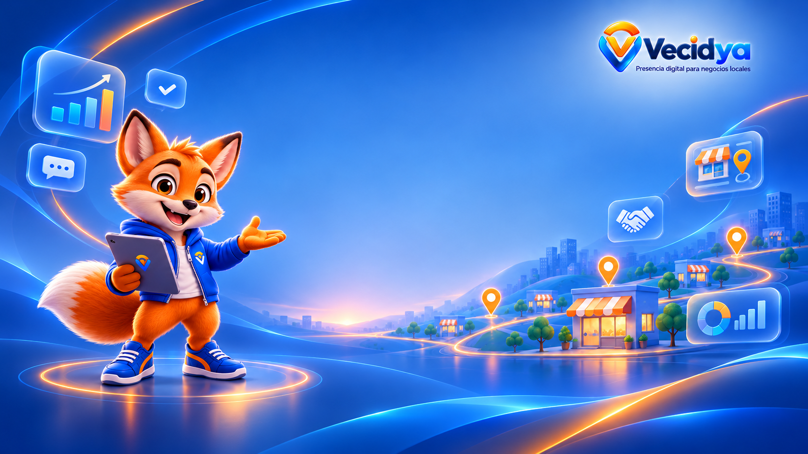
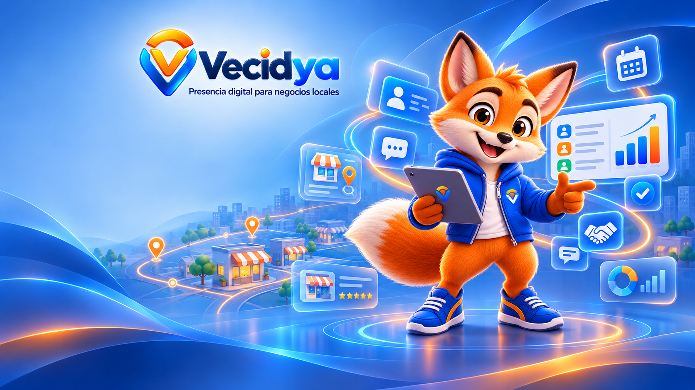

# Vecidya — sistema visual y de experiencia compartido (v0.2, 2026-11-11)

## Referencias investigadas
- [UI UX Pro Max](https://github.com/nextlevelbuilder/ui-ux-pro-max-skill): catálogo de patrones, contraste, tipografía, accesibilidad, dashboards y reglas por stack. Referencia, **no dependencia instalada**.
- [Anthropic frontend-design](https://github.com/anthropics/skills/tree/main/skills/frontend-design): dirección visual específica, calidad de interacción y composición; referencia, **no dependencia instalada**.

Estas referencias informan criterios, pero la fuente de verdad son los componentes, tokens, marca y restricciones **existentes en Vecidya**. No copiar estilos ni sustituir el branding.

## Arquitectura visual
1. **Pública**: editorial, cercana, clara. Explicar valor de presencia digital, beneficios, límites y CTA sin promesas absolutas.
2. **Mi Vecidya**: orientada a tareas. Un objetivo primario por pantalla, progreso real del perfil y próximos pasos.
3. **App Internal**: densa pero legible. Jerarquía: título/contexto → filtros → KPI → tendencia → tabla → acciones. Separar claramente agregados anónimos y PII.
4. **Diagnóstico**: preservar contexto metodológico, estado de evidencia y confianza; no convertir cocientes de eventos en conversiones por usuario.

### MiniWeb pública
- La portada es una imagen de contenido que llena el marco de identidad; el logo queda superpuesto y conserva su propio fondo para mantener legibilidad.
- La cabecera no repite un icono de marca junto al nombre cuando el logo ya está visible.
- Las secciones se apilan en una sola columna y siguen exactamente el orden guardado en el editor. No se asignan posiciones por tipo de módulo, así cada negocio mantiene control de su composición sin huecos artificiales.

- Los encabezados de sección tienen peso visual claro y separación breve respecto del contenido que presentan. Los módulos sin contenido publicable se omiten.

### Configuración privada de MiniWeb
- Presentar un paso activo por vez en un panel de ancho controlado; reducir separaciones verticales del lateral de Mi Vecidya solo en escritorio y esta ruta, para mantener pie, navegación y organización visibles desde 768 px de altura.
- Mantener en móvil el drawer de navegación de cliente con un ancho máximo de 19 rem y margen visible tras el scrim; no acoplar su ancho a la columna estrecha de escritorio.
- Mantener los controles de paso compactos, con áreas táctiles mínimas de 44 px; distinguir visualmente el paso actual sin duplicar estados ARIA.
- Colocar avisos de guardado/error antes del título y mantenerlos visibles al desplazarse, bajo la barra global; conservar los enlaces de salida en la misma pestaña para respetar el aviso de cambios sin guardar.
- Mantener scroll-margin suficiente bajo el encabezado sticky y revisar mensajes, tabs y acciones a 390 px para evitar overflow horizontal.

## Reglas compartidas
- Reutilizar `AdminShell`, `ClientAreaShell`, `Card`, `Badge`, `Icon` y tokens existentes.
- Tipografía, azul/naranja y marca Vecidya ya establecidas; no introducir paletas arbitrarias, fuentes remotas ni librerías visuales sin evaluación.
- Contenedores fluidos; tablas con scroll horizontal etiquetado y alternativas de lectura; evitar texto cortado, zoom roto o columnas imposibles en 320–375 px.
- Contraste WCAG AA, foco visible, `aria-current`, títulos semánticos, errores comunicados, objetivos táctiles de al menos 44 px donde sea posible.
- Gráficos: título, escala explícita, leyenda, rango temporal, fuente y tabla accesible. No usar solo color; valores cero se presentan como cero, no como línea engañosa.
- Respetar `prefers-reduced-motion`; evitar animaciones decorativas en dashboards.
- Estados obligatorios: sin datos, cargando, error, acceso denegado y éxito. Nunca mostrar datos ficticios como reales.
- Privacidad: métricas agregadas por día y PII en vistas separadas; `no-store` para rutas privadas; control server-side de roles.
- GHL aplazado: no introducir conexiones ni nomenclatura CRM en flujos de Vecidya.

## Componentes y patrones a consolidar
- `DiagnosticMetricCard`: número, unidad, descripción de fuente/periodo y vacío.
- `DiagnosticTrend`: serie diaria, eje temporal y tabla alternativa; responsive.
- `AdminFilterBar`: GET, criterios visibles, reset y paginación conservada.
- `ConsentStatus`: texto explícito autorizado/no autorizado; no inferir consentimiento por registro.
- `PageHeading`: eyebrow, título, explicación, acción contextual.

## Criterios de revisión para próximas fases
- 320, 375, 768, 1024 y 1440 px; zoom 200%; teclado y lector de pantalla.
- Contraste y reducción de movimiento; densidad y wrapping.
- Sin dependencias nuevas salvo justificación; CSS localizado y componentes existentes.
- Validación de estados reales en D1 y controles de acceso antes de publicar.

**Alcance de la guía:** define patrones de diseño; no implica auditoría visual de todas las rutas, certificación ni instalación de skills externas.

### Formularios de Mi negocio
- Agrupar campos por intención, limitar texto de ayuda a 66ch y controles a un ancho de lectura cómodo; priorizar dos columnas para datos cortos y una para textos largos.
- Reducir padding y separación en estado, grupos y horarios manteniendo controles de teclado, foco visible y áreas táctiles.
- Mantener la distinción de guardado del perfil y los horarios; la compacidad visual no debe cambiar sus contratos.

## Dirección visual oficial: acabado, no plantilla

El acabado aprobado se inspira en las dos referencias corporativas adjuntas. Se reutilizan para calibrar profundidad, transparencia, iluminación, color, Vico y nivel de detalle; no se copian literalmente su composición de wallpaper ni sus módulos flotantes en cada pantalla. El contenido y la tarea de cada ruta mandan sobre la decoración.

### Lectura de la referencia

- **Paleta:** azul profundo para estructura, azules vivos y cyan para tecnología y conexión, naranja para orientación, energía y puntos de acción. Los fondos luminosos y las zonas tranquilas equilibran el color.
- **Capas:** una atmósfera de fondo; una escena o grupo principal; superficies de vidrio que flotan sobre ella; contenido y controles con suficiente opacidad para leerse; sombras cortas que separan cada nivel.
- **Profundidad:** perspectiva y escala ordenan la vista. Los elementos principales reciben relieve; los secundarios no compiten. Líneas, halos y reflejos acompañan el recorrido, nunca tapan texto, datos, foco o controles.
- **Composición:** Vico y la marca anclan la escena; los negocios, marcadores y rutas construyen el Vecindario; iconos de métricas o conexión completan el relato. El espacio vacío es intencional y mantiene el equilibrio.
- **Acabado:** detalles nítidos a la escala de uso, bordes limpios, reflejos discretos y coherencia en materiales, luces, perspectiva e iconografía. Evitar el brillo plástico indiscriminado y la acumulación de tarjetas decorativas.

## Composición, alineación y espacio

1. Componer desde la tarea y el contenido real: título y contexto → acción principal → información agrupada → detalle o siguiente paso. Evitar duplicar el mismo mensaje en varias tarjetas.
2. Alinear título, explicación, acciones y grupos de información a una retícula común. En escritorio, usar columnas asimétricas para separar relato de visual; reservar tres columnas para elementos breves y equivalentes. En móvil, apilar y conservar el mismo orden de lectura.
3. Agrupar por intención: campos relacionados pueden compartir una fila; textos largos, resultados y explicaciones ocupan el ancho disponible. Dividir grupos con espacio o una línea tenue, no con una placa por cada párrafo.
4. Mantener ritmo vertical y márgenes consistentes con los tokens de espaciado. Dar aire alrededor de encabezados, ilustraciones, grupos de acciones y cambios de tema. El espacio negativo debe separar prioridades y dejar respirar la composición.
5. Usar columnas, filas, guías y alineaciones para hacer visibles las relaciones entre elementos. No centrar cada pieza por separado cuando pertenecen a un mismo conjunto; no dejar un control aislado sin relación con su etiqueta o sección.
6. Reservar la asimetría, los halos y los trazos de ruta para momentos editoriales o de descubrimiento. Formularios, tablas, métricas y operaciones siguen una lectura estable, compacta y predecible.
7. Mantener el ancho de lectura de texto largo entre 60 y 68 caracteres como referencia. Respetar el ancho máximo y las separaciones existentes del área antes de crear otra retícula.

## Sistema de fondos, superficies y relieve

El acabado usa niveles combinables. No aplicar vidrio en todas las capas ni apilar panel sobre panel sin una razón de lectura.

| Nivel | Uso | Tratamiento |
| --- | --- | --- |
| Atmósfera | Fondo de página o de una escena principal | Gradientes azules/cyan suaves; naranja muy localizado; arcos y ondas de baja opacidad; sin texturas que distraigan |
| Cristal | Navegación flotante, resumen, tarjeta editorial o grupo breve | Blanco translúcido, borde frío fino, desenfoque moderado y brillo superior |
| Cristal reforzado | Contenido que necesita lectura estable sobre un fondo visible | Mayor opacidad y desenfoque; separar el contenido sin perder la sensación de capa |
| Sólido | Formulario, tabla, editor, aviso, dato sensible o contenido denso | Superficie casi opaca, contraste estable y textura mínima |
| Destacado | Hero, recorrido, siguiente paso o llamada principal | Degradado azul/cyan sobrio y acento naranja puntual; relieve superior al resto |

La sombra debe describir altura: reposo para bloques secundarios, relieve medio para tarjetas y elevación fuerte solo para menús, diálogos o elementos realmente flotantes. El borde y el reflejo superior definen el volumen; el halo ambiental conecta con el fondo. Evitar sombras negras duras, efecto neón permanente y desenfoque sobre texto.

La base técnica vive en los tokens --v-* y en visual-system.css. El componente Card acepta surface="glass|solid|highlight" y depth="quiet|rest|raised|floating". Las clases v-stack, v-cluster, v-grid y v-section-heading comparten espaciado y alineación. Al cambiar un token o patrón común, revisar sus consumidores y ajustar variantes localmente; una corrección global no debe imponer el mismo relieve a un formulario que a una portada.

## Color, tipografía e iconografía

- Reutilizar los tokens aprobados: azul noche --v-blue-950 (#071c43), azul estructural --v-blue-800 (#0a448f), acción --v-blue-700 (#0755bd) / --v-blue-600 (#0668ed), cyan --v-cyan-500 (#08ccf3), naranja --v-orange-500 (#fb8300), tinta --v-ink y texto secundario --v-muted.
- Reservar naranja para puntos de orientación, énfasis o acción. No usarlo como color de grandes bloques ni codificar estados solo por color.
- Mantener la familia de interfaz --v-font-ui y sus fallbacks; no descargar fuentes remotas. Usar los pesos y tamaños existentes, títulos compactos con jerarquía clara, text-wrap: balance en encabezados y pretty para prosa.
- Usar el componente Icon: SVG de 24 unidades, trazo uniforme de 1.8, alineación con la línea de texto y una metáfora por acción. Evitar emoji, mezcla de rellenos/trazos y adornos repetidos. Cuando falte un icono, incorporarlo a la biblioteca compartida con el mismo contrato.
- La ilustración y Vico conservan nitidez, proporción y transparencia; usar object-fit: contain cuando el recorte altere la pose o el contexto. Añadir texto alternativo cuando aporten información; marcarlos como decorativos solo si el contenido ya se explica en texto.

## Vico, Vecindario y relatos de marca

- Vico acompaña y orienta: bienvenida, explicación, aprendizaje, ayuda contextual y estados vacíos con un siguiente paso útil. Mantener escala, pose y contraste adecuados al propósito.
- En una pantalla de operación, Vico es secundario y aparece donde ayude a entender; no ocupa el lugar de métricas, permisos, errores, acciones ni datos del negocio. No repetirlo en cada tarjeta.
- Los pins, rutas, fachadas, conexiones y manos que colaboran pertenecen a descubrimiento, Vecindario, presencia digital o colaboración. Sus líneas deben llevar la mirada a un destino con sentido, no simular datos ni insinuar ubicaciones, negocios, reseñas, calificaciones o actividad inexistentes.
- En MiniWeb publicada, la identidad visual, el orden de módulos, el logo y las decisiones de marca pertenecen al negocio. No insertar Vico, el fondo de Vecidya ni una tipografía global sin una opción explícita del negocio.

## Personalidad por superficie

| Superficie | Composición y nivel de acabado |
| --- | --- |
| Web pública | Editorial, cálida y expresiva. Hero con foco claro, ilustración contextual, navegación cristal y rutas visuales cuando expliquen el Vecindario o una conexión real. Una acción principal; contenido real y límites comerciales claros. |
| Mi Vecidya | Orientada al trabajo. Título y estado visibles, selector/acción relacionado, grupos de campos ordenados y tarjetas con relieve moderado. Vico puede orientar aprendizajes o próximos pasos; la interfaz no convierte datos de muestra en resultados. |
| Admin interno | Precisa y sobria. Priorizar secuencia, filtros, datos, actividad y acciones auditables. Fondos y superficies conservan la marca con contraste alto; tablas, filtros y formularios usan capas sólidas. Vico solo en ayuda o bienvenida, nunca como decoración de información sensible. |
| Diagnóstico e informe | Narrativa metodológica, legible y confiable. Jerarquía para evidencia, cobertura, confianza, valores nulos y próximos pasos. La profundidad acompaña la lectura; no exagera puntuaciones ni oculta incertidumbre. |
| Editor MiniWeb | Entorno de trabajo Vecidya alrededor de una vista previa fiel. Distinguir borrador, guardado y publicación sin tapar avisos. La vista previa respeta la identidad del negocio. |
| MiniWeb pública | Control del negocio. Conservar plantilla, orden, colores, tipografía, imágenes, logo y secciones configuradas; la guía de lectura no impone el lenguaje visual corporativo de Vecidya. |

## Transiciones e interacción

- Preferir cambios breves de opacidad, color, sombra y elevación (tokens de 160–220 ms). Reservar entradas algo más largas para ilustraciones editoriales; el movimiento de Vico en páginas públicas debe ser leve, ocasional y contextual.
- Usar hover solo con dispositivos que lo admiten. Añadir estados claros de foco, pulsación, carga, éxito, error y deshabilitado; mantener el foco visible y no depender del movimiento para comunicar estado.
- Evitar parallax, rebote continuo, brillo que atraviese texto, animaciones simultáneas y movimiento decorativo en tablas o paneles de trabajo.
- Respetar prefers-reduced-motion: quitar el movimiento no esencial y acortar transiciones; conservar información y estados.

## Guía de composición para fondos generados

El prompt es una guía de dirección, no una fuente de copy, datos ni componentes funcionales. Sustituir los corchetes por el destino y la información autorizada; entregar los recursos por separado cuando la interfaz deba mantener texto real y accesible.

**Prompt maestro**

> Diseña un recurso visual original para [superficie y sección] de Vecidya, plataforma de presencia digital y crecimiento para negocios locales. Usa la referencia corporativa adjunta solo para igualar su nivel de acabado: ilustración 3D CGI pulida y coherente, volúmenes legibles, bordes precisos, iluminación azul y cyan con acentos naranja, transparencias de cristal controladas, sombras suaves en capas, reflejos finos, perspectiva consistente y profundidad atmosférica. Organiza los elementos por jerarquía y alineación; reserva espacio negativo junto a [ubicación del contenido], integra Vico únicamente si aporta orientación, y representa negocios, Vecindario y rutas solo cuando el concepto lo requiera. Mantén el centro de atención claro, contraste legible en el área de texto, detalle nítido a escala de interfaz y composición responsive con elementos clave dentro de una zona segura. Sin texto generado, sin cifras, sin logotipos inventados, sin elementos que parezcan controles reales.

**Negative prompt**

> Sin palabras, letras deformes, números, marcas de agua, logotipos inventados, cambios de identidad o proporción de Vico, extremidades o dedos extra, ojos desalineados, perspectiva rota, iconos mezclados, símbolos ambiguos, mapas con ubicaciones falsas, negocios ficticios, calificaciones, datos o reseñas inventados, reflejos que oculten texto, cristal lechoso opaco, paneles amontonados, halos neón, brillos excesivos, sombras negras duras, exceso de naranja, fondo ruidoso, saturación extrema, recortes accidentales, bordes borrosos, ruido, baja resolución o detalle diminuto ilegible.

### Ajuste para fondo de escritorio

Formato panorámico 16:9 de alta resolución. Reservar una zona amplia y tranquila para iconos del escritorio; colocar marca y elementos visuales sin competir con esa zona; mantener texto esencial fuera del recurso y no dibujar iconos del sistema.

### Ajuste para pantalla de bloqueo

Diseñar una composición vertical o adaptable al recorte disponible. Mantener despejadas las zonas habituales del reloj y la fecha, dejar márgenes seguros, y evitar que Vico, la marca o las rutas se corten al cambiar de proporción.

## Lista de control de calidad visual

- [ ] Se entiende primero la tarea, el título y la acción principal; la decoración queda subordinada.
- [ ] Columnas, filas, alineaciones, anchos de lectura y agrupaciones mantienen una retícula común; el espacio negativo separa secciones.
- [ ] Fondos, ondas y trazos ambientales no compiten con texto ni sugieren información inexistente.
- [ ] Cada superficie usa nivel de transparencia, borde, reflejo, desenfoque y relieve por una razón; el contenido denso permanece sólido y legible.
- [ ] Azul, cyan y naranja siguen los tokens; el naranja no domina ni comunica estados por sí solo.
- [ ] Vico, escenas e iconos conservan escala, nitidez, significado, transparencia y texto alternativo adecuado.
- [ ] Tipografía, jerarquía, wrapping, párrafos, acciones y etiquetas se revisan con contenido real, incluidos textos largos y estados vacíos/error.
- [ ] Escritorio y móvil respetan el orden de lectura; revisar 320, 375/390, 768, 1024 y 1440/1920 px, además de zoom 200 %.
- [ ] Teclado, foco visible, contraste AA, lector de pantalla, estados y movimiento reducido se consideran; no declarar certificación por una revisión parcial.
- [ ] Imágenes optimizadas, sin desplazamientos al cargar, sin filtros costosos y con fallback sólido si el navegador no admite desenfoque de fondo.
- [ ] Interacciones funcionan con puntero y teclado; transiciones no retrasan controles ni ocultan enlaces.
- [ ] MiniWeb pública conserva todas las decisiones de identidad de su negocio y el contenido real publicado.

**Alcance del checkpoint:** la guía define la política oficial y la capa compartida de superficies, composición, interacción y tokens. Las rutas individuales mantienen su contenido y diseño propio; una guía o un build no certifican por sí solos cada viewport, lector de pantalla ni superficie privada.
